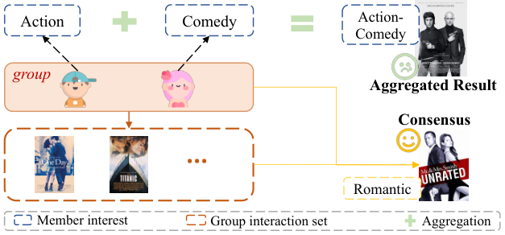
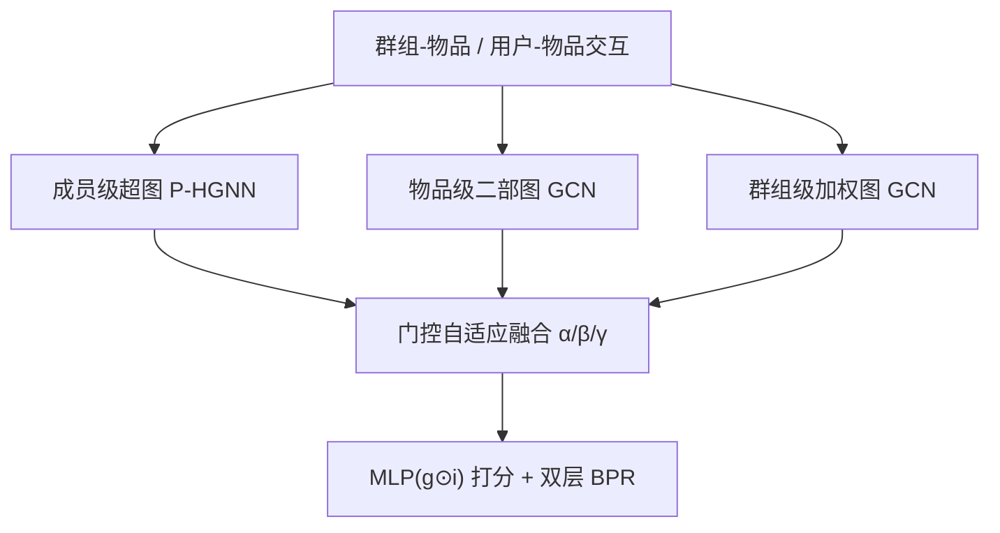
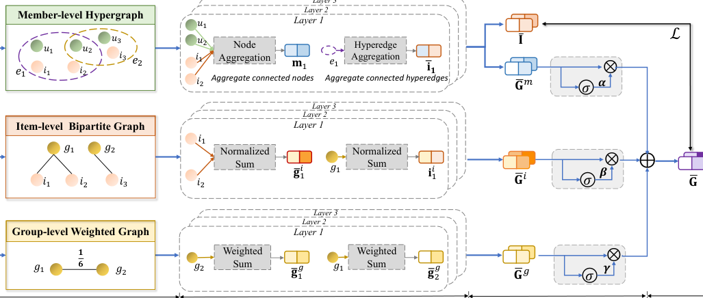

# ConsRec: Learning Consensus Behind Interactions for Group Recommendation (挖掘群组交互背后共识的群组推荐)

- **会议/期刊**: WWW 2023 (The ACM Web Conference)
- **作者与机构**: Xixi Wu, Yun Xiong, Yao Zhang, Yangyong Zhu (复旦大学), Yizhu Jiao (UIUC), Jiawei Zhang (UC Davis), Philip S. Yu (UIC)
- **推荐链路定位**: 召回 / 群组级候选生成（Group-Item 打分）
- **研究方向**: 社交与群组推荐 / 图神经网络与知识图谱推荐
- **论文原文**: [https://arxiv.org/abs/2302.03555v1](https://arxiv.org/abs/2302.03555v1)
- **开源代码**: [https://github.com/FDUDSDE/WWW2023ConsRec](https://github.com/FDUDSDE/WWW2023ConsRec)

## TL;DR (1分钟核心速览)

群组推荐的既有范式是"把成员兴趣聚合起来"，但真实群组决策是成员间妥协后形成的**共识 (consensus)**，个体聚合缺少群组层面的整体视角，且注意力聚合依赖候选物品、代价高且偏向活跃成员。ConsRec 提出三视图共识建模：成员级超图（把群组当作超边，一次卷积即得聚合）、物品级二部图（群组历史口味）、群组级加权图（群组固有偏好传播），并用门控自适应融合。在 Mafengwo/CAMRa2011 上以 100 负采样排序协议评测，Mafengwo HR@5 0.8844（+2.7% vs CubeRec），同时用户侧推荐也未退化。

## Background & Motivation (背景与核心矛盾)

- **主流范式**: 分数聚合（average / least misery / maximum satisfaction）与神经聚合（AGREE 类注意力、CubeRec 超立方体），亦有 HyperGroup/HCR 用超图传播高阶协同信号、GroupIM/S2-HHGR 引入自监督。
- **前人局限**: (1) 个体聚合缺少群组整体性——一对情侣（男爱动作、女爱喜剧）共同观影的共识其实是爱情片，而非"动作+喜剧"的折中；(2) 注意力聚合以候选物品为条件逐项计算权重，候选池巨大时不可行，且高频交互成员权重被系统性放大，聚合有偏。
- **核心洞察 (Key Insight)**: 群组共识同时体现在三个互补侧面——成员构成（谁在一起）、交互物品（他们一起消费了什么）、群组自身属性（同类群组倾向于同类内容，如家庭群体偏好家庭喜剧）。
- **本文切入点**: 为三个侧面各设计一种图结构 + 对应 GNN 编码，再以可学习门控融合成统一群组表征，用群组-物品与用户-物品双层 BPR 联合监督。

<figure class="paper-figure" markdown="span">
  <figcaption>图1：聚合结果与群体共识之间差距的说明性示例。仅聚合不同成员的兴趣缺乏对群体整体偏好的整体考量，未能捕捉共识。</figcaption>
</figure>

## Method (核心方法设计)

### 1. 整体框架 (Overall Architecture)

输入为群组-物品交互矩阵 $\mathbf{Y}$与用户-物品交互矩阵$\mathbf{R}$。ConsRec 并行构建三个图：成员级超图$G_m$（群组=超边，连接其成员与交互物品）、物品级二部图$G_i$、群组级加权图$G_g$；分别用 P-HGNN、LightGCN 式对称归一化卷积、加权图卷积编码，逐层平均得到$\mathbf{G}_m,\mathbf{G}_i,\mathbf{G}_g$，再经三个 sigmoid 门控加权求和得最终群组向量$\mathbf{G}$，与细化后的物品向量做 element-wise 乘积送入 MLP 打分。训练时群组侧与用户侧共享 MLP 联合优化。

<figure class="paper-figure" markdown="span">
  <figcaption>图2：ConsRec 概览。我们为共识建模构建三个不同视图，并采用特定的图神经网络进行表示学习。进一步整合这些视图特定表示用于群组-物品预测。</figcaption>
</figure>

### 2. 关键设计拆解 (Key Designs)

1. **偏好感知超图网络 P-HGNN（把成员聚合变成一次卷积）**：注意力聚合必须对每个候选物品重算权重，复杂度随候选数线性增长且偏向活跃成员。ConsRec 把群组直接建模为超边，超边消息即成员级聚合：$\mathbf{m}_e=\mathrm{CONCAT}(\mathbf{m}_{e,u},\mathbf{m}_{e,i},\mathbf{m}_{e,i}\odot\mathbf{g}_e)\mathbf{W}_f$，其中$\mathbf{m}_{e,u}$、$\mathbf{m}_{e,i}$分别对超边内成员集与物品集做均值池化，$\mathbf{g}_e$为群组独立嵌入，$\odot$项注入群组-物品协同信号作为"公平性侧信息"以抵消活跃成员偏置；节点再由$\mathbf{i}_j=\mathrm{AGG}_{he}(\{\mathbf{m}_e\mid e\in\mathcal{E}_j\})$ 反向更新。共识信息在超边内被压缩成与候选无关的定长向量，推理时无需逐候选重算。
2. **三视图 + 门控自适应融合**：单视图易过拟合某一侧面（成员构成的细粒度解释 vs. 物品口味 vs. 同类群组先验）。群组级图以共享成员/物品连边并赋 Jaccard 式权重 $A_g(p,q)=\frac{|\mathcal{G}_p\cap\mathcal{G}_q|+|\mathcal{Y}_p\cap\mathcal{Y}_q|}{|\mathcal{G}_p\cup\mathcal{G}_q|+|\mathcal{Y}_p\cup\mathcal{Y}_q|}$，让相似群组互相传播固有偏好。融合为$\mathbf{G}=\boldsymbol{\alpha}\mathbf{G}_m+\boldsymbol{\beta}\mathbf{G}_i+\boldsymbol{\gamma}\mathbf{G}_g$，$\boldsymbol{\alpha}=\sigma(\mathbf{G}_m\mathbf{W}_m)$（$\boldsymbol{\beta},\boldsymbol{\gamma}$ 同理），由推荐损失端到端学习各视图贡献，避免人工调权。
3. **训练目标与开销**：$\mathcal{L}=\mathcal{L}_{group}+\mathcal{L}_{user}$，两者均为 BPR 成对损失$\mathcal{L}=-\sum_{g_t}\frac{1}{|\mathcal{D}_{g_t}|}\sum_{(j,j')\in\mathcal{D}_{g_t}}\ln\sigma(\hat{y}_{tj}-\hat{y}_{tj'})$，负采样为均匀随机未交互物品；共享 MLP 使群组任务反哺用户表征（GroupIM/CubeRec 因分离训练在用户任务上大幅掉点）。图传播为预构建结构上的稀疏卷积，$L$ 层复杂度与边数线性。

## Experimental Setup & Evaluation Protocol (实验设置与评估协议)

- **数据集与预处理**:

| 数据集 | #Users | #Items | #Groups | #U-I | #G-I | 场景说明 |
| :--- | :---: | :---: | :---: | :---: | :---: | :--- |
| Mafengwo | 5,275 | 1,513 | 995 | 39,761 | 3,595 | 马蜂窝结伴旅行，群组交互极稀疏 |
| CAMRa2011 | 602 | 7,710 | 290 | 116,344 | 145,068 | 家庭户电影评分，稠密 |
| Mafengwo-S | 11,027 | 1,236 | 1,215 | — | — | 自爬取带地理位置语义，仅用于案例研究 |

- **数据划分与防穿越 (Splitting Strategy)**: 沿用 AGREE/HCR 的群组推荐标准设定（每个群组留出最后一次交互作测试、倒数第二次作验证的 `Leave-One-Out` 风格切分），未额外引入全局时间戳。
- **排名评测协议 (Ranking Protocol)**: `Sampled Ranking`——每个 ground-truth 物品随机采样 **100 个负样本** 共同排序，报告 HR@{5,10} 与 NDCG@{5,10}；所有方法在同一测试集与同一候选池上评测。
- **对比基线与超参设置**: 基线覆盖 Pop、NCF、AGREE（注意力）、HyperGroup/HCR（超图）、GroupIM/S2-HHGR/CubeRec（自监督+超立方体）；嵌入维度 $d$与层数$L$ 在附录做敏感性分析，AGG 均用均值池化。

## Key Experimental Results (实验关键数据)

### 1. 主实验对比 (Main Results)

群组推荐（节选，加粗为最优）：

| Dataset | Metric | NCF | AGREE | HyperGroup | HCR | GroupIM | S2-HHGR | CubeRec | **ConsRec** | Improv. |
| :--- | :--- | :---: | :---: | :---: | :---: | :---: | :---: | :---: | :---: | :---: |
| Mafengwo | HR@5 | 0.4701 | 0.4729 | 0.5739 | 0.7759 | 0.7377 | 0.7568 | 0.8613 | **0.8844** | +2.7% |
| Mafengwo | HR@10 | 0.6269 | 0.6321 | 0.6482 | 0.8503 | 0.8161 | 0.7779 | 0.9025 | **0.9156** | +1.5% |
| Mafengwo | NDCG@5 | 0.3657 | 0.3694 | 0.4777 | 0.6611 | 0.6078 | 0.7322 | 0.7574 | **0.7692** | +1.6% |
| Mafengwo | NDCG@10 | 0.4141 | 0.4203 | 0.5018 | 0.6852 | 0.6330 | 0.7391 | 0.7708 | **0.7794** | +1.1% |
| CAMRa2011 | HR@5 | 0.5803 | 0.5879 | 0.5890 | 0.5883 | 0.6552 | 0.6062 | 0.6400 | **0.6407** | +0.1% |
| CAMRa2011 | HR@10 | 0.7693 | 0.7789 | 0.7986 | 0.7821 | **0.8407** | 0.7903 | 0.8207 | 0.8248 | −1.9% |
| CAMRa2011 | NDCG@10 | 0.4448 | 0.4530 | 0.4538 | 0.4670 | 0.4914 | 0.4453 | 0.4935 | **0.4945** | +0.2% |

用户推荐侧（联合训练红利）同样领先：Mafengwo HR@5 达 **0.7725**（HCR 0.7571），CAMRa2011 HR@10 达 **0.8412**（S2-HHGR 0.8173）；而 GroupIM 在 Mafengwo 用户侧仅 0.1608 HR@5，CubeRec 仅 0.1847，暴露"分离训练过拟合群组任务"的副作用。

### 2. 消融实验 (Ablation Study)

Mafengwo 群组推荐（每次移除一个视图，其余两视图同机制融合）：

| Variant | HR@5 | HR@10 | NDCG@5 | NDCG@10 | ΔNDCG@5 |
| :--- | :---: | :---: | :---: | :---: | :---: |
| w/o Member (M) | 0.8201 | 0.8724 | 0.7021 | 0.7192 | −8.7% |
| w/o Item (I) | 0.8704 | 0.9075 | 0.7597 | 0.7718 | −1.2% |
| w/o Group (G) | 0.8593 | 0.9005 | 0.7376 | 0.7510 | −4.1% |
| **Full ConsRec** | **0.8844** | **0.9156** | **0.7692** | **0.7794** | — |

### 3. 关键实验发现 (Key Findings)

1. **成员级超图是最大功臣且三视图互补不可替代**：去掉成员视图 NDCG@5 骤降 8.7%（0.7692→0.7021），去掉群组视图降 4.1%，去掉物品视图降 1.2%，三者缺一即退，验证"共识 = 成员构成 + 共同消费 + 同类先验"的正交分解假设。
2. **联合优化是用户侧不掉点的关键**：ConsRec 在用户任务上 Mafengwo HR@5 0.7725 反超专门做群组的 HCR（0.7571），而 GroupIM/CubeRec 因将用户-物品与群组-物品训练分离，用户侧 HR@5 崩至 0.1608/0.1847；说明共享 MLP + 双 BPR 起到正则与信号互补作用。
3. **共识建模带来可解释的嵌入几何**：在 Mafengwo-S 上，ConsRec 学到的地点嵌入按地理区域（东南亚/美国/欧洲/中国/澳洲）自然聚类，案例中群组与全体成员均游历欧洲城市时正确推荐匈牙利，而 HCR/GroupIM/S2-HHGR/CubeRec 被单个成员对冰岛的兴趣劫持；稠密的 CAMRa2011 上效率优势更明显（同等 NDCG 下总耗时更低），归功于与候选无关的超边聚合。

## Highlights & Limitations (亮点、对比与审稿批判)

- **与代表作对比 (vs. Prior Work)**: 相比 AGREE 的候选依赖注意力，P-HGNN 把聚合前移到超边卷积，做到与候选数解耦并自然支持高阶传播；相比 HCR/HyperGroup 仅用超图传播用户级信号、群组侧仍靠注意力，ConsRec 直接把超边消息当作群组表征；相比 CubeRec 用一个超立方体容纳多面兴趣（体积过大导致预测模糊），本文用三视图分工而非单一几何体承载共识。
- **可迁移亮点**: (1) "把群组/会话当超边、用超边消息替代候选条件注意力"可迁移到会话推荐与 bundle 推荐以省去逐候选打分；(2) 用群组-物品与用户-物品双任务共享打分头，低成本缓解群组侧数据稀疏。
- **审稿级局限批判**: (1) 评测采用 100 负样本的 Sampled Ranking 而非 Full-Ranking，且 CAMRa2011 上 HR@10 实际落后 GroupIM 1.9%，提升幅度在部分指标上落在噪声区间，缺显著性检验；(2) 群组级图需按共享成员/物品构图并计算 Jaccard 权重，群组数增长时边数近平方膨胀，文中未给出该视图的规模上限分析，也未报告三视图门控权重 $\boldsymbol{\alpha},\boldsymbol{\beta},\boldsymbol{\gamma}$ 在不同数据集上的稳定性。

## Rating (四维评分)

- **方法创新性 (Novelty)**: ⭐⭐⭐⭐ （"共识 ≠ 个体聚合"的问题重构 + 超边即聚合的算子改写有实质新意，但三视图融合本身属常见多视图套路）
- **评估协议与实验扎实度 (Protocol & Experiments)**: ⭐⭐⭐ （两数据集 + 消融 + 效率 + 语义案例较完整，但仅 100 负采样排序、缺 Full-Ranking 与显著性检验，CAMRa2011 部分指标未夺魁）
- **写作与数学规范度 (Clarity & Rigor)**: ⭐⭐⭐⭐ （三视图与 P-HGNN 公式定义清楚、图 3 对比直观，复杂度分析偏定性，部分细节下放附录）
- **工业落地与复现价值 (Industrial & Practical Value)**: ⭐⭐⭐⭐ （聚合与候选解耦，推理开销可控，代码已开源，适合群组/家庭账号场景的召回层落地）

