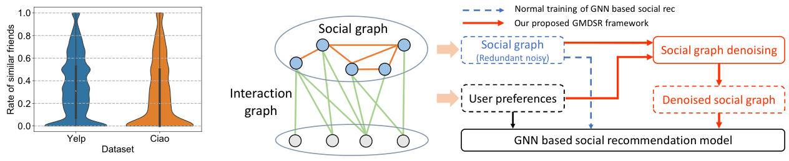
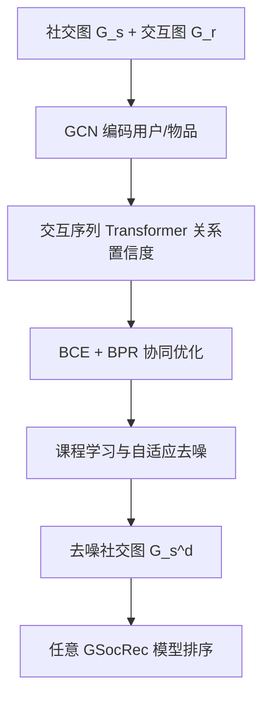
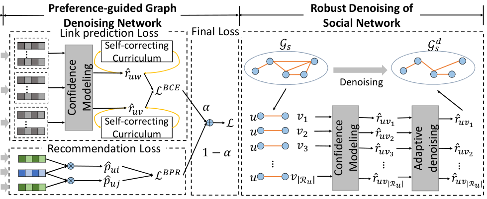

# Robust Preference-Guided Denoising for Graph based Social Recommendation (基于图的社交推荐鲁棒偏好引导去噪)

- **会议/期刊**: WWW 2023
- **作者与机构**: Yuhan Quan, Jingtao Ding, Chen Gao, Lingling Yi, Depeng Jin, Yong Li；清华大学、腾讯微信
- **推荐链路定位**: 精排（社交增强的偏好学习）；去噪模块位于推荐模型训练之前
- **研究方向**: 社交与群组推荐 / 图神经网络与知识图谱推荐
- **论文原文**: [https://arxiv.org/abs/2303.08346v1](https://arxiv.org/abs/2303.08346v1)
- **开源代码**: [https://github.com/tsinghua-fib-lab/Graph-Denoising-SocialRec](https://github.com/tsinghua-fib-lab/Graph-Denoising-SocialRec)

## TL;DR (1分钟核心速览)

社交推荐默认“好友偏好相似”，但真实社交图中大量关系冗余甚至噪声。本文提出 GDMSR：仅用用户交互历史建模好友关系置信度，并以推荐损失协同监督，再用自校正课程学习与按好友度数自适应的去噪比例裁剪社交边。在 Ciao/Yelp/Douban 的 Sampled Ranking 协议下，GDMSR 可稳定增强 Diffnet++ 与 MHCN，Ciao 上 R@1 最高相对提升 5.26%，MHCN 的 R@3 提升达 10.06%，且可删 10–40% 社交关系而不损精度。

## Background & Motivation (背景与核心矛盾)

- **主流范式**: GNN 社交推荐（GSocRec）在完整用户社交图上做消息传播，以社交同质性与影响力增强用户/物品表征，代表为 Diffnet++、MHCN。
- **前人局限**: 其一，全量社交图带来巨大计算与存储开销；其二，好友关系成因复杂，“好友在某域无共同偏好”极常见，直接传播反而引入噪声。
- **核心洞察 (Key Insight)**: 图1(a) 显示，多数用户仅与少数好友有共同交互，社交关系的中位有效比例仅约 20–30%；因此社交图应先“去噪”再用于偏好学习。
- **本文切入点**: 将社交图去噪建模为偏好引导的链路置信度预测，先得到稀疏但信息量更高的社交图，再交给任意 GSocRec 模型。

<figure class="paper-figure" markdown="span">
  <figcaption>图1：(a) 具有共同交互的好友比例分布图。(b) 我们提出的去噪增强社交推荐框架。</figcaption>
</figure>

## Method (核心方法设计)

### 1. 整体框架 (Overall Architecture)

GDMSR 分两阶段：先以社交图 $G_s$与交互图$G_r$联合训练去噪网络，为每条已观测社交边$(u,v)$输出置信度$\hat r_{uv}$；再按置信度裁剪低质量边，得到去噪社交图$G_s^d$；最后将$G_s^d$与$G_r$ 输入任意 GNN 社交推荐模型训练与排序。去噪与推荐解耦，因此一张去噪图可复用于 Diffnet++、MHCN 等不同底座。

<figure class="paper-figure" markdown="span">
  <figcaption>图2：GDMSR 中图去噪过程的细节。</figcaption>
</figure>

### 2. 关键设计拆解 (Key Designs)

1. **仅用交互历史建模关系置信度**：直接用 GCN 用户表征会混入画像与社交影响，难以判断“好友是否真有共同偏好”。GDMSR 只取用户与好友各自交互物品的初始表征序列，拼接后过无位置编码的 Transformer，并以 CLS 式向量经 MLP 打分：$\hat r_{uv}=\mathrm{Trf}(S_L(\{E^{(0)}_2(i)\mid i\in P_u\})\oplus S_L(\{E^{(0)}_2(j)\mid j\in P_v\}))$。直觉是“共同交互”比“社交传播后的用户向量”更接近偏好相似性的直接证据。

2. **链接预测与推荐损失协同优化**：若只用 BCE 训练去噪器，物品表征缺少推荐监督，关系置信度不稳。本文将链路预测 BCE 与 BPR 推荐损失联合：$\mathcal{L}=\alpha\mathcal{L}_{BCE}+(1-\alpha)\mathcal{L}_{BPR}$，其中$\mathcal{L}_{BCE}=-\sum_{(u,v)\in R}\log\sigma(\hat r_{uv})-\sum_{(u,w)\notin R}\log(1-\sigma(\hat r_{uw}))$，$\mathcal{L}_{BPR}=\sum_{(u,i,j)\in P}\ln\sigma(\hat p_{ui}-\hat p_{uj})$。BPR 让物品表征更懂偏好，从而反向提升去噪精度；实验 α 在 Ciao 取 0.5、Douban 取 0.3–0.5 最佳。

3. **鲁棒去噪：自校正课程 + 自适应比例**：社交边含噪时，模型易记忆困难样本。训练中每 $D$轮移除用户$u$置信度最低的$\eta_u$个好友，并用 EMA 平滑置信度：$\hat r_{uv}(kD)=\beta\hat r_{uv}((k-1)D)+(1-\beta)\hat r_{uv}(kD)$。最终按好友度数自适应裁剪：$|R_u|<\epsilon$时$\eta_u=0$，否则$\eta_u=\lfloor\log_{10}(|R_u|)\rfloor^\gamma\times R$。高度数用户多删、低度数用户保留，避免“一刀切”破坏稀疏用户的社交信号。

## Experimental Setup & Evaluation Protocol (实验设置与评估协议)

- **数据集与预处理**: 原文称沿用公开社交推荐版本，正文未给 k-core 细节（见附录 B）。统计如下：

| 数据集 | #Users | #Items | #Interactions | #Relations | 交互密度 | 关系密度/说明 |
| :--- | :---: | :---: | :---: | :---: | :---: | :--- |
| Ciao | 7,355 | 17,867 | 140,628 | 111,679 | 0.11% | 0.21%；含评分与社交 |
| Yelp | 32,827 | 59,972 | 598,121 | 964,510 | 0.03% | 0.09%；大规模稀疏 |
| Douban | 2,669 | 15,940 | 535,210 | 32,705 | 1.26% | 0.46%；交互密集 |

- **数据划分与防穿越 (Splitting Strategy)**: 正文未明确声明 Leave-One-Out、比例划分或全局时间戳切分，细节见附录 B；本笔记不臆测。评测按 real-plus-N：测试集每用户随机采 100 个未交互物品与正样本共同排序。
- **排名评测协议 (Ranking Protocol)**: 属于 `Sampled Ranking (100 负样本)`，非无偏 Full-Ranking；指标为 Recall@1/3、NDCG@3。
- **对比基线与超参设置**: 底座为 Diffnet++、MHCN；去噪对比 Rule based、NeuralSparse、ESRF；另列无社交的 LightGCN。原文未在正文给出统一嵌入维度 $d$；改进经配对 t 检验，$p<0.01$ 显著。

## Key Experimental Results (实验关键数据)

### 1. 主实验对比 (Main Results)

平均去噪率约 5–10%；每格为 `R@1/R@3/N@3`，加粗为组内最优。

| 底座/方法 | Ciao | Yelp | Douban |
| :--- | :---: | :---: | :---: |
| LightGCN | 0.2298/0.0785/0.2071 | 0.5861/0.2774/0.5804 | 0.4321/0.1696/0.4156 |
| Diffnet++ w/o denoising | 0.2742/0.1109/0.2639 | 0.6031/0.3072/0.5897 | 0.5165/0.2156/0.4988 |
| Diffnet++ + Rule based | 0.2860/0.1123/0.2677 | 0.6230/0.3228/0.5996 | 0.5358/0.2489/0.5172 |
| Diffnet++ + NeuralSparse | 0.2869/0.1153/0.2734 | 0.6383/0.3289/0.6054 | 0.5470/0.2226/0.5102 |
| Diffnet++ + ESRF | 0.2864/0.1197/0.2736 | 0.6184/0.3124/0.5958 | 0.5374/0.2393/0.5194 |
| Diffnet++ + GDMSR | **0.3020/0.1244/0.2821** | **0.6449/0.3291/0.6102** | **0.5614/0.2540/0.5297** |
| MHCN w/o denoising | 0.2330/0.0884/0.2297 | 0.6991/0.3252/0.6364 | 0.6198/0.3167/0.5933 |
| MHCN + Rule based | 0.2301/0.0916/0.2311 | 0.6966/0.3234/0.6347 | 0.6082/0.3372/0.5980 |
| MHCN + NeuralSparse | 0.2461/0.1034/0.2540 | 0.7012/0.3288/0.6352 | 0.6206/0.3349/0.6011 |
| MHCN + ESRF | 0.2495/0.1028/0.2568 | 0.6927/0.3298/0.6344 | 0.6194/0.3244/0.5995 |
| MHCN + GDMSR | **0.2618/0.1138/0.2632** | **0.7036/0.3405/0.6434** | **0.6396/0.3496/0.6137** |

相对各自最佳基线，GDMSR 的 `Δ(R@1/R@3/N@3)`：Diffnet++ 在 Ciao 为 `+5.26/+3.93/+3.11%`，Yelp `+1.03/+0.06/+0.79%`，Douban `+2.63/+2.05/+1.98%`；MHCN 在 Ciao `+4.93/+10.06/+2.50%`，Yelp `+0.34/+3.24/+1.10%`，Douban `+3.06/+3.68/+2.10%`。

### 2. 消融实验 (Ablation Study)

| 消融维度 | 设置 | 关键结果/结论 |
| :--- | :--- | :--- |
| 协同优化权重 α | $0$/$0.5$/$1$|$\alpha=0$时几乎等同不去噪；Ciao 上$\alpha=0.5$最优，Douban 上$0.3$–$0.5$ 最优 |
| 关系置信度输入 | Item-0 Transformer / Pooling / User-0 MLP / User-1 MLP | 仅交互物品表征最佳；引入用户侧或社交传播表征反而退化 |
| 自适应去噪 | GDMSR vs. w/o adaptive | 5–20% 去噪率下多数更优；Diffnet++ 可删 20–40% 关系仍维持/提升精度 |
| 鲁棒课程 | 50% 假边合成数据 | GDMSR 删假边 16%、真边 9%，判别准确率约 64%；w/o ad & sc 失效 |

### 3. 关键实验发现 (Key Findings)

1. **去噪本身即有效，且偏好引导去噪更强**：即使 Rule based 也在所有底座/数据集上优于 w/o denoising；GDMSR 在 Diffnet++ Ciao R@1 比最佳基线高 5.26%，MHCN Ciao R@3 高 10.06%，说明“删关系”比“全图注意力”更抗噪。
2. **只用交互历史比混入社交表征更准**：消融显示 Item-0 Transformer 最优，用户表征/社交传播表征会稀释偏好信号；同时 $\alpha=0$ 无协同优化时优势消失，证明 BCE 与 BPR 必须互补。
3. **鲁棒与效率可兼得**：合成数据 50% 关系被污染时仍能多删假边（16% vs 9%）；Yelp 上 Diffnet++ 可减 20–40% 社交边并提升精度，社会图侧推理时间随去噪率上升而下降；仅用 30% 交互训练去噪器仍多数正增益，最高约 +23.64%（MHCN Ciao R@3）。

## Highlights & Limitations (亮点、对比与审稿批判)

- **与代表作对比 (vs. Prior Work)**: Diffnet++/MHCN 在完整社交图上用注意力/超图传播，未显式剔噪；NeuralSparse/ESRF 做通用图稀疏或结构学习，未以推荐偏好为首要判据。GDMSR 的核心差异是“偏好序列 Transformer + 推荐损失协同 + 度数自适应去噪”，且与底座解耦。
- **可迁移亮点**: 用交互序列做链路置信度，可迁移到社交/群组关系清洗；按节点度数设置裁剪比例与 EMA 置信度平滑，可用于其他含噪图预训练。
- **审稿级局限批判**: 两阶段解耦可能非全局最优；评测为 100 负样本 Sampled Ranking，未做 Full-Ranking，划分细节未在正文交代；自适应及课程超参 $\epsilon,\gamma,R,\beta,D$ 较多，Yelp 与 MHCN 部分增益较小（如 Yelp R@3 仅 +0.06%），工业上线仍需验证时效与稳定性。

## Rating (四维评分)

- **方法创新性 (Novelty)**: ⭐⭐⭐⭐ （偏好序列关系置信度与推荐损失协同去噪较新颖，但仍是“图裁剪 + 课程学习”的组合创新）
- **评估协议与实验扎实度 (Protocol & Experiments)**: ⭐⭐⭐ （三数据集、双底座、消融/合成/效率实验较完整，但仅 100 负样本采样排序且划分细节缺失）
- **写作与数学规范度 (Clarity & Rigor)**: ⭐⭐⭐⭐ （公式与模块关系清晰，去噪流程完整；超参与公式符号略密）
- **工业落地与复现价值 (Industrial & Practical Value)**: ⭐⭐⭐⭐ （开源代码可用，稀疏化直接降低社交图存储与推理开销，具备线上预清洗价值）

