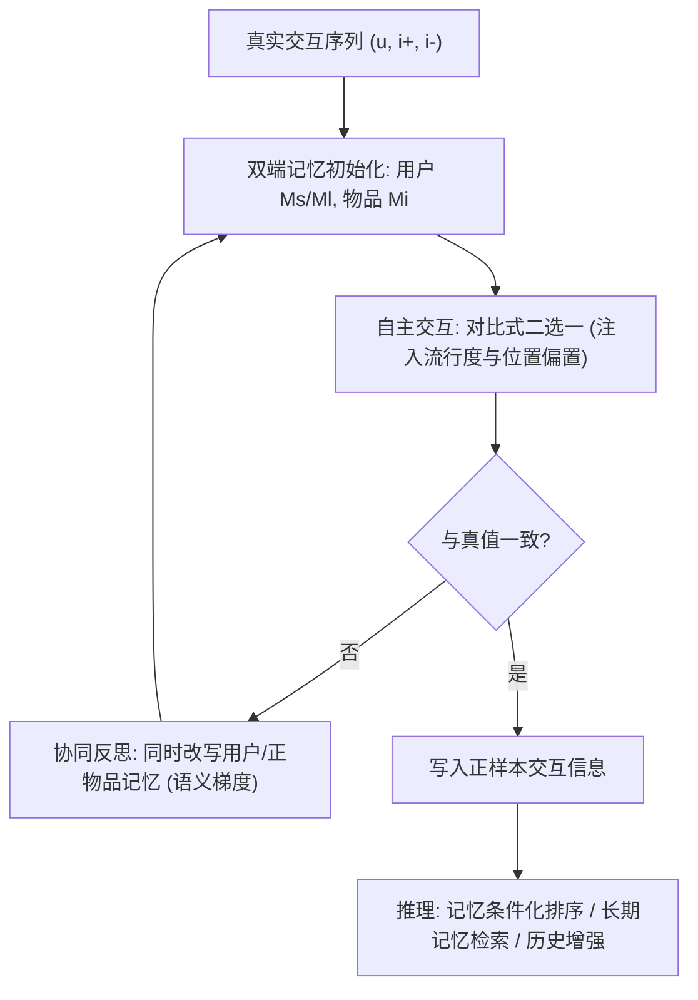
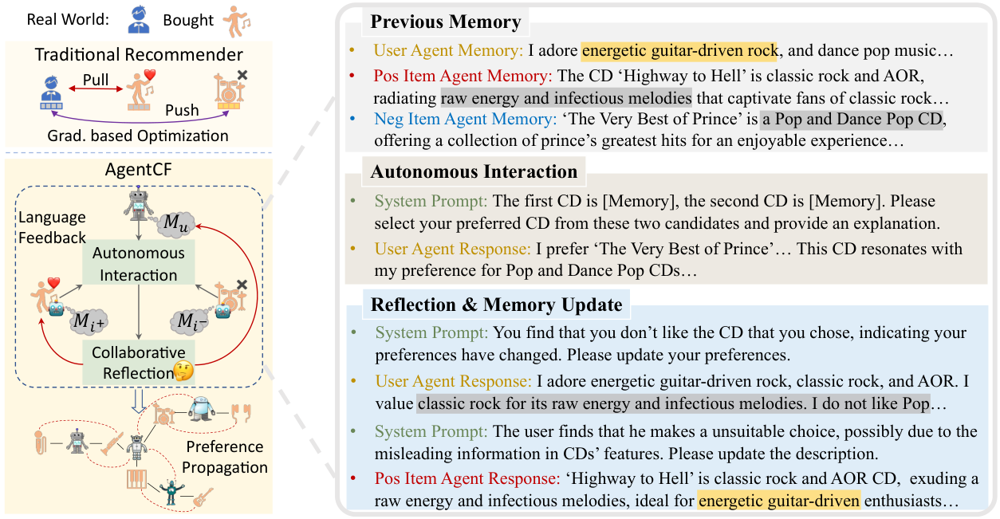

# AgentCF: Collaborative Learning with Autonomous Language Agents for Recommender Systems (基于自主语言智能体协同学习的推荐系统)

- **会议/期刊**: WWW 2024
- **作者与机构**: Junjie Zhang, Wenqi Sun, Wayne Xin Zhao, Ji-Rong Wen (人大高瓴) / Yupeng Hou, Julian McAuley (UCSD) / Ruobing Xie, Leyu Lin (腾讯微信)
- **推荐链路定位**: 重排（列表级候选排序）＋用户行为仿真
- **研究方向**: 对话推荐与智能体仿真 / 大语言模型推荐
- **论文原文**: [论文原文链接](https://arxiv.org/abs/2310.09233v1)
- **开源代码**: 暂未开源

## TL;DR (1分钟核心速览)

现有 LLM 智能体仿真只模拟"对话"与"用户侧"，无法刻画隐式点击行为，且语言知识与协同过滤信号（如"买尿布的人常买啤酒"）天然错位。AgentCF 首次把**物品也做成智能体**，用「用户/物品双端记忆 + 自主对比式交互 + 协同反思改写记忆」模拟 BPR 式的前向打分与反向更新（无梯度），使偏好通过交互在 agent 间传播。在 Amazon CDs/Office 的 4 个 100 用户子集、Leave-One-Out + 1:9 采样排序协议下，NDCG@10 相对 LLMRank 提升 7.4%–14.6%，且仅用全量 0.07% 数据即接近全量训练的 SASRec。

## Background & Motivation (背景与核心矛盾)

- **主流范式**: 用 LLM Agent 仿真人类行为（RecAgent、Generative Agents）或直接把用户历史交互"口语化"后喂给 LLM 做零样本排序（LLMRank）。
- **前人局限**: ① 仅建模用户侧，忽略物品侧"潜在采纳者偏好"，而推荐本质是双边关系建模，缺失物品侧就无法实现 "like alike"；② 仅做**自学习式反思**（Reflexion / Self-Refine 只从自身任务出发），而非用户-物品互相纠错的协同学习。
- **核心洞察 (Key Insight)**: 传统 CF 的"前向偏好评估 + 反向参数更新"可以用语言空间复现——**记忆即语言化 embedding，反思即语义梯度**。
- **本文切入点**: 将每个用户与每个物品都实例化为带可写记忆的 Agent，让二者的交互误差通过协同反思同时回写到双方记忆里。

## Method (核心方法设计)

### 1. 整体框架 (Overall Architecture)

对每条真实交互（用户 $u$的正样本$i^+$与其负样本$i^-$），先由用户 Agent 读取短期记忆、物品 Agent 读取各自记忆，自主选择一个物品并给出理由（前向）；随后把选择与真值比对，若错误则同时提示用户与正样本物品 Agent 反思，改写短期记忆并向长期记忆追加（反向）；物品记忆因此吸收"谁喜欢我"，在下一次交互中被传播给新用户。推理时 LLM 完全冻结，只以 Agent 记忆作为条件对候选列表排序，并可选地检索长期记忆或拼接历史交互。

<figure class="paper-figure" markdown="span">
  <figcaption>图 1：AgentCF 的整体框架及一个关于智能体优化过程的案例：（1）首先提示用户智能体和物品智能体自主交互。（2）这些智能体通过反思其决策与真实世界交互之间的差异，调整记忆中的错误认知。在此过程中，用户智能体和物品智能体的模拟偏好会聚集（如高亮内容所示），并可在后续交互中传播给其他智能体。</figcaption>
</figure>

### 2. 关键设计拆解 (Key Designs)

1. **双端可写记忆（语言化 embedding）**：用户 Agent 配短期记忆 $M^s_u$（当前偏好文本）+ 长期记忆$M^l_u$（偏好演化池，可按候选检索）；物品 Agent 只配单一记忆$M_i$（属性稳定），初始化为标题/类目文本，但**会被采纳者偏好持续改写**。这就是把"物品 embedding"从静态 ID 变成可累积协同信号的载体，是偏好传播的物理基础。
2. **协同反思作为"语义梯度"**：梯度缺失下，用真值差异驱动双端记忆更新：
$$M'^{s}_{u}\leftarrow \mathrm{Reflection}_u(i_o;y_{exp};M_u;M_{i^-};M_{i^+}),\quad M'_{i}\leftarrow \mathrm{Reflection}_i(i_o;y_{exp};M_u;M_{i^-};M_{i^+})$$
并令 $M'^{l}_{u}=\mathrm{Append}(M^{l}_{u};M^{s}_{u})$ 保留演化轨迹。反思提示中同时呈现正负物品记忆，迫使 LLM 显式判别"我为何错"，等价于 BPR 的成对约束；**负样本物品记忆不更新**，因为 LLM 会过度贬低负例、破坏其面向其他用户的吸引力。
3. **训练/推理与开销**：无显式损失与负采样器（候选对天然使用"高流行度负例 + 置于正例之前"的强偏置构造，见 $i_o=f_{\mathrm{LLM}}(M_u;M_{i^-};M_{i^+})$）；总"目标"是记忆收敛到与真值一致。推理三档：$\mathcal{R}_B=f_{\mathrm{LLM}}(M^s_u;\{M_{c_1},\dots,M_{c_n}\})$、$+R$追加长期记忆检索$M^r_u$、$+H$追加历史$m$ 个物品记忆。开销全在 LLM API 调用（每步 3–5 次 prompt），无训练成本但有在线延迟。

## Experimental Setup & Evaluation Protocol (实验设置与评估协议)

- **数据集与预处理**: Amazon 评论（text-intensive 子集），因 API 昂贵**每数据集抽样 100 用户**，各构造 dense/sparse 两版：

| 数据集 | #Users | #Items | #Interactions | 稀疏度 | 特征/场景说明 |
| :--- | :---: | :---: | :---: | :---: | :--- |
| CDs full | 93,653 | 64,032 | 1,178,439 | 99.98% | 音乐 CD，描述短（avg 8.0 词） |
| CDs-dense | 100 | 269 | 800 | 97.03% | 8 交互/人 |
| CDs-sparse | 100 | 704 | 800 | 98.86% | 物品更分散 |
| Office full | 86,530 | 25,842 | 675,683 | 99.97% | 办公用品，描述长（avg 25.1 词） |
| Office-dense | 100 | 188 | 600 | 96.81% | 6 交互/人 |
| Office-sparse | 100 | 561 | 600 | 98.93% | 稀疏对照 |

- **数据划分与防穿越**: `Leave-One-Out`（每序列最后一项为测试真值），无时间戳泄漏风险；时间序用于 agent 逐步优化。
- **排名评测协议**: `Sampled Ranking`，目标物品与 **9 个随机负例** 组成候选（1:9）；重复 3 次取均值，指标 NDCG@1/5/10。**注意：非 Full-Ranking**，候选池极小，绝对值偏高估。
- **对比基线与超参**: BPR、SASRec（各在 sampled 与 full 上训练并区分标注）、Pop、BM25、LLMRank（ChatGPT 零样本）；LLM 在优化全程冻结，Agent 记忆为唯一变量。

## Key Experimental Results (实验关键数据)

### 1. 主实验对比 (Main Results)

| Method | CDs-sparse N@1 | N@10 | CDs-dense N@1 | N@10 | Office-sparse N@1 | N@10 | Office-dense N@1 | N@10 | Improv.%(N@10 vs LLMRank) |
| :--- | :---: | :---: | :---: | :---: | :---: | :---: | :---: | :---: | :---: |
| BPR_full | 0.1900 | 0.5619 | 0.3900 | 0.7089 | 0.1600 | 0.4983 | 0.5600 | 0.7625 | — |
| SASRec_full | 0.3300 | 0.6381 | 0.5800 | 0.7925 | 0.2500 | 0.5467 | 0.4700 | 0.6959 | — |
| BPR_sample | 0.1300 | 0.4907 | 0.1300 | 0.4812 | 0.0100 | 0.4118 | 0.1200 | 0.4576 | — |
| SASRec_sample | 0.1900 | 0.5308 | 0.1300 | 0.4676 | 0.0700 | 0.4437 | 0.3600 | 0.6137 | — |
| Pop | 0.1100 | 0.4562 | 0.0400 | 0.3743 | 0.1100 | 0.4413 | 0.0700 | 0.4137 | — |
| BM25 | 0.0800 | 0.4584 | 0.0600 | 0.4325 | 0.1200 | 0.4693 | 0.0600 | 0.4540 | — |
| LLMRank | 0.1367 | 0.4715 | 0.1333 | 0.4946 | 0.1750 | 0.4728 | 0.2067 | 0.4928 | 基准 |
| AgentCF_B | 0.1900 | 0.5019 | 0.2067 | 0.5328 | 0.1650 | 0.4781 | **0.2067** | **0.5335** | +7.8% |
| AgentCF_B+R | **0.2300** | **0.5403** | **0.2333** | **0.5405** | 0.1900 | 0.5062 | 0.1933 | 0.5247 | +14.6% / +9.3% / +7.1% / +6.5% |
| AgentCF_B+H | 0.1500 | 0.5115 | 0.2100 | 0.5198 | **0.2133** | **0.5076** | 0.1600 | 0.5147 | +7.4% |

（加粗为 sampled-trained / tuning-free / 本文三组内最优；全量训练基线仅作参考上限。）

### 2. 消融实验 (Ablation Study)

| Variants | CDs-dense N@1 | CDs-dense N@10 | Office-dense N@1 | Office-dense N@10 |
| :--- | :---: | :---: | :---: | :---: |
| AgentCF_B (full) | **0.2067** | **0.5328** | 0.2067 | **0.5335** |
| w/o Auto. Interaction | 0.1200 | 0.4964 | 0.1733 | 0.5031 |
| w/o User Agent | 0.1100 | 0.4693 | 0.2200 | 0.5145 |
| w/o Item Agent | 0.1767 | 0.5128 | 0.1800 | 0.5169 |

### 3. 关键实验发现 (Key Findings)

1. **误差反馈比"喂历史"重要**：去掉自主交互（直接告知真值让 agent 解释）在 CDs-dense 上 N@1 从 0.2067 崩到 0.1200（−42%），说明"先自己犯错再反思"产生的对比式反馈才是有效监督信号。
2. **双端建模缺一不可、但物品侧更关键**：去掉物品 Agent 在 CDs-dense 掉 15%（0.2067→0.1767）；而 Office-dense 上去掉用户 Agent 反而升至 0.2200，作者归因于该数据集物品描述长（avg 25 词），LLM 可直接充当序列推荐器——即物品侧收益随文本丰度变化。
3. **抗偏置与传播衰减共存**：协同反思后约 **95%** 用户 Agent 能一次选对正例；面对高流行负例置前的强偏置候选，AgentCF 的 NDCG@10 随真值位置/流行度波动明显小于 LLMRank；偏好传播比例在 1→2→3 跳内由 1.0 衰减至 0.8125→0.6415，符合真实信息扩散规律，同时冷启动物品 Agent 与"相似"热门物品交互 3 次后 NDCG@10 由 ~0.46 提升至 ~0.55。

## Highlights & Limitations (亮点、对比与审稿批判)

- **与代表作对比 (vs. Prior Work)**: 对比 RecAgent / Reflexion，本文把反思从"用户自省"升级为**用户-物品互相纠错的协同反思**，并用物品记忆承担跨用户偏好传播，等价于无梯度的 BPR；对比 LLMRank，本文不是把交互口语化后零样本推理，而是让记忆在交互中**被优化**，因而摆脱了 LLM 对语义无关协同信号（啤酒-尿布）的盲区。
- **可迁移亮点**: ① "负例记忆不更新"这一反直觉操作，可直接迁移到任何 LLM 驱动的偏好文本生成，避免 LLM 过度贬低负样本；② 用"高流行负例置前"构造强偏置候选对，是评估/增强 Agent 个性化的廉价手段。
- **审稿级局限批判**: ① 评测仅 100 用户、1:9 采样排序（9 个随机负例），与 Full-Ranking 差距大，结论的工业泛化性弱；② 每步 3–5 次 LLM 调用、无缓存/蒸馏设计，在线延迟与 API 成本不可忽视；③ 超参（反思轮数、长期记忆检索方式、$+R$/$+H$ 选择）随数据集漂移，Office 上用户 Agent 移除反而更优，说明方法稳健性依赖物品文本质量。

## Rating (四维评分)

- **方法创新性 (Novelty)**: ⭐⭐⭐⭐ （"物品即 Agent + 反思当语义梯度"是 CF 与 LLM Agent 的一次真正结构对齐，非提示词包装）
- **评估协议与实验扎实度 (Protocol & Experiments)**: ⭐⭐ （4 个 100 用户子集 + 1:9 采样排序，无 Full-Ranking、无显著性检验，绝对数值参考价值有限）
- **写作与数学规范度 (Clarity & Rigor)**: ⭐⭐⭐⭐ （与传统 CF 前向/反向的类比清晰，记忆更新公式与三档推理形式化到位，但缺复杂度分析）
- **工业落地与复现价值 (Industrial & Practical Value)**: ⭐⭐ （无需训练即可冷启动物品传播偏好很诱人，但依赖闭源 LLM API、延迟高，且代码未开源）

---
**修订说明**：原文未给出 `Improv.%` 字段，表中 Improv.% 由本文结果与 LLMRank 同数据集 NDCG@10 计算得出（CDs-sparse/Office-dense 列按 B+R、B 最优变体计）；完整 4 数据集 × N@1/5/10 结果见原文 Table 2。

