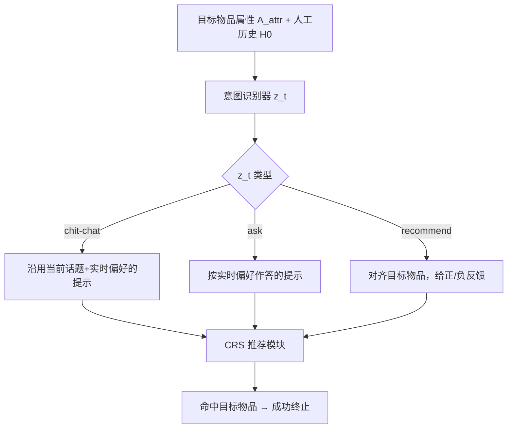
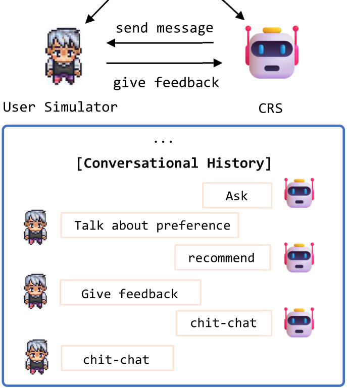
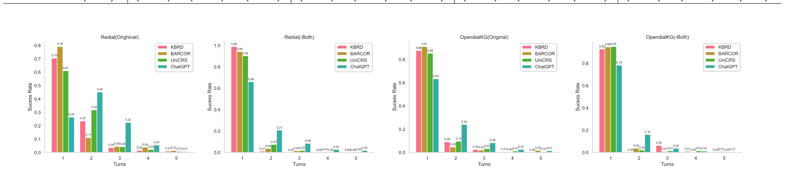
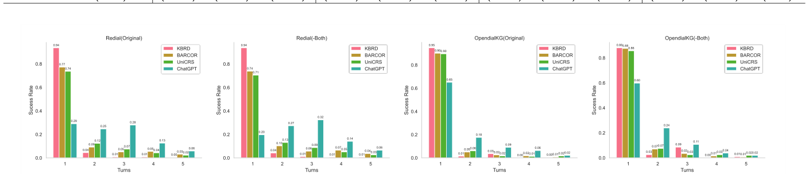

# How Reliable is Your Simulator? Analysis on the Limitations of Current LLM-based User Simulators for Conversational Recommendation (你的模拟器靠谱吗？LLM 用户模拟器用于对话推荐的局限分析)

- **会议/期刊**: WWW 2024 Companion（7 页短论文）
- **作者与机构**: Lixi Zhu, Xiaowen Huang, Jitao Sang（北京交通大学计算机学院 / 交通数据分析与挖掘北京市重点实验室）
- **推荐链路定位**: 端到端对话交互评测（不训练新推荐模型，而是重新审计 CRS 的评测协议）
- **研究方向**: 对话推荐与智能体仿真 / 大语言模型推荐
- **论文原文**: [arXiv:2403.16416](https://arxiv.org/abs/2403.16416v1)
- **开源代码**: [RUCAIBox/iEvaLM-CRS](https://github.com/RUCAIBox/iEvaLM-CRS)

## TL;DR (1分钟核心速览)

本文是一篇“评测反审”工作：作者对当前最常用的 LLM 用户模拟器 iEvaLM 做受控消融，发现 CRS 的 Recall 提升大量来自 **对话历史里本就出现的答案** 与 **模拟器回复直接泄题**，而非系统真的会用交互反馈；剔除两类泄漏后，ReDial/OpenDialKG 上 Recall@50 分别普降 13.5%–21.6% 与 3.1%–39.1%。据此提出 SimpleUserSim——屏蔽目标物品标题、按 CRS 意图（chit-chat / ask / recommend）分派不同提示，把回应泄漏导致的指标虚高从 12.0% 压到 0.3%，并使 CRS 在第 2–5 轮真正产生多轮增益。

## Background & Motivation (背景与核心矛盾)

- **主流范式**: 属性式 CRS 用模板模拟器（无对话流），NLP 式 CRS 用固定人工对话（无交互性）；iEvaLM 等 LLM 模拟器以“单提示（single-prompt）会话级指令”生成回复，成为当前 CRS 在线评测的事实标准。
- **前人局限**: ① 模拟器的输入包含人工标注历史与目标物品标题，形成系统性信息泄漏；② 单模板提示无法在不同对话情境（闲聊 vs. 追问 vs. 反馈）下精细控制输出，模拟器常在闲聊中主动泄露目标标题。
- **核心洞察 (Key Insight)**: 真正衡量 CRS 交互能力的量应是“交互带来的增量”而非“绝对成功率”。定义轮次增益 $G_{2:5}=\sum_{t=2}^{5}\big(\mathrm{SR}_t-\mathrm{SR}_1\big)$，作者发现 iEvaLM 下$\mathrm{SR}_1$已极高，即$I(y;\mathcal{R}_{1:t}\mid\mathcal{H}_0)\ll I(y;\mathcal{H}_0)$——**推荐成功几乎全部由历史信息解释，模拟器的互信息贡献可以忽略**。
- **本文切入点**: 用“删泄漏 + 意图条件化动作”两把手术刀，重建一个不偷看答案的用户模拟器。

## Method (核心方法设计)

### 1. 整体框架 (Overall Architecture)

审计维度与改进方案共享同一套交互闭环：模拟器以目标物品的**属性集合** $\mathcal{A}_{\text{attr}}$（导演、类型、年份等）与人工历史$\mathcal{H}_0$初始化，与 CRS 进行至多$t=5$轮交互；每轮先由 LLM 判定 CRS 输出意图$z_t$，再由$z_t$ 选择对应提示生成用户话语，只有当 CRS 推荐命中目标物品时才判定成功并终止。评测侧则对同一批对话施加三类剔除掩码（`-history` / `-response` / `-both`），比较掩码前后的指标落差以量化泄漏贡献。SimpleUserSim 相对 iEvaLM 只改了“可见信息”与“动作分派”两点，不改模型、不改训练。

<figure class="paper-figure" markdown="span">
  <figcaption>图1：User Simulator 的工作流程。</figcaption>
</figure>

### 2. 关键设计拆解 (Key Designs)

1. **泄漏感知的评测重构（Leakage-Aware Evaluation）**：痛点在于原评测把所有成功对话一律计入指标。本文把成功会话集合按泄漏来源切分，修正后的召回为
$$\mathrm{Recall@}k^{\text{clean}}=\frac{1}{|\mathcal{C}|}\sum_{c\in\mathcal{C}}\mathbb{I}\big[y_{\tau(c)}\in\mathrm{Top}\text{-}k(c)\big]\cdot\mathbb{I}\big[\mathrm{leak}(c)=0\big].$$
直觉：只有被剔除后仍成立的推荐，才归功于系统的交互推理能力；差值即“评测泡沫”。

2. **目标标题掩蔽（Title Masking）**：iEvaLM 允许模拟器知晓 $y$的标题，等同于在对话中把答案念给 CRS。SimpleUserSim 令可观测信息为$\mathrm{Obs}_t=(\mathcal{A}_{\text{attr}},\mathcal{H}_t)$，标题$y$直到被成功推荐后才解锁，即$\Pr(\text{leak}\mid y\in\mathcal{A})\approx 0$；同时仍保留“世界知识间接提及”这一残余泄漏通道（如列举某导演代表作时顺带说出片名），使评测更接近真实用户。

3. **意图条件化的多提示动作策略**：把单模板拆成动作函数 $a_t=\pi_{\text{sim}}(z_t,\mathcal{A}_{\text{attr}},\mathcal{H}_t)$，$z_t\in\{\text{chit-chat},\text{ask},\text{recommend}\}$ 三支路各用独立提示——闲聊支路主动把话题引向目标物品属性，追问支路给出细粒度偏好，推荐支路做严格的命中校验并给正/负反馈。此举让“模拟器 → CRS”的信息通道在多轮中真正有内容可传，避免单提示下意图错位（如 CRS 在闲聊时被强行灌偏好）。

4. **训练目标与推理开销**：全文无参数训练、无负采样，所有模型（KBRD / BARCOR / UniCRS / GPT-3.5-turbo-0613）冻结；额外开销仅为每轮一次意图分类的 LLM 调用，评测成本与 iEvaLM 同级。

## Experimental Setup & Evaluation Protocol (实验设置与评估协议)

- **数据集与预处理**: 沿用 iEvaLM 官方管线，未额外做 k-core 过滤。

| 数据集 | #Users | #Items | #Interactions(对话) | 领域 | 说明 |
| :--- | :---: | :---: | :---: | :---: | :--- |
| ReDial | 未报告（沿用官方划分） | 未报告（全库物品） | 10,006 | 单域电影 | 众包闲聊式对话，chit-chat 占比高 |
| OpenDialKG | 未报告（沿用官方划分） | 未报告（全库物品） | 13,802（仅用电影域） | 多域（取电影） | 知识图谱对齐对话 |

- **数据划分与防穿越 (Splitting Strategy)**: 沿用 iEvaLM 的对话级划分；本文额外引入 **泄漏掩码划分**（`-history` / `-response` / `-both`），这是本文对协议的核心增补。
- **排名评测协议 (Ranking Protocol)**: `Full-Ranking` 全库未交互物品排序，指标为 Recall@1 / @10 / @50；最大交互轮数 $t=5$；报告“成功推荐发生在第几轮”的轮次分布（图 4、图 6）作为多轮能力证据。未报告显著性检验与多次采样方差，属明显短板。
- **对比基线与超参设置**: KBRD（KG 增强）、BARCOR（BART 统一建模）、UniCRS（知识增强提示学习）、ChatGPT（GPT-3.5-turbo-0613，零样本）。超参、embedding 维度全部继承基线默认设置，以保证与 iEvaLM 原报告可比。

## Key Experimental Results (实验关键数据)

### 1. 主实验对比 (Main Results)

| 数据集 | 模拟器 | 模型 | R@1 | R@10 | R@50 |
| :--- | :--- | :--- | :---: | :---: | :---: |
| ReDial | iEvaLM | KBRD | 0.033 | 0.229 | 0.575 |
| ReDial | iEvaLM | BARCOR | 0.032 | 0.190 | 0.499 |
| ReDial | iEvaLM | UniCRS | 0.219 | 0.454 | 0.718 |
| ReDial | iEvaLM | **ChatGPT** | **0.220** | **0.539** | **0.816** |
| ReDial | SimpleUserSim | KBRD | 0.027 | 0.170 | 0.443 |
| ReDial | SimpleUserSim | BARCOR | 0.030 | 0.205 | 0.510 |
| ReDial | SimpleUserSim | UniCRS | 0.073 | 0.284 | 0.592 |
| ReDial | SimpleUserSim | **ChatGPT** | **0.209** | **0.490** | **0.706** (−13.5% vs. iEvaLM) |
| OpenDialKG | iEvaLM | KBRD | 0.269 | 0.469 | 0.603 |
| OpenDialKG | iEvaLM | UniCRS | 0.280 | 0.494 | 0.646 |
| OpenDialKG | iEvaLM | **ChatGPT** | **0.425** | **0.774** | **0.941** |
| OpenDialKG | SimpleUserSim | KBRD | 0.243 | 0.432 | 0.558 |
| OpenDialKG | SimpleUserSim | UniCRS | 0.256 | 0.458 | 0.614 |
| OpenDialKG | SimpleUserSim | ChatGPT | **0.429** | 0.724 | 0.918 |

> 注：表中“下降”并非模型变差，而是剔除泄漏后指标回归真实水平；iEvaLM 一栏可视为**虚高上界**。

### 2. 消融实验 (Ablation Study)

| 设置（ReDial, R@50） | KBRD | BARCOR | UniCRS | ChatGPT |
| :--- | :---: | :---: | :---: | :---: |
| iEvaLM 原始 | 0.575 | 0.499 | 0.718 | 0.816 |
| iEvaLM `-history` | 0.542 (−5.7%) | 0.473 (−5.2%) | 0.587 (−18.2%) | 0.833 (+2.1%) |
| iEvaLM `-response` | 0.506 (−12.0%) | 0.465 (−6.8%) | 0.644 (−10.3%) | 0.670 (−17.9%) |
| iEvaLM `-both` | 0.451 (−21.6%) | 0.430 (−13.8%) | 0.621 (−13.5%) | 0.641 (−21.4%) |
| SimpleUserSim `-response` | 0.443 (−0.0%) | 0.510 (−0.0%) | 0.590 (−0.3%) | 0.705 (−0.1%) |
| SimpleUserSim `-both` | 0.385 (−13.1%) | 0.486 (−4.7%) | 0.560 (−5.4%) | 0.700 (−0.8%) |

OpenDialKG 侧同向且更剧烈：iEvaLM `-both` 使 R@50 分别下降 39.1% / 31.7% / 28.6% / 3.1%；SimpleUserSim 的 `-response` 掩码几乎不再造成损失（−0.9% ~ +0.7%），说明回应泄题通道已被基本封死。

### 3. 关键实验发现 (Key Findings)

1. **回应泄题是主因，历史泄题是数据宿疾**: ReDial 上 iEvaLM 的 `-response` 让 UniCRS/ChatGPT 的 R@50 掉 10.3%/17.9%，而 SimpleUserSim 下同一掩码只掉 0.3%/0.1%——说明新模拟器把可控泄漏压到近零，但 `-history` 仍造成 4.9%–13.1% 的损失，属于数据集固有缺陷，模拟器无力修复。
2. **★ 排序结论被泄漏反转**: 含泄漏时 KBRD 在 ReDial 上明显强于 BARCOR（0.575 vs. 0.499），但在 `-both` 干净评测下 KBRD 反成最弱（0.385 vs. 0.486）。这意味着**过去基于 iEvaLM 的模型排名并不可信**，KG 类模型更擅长“抄历史答案”而非“用交互反馈”。
3. **多轮增益才区分模型**: 第 1 轮成功率极高（绝大多数成功对话发生在 CRS 尚未使用任何反馈时），`-both` 下第 2–5 轮成功率骤降；SimpleUserSim 在 2–5 轮显著更高，且 ChatGPT 因世界知识更善于利用反馈，在 2–5 轮领先其余基线——这与“推荐成功主要靠历史而非模拟器回应”的诊断互相印证。

<figure class="paper-figure" markdown="span">
  <figcaption>图4：以 iEvaLM 作为用户模拟器时，各轮次成功推荐的百分比。</figcaption>
</figure>
<figure class="paper-figure" markdown="span">
  <figcaption>图6：使用 SimpleUserSim 进行用户模拟时，各轮次成功推荐的百分比。</figcaption>
</figure>

## Highlights & Limitations (亮点、对比与审稿批判)

- **与代表作对比 (vs. Prior Work)**: iEvaLM 首创 LLM 模拟器但采用单一会话级提示且不屏蔽标题；UGriega/LLM-Redial 类工作关注回复自然度而非评测可信度；本文则把“模拟器”从生成组件降级为**标尺组件**，并提出可校验的泄漏掩码协议，方法论上更接近 IR 领域的评测偏差审计。
- **可迁移亮点**: ① “删泄漏重算指标”的掩码范式可直接迁移到 LLM-as-Judge、Agent 沙盒与合成数据评测；② 意图条件化多提示（按系统意图分派不同提示支路）是低成本提升任何对话模拟器可控性的通用技巧。
- **审稿级局限批判**: ① 只审计了 iEvaLM 一个模拟器、两个数据集且仅用电影域，样本面窄，缺少多次采样的方差与显著性检验，单次 LLM 调用波动可能吞掉 1–2 个百分点的差异；② 未量化“世界知识间接泄题”（作者自己承认仍存在），也未给出在线人类用户对照，因此 SimpleUserSim 的“更真实”只有内部一致性证据；③ 指标仍限于 Recall，未评估回复质量、轮次效率与用户体验成本。

## Rating (四维评分)

- **方法创新性 (Novelty)**: ⭐⭐⭐ （不是新模型而是新标尺，泄漏掩码 + 意图条件化提示的组合朴素但切中要害）
- **评估协议与实验扎实度 (Protocol & Experiments)**: ⭐⭐⭐ （四模型 × 两数据集 × 四种泄漏掩码设计清晰，但缺显著性检验、数据集过窄、统计信息报告不全）
- **写作与数学规范度 (Clarity & Rigor)**: ⭐⭐⭐ （论证链条与图示（图 1–6）非常直观，但形式化程度低，几乎无公式推导与复杂度分析）
- **工业落地与复现价值 (Industrial & Practical Value)**: ⭐⭐⭐⭐ （代码基于 iEvaLM-CRS 开源、零训练成本，可直接作为对话推荐/Agent 评测的合规检查清单）

