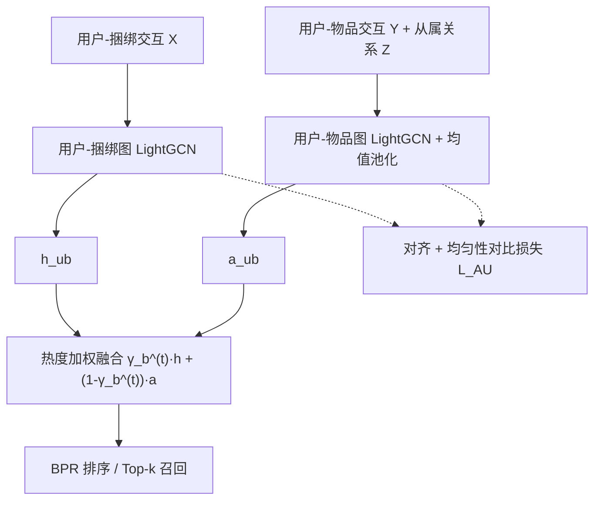
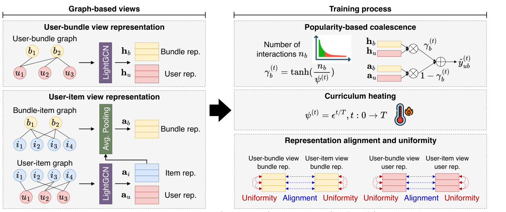
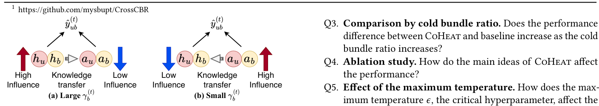

# Cold-start Bundle Recommendation via Popularity-based Coalescence and Curriculum Heating (基于热度合并与课程升温的冷启动捆绑推荐)

- **会议/期刊**: WWW 2024（8 页正文 + 附录）
- **作者与机构**: Hyunsik Jeon (UCSD)、Jong-eun Lee、Jeongin Yun、U Kang（首尔大学 SNU）
- **推荐链路定位**: 召回（Top-k bundle 全库排序）
- **研究方向**: 冷启动与长尾推荐 / 图神经网络推荐
- **论文原文**: [https://arxiv.org/abs/2310.03813v3](https://arxiv.org/abs/2310.03813v3)
- **开源代码**: [https://github.com/snudatalab/CoHeat](https://github.com/snudatalab/CoHeat)

## TL;DR (1分钟核心速览)

本文首次提出「冷启动捆绑推荐」这一任务：新 bundle 无任何用户交互，而用户-捆绑交互分布极度长尾（Youshu 中绝大多数 bundle 交互数趋近 0），导致既有的冷启动**物品**推荐方法（CLCRec/CCFCRec 等）无法利用 bundle 由多物品组成这一结构先验。CoHeat 构建「用户-捆绑图」与「用户-物品图」双 LightGCN 视图，用 $\tanh(n_b/\psi^{(t)})$ 的热度系数按 bundle 交互数动态融合两视图分数，并以课程升温 + 对齐/均匀性对比损失实现跨视图知识迁移。在 Youshu/NetEase/iFashion 三数据集上，冷启动场景 nDCG@20 相对最优基线提升 20.7%–123.3%，全量场景最高提升 **193%**，且热启动场景亦反超 CrossCBR。

## Background & Motivation (背景与核心矛盾)

- **主流范式**: 捆绑推荐沿两条线演进——矩阵分解系（DAM、MFBPR 变体）与图表征系（BundleNet、BGCN、CrossCBR），后者用双 LightGCN 分别建模用户-捆绑、用户-物品图，并以 InfoNCE 对齐两视图。
- **前人局限 1（分布极度倾斜）**: 上述方法均假设所有 bundle 都有历史交互，权重对两视图**一视同仁**；而真实数据中 bundle 交互分布远比 item 交互更偏斜，冷门 bundle 在用户-捆绑图中几乎是孤立点，等权融合等于放大噪声。
- **前人局限 2（冷启动物品方法不可迁移）**: DropoutNet/GAR/CLCRec 等把内容表示（文本、图像）当作独立实体对齐行为表示，但 bundle 的"内容"是**多物品从属关系**，需先学到好的 item/user 表征才能得到 bundle 表征，现有方法缺乏这一传导机制。
- **核心洞察 (Key Insight)**: 冷门 bundle 在用户-捆绑视图信息不足，但在用户-物品视图信息充足（图 1b/1c）；因此「视图权重应当随 bundle 热度连续变化」而非固定——这正是 CrossCBR 等缺失的自由度。
- **本文切入点**: 把融合权重写成热度 $n_b$与训练轮次$t$ 的显式函数，让模型自己"由易到难"地从用户-捆绑视图迁移到用户-物品视图。

## Method (核心方法设计)

### 1. 整体框架 (Overall Architecture)

输入为三组关系：用户-捆绑交互 $\mathbf{X}$、用户-物品交互$\mathbf{Y}$、捆绑-物品从属$\mathbf{Z}$。CoHeat 分别在其上跑两个 LightGCN（层聚合采用$\sum_k \frac{1}{k+1}\mathbf{h}^{(k)}$的低层加权），得到用户-捆绑视图分数$h_{ub}=\mathbf{h}_u^{\top}\mathbf{h}_b$与用户-物品视图分数$a_{ub}=\mathbf{a}_u^{\top}\mathbf{a}_b$（其中$\mathbf{a}_b=\frac{1}{|\mathcal{N}'_b|}\sum_{i\in\mathcal{N}'_b}\mathbf{a}_i$由所属物品均值池化，这是冷启动 bundle 唯一可用的信息通路）。两分数经热度系数$\gamma_b^{(t)}$线性合并为最终打分$\hat{y}_{ub}^{(t)}$，训练时用 BPR + 对齐/均匀性对比损失联合优化，推理时对全库 bundle 打分取 Top-k。

<figure class="paper-figure" markdown="span">
  <figcaption>图3：CoHeat 概览（详见第3节）。</figcaption>
</figure>

### 2. 关键设计拆解 (Key Designs)

1. **热度合并 (Popularity-based Coalescence)**：为消除等权融合对冷门 bundle 的偏置，作者提出两条显式性质——交互越少，$h_{ub}$的偏导应越小、$a_{ub}$ 的偏导应越大；并构造
   $\hat{y}_{ub}=\gamma_b h_{ub}+(1-\gamma_b)a_{ub},\ \gamma_b=\tanh\!\left(n_b/\psi\right)$因$\tanh$单调递增且$n_b$越小$\gamma_b$越小，性质 1/2 自动满足（Lemma 3.1/3.2）。直觉：冷 bundle 的$h_{ub}$ 近似随机初始化噪声，压低其权重等于「把不可信证据静音」，改用物品协同信号投票。

2. **课程升温 (Curriculum Heating)**：若一次性把权重压到 0，用户-物品视图（依赖 item→user 两跳传播）表征尚未学好便被迫主导预测。故将温度设为 $\psi^{(t)}=\epsilon^{t/T}$（$\epsilon>1$），使
   $\gamma_b^{(t)}=\tanh\!\left(n_b/\epsilon^{t/T}\right)$随 epoch 单调下降：早期偏向易学的$h_{ub}$，后期平移到难的$a_{ub}$，所有 bundle 共享同一温度因此性质 1/2 仍成立（Lemma 3.3/3.4）。这是一条**无额外参数的软调度**，替代了硬性的视图切换。

3. **对齐与均匀性正则 + 训练目标**：InfoNCE 需构造正负对，而冷 bundle 在用户-捆绑视图无正样本；作者改用直接作用于几何性质的 $\mathcal{L}_{AU}=\mathbb{E}\|\tilde{\mathbf{h}}-\tilde{\mathbf{a}}\|_2^2+\log\mathbb{E}\,e^{-2\|\tilde{\mathbf{h}}-\tilde{\mathbf{h}}'\|_2^2}$（用户、bundle 两侧各一份），训练目标为
   $\mathcal{L}^{(t)}=\mathcal{L}_{BPR}^{(t)}+\lambda_1\mathcal{L}_{AU}+\lambda_2\|\Theta\|_2^2$负采样用 BPR 的均匀随机负例，$p_{user}/p_{bundle}$取 **in-batch 采样**（非全库）以降低偏置；图侧加 edge dropout 增强鲁棒性。推理仅需双视图内积加权，单对打分$O(d)$；训练开销约为主流双 LightGCN 的 2 倍（两条图传播 + 批内两两距离）。

<figure class="paper-figure" markdown="span">
  <figcaption>图4：CoHeat 的学习机制（详见第3.7节）。</figcaption>
</figure>

## Experimental Setup & Evaluation Protocol (实验设置与评估协议)

- **数据集与预处理**: 无 5-core 过滤，直接沿用 CrossCBR 公开切分。

| 数据集 | #Users | #Bundles | #Items | 用户-捆绑交互(密度) | 平均 bundle 大小 |
| :--- | :---: | :---: | :---: | :---: | :---: |
| Youshu | 8,039 | 4,771 | 32,770 | 51,377 (0.13%) | 37.03 |
| NetEase | 18,528 | 22,864 | 123,628 | 302,303 (0.07%) | 77.80 |
| iFashion | 53,897 | 27,694 | 42,563 | 1,679,708 (0.11%) | 3.86 |

- **数据划分与防穿越 (Splitting Strategy)**: 三种场景——① Warm：**交互比例划分 7:1:2**；② Cold（主场景）：**按 bundle 划分 7:1:2**，测试 bundle 在训练期完全无交互（严格 zero-shot bundle）；③ All：交互同比例划分，且一半 warm、一半 cold bundle。所有结果取 3 次运行、100 epoch 内最优。
- **排名评测协议 (Ranking Protocol)**: 沿用 CrossCBR 的**全库 Full-Ranking**（对全部 bundle 打分排序，不采样候选），指标 Recall@20 / nDCG@20。
- **对比基线与超参**: 冷启动基线 8 个（DropoutNet、CB2CF、Heater、GAR-CF/GNN、CVAR、CLCRec、CCFCRec，bundle-item 多热向量作为其 content）；热启动基线 9 个（MFBPR、LightGCN、SGL、SimGCL、LightGCL、DAM、BundleNet、BGCN、CrossCBR）。最大温度 $\epsilon=10^4$（全数据集统一），$\lambda_1,\lambda_2$ 见附录 B。**未报告显著性检验**。

## Key Experimental Results (实验关键数据)

### 1. 主实验对比 (Main Results)

冷启动场景（Cold）与全量场景（All）对比，Recall@20 / nDCG@20：

| Model | Youshu Cold R | Youshu Cold N | Youshu All N | NetEase Cold R | NetEase Cold N | iFashion Cold R | iFashion Cold N | iFashion All N |
| :--- | :---: | :---: | :---: | :---: | :---: | :---: | :---: | :---: |
| DropoutNet | .0022 | .0007 | .0055 | .0028 | .0015 | .0009 | .0008 | .0027 |
| Heater | .0016 | .0007 | .0286 | .0021 | .0010 | .0015 | .0010 | .0083 |
| GAR-CF | .0015 | .0011 | .0317 | .0010 | .0005 | .0013 | .0013 | .0055 |
| CVAR | .0008 | .0002 | .0533 | .0002 | .0001 | .0007 | .0004 | .0084 |
| CLCRec | .0137 | .0087 | .0194 | .0136 | .0075 | .0053 | .0043 | .0085 |
| CCFCRec | .0044 | .0022 | .0425 | .0007 | .0004 | .0005 | .0003 | .0172 |
| **CoHeat** | **.0183** | **.0105** | **.0833** | **.0191** | **.0093** | **.0170** | **.0096** | **.0504** |
| *Improv.* | *+33.6%* | *+20.7%* | *+56.3%* | *+40.4%* | *+24.0%* | *+220.8%* | *+123.3%* | *+193.0%* |

热启动场景（Warm，Recall@20 / nDCG@20）：

| Model | Youshu | NetEase | iFashion |
| :--- | :---: | :---: | :---: |
| MFBPR | .1959 / .1117 | .0355 / .0181 | .0752 / .0542 |
| LightGCN | .2286 / .1344 | .0496 / .0254 | .0837 / .0612 |
| SimGCL | .2691 / .1593 | .0710 / .0377 | .0919 / .0677 |
| BGCN | .2347 / .1345 | .0491 / .0258 | .0733 / .0531 |
| CrossCBR | .2776 / .1641 | .0791 / .0433 | .1133 / .0875 |
| **CoHeat** | **.2804** / **.1646** | **.0847** / **.0455** | **.1156** / **.0876** |

### 2. 消融实验 (Ablation Study)

冷启动场景，逐组件移除：

| 变体 | 说明 | Youshu R / N | NetEase R / N | iFashion R / N |
| :--- | :--- | :---: | :---: | :---: |
| CoHeat-PC | 令 $\gamma_b^{(t)}\equiv 0.5$（退化为等权融合） | .0000 / .0000 | .0000 / .0000 | .0000 / .0000 |
| CoHeat-CH-Ant | 反课程：$t:T\to 0$，先难后易 | .0177 / .0087 | .0176 / .0087 | .0164 / .0093 |
| CoHeat-CH-Fix | 固定 $\psi^{(t)}=\epsilon$，无升温调度 | .0180 / .0092 | .0182 / .0090 | .0164 / .0092 |
| CoHeat-AU | 去掉 $\mathcal{L}_{AU}$ | .0069 / .0031 | .0029 / .0013 | .0013 / .0005 |
| **CoHeat** | 完整模型 | **.0183 / .0105** | **.0191 / .0093** | **.0170 / .0096** |

### 3. 关键实验发现 (Key Findings)

1. **热度系数是不可替代的硬约束，而非调参技巧**：把 $\gamma_b$固定为 0.5 后 Recall@20 在三个数据集上**全部归零**——冷 bundle 的$h_{ub}$是纯初始化噪声，等权融合会让它系统性地压过有效的$a_{ub}$，直接把所有冷 bundle 挤出 Top-20；这与 CrossCBR 冷场景 nDCG 仅 .0875（热）/ 接近 0（纯冷）互为印证。
2. **对比正则比课程调度更"命门"，但两者互补**：去掉 $\mathcal{L}_{AU}$使 iFashion 冷启动 Recall 从 .0170 崩到 .0013（-92%），退化幅度远超 CH-Ant（.0164）与 CH-Fix（.0164）的小幅下降，说明跨视图对齐才是让$a_{ub}$ 可用的前提；而 CH-Ant 反课程仅损失约 4%，说明"先易后难"提供的是平滑性收益而非决定性收益。
3. **bundle 越大、交互越稀疏，CoHeat 优势越明显**：随测试集冷 bundle 比例上升，CoHeat 相对 CrossCBR 的差距由 +88.4%(iFashion) 扩大到 +124%(NetEase)，且在 100% 冷条件下 CrossCBR 掉到 0 而 CoHeat 仍稳定；这与 NetEase 平均 bundle 尺寸 77.80（物品协同信号最丰富）、iFashion 仅 3.86 的现象一致——收益正比于"用户-物品视图可提供的信息量"。

## Highlights & Limitations (亮点、对比与审稿批判)

- **与代表作对比**: ① vs. **CrossCBR**：同为双 LightGCN + 对比学习，但 CrossCBR 等权融合且用 InfoNCE 需正样本对，CoHeat 把权重变成热度的连续函数并用 alignment/uniformity 替代 InfoNCE，从而在冷场景不被稀疏视图拖死、热场景还能微涨（.2776→.2804）。② vs. **CLCRec/CCFCRec**：它们把 content 当独立实体，无法聚合多物品的协同信号；CoHeat 直接用用户-物品图传播再池化，天然适配 bundle 结构。③ vs. **DropoutNet 系**：dropout 增强的是鲁棒性而非信息源，无法解决"冷 bundle 在用户-捆绑视图信息量为 0"的根本问题。
- **可迁移亮点**: (a) 用 $\tanh(n_b/\psi)$ 把"样本可信度"写成可微的融合系数，可平移到多源召回融合、冷/热双塔加权、多场景 PEPNet 门控；(b) 用 alignment+uniformity 替代 InfoNCE 以规避冷侧无正样本的困境，适用于任何"一边缺样本"的跨视图对齐任务。
- **审稿级局限批判**: ① **冷启动是"伪冷"**——仅抹掉 bundle 的交互，其组成物品仍有完整用户-物品交互；若新 bundle 由全新长尾物品构成（item 侧也冷），$a_{ub}$同样失效，论文未与 item 冷启动联合建模。② **超参极敏感且缺乏统计检验**：$\epsilon=10^4$ 这一量级完全由网格搜索定出，图 6 显示过高/过低均显著掉点；同时未做显著性检验，冷启动场景绝对指标极低（nDCG≈0.01），三倍随机运行的方差可能吞掉部分差距。③ **训练开销翻倍**：双图每 epoch 全图传播加批内两两距离计算，论文将复杂度分析推至附录，未给出与 CrossCBR 的实际训练/推理时延对比，工业落地前需补该实验。

## Rating (四维评分)

- **方法创新性 (Novelty)**: ⭐⭐⭐⭐ （首次定义冷启动 bundle 推荐；热度系数 + 课程升温的组合有清晰的性质刻画与引理支撑，但两视图骨架沿用 LightGCN/CrossCBR，属"精巧改写"而非架构级创新）
- **评估协议与实验扎实度 (Protocol & Experiments)**: ⭐⭐⭐ （三数据集 × 三场景、8 个冷启动 + 9 个热启动基线较完整，但冷启动为伪冷划分、无显著性检验、超参敏感性突出）
- **写作与数学规范度 (Clarity & Rigor)**: ⭐⭐⭐⭐ （性质 1/2 与四个 Lemma 把"为什么这样设计"讲得很干净，公式与符号自洽；对 $\gamma$ 归零导致 Recall=0 的机理缺少显式展开）
- **工业落地与复现价值 (Industrial & Practical Value)**: ⭐⭐⭐⭐ （代码开源、可复用 CrossCBR 数据管线；推理仅需双视图内积，适合新 bundle 上架即召回的运营场景，但训练成本约 2× 需权衡）

