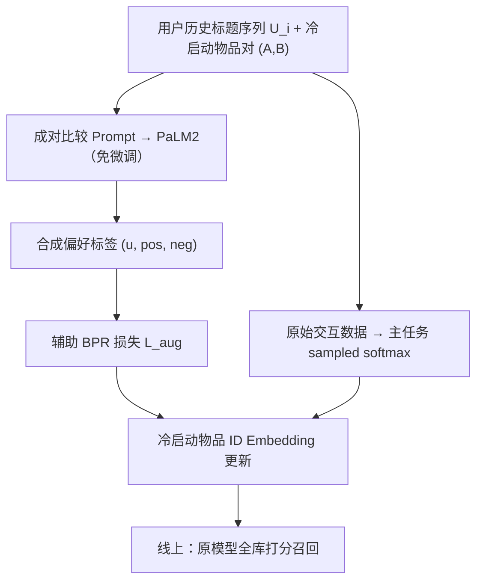
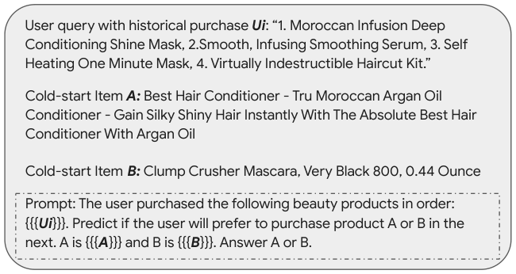
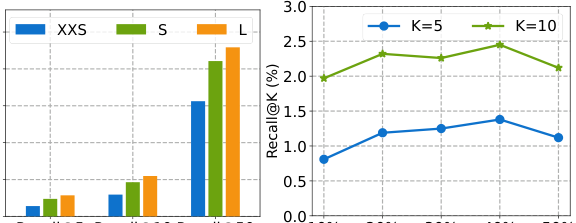

# Large Language Models as Data Augmenters for Cold-Start Item Recommendation (大语言模型作为冷启动物品推荐的数据增强器)

- **会议/期刊**: WWW 2024 (Short Paper, 4 pages)
- **作者与机构**: Jianling Wang, Haokai Lu, James Caverlee, Ed Chi, Minmin Chen (Google DeepMind；Texas A&M University)
- **推荐链路定位**: 召回（训练期增强，不改变线上服务链路）
- **研究方向**: 冷启动与长尾推荐 / 大语言模型推荐 (LLM4Rec)
- **论文原文**: [https://arxiv.org/abs/2402.11724v1](https://arxiv.org/abs/2402.11724v1)
- **开源代码**: 暂未开源

## TL;DR (1分钟核心速览)

本文针对 "冷启动物品没有任何交互因而 ID embedding 完全未被训练" 这一痛点，**不在服务期调用 LLM**，而是把 LLM 当作训练期的数据增强器：用成对比较提示（pairwise prompt）让 PaLM2 依据用户历史购买标题推断其对两个冷启动物品的偏好，再将合成偏好以辅助 BPR 成对损失注入 NeuMF/SASRec。在 Amazon Beauty/Sports 上采用全局时间戳 7:3 切分（仅出现在测试期的物品定义为 cold）与全库 Recall@K 评测，NeuMF 冷启动 R@50 从 0.48% 提升到 10.53%（约 21.9 倍），SASRec 从 0.74% 提升至 11.40%，而 warm-start 指标仅有 ≤0.4% 的边际波动。

## Background & Motivation (背景与核心矛盾)

- **主流范式**: 工业推荐依赖 ID-based 隐因子模型 $\hat{y}_{u,i}=\mathbf{v}_u^{\top}\mathbf{v}_i$（NeuMF、SASRec 等），以及用 BOW/类别等 side information 做 content-based 泛化。
- **前人局限**: ① 纯 ID 模型对新上架、零反馈物品无任何梯度，冷启动物品 embedding 近乎随机初始化；② content-based 方案虽能给出非零分，但丢弃协同信号，在 warm-start 上显著掉点（Beauty R@50 18.76%→16.89%）；③ 直接部署 LLM 做生成式检索需微调大型模态编码器且单请求延迟远超工业要求的 O(100ms)，QPS 不可承受。
- **核心洞察 (Key Insight)**: LLM 的 world knowledge 足以"推理"用户是否会喜欢某个新物品；且 LLM 在做**成对比较**时比做点式相关性打分更可靠（后者标定性差），成对提问还能保证每次调用都产出有效偏好标签（点式提问大概率得到"不感兴趣"）。
- **本文切入点**: 把 LLM 的输出放在**离线训练阶段**当作合成交互，用模型无关的辅助损失消费，从而同时规避服务延迟与冷启动数据缺口。

## Method (核心方法设计)

### 1. 整体框架 (Overall Architecture)

对训练集中每条用户查询 $U_i$（用户历史物品的标题序列），随机采样两个冷启动物品$A,B\in\mathcal{I}_{cold}$构造成对比较提示，问 LLM "该用户下一次更可能买 A 还是 B，只回答 A 或 B"；LLM 返回的胜者记为$pos$、败者记为$neg$，构成一条合成偏好三元组$(u,pos,neg)$。该三元组与原始交互数据混合成一个 batch，除主任务的 sampled batch softmax 损失外，再叠加辅助 BPR 损失，梯度直接回传到两个冷启动物品的 ID embedding 上完成"预热"。推理阶段完全回到原推荐模型，无任何 LLM 调用开销。

### 2. 关键设计拆解 (Key Designs)

1. **成对比较提示构造（Pairwise Comparison Prompting）**：痛点是点式提问下正例极稀疏且 LLM 打分未标定；改法是强制二选一，使每次调用必产出一个正例与一个负例，等价于对冷启动物品池做了一次"免费"的成对偏好标注。提示中历史交互只用描述性标题（而非 ID），从而把 CF 信号转成 LLM 可读的语义上下文。

<figure class="paper-figure" markdown="span">
  <figcaption>图1：用户查询的成对比较提示。</figcaption>
</figure>

2. **辅助成对排序损失（Auxiliary Pairwise Loss）**：痛点在于冷启动物品在 sampled softmax 中几乎不会作为正例出现，梯度为零；本文加入

$$\mathcal{L}_{aug}=-\sum_{(u,pos,neg)}\ln\sigma(\hat{y}_{u,pos}-\hat{y}_{u,neg}),\quad \hat{y}_{u,i}=\mathbf{v}_u^{\top}\mathbf{v}_i$$

其物理直觉是：该损失只约束 $pos$与$neg$ 的相对序，不要求绝对分数标定，因而对 LLM 可能存在的噪声与偏置更鲁棒；同时一条合成样本同时更新两个冷启动物品的 embedding，样本利用率为点式做法的两倍。

3. **训练目标、负采样与推理效率**：总损失 $\mathcal{L}=\mathcal{L}_{softmax}+\lambda\mathcal{L}_{aug}$；负例来自 batch 内负采样（主任务）与 LLM 判负的冷启动物品（辅助任务），**无需额外硬负采样挖掘**。增强比例上仅随机抽取 20% 用户查询、每查询生成 1 条样本（PaLM2-S）。推理零额外开销——这是相对 LLM-as-recommender 路线最本质的工程优势。

## Experimental Setup & Evaluation Protocol (实验设置与评估协议)

- **数据集与预处理**: Amazon Review 的 Beauty 与 Sports and Outdoors 两个类目；物品文本用标题+类别构造。

| 数据集 | #Warm Items | #Cold Items | #User Queries | 切分 | 场景说明 |
| :--- | :---: | :---: | :---: | :---: | :--- |
| Amazon-Beauty | n.r.（原文未报告） | n.r. | n.r. | 全局时间戳 7:3 | 美妆评论 |
| Amazon-Sports | 55,255 | 2,751 | 224,956 | 全局时间戳 7:3 | 户外运动评论 |

- **数据划分与防穿越**: `全局时间戳切分 (single-time-point split)`——以时间点按 7:3 切分训练/测试；**仅出现在测试期的物品定义为 cold-start**，其余为 warm-start，最贴近真实上架场景（严格 zero-shot，无任何交互）。
- **排名评测协议**: 无偏 `Full-Ranking`——对每个测试查询在 $\mathcal{I}=\mathcal{I}_{cold}\cup\mathcal{I}_{warm}$ 全库上打分取 Top-K；按 ground-truth 物品是否属于冷启动分组汇报 Recall@5/10/50。训练负采样为主任务 batch 内 softmax 负采样。
- **对比基线与超参**: 骨干 NeuMF（ID 双塔）与 SASRec（自注意力序列）；三档变体 = Baseline(w/o aug)、content-based (BOW 物品表征)、LLM-augmentation(w/ aug)。LLM 侧用 PaLM2 XXS/S/L 免微调；主实验固定 PaLM2-S + 20% 增强比例。

## Key Experimental Results (实验关键数据)

### 1. 主实验对比 (Main Results)

| 任务 | Cold-start (Beauty) | | | Cold-start (Sports) | | | Warm-start (Beauty) | | | Warm-start (Sports) | | |
| :--- | :---: | :---: | :---: | :---: | :---: | :---: | :---: | :---: | :---: | :---: | :---: | :---: |
| 模型/指标 | R@5 | R@10 | R@50 | R@5 | R@10 | R@50 | R@5 | R@10 | R@50 | R@5 | R@10 | R@50 |
| NeuMF w/o aug | 0.14 | 0.22 | 0.48 | 0.01 | 0.02 | 0.13 | 3.44 | 5.36 | 18.76 | 2.65 | 4.76 | 17.98 |
| NeuMF content-based | 0.45 | 1.07 | 2.13 | 0.09 | 0.19 | 0.87 | 2.48 | 4.02 | 16.89 | 1.77 | 3.23 | 16.01 |
| **NeuMF w/ aug** | **1.19** | **2.32** | **10.53** | **0.22** | **0.41** | **2.11** | 3.35 | 5.21 | 18.03 | 2.32 | 4.75 | 17.67 |
| SASRec w/o aug | 0.18 | 0.48 | 0.74 | 0.10 | 0.22 | 0.31 | 4.25 | 6.18 | 19.87 | 3.57 | 5.48 | 19.01 |
| SASRec content-based | 0.56 | 1.26 | 4.77 | 0.15 | 0.30 | 0.96 | 2.90 | 5.01 | 16.97 | 1.89 | 3.09 | 16.33 |
| **SASRec w/ aug** | **1.34** | **2.47** | **11.40** | **0.37** | **0.61** | **2.41** | **4.30** | 6.11 | 19.79 | 3.51 | 5.39 | 18.95 |
| Improv. (vs w/o aug, 冷启 R@50) | +750% | +955% | **+2094%** | +2100% | +1950% | **+1523%** | — | — | −3.9% | — | — | −1.7% |
| Improv. (vs w/o aug, 冷启 R@50, SASRec) | +644% | +415% | **+1440%** | +270% | +177% | **+677%** | — | — | −0.4% | — | — | −0.3% |

### 2. 消融实验 (Ablation Study)

| 配置 (Beauty, NeuMF) | Cold R@5 | Cold R@50 | Warm R@50 | 说明 |
| :--- | :---: | :---: | :---: | :--- |
| Baseline (w/o aug) | 0.14 | 0.48 | 18.76 | 无冷启动物品训练信号 |
| 仅 content-based（替换物品表征） | 0.45 | 2.13 | 16.89 | 用 side info 但丢协同信号 |
| + 成对提示 + BPR 增强 (PaLM2-S, 20%) | **1.19** | **10.53** | 18.03 | 完整方案 |

| PaLM2 规模 / 增强比例（图2 趋势，NeuMF, Beauty） | 冷启 Recall 变化 |
| :--- | :--- |
| XXS → S → L | 单调上升，L 最强（LLM 推理能力随规模涌现） |
| 10% → 20% → 30% → 40% → 50% 增强比例 | 持续上升，约 40% 后饱和、无进一步收益 |

### 3. 关键实验发现 (Key Findings)

1. **增强信号显著优于纯内容特征**：Beauty 冷启 R@50 上，content-based 仅 2.13%，而 LLM 增强达 10.53%（约为其 4.9 倍，约为无增强基线的 21.9 倍），说明 LLM 提供的是"协同式"偏好而非仅语义相似度。
2. **增益随 K 增大而放大**：NeuMF Beauty 冷启 R@5 提升 8.5 倍、R@50 提升 21.9 倍，表明增强主要让模型把**更多弱相关但合理的冷启动物品**排进候选长尾，而非精修 Top-1，正好契合召回阶段的需求。
3. **几乎无损 warm-start，且避免了 content-based 的严重掉点**：SASRec Beauty warm R@5 反而从 4.25% 升到 4.30%，R@50 仅降 0.4%；对照 content-based 的 warm R@50 暴跌 14.6%（19.87%→16.97%），说明辅助损失与主任务解耦良好，不存在"用协同换冷启"的硬权衡。

<figure class="paper-figure" markdown="span">
  <figcaption>图2：不同模型规模与增强百分比下的冷启动推荐。</figcaption>
</figure>

## Highlights & Limitations (亮点、对比与审稿批判)

- **与代表作对比 (vs. Prior Work)**: 相比 P5/TIGER 类 LLM-as-recommender 直接生成式检索，本文把 LLM 完全移出服务链路，延迟为零；相比 content-based 冷启动（BOW/元特征映射），本文不替换物品表征而是补足训练信号，因而保住 warm-start；相比 CLS4Rec 等"改序列视图"的数据增广，本文首次用 LLM 生成**跨物品、语义级**的合成偏好。
- **可迁移亮点**: ① "成对提示 + BPR" 是低成本的 LLM 知识蒸馏接口，可迁移到新用户冷启动、跨域迁移与长尾扶持；② 用 LLM 判负作为免费硬负样本，替代人工负采样挖掘。
- **审稿级局限批判**: ① 冷启动物品仅依赖标题文本，缺失图像/属性/价格等多模态信息，对标题信息量低的长尾类目可能失效；② 全文未验证 LLM 合成偏好的**准确率**（无人工校验或与真实交互的一致性指标），且仅两个 ID-based 骨干、无 prompt 变体消融，PaLM2 闭源亦削弱可复现性；③ 冷启动定义仅为"测试期新出现"，未覆盖上线后持续零曝光的 Stricter Zero-shot 场景。

## Rating (四维评分)

- **方法创新性 (Novelty)**: ⭐⭐⭐⭐ （"LLM 只做训练期增强器"的定位与成对提示设计思路干净，但 BPR 辅助损失本身是成熟组件，属组合式创新）
- **评估协议与实验扎实度 (Protocol & Experiments)**: ⭐⭐⭐ （全局时间戳切分 + 全库排序 Recall 协议规范，但仅两数据集、无显著性检验、无 LLM 偏好准确率校验）
- **写作与数学规范度 (Clarity & Rigor)**: ⭐⭐⭐⭐ （4 页短文逻辑闭环、公式与符号极简清晰，代价是缺少复杂度与噪声分析）
- **工业落地与复现价值 (Industrial & Practical Value)**: ⭐⭐⭐⭐ （零服务期开销、模型无关、可直接插入现有训练管线，落地价值高；扣分在于未开源且依赖闭源 PaLM2）

