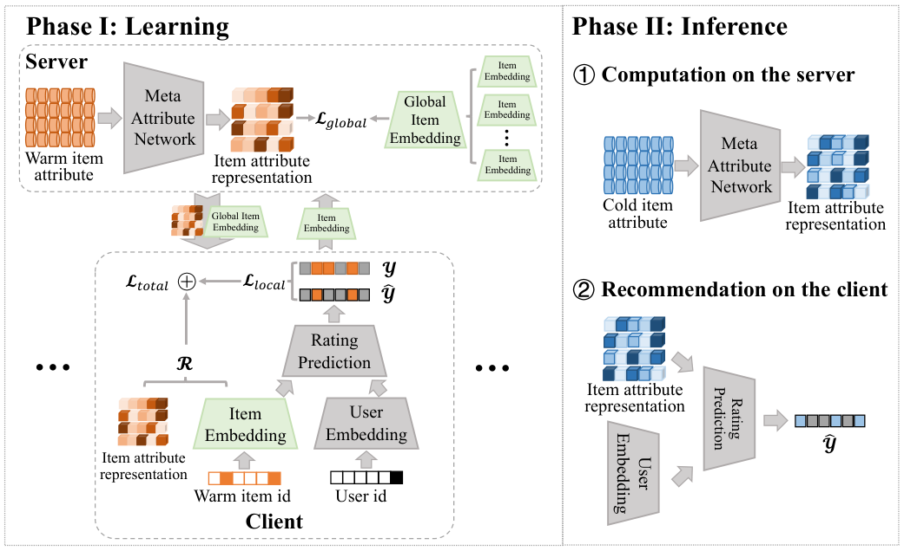
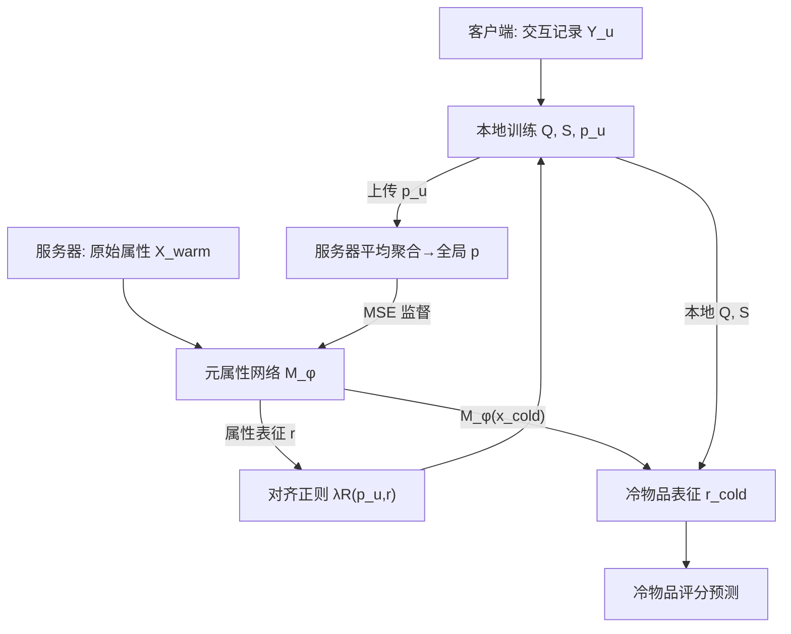

# When Federated Recommendation Meets Cold-Start Problem: Separating Item Attributes and User Interactions (当联邦推荐遇上冷启动：分离物品属性与用户交互)

- **会议/期刊**: WWW 2024 (Regular Paper)
- **作者与机构**: Chunxu Zhang, Bo Yang 等（吉林大学）；Guodong Long, Peng Yan（悉尼科技大学 AAII）；Tianyi Zhou（马里兰大学）
- **推荐链路定位**: 端到端联邦推荐（召回/打分一体）
- **研究方向**: 冷启动与长尾推荐 / 去偏公平、可信隐私与工业架构（联邦推荐）
- **论文原文**: [https://arxiv.org/abs/2305.12650v2](https://arxiv.org/abs/2305.12650v2)
- **开源代码**: [https://github.com/Zhangcx19/IFedRec](https://github.com/Zhangcx19/IFedRec)

## TL;DR (1分钟核心速览)

现有 FedRecSys 只对历史交互物品建模，冷启物品因无交互嵌入而无法被推荐；若把原始物品属性下发到客户端又会泄露商业机密与对抗风险。IFedRec 首次把「物品属性（服务器侧）」与「用户交互（客户端侧）」分成两套物品表征，服务器端用聚合物品嵌入作监督训练元属性网络、客户端加对齐正则把本地嵌入拉向属性表征，从而把"属性→用户偏好"的映射学到手。在 CiteULike、XING-5000/10000/20000 上，IFedNCF/IPFedRec 的 Recall@20 达 42.32/41.51，较最优联邦基线 FedVBPR 提升约 126%、较最优集中式基线 Heater 提升 13.86%。

## Background & Motivation (背景与核心矛盾)

- **主流范式**: 联邦推荐把每用户视作一个客户端、服务器只聚合共享模块（物品嵌入），用户嵌入与评分模块本地保留以保护交互隐私。
- **前人局限 1**: 冷启物品无任何交互记录，客户端学不到物品嵌入，服务器聚合的全局物品嵌入对其无定义，纯 zero-shot 场景直接失效。
- **前人局限 2**: 直觉解法是把服务器上的原始物品属性下发到每个客户端训练属性网络（图 1b），但属性是专家精心构造的商业资产，外泄既损商业价值又易被敌手对抗利用；且每客户端各拟合一份属性网络，参数量与算力浪费。
- **核心洞察 (Key Insight)**: 物品属性与用户交互是两种正交信息源，前者刻画物品本体、天然存放在服务器，后者刻画用户偏好、天然存放在客户端。只要学到"属性→偏好感知表征"的映射，冷物品仅凭属性即可映射到用户偏好空间打分。
- **本文切入点**: 服务器训练元属性网络，用客户端上传的聚合物品嵌入作监督信号；同时客户端把本地物品嵌入向服务器属性表征对齐，双向让两个表征空间重合。

## Method (核心方法设计)

### 1. 整体框架 (Overall Architecture)

IFedRec 分为学习与推理两阶段交替进行。**学习阶段**每轮交替：(1) 客户端本地用二元交叉熵更新用户嵌入 $Q$、评分模块$S$，再用全局物品嵌入$p$更新本地物品嵌入$p_u$；(2) 上传$p_u$到服务器平均聚合为全局$p$；(3) 服务器用 MSE 把$r=\mathcal{M}_\phi(X_{warm})$拟合到$p$，吸收用户偏好；(4) 客户端用对齐正则$\lambda R(p_u,r)$把$p_u$拉向属性表征、注入物品语义。**推理阶段**新物品到达，服务器用训练好的$\mathcal{M}_\phi$输出冷物品属性表征$r_{cold}$下发，客户端用本地$Q$、$S$ 直接打分，无需冷物品任何交互。整个流程保持"客户无属性、服务器无交互"的隐私边界。

<figure class="paper-figure" markdown="span">
  <figcaption>图2：IFedRec 的框架。在学习阶段，客户端将物品嵌入上传到服务器进行全局聚合，其他推荐模块保留在本地以捕捉用户个性化。在服务器端，我们设计了一个元属性网络，基于原始物品属性学习物品属性表示。此外，开发了一种物品表示对齐机制，以对齐两种物品表示，即 L𝑔𝑙𝑜𝑏𝑎𝑙 和 R。在推理阶段，服务器首先学习冷物品属性表示，然后每个客户端可进行个性化……</figcaption>
</figure>

### 2. 关键设计拆解 (Key Designs)

1. **服务器-客户端双物品表征与双向对齐**：冷物品无交互，其嵌入无从学起；本文改为两套并行表征——服务器侧 $r_v=\mathcal{M}_\phi(x_v)$由原始属性生成，客户端侧$p_u$由交互学得。服务器用 MSE 把$r$拟合到聚合的$p$：$\mathcal{L}(p;\phi)=\frac{1}{m}\sum_{v=1}^{m}(r_v-p(v))^2$；客户端在推荐损失上加对齐正则$\mathcal{L}_{total}:=\mathcal{L}_u(Y_{uv};\theta_u)+\lambda R(p_u,r)$。直觉：聚合$p$携带群体偏好、$r$携带属性语义，MSE 让$\mathcal{M}_\phi$学成"偏好感知属性表征"；客户端正则让本地$p_u$也贴近$r$，避免两个空间漂移，冷物品属性表征$r_{cold}$ 才能直接落到用户偏好空间中打分。

2. **元属性网络与冷启动推理**：$\mathcal{M}_\phi$是一个浅层全连接网络，服务器端用$\phi := \phi-\gamma\partial_\phi\mathcal{L}(p;\phi)$更新；推理时$\hat{Y}^{cold}_u = \mathcal{F}_\theta(X_{cold})$，其中"物品嵌入"槽位由$r_{cold}=\mathcal{M}_\phi(x_{cold})$填充，与热物品打分走同一套$Q$、$S$，从而跟本地个性化无缝衔接。

3. **训练目标、负采样与 LDP 推理效率**：整体是双层优化 $\min_{\{p_u,q_u,s_u\}}\sum_u \mathcal{L}_u(Y_u;p_u,q_u,s_u)+\lambda R(p_u,r)$s.t.$r:=\mathcal{M}_\phi(X_{warm})$。负采样：对每个用户从$\mathcal{I}_{warm}\setminus\mathcal{I}_u$中按交互数量比例均匀采样负样本。客户端零额外参数与计算（只加一项正则），服务器每轮仅做一次前向 + MSE。为进一步保护隐私，客户端上传前可加零均值拉普拉斯噪声$p_u:=p_u+\mathrm{Laplace}(0,\delta)$，服务器仅收到含噪物品嵌入，无法反推用户偏好。

## Experimental Setup & Evaluation Protocol (实验设置与评估协议)

- **数据集与预处理**:

| 数据集 | #Users | #Items | #Interactions | 稀疏度/密度 | 特征/场景说明 |
| :--- | :---: | :---: | :---: | :---: | :--- |
| CiteULike | 5,551 | 16,980 | ~20.4w | ~99.8% | 论文文字 + 标签属性 |
| XING-5000 | 5,000 | ~26k | 采样 | ~99.9% | 物品属性 + 社交 |
| XING-10000 | 10,000 | ~26k | 采样 | ~99.9% | 同上 |
| XING-20000 | 20,000 | ~26k | 采样 | ~99.9% | 同上 |

- **数据划分与防穿越 (Splitting Strategy)**: 遵循 Heater [47] 的预热/冷启划分。CiteULike 取 80% 物品为预热训练集、其余为冷启物品；冷启再抽 30% 作验证、剩 70% 作测试。XING 三个子集按 `6:1:3` 训练/验证/测试，测试集即冷启物品。
- **排名评测协议 (Ranking Protocol)**: 对全部冷启物品做**全排序**（测试集即所有未交互冷启物品，无采样），报告 `Recall@k`、`Precision@k`、`NDCG@k`，$k\in\{20,50,100\}$，统一乘$10^{-2}$。
- **对比基线与超参设置**: 联邦类：FedMVMF、CS_FedNCF、CS_PFedRec、FedVBPR、FedDCN；集中式类：Heater、GAR、CS_NCF、CS_MF。嵌入维 $d$、学习率$\eta_1,\eta_2,\gamma$等按附录 E 设定；$\lambda$ 通过网格搜索。

## Key Experimental Results (实验关键数据)

### 1. 主实验对比 (Main Results)

抽取 CiteULike 与 XING-10000 的 @20 指标（数值 ×10⁻²）：

| 方法 | 类型 | CiteULike R@20 | P@20 | N@20 | XING-10k R@20 | P@20 | N@20 |
| :--- | :---: | :---: | :---: | :---: | :---: | :---: | :---: |
| FedMVMF | Fed | 6.18 | 1.57 | 5.55 | 0.96 | 0.52 | 1.02 |
| CS_PFedRec | Fed | 1.37 | 0.33 | 1.40 | 0.29 | 0.19 | 0.35 |
| FedVBPR | Fed | 18.73 | 3.75 | 13.24 | 0.42 | 0.24 | 0.35 |
| FedDCN | Fed | 1.42 | 0.35 | 1.10 | 0.43 | 0.44 | 0.66 |
| Heater | Cen | 37.17 | 8.92 | 31.36 | 16.60 | 8.73 | 14.00 |
| CS_NCF | Cen | 29.41 | 7.06 | 24.93 | 21.80 | 11.72 | 17.58 |
| **IFedNCF (Ours)** | **Fed** | **42.32** | **9.70** | **34.29** | **26.97** | **14.38** | **21.65** |
| **IPFedRec (Ours)** | **Fed** | 41.51 | 9.48 | 33.48 | 25.92 | 13.84 | 20.66 |

对最优集中式基线（CiteULike 上的 Heater、XING-10k 上的 CS_NCF），IFedNCF 的 Recall/Precision/NDCG@20 分别提升 `+13.9% / +8.7% / +9.3%` 与 `+23.7% / +22.7% / +23.1%`；对最优联邦基线 FedVBPR，CiteULike 上 Recall@20 从 18.73 跃至 42.32（`+126%`）。

### 2. 消融实验 (Ablation Study)

| 变体 | CiteULike R@20 | XING-5k R@20 | XING-10k R@20 | XING-20k R@20 |
| :--- | :---: | :---: | :---: | :---: |
| IFedNCF | **42.32** | **23.48** | **26.97** | **26.36** |
| IFedNCF w/ LAN（属性网络下放客户端） | 38.73 | 1.59 | 0.86 | 1.54 |
| IFedNCF w/o ISAM（去对齐机制） | 0.85 | 0.55 | 0.32 | 0.25 |
| IPFedRec | **41.51** | **21.77** | **25.92** | **24.67** |
| IPFedRec w/ LAN | 38.73 | 2.00 | 0.58 | 0.18 |
| IPFedRec w/o ISAM | 1.05 | 0.27 | 0.42 | 0.46 |

**LDP 噪声鲁棒性**（CiteULike, @20）：

| 噪声强度 δ | 0 | 0.1 | 0.2 | 0.3 | 0.4 | 0.5 |
| :--- | :---: | :---: | :---: | :---: | :---: | :---: |
| IFedNCF Recall | 42.32 | 41.81 | 41.87 | 41.23 | 41.09 | 40.84 |
| IPFedRec Recall | 41.51 | 41.10 | 40.48 | 40.11 | 40.57 | 39.52 |

### 3. 关键实验发现 (Key Findings)

1. **对齐机制是决定性环节**：剥掉 ISAM 后 CiteULike Recall@20 从 42.32 崩到 0.85、XING 上跌至 0.25–0.55，说明"用聚合交互嵌入当监督 + 客户端正则回拉"缺一不可——没有它，元属性网络学到的属性表征完全无法被用户偏好空间消费。
2. **属性必须留在服务器端**：把属性网络下放到客户端（w/ LAN）不仅违反隐私边界，XING 上 Recall@20 还从 21.77/23.48 骤降到 1.59–2.00，CiteULike 上也跌 ~8.5%；说明服务器聚合得到的群体偏好监督是客户端本地属性网络不可复现的。
3. **隐私-性能存在清晰折中曲线**：$\delta$从 0 加到 0.5，IFedNCF 的 Recall@20 仅从 42.32 降到 40.84（-3.5%）；$\delta=0.2$是兼顾噪声强度与模型可用性的推荐工作点；$\lambda$最优分别为 1.0（IFedNCF）和 10.0（IPFedRec），$\lambda$ 过大时属性信息淹没本地偏好、性能反向下降。

## Highlights & Limitations (亮点、对比与审稿批判)

- **与代表作对比 (vs. Prior Work)**: 相比 FedVBPR（联邦版 VBPR，同样用属性特征），IFedRec 不向客户端下发原始属性，且服务器聚合让属性网络只训练一份；相比 Heater（集中式最优），IFedRec 保留了客户端个性化 Q、S 模块，CiteULike@20 反而领先 13.9%，同时不接触原始交互数据；相比 [32] 的联邦冷启方案（仍依赖新物品少量交互），本文实现严苛的 zero-shot 冷启。
- **可迁移亮点**: (1)「服务器表征 + 客户端表征 + 对齐正则」的双塔分离框架可直接迁移到联邦多模态冷启、联邦用户冷启等场景；(2) 对聚合物品嵌入加 LDP 噪声而保留服务器端属性网络干净的思路，是隐私预算花在"用户侧产物"上的好范例。
- **审稿级局限批判**: (1) 仅覆盖物品冷启，未处理用户冷启与属性分布漂移；(2) 全排序协议下缺少显著性检验、冷启物品数量对推理稳定性的量化分析；(3) 冷启阶段完全依赖 $\mathcal{M}_\phi$ 外推，属性缺失或属性模态异构时效果会显著退化。

## Rating (四维评分)

- **方法创新性 (Novelty)**: ⭐⭐⭐⭐ （首个联邦冷启框架，双表征分离 + 双向对齐的组合在场景上有开创意义，但组件本身（MSE 对齐 + L2 正则）相对标准）
- **评估协议与实验扎实度 (Protocol & Experiments)**: ⭐⭐⭐⭐ （4 数据集 × 联邦/集中式双类基线，含消融、超参、收敛、LDP 鲁棒性，覆盖完整；但缺少显著性检验与冷启物品数量敏感性分析）
- **写作与数学规范度 (Clarity & Rigor)**: ⭐⭐⭐⭐ （两阶段流程 + 双层优化公式清晰，$r$/$p$/$p_u$ 三层符号区分严谨，附录补齐算法细节）
- **工业落地与复现价值 (Industrial & Practical Value)**: ⭐⭐⭐⭐ （可插拔到 FedNCF、PFedRec 等现有 FedRecSys，客户端零额外参数与计算，服务器仅增一个浅层属性网络，且 LDP 可直接部署；开源可复现）

