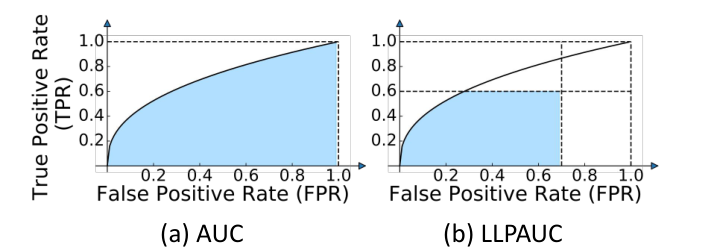
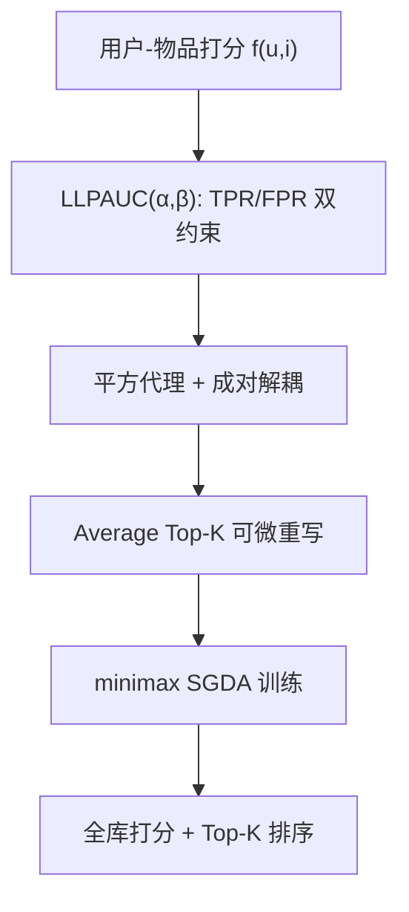

# Lower-Left Partial AUC: An Effective and Efficient Optimization Metric for Recommendation（左下部分AUC：面向推荐系统的高效有效优化指标）

- **会议/期刊**: WWW 2024
- **作者与机构**: Wentao Shi, Chenxu Wang, Fuli Feng, Yang Zhang, Wenjie Wang, Junkang Wu, Xiangnan He；中国科学技术大学、新加坡国立大学
- **推荐链路定位**: 精排（训练目标/损失函数）
- **研究方向**: 协同过滤与双塔召回 / 噪声鲁棒优化（交叉）
- **论文原文**: [论文原文链接](https://arxiv.org/abs/2403.00844v1)
- **开源代码**: [开源代码仓库链接](https://github.com/swt-user/LLPAUC)

## TL;DR (1分钟核心速览)

针对Top-K指标难优化、AUC与Top-K目标错位的问题，本文提出LLPAUC：只取ROC左下角、同时约束TPR≤α与FPR≤β的部分AUC，理论上给出比OPAUC更紧的Recall@K/Precision@K界，并推导出与BPR/BCE同复杂度的点式minimax损失。在三个数据集全库排序、Recall/NDCG@20下，MF backbone较最强基线最高提升11.79%（NDCG），噪声训练下仍领先。

## Background & Motivation (背景与核心矛盾)

- **主流范式**: 推荐系统常用BCE优化Accuracy、BPR优化AUC，或用Softmax/OPAUC类损失间接逼近Top-K排序；NDCG@K/Recall@K虽对齐目标，但不可微且全库排序开销大。
- **前人局限**: AUC对所有正负样本对一视同仁，大量低分负样本稀释了Top-K优化信号；OPAUC只约束FPR，未过滤低分噪声正样本，面对隐式反馈假阳性时仍易过拟合。
- **核心洞察 (Key Insight)**: 若同时截断TPR与FPR，LLPAUC只度量“高分正样本 vs 高分负样本”的排序质量，天然聚焦Top-K，并把难拟合的噪声正样本排除在损失之外。
- **本文切入点**: 用双约束部分AUC替代全局AUC/单边OPAUC，并设计可微分、点式、mini-batch可优化的替代损失。

<figure class="paper-figure" markdown="span">
  <figcaption>图 1：(a) AUC 衡量 ROC 曲线下的整个面积；(b) LLPAUC 考虑左下角；(c) 与 AUC 相比，LLPAUC 仅考虑排名靠前项目的排序。</figcaption>
</figure>

## Method (核心方法设计)

### 1. 整体框架 (Overall Architecture)

输入用户-物品打分 $f_{u,i}$后，LLPAUC先按用户内正/负样本分数分布确定阈值$\eta_\alpha,\eta_\beta$，仅保留高分正样本与高分负样本参与排序；随后用平方代理损失替换不可微指示函数，将成对比较解耦为点式项，再用Average Top-K技巧把硬截断改写为可微minimax形式，最后以SGDA交替更新模型参数与辅助变量。推理阶段不增加额外打分开销，仍按backbone全库排序取Top-K。

### 2. 关键设计拆解 (Key Designs)

1. **双约束左下部分AUC（LLPAUC）**：痛点起因是AUC把低分负样本也纳入优化、OPAUC只看FPR。LLPAUC定义为
$\mathrm{LLPAUC}(\alpha,\beta)=\frac{1}{|\mathcal{U}|}\sum_{u\in\mathcal{U}}\Pr_{i\sim\mathcal{I}_u^+,j\sim\mathcal{I}_u^-}[f_{u,i}>f_{u,j},\,f_{u,i}\ge\eta_\alpha,\,f_{u,j}\ge\eta_\beta]$，
其中 $\Pr[f_{u,i}\ge\eta_\alpha]=\alpha$、$\Pr[f_{u,j}\ge\eta_\beta]=\beta$。显然$\mathrm{AUC}=\mathrm{LLPAUC}(1,1)$、$\mathrm{OPAUC}(\beta)=\mathrm{LLPAUC}(1,\beta)$。当$\alpha=K/n^+,\beta=K/n^-$时，LLPAUC对Recall@K/Precision@K给出双侧界，且比OPAUC更紧；例如$\mathrm{Recall@K}\le \frac{1}{n^+}\sqrt{n^+n^-\mathrm{LLPAUC}}$。物理直觉是：双截断把优化焦点压到Top-K邻域，TPR约束还过滤低分噪声正样本。

2. **成对损失解耦为点式minimax**：将 $\mathbb{I}[f_{u,i}>f_{u,j}]$替换为满足一致性的平方代理$\ell(x)=(1-x)^2$，并引入$a,b,\gamma$ 解耦正负项，得到
$\min_{\theta,(a,b)\in[0,1]^2}\max_{\gamma\in[-1,1]}\frac{1}{|\mathcal{U}|}\sum_u\left[\frac{1}{n_u^+}\sum_i\ell^+(f_{u,i})\mathbb{I}[f_{u,i}\ge\eta_\alpha]+\frac{1}{n_u^-}\sum_j\ell^-(f_{u,j})\mathbb{I}[f_{u,j}\ge\eta_\beta]-\gamma^2\right]$，
其中 $\ell^+(f)=(f-a)^2-2(1+\gamma)f$，$\ell^-(f)=(f-b)^2+2(1+\gamma)f$。这样成对项变成点式项，可直接mini-batch训练。

3. **Average Top-K重写与训练目标**：硬阈值指示仍不可微，作者把选择项改写为
$\sum_i\ell^+(f_{u,i})\mathbb{I}[f_{u,i}\ge\eta_\alpha]=\max_{s^+}\sum_i[-\alpha s^+-[-\ell^+(f_{u,i})-s^+]_+]$，
负样本侧对称地用 $\min_{s^-}$表示；再用softplus$r_\kappa$平滑$[x]_+$，最终得到
$\min_{\theta,a,b,s^-}\max_{\gamma,s^+}\frac{1}{|\mathcal{U}|}\sum_u\{\frac{1}{n_u^+}\sum_i[-\alpha s^+-r_\kappa(-\ell^+(f_{u,i})-s^+)]+\frac{1}{n_u^-}\sum_j[\beta s^-+r_\kappa(\ell^-(f_{u,j})-s^-)]-(w+1)\gamma^2\}$。
$\kappa\to\infty$时$r_\kappa(x)\to[x]_+$，优化渐近无偏。总损失即上式，用SGDA求解；训练每正样本采100个负样本，推理不增开销，单次迭代复杂度与BPR/BCE同阶。

## Experimental Setup & Evaluation Protocol (实验设置与评估协议)

- **数据集与预处理**: 原文未给全量统计，下表仅列可核实信息；Adressa以dwell time<10s为噪声，Yelp/Amazon-book以评分<3为噪声。

| 数据集 | #Users | #Items | #Interactions | 稀疏度/密度 | 特征/场景说明 |
| :--- | :---: | :---: | :---: | :---: | :--- |
| Adressa | 未报告 | 未报告 | 未报告 | 未报告 | 新闻点击；短停留为噪声 |
| Yelp | 未报告 | 未报告 | 未报告 | 未报告 | 餐厅评分；1–5星 |
| Amazon-book | 未报告 | 未报告 | 未报告 | 未报告 | 图书评分；长尾明显 |

- **数据划分与防穿越 (Splitting Strategy)**: clean training先过滤噪声，再按[35]划分train/val/test；noise training固定同一测试集，仅向训练/验证注入同规模噪声；未见全局时间戳切分。
- **排名评测协议 (Ranking Protocol)**: 无偏 `Full-Ranking` 全库未交互排序，报告Recall@20、NDCG@20；训练阶段每正样本采100负样本，测试不做负采样。
- **对比基线与超参设置**: backbone为MF与LightGCN；基线含BCE、BPR、SCE、CCL、DNS(M,N)、Softmax_v(ρ,N)、PAUCI(OPAUC)，噪声实验加RCE/TCE。Adam lr=1e-3、batch=128；α∈{0.1,…,0.9}，β∈{0.01,0.02,0.05,0.1,0.2,0.5,0.7,0.9}；三次重复取均值，未报告显著性检验。

## Key Experimental Results (实验关键数据)

### 1. 主实验对比 (Main Results)

表1 MF backbone、干净训练主结果（Full-Ranking，K=20；均值，std见原文）。

| 方法 | Adressa R@20 | Adressa N@20 | Yelp R@20 | Yelp N@20 | Amazon R@20 | Amazon N@20 |
| :--- | :---: | :---: | :---: | :---: | :---: | :---: |
| BCE | 0.1573 | 0.0793 | 0.0814 | 0.0448 | 0.0663 | 0.0363 |
| BPR | 0.1800 | 0.0991 | 0.0647 | 0.0358 | 0.0695 | 0.0384 |
| SCE | 0.2001 | 0.1057 | 0.0762 | 0.0425 | 0.0894 | 0.0507 |
| CCL | 0.1956 | 0.0911 | 0.0842 | 0.0486 | 0.0944 | 0.0551 |
| DNS(M,N) | 0.1877 | 0.0965 | 0.0856 | 0.0489 | 0.1012 | 0.0580 |
| Softmax_v(ρ,N) | 0.1849 | 0.0949 | 0.0824 | 0.0470 | 0.1024 | 0.0592 |
| PAUCI(OPAUC) | 0.2021 | 0.1086 | 0.0821 | 0.0479 | 0.0991 | 0.0549 |
| **LLPAUC** | **0.2166** | **0.1214** | **0.0884** | **0.0505** | **0.1076** | **0.0612** |
| **Improv.% vs best** | **+7.17%** | **+11.79%** | **+3.27%** | **+3.27%** | **+5.08%** | **+3.38%** |

### 2. 消融实验 (Ablation Study)

表2 去掉TPR/FPR约束的消融（MF，clean；AUC用BPR代理，OPAUC用PAUCI代理）。

| 变体 | Adressa R@20 | Adressa N@20 | Yelp R@20 | Yelp N@20 | Amazon R@20 | Amazon N@20 |
| :--- | :---: | :---: | :---: | :---: | :---: | :---: |
| w/o TPR&FPR: AUC(BPR) | 0.1800 | 0.0991 | 0.0647 | 0.0358 | 0.0695 | 0.0384 |
| w/o TPR: OPAUC(PAUCI) | 0.2021 | 0.1086 | 0.0821 | 0.0479 | 0.0991 | 0.0549 |
| Full LLPAUC | **0.2166** | **0.1214** | **0.0884** | **0.0505** | **0.1076** | **0.0612** |

### 3. 关键实验发现 (Key Findings)

- **双约束均有增益，Adressa最显著**：去掉TPR约束（OPAUC）使Adressa Recall从0.2166降至0.2021（-6.7%）、NDCG从0.1214降至0.1086（-10.5%）；再去FPR约束（AUC）进一步跌至0.1800/0.0991，说明TPR与FPR截断互补。
- **对Top-K的对齐优于OPAUC/AUC**：在三个数据集上LLPAUC均优于PAUCI(OPAUC)与BPR(AUC)，Adressa NDCG较PAUCI提升11.79%，Yelp/Amazon分别提升3.27%/3.38%，与理论“更紧界”一致。
- **噪声训练下仍领先且最优α左移**：MF噪声训练Adressa LLPAUC Recall=0.2127，高于SCE的0.1938（+9.75%）；Amazon 0.0998 vs RCE 0.0965（+3.42%）；最优α由clean的0.9降至noise的0.8，说明TPR约束越紧、越能过滤低分噪声正样本。

## Highlights & Limitations (亮点、对比与审稿批判)

- **与代表作对比 (vs. Prior Work)**: BPR优化全局AUC，PAUCI/OPAUC只约束FPR，pAp@K只是LLPAUC的特例；本文首次把TPR与FPR双截断统一进部分AUC，并给出比OPAUC更紧的Top-K界与抗噪解释。
- **可迁移亮点**: Average Top-K技巧可把任意硬Top截断改写成可微minimax；α/β可作为“Top-K聚焦度/去噪强度”旋钮，按K与噪声水平调节。
- **审稿级局限批判**: ①α、β需网格搜索，理论设定α=K/n+、β=K/n-依赖已知n+/n-，线上全库规模下调参成本高；②只过滤低分噪声正样本，不能完全去噪，且minimax/SGDA引入额外辅助变量与训练稳定性问题；③仅三个数据集、无显著性检验与线上A/B，统计报告亦不完整。

## Rating (四维评分)

- **方法创新性 (Novelty)**: ⭐⭐⭐⭐ （双约束LLPAUC及更紧Top-K界有理论新意，但优化框架延续PAUCI的Average Top-K思路）
- **评估协议与实验扎实度 (Protocol & Experiments)**: ⭐⭐⭐⭐ （三数据集、clean/noise、Full-Ranking、双backbone，但缺显著性检验与数据集统计）
- **写作与数学规范度 (Clarity & Rigor)**: ⭐⭐⭐⭐ （定义、定理与损失推导清晰，minimax与Average Top-K部分较密）
- **工业落地与复现价值 (Industrial & Practical Value)**: ⭐⭐⭐⭐ （开源、推理零额外开销、训练复杂度同BPR/BCE，但α/β调参和训练稳定性需工程处理）

