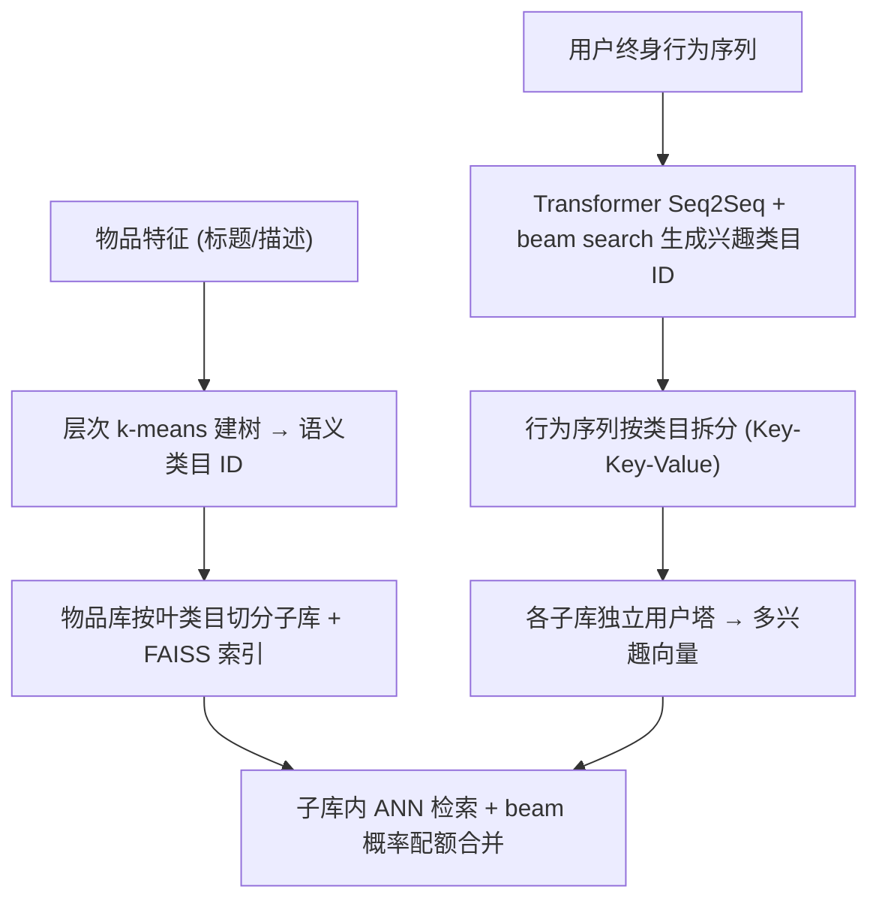

# RimiRec: Modeling Refined Multi-interest in Hierarchical Structure for Recommendation (层次化细粒度多兴趣推荐建模)

- **会议/期刊**: WWW 2024 (4 pages, short paper / industry track)
- **作者与机构**: Haolei Pei, Yangping Zhu, Yuan Nie (网易 NetEase)；Yuanyuan Xu (东南大学，网易实习)
- **推荐链路定位**: 召回 (Candidate Generation / EBR 双塔检索)
- **研究方向**: 协同过滤与双塔召回 / 生成式推荐与离散语义 ID
- **论文原文**: [https://arxiv.org/abs/2402.01253v3](https://arxiv.org/abs/2402.01253v3)
- **开源代码**: 暂未开源

## TL;DR (1分钟核心速览)

现有双塔多兴趣召回（MIND/ComiRec）把用户所有行为硬压成 K 个向量，忽略兴趣本身的**层次性**（"动画 → 日漫 → 名侦探柯南 → 柯南/怪盗基德"），细粒度兴趣被平均化稀释；Divide&Conquer 虽切了物品库却仍用同一条序列产出所有子库查询。RimiRec 两阶段破局：①对物品层次 k-means 建树得到**语义类目 ID**，用 Transformer seq2seq + beam search 直接生成用户多层兴趣路径；②按叶子类目切分子库，并用 Key-Key-Value 结构把用户长序列按类目拆分，各子库独立训练用户塔做 ANN 检索。在 ML-1M / Lofter 的 Top-M 全库召回协议下 Recall@20 提升 17.8%、Recall@500 提升 24.7%，Lofter 线上 A/B 互动率 +2.00%。

## Background & Motivation (背景与核心矛盾)

- **主流范式**: 多兴趣召回用 capsule 路由 (MIND) 或多头注意力 (ComiRec) 从一条用户序列推断 K 个兴趣向量，再在**整个**物品库上做 ANN 检索。
- **前人局限**: (1) 兴趣数 K 固定且扁平，无法表达"上层大类兴趣 + 下层角色级细粒度兴趣"的层级包含关系，细粒度信号在平均池化中被抹平；(2) 长生命周期行为序列噪声极大，粒度越细兴趣越稀疏，统一序列难以学到角色级表征。
- **核心洞察 (Key Insight)**: 内容社区 (Lofter) 天然存在用户自组织的"圈子—子圈子"内容流结构，且**上层圈子的内容是子圈子内容的混合**——物品侧的层次结构与用户侧兴趣层次是同构的，可先对物品建树，再让模型"预测用户会落到哪条树路径"。
- **本文切入点**: 把"多兴趣挖掘"转化为"层次语义类目 ID 生成"，把"多兴趣检索"转化为"按圈划分子库的条件检索"。

## Method (核心方法设计)

### 1. 整体框架 (Overall Architecture)

物品先经层次 k-means 递归聚类成树，叶路径即语义类目 ID；用户长期+短期行为序列送入 Transformer Encoder，Decoder 以 early-stop 生成任意长度（任意层级）的类目 ID，beam search 得兴趣集合 $L_u$。第二阶段把物品库按叶类目切为子库，用户终身序列按 `(user, category ID, items)` 的 Key-Key-Value 拆成多条子序列，各训练一个用户塔产出多向量，仅在对应子库内 ANN 检索，最后按 beam 概率配额合并各子库结果。

### 2. 关键设计拆解 (Key Designs)

1. **层次语义类目 ID 生成（取代固定 K 个兴趣簇）**：痛点是把所有物品压进 $k$个簇时，"柯南"与"海贼王"同级，"日漫"与"美剧"也同级。做法是递归 k-means：簇内物品数$>c$则继续分裂，第$i$层簇编号$r_i\in[0,k-1]$，叶路径$l=\{r_1,\dots,r_m\}$，且每个物品同时持有所有前缀路径$l'=\{r_1,\dots,r_p\},1\le p\le m$作为多粒度类目 ID。关键是**不同层的同一数字被编码为不同 token**（$t_{(2,4)}\neq t_{(3,4)}$），使 Decoder 能区分层级语义。

2. **生成式兴趣推断 + 早停自适应层级**：Decoder 逐位生成路径，early-stop 让模型自行决定该兴趣停在"动画"这一粗层还是深入到"柯南"这一角色层：
$$P(l'|\boldsymbol{s}_u)=\prod_{i=1}^{p}P\left(r_i\mid \boldsymbol{h},r_1,\dots,r_{i-1}\right),\quad \boldsymbol{h}=\mathrm{Encoder}(\boldsymbol{s}_u)$$
训练时 $p=m$（叶层），推理时对前缀树做 beam search 得$L_u$。直觉：兴趣越集中，生成路径越深；兴趣越泛化，越早停止——层级深度成为兴趣强度的隐式度量。

3. **分区检索、难负样本与推理开销**：把库切为 $\{\mathcal{I}_1,\dots,\mathcal{I}_{|L_u|}\}$，用户序列按类目拆分为$\mathcal{I}_{u}^{l'_n}$，各子序列独立编码。损失只在**同类目子库内**采样负样本（天然难负样本）：
$$\mathcal{L}=-\sum_{u}\sum_{n=1}^{|L_u|}\sum_{i^+\in \mathcal{I}_u\cap\mathcal{I}_n}\left[\log\sigma(r_{ui^+})+\mathbb{E}_{i^-\sim\mathcal{I}_n\setminus\mathcal{I}_u}\log\left(1-\sigma(r_{ui^-})\right)\right]$$
物品向量离线预计算并建 FAISS 索引，线上只实时跑 $|L_u|$ 个轻量用户塔，检索复杂度随子库规模而非全库规模增长，且拆序列同时起到长序列噪声过滤作用。

## Experimental Setup & Evaluation Protocol (实验设置与评估协议)

| 数据集 | #Users | #Items | #Interactions | 稀疏度 | 特征/场景说明 |
| :--- | :---: | :---: | :---: | :---: | :--- |
| ML-1M | 6,040 | 3,411 | 892,458 | 4.3% | 电影评分，仅用行为序列（不用 user ID） |
| LofterData | 12,000 | 798,949 | 808,619 | 0.008% | 网易 Lofter 15 天日志，已过滤点击数<20、日互动<5 的用户 |

- **数据划分与防穿越**: ML-1M 按**用户随机 80%/20% 划分**（非时间切分）；LofterData 取 15 天日志，**第 15 天数据留作测试**（时间切分，无穿越）。
- **排名评测协议**: 面向检索的 **Top-M 候选召回协议**——各方法在全库（或其子库）内 ANN 取 Top-$M$，在后续$N$个不重叠行为上算 `Recall@M` 与 `HitRate@M`；$M\in\{20,50\},N=10$(ML-1M)，$M\in\{500,1000\}$、$N\approx25.3$ (Lofter)。未使用采样式负样本排序，评估覆盖全库物品池。
- **对比基线与超参**: 基线为 MIND (capsule 路由)、ComiRec-SA (多头注意力)、Divide&Conquer (库切分 + 单一序列)；$k=4/6$、递归终止阈值$c=250$(ML-1M)/$100{,}000$(Lofter)，叶圈数 28/176；线上 A/B 覆盖 >10% 用户、为期一月，$p<0.05$。

## Key Experimental Results (实验关键数据)

### 1. 主实验对比 (Main Results)

| Method | ML-1M R@20 | ML-1M H@20 | ML-1M R@50 | ML-1M H@50 | Lofter R@500 | Lofter H@500 | Lofter R@1000 | Lofter H@1000 |
| :--- | :---: | :---: | :---: | :---: | :---: | :---: | :---: | :---: |
| MIND | 4.557 | 23.372 | 11.605 | 43.294 | 24.754 | 61.158 | 38.719 | 71.660 |
| ComiRec-SA | 7.744 | 44.238 | 17.165 | 65.820 | 26.010 | 61.467 | 40.410 | 70.156 |
| Divide&Conquer | 7.107 | **48.014** | 15.465 | 69.889 | 27.722 | **68.035** | 44.965 | **75.950** |
| RimiRec-2beams | 9.119 | 50.878 | 19.263 | 73.542 | 32.428 | 66.332 | 46.581 | 72.781 |
| RimiRec-4beams | 9.401 | 51.975 | 20.498 | 76.176 | 37.083 | 66.561 | 59.376 | 73.667 |
| **RimiRec-6beams** | **9.461** | 52.571 | **20.630** | **76.207** | **39.978** | 67.740 | **65.430** | 73.748 |
| Improv. (2beam vs ComiRec) | +17.8% | +15.0% | +12.2% | +11.7% | +24.7% | +7.9% | +15.3% | +3.7% |

### 2. 消融实验 (Ablation Study)

| 配置 (Lofter, 2beams) | Recall@500 | Recall@1000 | 相对完整模型 |
| :--- | :---: | :---: | :---: |
| RimiRec 完整 | **32.428** | **46.581** | — |
| w/o sub-libraries（全库 ANN 而非对应子库） | 30.028 | 44.590 | −8.0% / −4.5% |
| w/o behavior splitting（统一序列而非分域序列） | 31.061 | 45.534 | −4.4% / −2.3% |

线上 A/B（对照组 = 已部署的 ComiRec）：User Activity **+0.31%**、Click **+0.76%**、Engagement **+2.00%**、Retention **+0.45%**、Diversity **+1.26%**，均 $p<0.05$。

### 3. 关键实验发现 (Key Findings)

1. **兴趣数量的边际收益递减但仍显著**：Lofter 上 beam 2→6 让 Recall@1000 从 46.581 跃到 65.430（+40.5%），而 Recall@500 仅从 32.428 到 39.978（+23.3%），说明更多 beam 主要补回"长尾深层兴趣"，但也提示 K 越大单兴趣样本越稀疏。
2. **性能增益主要来自检索空间分区，而非序列拆分**：去掉子库检索掉 8.0%，去掉序列拆分仅掉 4.4%；作者自陈离线集中单类目序列过短、特征稀疏，拆序列优势被压缩——这与线上 +2.00% 互动率的更大收益形成对照，说明终身序列越长、拆分收益越大。
3. **Recall 与 HitRate 存在明确的权衡**：Divide&Conquer 因在近乎全部子库并行检索而拿到最高 HitRate@500 (68.035)，但 Recall@500 仅 27.722，被 RimiRec-6beams (39.978) 大幅超越；说明"广撒网"命中率高但候选质量差，按生成兴趣定向分区在候选命中质量上更优。

## Highlights & Limitations (亮点、对比与审稿批判)

- **与代表作对比**: vs. **MIND/ComiRec**——本质区别是把"从序列抽 K 个向量"改为"生成物品树上的路径"，兴趣数量与层级长度由 beam + early-stop 自适应决定而非预设；vs. **Divide&Conquer**——D&C 切库但所有子库共享同一用户序列与同一兴趣表征，RimiRec 额外做到"一库一序列一塔"，并用 beam 概率做配额合并，因此候选更精而非更全。
- **可迁移亮点**: (1) 「层级 k-means 路径 + 分层去重 token 化」可直接复用到内容社区/电商的类目树召回，无需训练量化的 RQ-VAE 码本，工程成本极低；(2) 「同子库采样负样本」天然构成难负样本，几乎零代价提升了细粒度区分度。
- **审稿级局限批判**: (1) ML-1M 仅 3.4K 物品却用 $M=20/50$的 Top-M 协议，与全库 3.4K 的规模不匹配，Recall 绝对值偏低（<10%），且用户随机划分而非时间划分，存在行为穿越风险；(2) 类目树完全依赖离线 k-means 与超参$(k,c)$，物品冷启动需重新聚类并重建 ID 空间与索引，增量更新代价未讨论；(3) 线上只报了相对提升、无置信区间与样本量，且 Lofter 物品数 (798,949) 远大于交互数 (808,619)，每物品平均仅 1 次交互，离线评估的稀疏性使结论外推需谨慎。

## Rating (四维评分)

- **方法创新性 (Novelty)**: ⭐⭐⭐⭐ （把层次聚类路径当作生成式语义 ID，用 early-stop 让兴趣层级自适应，思路简洁且有清晰物理直觉，但各组件均为成熟技术的巧妙拼接）
- **评估协议与实验扎实度 (Protocol & Experiments)**: ⭐⭐⭐⭐ （离线双数据集 + 完整消融 + 一月线上 A/B 且 $p<0.05$ 齐全，但 ML-1M 划分方式与 Top-M 协议规模不匹配扣分）
- **写作与数学规范度 (Clarity & Rigor)**: ⭐⭐⭐⭐ （两阶段公式与算法 1 表述清楚，token 层级歧义的说明尤其到位；但缺少复杂度分析与 beam/聚类超参敏感性分析）
- **工业落地与复现价值 (Industrial & Practical Value)**: ⭐⭐⭐⭐ （已在 Lofter 主场景全量部署，物品塔离线、用户塔轻量、FAISS 子库分片，工程可复制性强；可惜未开源代码与预处理脚本）

