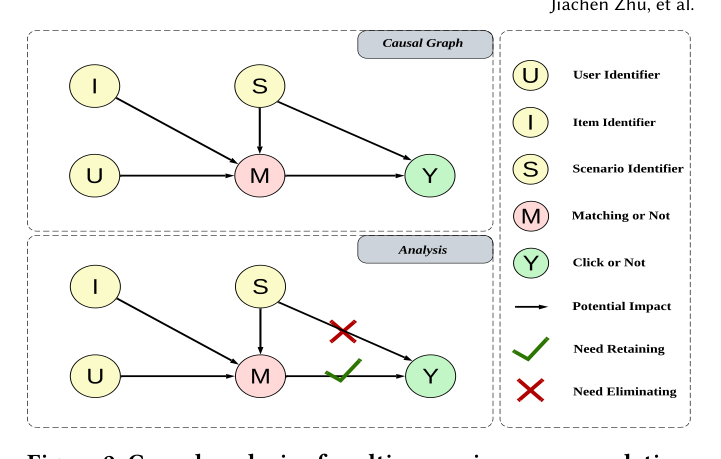
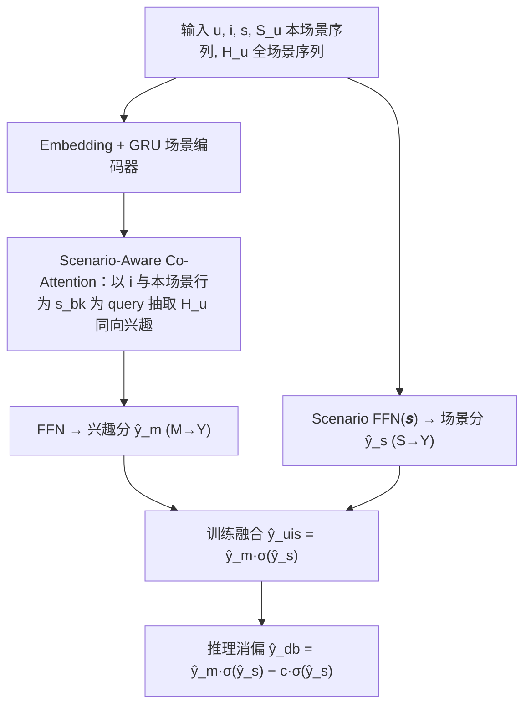
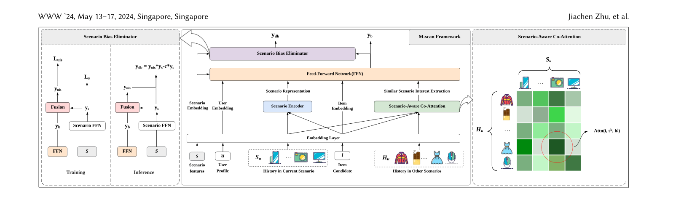

# M-scan: A Multi-Scenario Causal-driven Adaptive Network for Recommendation（多场景因果驱动自适应推荐网络）

- **会议/期刊**: WWW 2024 (The Web Conference)
- **作者与机构**: Jiachen Zhu, Jianghao Lin, Jiarui Qin, Weinan Zhang, Yong Yu（上海交通大学）；Yichao Wang, Ruiming Tang（华为诺亚方舟实验室）
- **推荐链路定位**: 精排（多业务场景统一 CTR 预估）
- **研究方向**: 跨域与多场景推荐 / 去偏与可信推荐
- **论文原文**: [https://arxiv.org/abs/2404.07581v2](https://arxiv.org/abs/2404.07581v2)
- **开源代码**: [https://github.com/Gebro13/M-scan](https://github.com/Gebro13/M-scan)（另有 MindSpore 版本）

## TL;DR (1分钟核心速览)

M-scan 瞄准多场景推荐的两个痛点：一是 MMOE/PLE 一类专家网络只做**隐式**知识迁移、难训练且用户表征不全；二是直接把其他场景的点击标签拿来训练本场景，忽略了场景本身（曝光位置、尺寸、视窗）对点击的**直推影响**，会把"用户没看见"误判成"用户不喜欢"。作者用因果图把场景效应拆成 $S\to M\to Y$与$S\to Y$两路，分别用场景感知共注意力（显式抽取跨场景同向兴趣）与反事实消偏器（推理期减掉$S\to Y$）处理。在 Aliccp(3 场景) 与 Cloud Theme(355 场景) 上，全场景 AUC 达 0.6714 / 0.7608，相对最佳基线提升 2.13% / 0.96%（$p<0.05$）。

## Background & Motivation (背景与核心矛盾)

- **主流范式**: 用一套统一网络同时服务多场景，靠共享专家 + 场景私有专家（MMOE、PLE、STAR、AESM2）或元学习动态权重（M2M）在架构层面做知识迁移。
- **前人局限**: ①只做隐式建模，参数多、收敛难，且没有在用户粒度上显式刻画"用户在本场景到底想买什么"，导致表征不完整；②分析因果图后发现 $S\to Y$ 这条直推边被完全忽略——某场景位次靠边、尺寸偏小时，用户即便喜欢该物品也不会点击，这样的样本被当作真负例训练会系统性压低该场景物品的分数。
- **核心洞察 (Key Insight)**: 场景的总效应可分解为 $TE=E_{S\to Y}+E_{M\to Y}$；线上推理是**场景内排序**，同一场景下$S\to Y$ 对所有候选项是常数，不影响相对序，因此推理时必须把它减掉，只保留用户兴趣通道。
- **本文切入点**: 一个模块专门显式抽取 $M\to Y$，一个模块用反事实相减剔掉$S\to Y$。

<figure class="paper-figure" markdown="span">
  <figcaption>图2：多场景推荐的因果分析。</figcaption>
</figure>

## Method (核心方法设计)

### 1. 整体框架 (Overall Architecture)

输入五元组：用户画像 $u$、候选物品$i$、场景特征$s$、本场景历史行为$S_u$、全场景历史行为$H_u$。$S_u$经 Embedding 后送入 GRU 场景编码器得到$h_{N_u^s}$（本场景兴趣锚点）；$H_u$与$i$、$S_u$一起进入场景感知共注意力，加权聚合得到跨场景同向兴趣$\boldsymbol{R}_h$；两者与$u,i,s$拼接后经 FFN 输出兴趣分$\hat{y}_m$。同时另起一支 Scenario FFN 只吃场景特征$s$输出$\hat{y}_s$，拟合$S\to Y$。训练时二者相乘重建真实点击，推理时减去反事实项得到无偏分。整套结构是单塔的，**不为每个场景开专家**，因此场景数上百也不爆炸。

<figure class="paper-figure" markdown="span">
  <figcaption>图3：M-scan 的整体示意图。</figcaption>
</figure>

### 2. 关键设计拆解 (Key Designs)

1. **场景感知共注意力 SACA（让"别的场景里像我的行为"浮出来）**：常规 target attention 以候选物品为 query 对 $H_u$打分（$\beta_j=\mathrm{softmax}_j\,\mathrm{Attn}(\boldsymbol{h}_{b_j},\boldsymbol{i})$），但多场景下$H_u$混杂着与当前场景无关的兴趣，单靠物品无法分辨"这条行为属于哪类场景"。M-scan 把本场景序列也塞进 query 做共注意力矩阵，再对$k$ 维取 max-pooling：
$C_{jk}=\mathrm{FFN}([\boldsymbol{h}_{b_j}\oplus\boldsymbol{i}\oplus\boldsymbol{s}_{b_k}]),\quad c_j=\mathrm{MP}(\{C_{jk}\}_{k=1}^{N_u^s}),\quad \boldsymbol{R}_h=\sum_{j}\beta_j\boldsymbol{h}_{b_j}$
直觉是：只要某条跨场景行为与当前场景中**任意**一次真实行为高度相关，就说明它落在同一兴趣分布里，取 max 而非 mean 避免被大量无关行为稀释。

2. **场景偏置消除器 SBE（反事实相减去掉 $S\to Y$）**：由因果图定义总效应$TE=Y_{S,M}-Y_{s^*,m^*}$、场景直推效应$E_{S\to Y}=Y_{S,m^*}-Y_{s^*,m^*}$，两者相减即得纯兴趣效应：
$E_{M\to Y}=TE-E_{S\to Y}=Y(S=s,M=m)-Y(S=s,M=m^*)$其中$m^*$为把用户兴趣置为反事实参考态。落到打分上：训练时用$\hat{y}_{uis}=\hat{y}_m\cdot\sigma(\hat{y}_s)$ 重建真实点击，推理时用
$\hat{y}_{db}=\hat{y}_m\cdot\sigma(\hat{y}_s)-c\cdot\sigma(\hat{y}_s)$减掉场景常数项。物理直觉：若$s_1$位次优于$s_2$使$\hat{y}_{s_1}\gg\hat{y}_{s_2}$，减去后反而让原本分低的$s_2$ 反超——这正是"在不利场景下仍然点进来，说明是真爱"。

3. **训练目标与推理开销**：$\mathcal{L}_{final}=\mathcal{L}_{uis}+\alpha\mathcal{L}_{s}$，两路均为逐样本交叉熵，**无负采样**（CTR 式点级监督）。$\alpha$控制辅助场景分支权重。推理只需一次 GRU + 一次对$|H_u|$ 的共注意力前向，额外开销仅一个标量 FFN，相对主模型可忽略。

## Experimental Setup & Evaluation Protocol (实验设置与评估协议)

- **数据集与预处理**: 两个公开多场景 CTR 数据集。原文正文未列 #Users/#Items/#Interactions 与过滤规则，统计口径放在附录 A.1，此处如实标注：

| 数据集 | #Scenarios | #Users / #Items / #Interactions | 场景说明 | 指标 |
| :--- | :---: | :---: | :--- | :--- |
| Aliccp | 3 | 正文未给（见原文附录 A.1） | 阿里广告点击，3 个曝光位场景 | AUC / RelaImpr |
| Cloud Theme | 355 | 正文未给（见原文附录 A.1） | 云主题多列表，仅展示随机抽取的 3 个场景 | AUC / RelaImpr |

- **数据划分与防穿越 (Splitting Strategy)**: 正文未明确说明是 `Leave-One-Out`、比例划分还是时间戳切分（同样下放至附录 A.1），亦未见冷启动划分；这是复现时需要自行确认的一处空白。
- **排名评测协议 (Ranking Protocol)**: **非列表级排序**。采用逐样本二分类 CTR 的 `AUC`，并报告 `RelaImpr = (AUC - AUC_base)/AUC_base × 0.5`；`#All` 行的 RelaImpr 以 Mix 为基准，单场景行以 Single 为基准。无 Full-Ranking / Sampled Ranking 的召回式评估。
- **对比基线与超参设置**: 基线覆盖 Single、Mix、Shared Bottom、Finetune、MMOE、PLE、AESM2、M2M 共 8 类；场景编码器选 GRU，显著性检验为 $p<0.05$（相对最佳基线）；关键超参$\alpha$与$c$按数据集分别调（Aliccp:$\alpha\approx0.001$、$c$取数十量级；Cloud Theme:$\alpha=0.1$、$c\approx1$）。

## Key Experimental Results (实验关键数据)

### 1. 主实验对比 (Main Results)

| 模型 | Aliccp #All AUC | RelImp | Cloud Theme #All AUC | RelImp |
| :--- | :---: | :---: | :---: | :---: |
| Mix（#All 参照） | 0.6574 | — | 0.7536 | — |
| Shared Bottom | 0.6573 | -0.02% | 0.7543 | 0.09% |
| MMOE | 0.6543 | -0.47% | 0.7553 | 0.23% |
| PLE | 0.6621 | 0.71% | 0.7563 | 0.36% |
| AESM2 | 0.6420 | -2.34% | 0.7551 | 0.20% |
| M2M | 0.6441 | -2.02% | 0.7570 | 0.45% |
| **M-scan** | **0.6714*** | **2.13%** | **0.7608*** | **0.96%** |

分场景看：Aliccp #3（最稀疏场景）M-scan 0.6513，RelImp 7.46%，远超 PLE 的 0.6405（5.68%）；Cloud Theme #2 达 0.8070（6.03%）对 PLE 0.8031（5.52%）。

### 2. 消融实验 (Ablation Study)

| SACA | SBE | Aliccp AUC | Cloud Theme AUC |
| :---: | :---: | :---: | :---: |
| ✓ | ✓ | **0.6714** | **0.7608** |
| ✓ | × | 0.6671 (-0.43pt) | 0.7581 (-0.27pt) |
| × | ✓ | 0.6618 (-0.96pt) | 0.7591 (-0.17pt) |
| × | × | 0.6573 (-1.41pt) | 0.7477 (-1.31pt) |

### 3. 关键实验发现 (Key Findings)

1. **SBE 的收益在稀疏场景最大**：Aliccp #3 相对 Single 提升 7.46%，是三个场景中最高；说明场景偏置在数据少的曝光位上最致命，反事实校正把"没看见"的假负例从梯度里解放出来。
2. **SACA 与 SBE 互补而非互斥**：单去 SACA 在 Aliccp 掉 0.96pt（大于去 SBE 的 0.43pt），但在 Cloud Theme 单去任一模块只掉 0.17–0.27pt，二者同时去掉却掉 1.31pt——355 场景下跨场景兴趣抽取与偏置消除必须同时存在才能防止表征被噪声场景淹没。
3. **专家架构在超多场景下失效，显式建模反超**：Cloud Theme 上 MMOE(0.7553)/AESM2(0.7551) 双双不如 Mix(0.7536) 的边际，355 个场景无法一一分配专家；而 M-scan 单塔 + 显式兴趣抽取拿到 0.96% 提升。另需注意 Finetune 在 Aliccp #1/#2 上（0.6699/0.6647）已能追平甚至超过多数专家模型，印证"用本场景数据把模型拉回初心"比堆架构更划算——这也正是 M-scan 的设计哲学。

## Highlights & Limitations (亮点、对比与审稿批判)

- **与代表作对比 (vs. Prior Work)**: 相较 PLE/STAR/AESM2/M2M，本文的本质差异是把场景迁移从"架构层面隐式路由专家"改写为"因果图上的显式通路分解"：兴趣通路用共注意力显式提取，偏置通路用反事实推理显式剔除。相较 CR/MACR 等反事实去偏工作，本文首次把去偏对象从点击诱饵/流行度扩展到**场景本身**。
- **可迁移亮点**: ①推理式 $\hat{y}-c\cdot\sigma(\hat{y}_s)$ 是一个即插即用的"上下文直推偏置"校正项，可直接移植到位置偏置、端内资源位偏置等场景；②共注意力里把**目标域历史序列**而非仅候选物品作为 query 的做法，可迁移到跨域序列迁移与多兴趣召回。
- **审稿级局限批判**: ①消偏强度 $c$与$\alpha$在两个数据集上相差两三个数量级（18 vs 1、0.001 vs 0.1），随场景数与单场景数据量漂移，线上多业务需逐场景重调，落地成本高；②$\mathcal{L}_s$的监督标签仍来自同一点击标签$y_{uis}$，$\hat{y}_s$是否真学到"纯场景先验"缺乏独立监督与可识别性论证，反事实值$Y(S=s,M=m^*)$ 亦由网络拟合而非可验证估计；③评估只有 AUC，无 Full-Ranking/线上 A/B，Cloud Theme 355 场景仅展示随机 3 个，代表性有限。

## Rating (四维评分)

- **方法创新性 (Novelty)**: ⭐⭐⭐⭐ （首次用因果图区分 $S\to M\to Y$与$S\to Y$，并把共注意力 query 从物品扩展到本场景行为序列，思路清晰且有理论落点）
- **评估协议与实验扎实度 (Protocol & Experiments)**: ⭐⭐⭐ （8 个基线 + 3 组消融 + 双数据集超参分析齐全，但仅有 AUC、无排序/线上验证，划分与数据统计下放附录）
- **写作与数学规范度 (Clarity & Rigor)**: ⭐⭐⭐⭐ （因果分解推导 $E_{M\to Y}=Y_{S,M}-Y_{S,m^*}$简洁自洽，训练/推理公式对齐；$\hat{y}_s$ 监督语义略含糊）
- **工业落地与复现价值 (Industrial & Practical Value)**: ⭐⭐⭐⭐ （Torch + MindSpore 双版本开源，单塔结构对 355 场景友好，推理仅增一个标量分支，但超参需按业务调）

