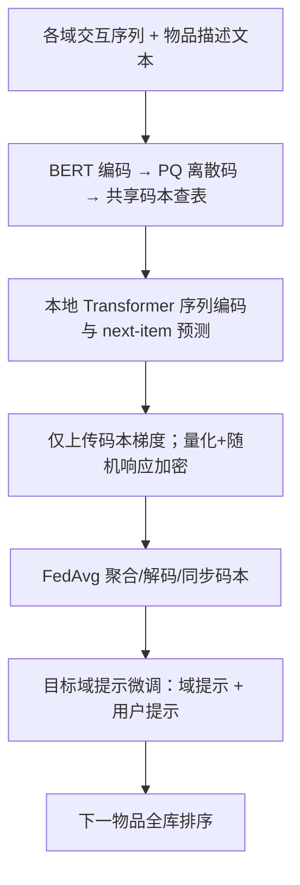

# Prompt-enhanced Federated Content Representation Learning for Cross-domain Recommendation (提示增强的联邦内容表征跨域推荐)

- **会议/期刊**: WWW 2024
- **作者与机构**: Lei Guo, Ziang Lu, Junliang Yu, Nguyen Quoc Viet Hung, Hongzhi Yin；山东师范大学、昆士兰大学、格里菲斯大学
- **推荐链路定位**: 召回（序列 next-item 全库排序）
- **研究方向**: 跨域与多场景推荐 / 去偏公平、可信隐私与工业架构
- **论文原文**: [https://arxiv.org/abs/2401.14678v3](https://arxiv.org/abs/2401.14678v3)
- **开源代码**: [https://github.com/Ckano/PFCR](https://github.com/Ckano/PFCR)

## TL;DR (1分钟核心速览)

面向非重叠用户/物品场景下的域级隐私保护跨域序列推荐：已有联邦 CDR 仍需上传用户信息、依赖原子 ID、假设用户重叠。PFCR 用物品描述文本经 BERT+PQ 生成共享语义码本，仅上传码本梯度并做量化+随机响应加密；预训练后用域提示/用户提示适配目标域。在 Office-Arts、OnlineRetail-Pantry 的 Leave-One-Out 全库排序协议下，R@10 最高相对提升 10.52%。

## Background & Motivation (背景与核心矛盾)

- **主流范式**: 跨域推荐依靠域间共享模式迁移知识；隐私保护场景多采用联邦学习，将域视为 client，服务器聚合模型参数。
- **前人局限**: ① 上传用户嵌入或用户相关参数仍可能泄露偏好；② 原子 ID 无法在不同域间建立统一语义空间；③ 大多数方法默认存在重叠用户以对齐域，而真实跨平台场景往往完全非重叠。
- **核心洞察 (Key Insight)**: 物品描述文本是公共且跨域通用的，若将文本压缩为离散语义码并通过共享码本查表，可在不暴露用户身份的前提下对齐不同域。
- **本文切入点**: 用“文本→离散码→码本嵌入”替代原子 ID，联邦只聚合物品码本梯度，再用提示微调将全局语义迁移到目标域。

## Method (核心方法设计)

### 1. 整体框架 (Overall Architecture)

PFCR 分两阶段。预训练阶段：各域本地用 BERT 编码物品描述，PQ 量化得到离散码，查共享码本得到物品向量；Transformer 序列编码器做下一物品预测；客户端仅上传码本梯度，经量化与随机响应加密后由服务器 FedAvg 聚合并同步。微调阶段：冻结预训练内容表征，在目标域加入域提示与用户提示，以少量参数适配本地偏好并完成全库排序。

### 2. 关键设计拆解 (Key Designs)

1. **向量量化物品表征 VQIR（跨域语义桥）**：原子 ID 在不同域不可比；先将文本编码 $\boldsymbol{x}_i=\mathrm{BERT}([\mathrm{CLS}];w_1;\dots;w_c])$，再切分为$D$个子向量并用 PQ 选最近中心：$c_{i,k}=\arg\min_j\|\boldsymbol{x}_{i,k}-\boldsymbol{a}_{k,j}\|_2$；查全局码本$\boldsymbol{E}\in\mathbb{R}^{D\times M_c\times d_V}$后池化得$\boldsymbol{v}_i=\mathrm{Pool}([\boldsymbol{e}_{1,c_{i,1}};\dots;\boldsymbol{e}_{D,c_{i,D}}])$。共享码本使语义相近物品即使不同域也落在同一码空间，且无需用户重叠。

2. **联邦内容表征 FCR + 梯度加密（隐私与知识迁移）**：用户相关梯度一律不上传，仅上传码本梯度 $\boldsymbol{g}$；先截断量化$\boldsymbol{q}_i=\mathrm{round}((\boldsymbol{g}_i+\tau)/s)$，再做随机响应$\boldsymbol{r}_i=(\boldsymbol{q}_i+\boldsymbol{c}_i\cdot\mathrm{noise})\boldsymbol{o}d b$，其中$\boldsymbol{c}_i\sim\mathrm{Bernoulli}(p)$，$p=(e^\epsilon+1)/(e^\epsilon+2)$。服务器用$\boldsymbol{g}=\sum_i \boldsymbol{r}_i\cdot\boldsymbol{E}_{c,i}\cdot w_i$校正并解码，$w_i$ 为样本比例。该设计在不集中用户数据的前提下，让码本吸收跨域共现知识。

3. **域自适应提示微调（目标域适配）**：全提示用域提示 $\boldsymbol{P}_{\mathrm{domain}}$捕捉域内共性，用物品 ID 序列经 UPE 得到用户提示$\boldsymbol{P}_{\mathrm{user}}$，拼接后$\boldsymbol{h}_{\mathrm{full}}=\boldsymbol{W}_C[\boldsymbol{P}_{\mathrm{domain}}\oplus\boldsymbol{P}_{\mathrm{user}}\oplus\boldsymbol{h}_S]+\boldsymbol{b}_C$；轻提示仅保留$\boldsymbol{h}_{\mathrm{light}}=\boldsymbol{P}_{\mathrm{domain}}+\boldsymbol{h}_S$，显著降低存储与计算。训练目标为下一物品交叉熵$\mathcal{L}=-\frac{1}{|\mathcal{S}|}\sum_{\mathcal{S}_i}\log P(item_{i+1}\mid\mathcal{S}_i)$，全物品 softmax，无负采样。

## Experimental Setup & Evaluation Protocol (实验设置与评估协议)

- **数据集与预处理**: 两对完全非重叠域；物品含描述文本，用户序列按时间排序。正文未列规模，完整统计在附录 A。

| 数据集 | #Users | #Items | #Interactions | 稀疏度/密度 | 特征/场景说明 |
| :--- | :---: | :---: | :---: | :---: | :--- |
| Office-Arts | 见附录 A | 见附录 A | 见附录 A | — | Amazon 跨品类；用户/物品不相交 |
| OnlineRetail-Pantry | 见附录 A | 见附录 A | 见附录 A | — | 跨平台；用户/物品不相交 |

- **数据划分与防穿越**: `Leave-One-Out`；每用户序列最后三个物品分别作 test、validation、training target。
- **排名评测协议**: 下一物品在域内全物品 softmax，等价 `Full-Ranking (全库未交互排序)`；训练无负采样。指标 Recall@10/50、NDCG@10/50。
- **对比基线与超参**: ID-only（GRU4Rec/SASRec/BERT4Rec）、非重叠 CDR（CCDR/RecGURU）、ID-Text（FDSA/S3-Rec）、Text-only（ZESRec/VQRec）。隐层 300、4 头、Adam 1e-3、batch 1024；码本 Office $M=48,D=256$，OnlineRetail$M=32,D=256$；联邦 10 轮；$t$-test$p<0.05$。

## Key Experimental Results (实验关键数据)

### 1. 主实验对比 (Main Results)

表 1 保留 6 个代表性基线，列出 Recall@10 与 NDCG@10；粗体为行最优，Δ% 为 PFCR 最优值相对最强基线。

| 数据集-域 | 指标 | SAS | BERT | RecG | FDSA | ZES | VQ | PFCR(l) | PFCR(f) | Δ% |
| :--- | :---: | :---: | :---: | :---: | :---: | :---: | :---: | :---: | :---: | :---: |
| Office | R@10 | 0.1157 | 0.0693 | 0.1145 | 0.1091 | 0.0641 | 0.1207 | **0.1215** | 0.1206 | +0.66 |
| Office | N@10 | 0.0663 | 0.0554 | 0.0768 | **0.0821** | 0.0391 | 0.0742 | 0.0775 | 0.0782 | −4.75 |
| Arts | R@10 | 0.1048 | 0.0638 | 0.1084 | 0.1016 | 0.0664 | 0.1132 | **0.1170** | 0.1153 | +3.36 |
| Arts | N@10 | 0.0557 | 0.0364 | 0.0651 | 0.0671 | 0.0375 | 0.0624 | 0.0651 | **0.0677** | +0.89 |
| OR | R@10 | 0.1484 | 0.1392 | 0.1467 | 0.1487 | 0.1103 | 0.1496 | 0.1522 | **0.1561** | +4.35 |
| OR | N@10 | 0.0684 | 0.0642 | 0.0535 | 0.0715 | 0.0535 | 0.0708 | 0.0710 | **0.0739** | +3.36 |
| Pantry | R@10 | 0.0467 | 0.0281 | 0.0469 | 0.0414 | 0.0454 | 0.0561 | **0.0620** | 0.0616 | +10.52 |
| Pantry | N@10 | 0.0207 | 0.0142 | 0.0209 | 0.0218 | 0.0230 | 0.0251 | 0.0272 | **0.0293** | +16.73 |

补充：R@50 上 Office/Arts/OR/Pantry 最优 PFCR 为 0.1945/0.2208/0.3982/0.1591，较最强基线 +0.57/+2.22/+2.10/+4.12%；除 Office N@50 外，Arts/OR/Pantry 的 N@50 分别提升 5.12%/2.51%/9.83%。

### 2. 消融实验 (Ablation Study)

表 2 在 Office-Arts 上逐个移除 VQIR、FCR、DP（域提示）组件。

| 变体 | Office R@10 | Office N@10 | Arts R@10 | Arts N@10 |
| :--- | :---: | :---: | :---: | :---: |
| PFCR-VFD | 0.1157 | 0.0663 | 0.1048 | 0.0557 |
| PFCR-FD | 0.1207 | 0.0742 | 0.1132 | 0.0624 |
| PFCR-D | 0.1213 | 0.0771 | 0.1146 | 0.0638 |
| PFCR-F | 0.1169 | 0.0738 | 0.1147 | 0.0655 |
| PFCR | 0.1206 | **0.0782** | **0.1153** | **0.0677** |

### 3. 关键实验发现 (Key Findings)

1. **语义码本+联邦内容表征是主增益来源**：移除 VQIR/FCR/DP 后，Office R@10 从 0.1206 降至 0.1157（−4.1%），N@10 从 0.0782 降至 0.0663（−15.2%）；Arts N@10 从 0.0677 降至 0.0557（−17.7%），说明非重叠域下文本语义桥比 ID 对齐更关键。
2. **提示微调主要提升排序质量，轻提示更省参数**：去掉 DP 后 Office N@10 0.0782→0.0771，Arts N@10 0.0677→0.0638；全提示在 Arts N@10 优于轻提示（0.0677 vs 0.0651），但轻提示在 Office R@10 反而更高（0.1215 vs 0.1206），适合低存储场景。
3. **联邦聚合与隐私参数存在非单调权衡**：FedAvg 在 Office R@10 达 0.1213，优于 FedProx 0.1197、Scaffold 0.1146；仅聚合高频码的 PopCode 在 Arts N@10 降至 0.0629。通信轮数 $t$过大导致过更新，量化桶$b$过大/过小均损性能，$\epsilon$ 因只扰动部分梯度而呈非单调。

## Highlights & Limitations (亮点、对比与审稿批判)

- **与代表作对比 (vs. Prior Work)**: VQRec 同样用文本→离散码，但集中式训练且不处理跨域隐私；RecGURU/CCDR 做非重叠 CDR，但依赖用户/ID 对齐且无联邦隐私保护；PFCR 首次把共享语义码本、联邦梯度加密与提示微调串成非重叠 DPCSR 闭环。
- **可迁移亮点**: ① 用公共内容码本作为跨域/跨平台“语义锚点”，可迁移到冷启动与多模态召回；② 域提示+用户提示的分层参数化，适合多业务场景的低成本适配。
- **审稿级局限批判**: ① 量化+随机响应未给出严格 DP 预算与攻击实验，隐私保证偏经验性；② 码本质量受 BERT/PQ 与文本质量制约，且全提示增加用户级参数与通信开销；仅两对数据集、无线上 A/B，Office 的 NDCG 仍低于 FDSA。

## Rating (四维评分)

- **方法创新性 (Novelty)**: ⭐⭐⭐⭐ （联邦语义码本+提示微调的组合有新意，但 BERT/PQ/FedAvg 均为成熟组件）
- **评估协议与实验扎实度 (Protocol & Experiments)**: ⭐⭐⭐ （全库排序与 t-test 较规范，消融完整；但仅两对数据集、无规模统计与线上验证）
- **写作与数学规范度 (Clarity & Rigor)**: ⭐⭐⭐⭐ （两阶段框架与公式清晰，加密聚合细节稍密）
- **工业落地与复现价值 (Industrial & Practical Value)**: ⭐⭐⭐⭐ （开源代码，非重叠跨平台场景实用；通信轮数与加密参数需调优）

