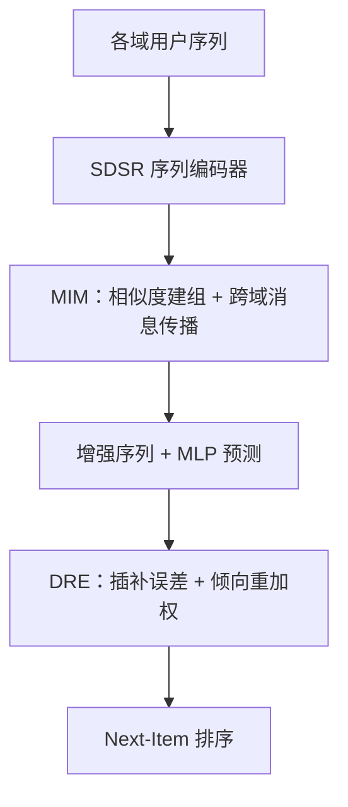
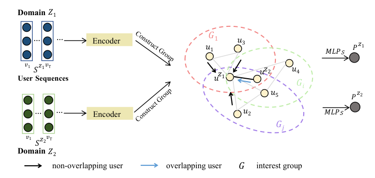

# Rethinking Cross-Domain Sequential Recommendation under Open-World Assumptions (开放世界假设下重新审视跨域序列推荐)

- **会议/期刊**: WWW 2024
- **作者与机构**: Wujiang Xu, Qitian Wu, Runzhong Wang, Mingming Ha, Qiongxu Ma, Linxun Chen, Bing Han, Junchi Yan；MYbank (Ant Group) / SJTU / MIT
- **推荐链路定位**: 精排/排序（跨域 next-item 打分）
- **研究方向**: 跨域与多场景推荐 / 去偏公平与可信
- **论文原文**: [论文原文链接](https://arxiv.org/abs/2311.04590v6)
- **开源代码**: [开源代码仓库链接](https://github.com/WujiangXu/AMID)

## TL;DR (1分钟核心速览)

针对 CDSR 在开放世界下“重叠用户稀少 + 训练/测试选择偏差”两大痛点，AMID 用多兴趣信息模块（MIM）为重叠、非重叠乃至未见用户建组传播，并用跨域双稳健估计器（DRE）校正选择偏差。Amazon 与 MYbank-CDR 的 1:999 采样排序中，Cloth NDCG@10 相对提升 26.48%，线上曝光 +9.65%、CVR +1.32%。

## Background & Motivation (背景与核心矛盾)

- **主流范式**: Pi-Net/DASL/C2DSR 等 CDSR 依赖重叠用户桥接跨域知识，常假设用户几乎完全重叠且训练/测试同分布。
- **前人局限**: ①真实平台多为部分重叠，低重叠下 SASRec 反而优于 CDSR；②训练只观察被曝光用户，$S\to O\leftarrow R$ 碰撞路径带来选择偏差与分布漂移。
- **核心洞察 (Key Insight)**: t-SNE 显示 25% 重叠比下训练/测试分布差异大于 100% 重叠；且 $K_u$ 越低，偏差越大、CDSR 越易失效。
- **本文切入点**: 不再依赖重叠用户建组，改用序列相似度构造兴趣组；同时用 DR 估计做无偏风险评估。

<figure class="paper-figure" markdown="span">
  ![图1：传统方法 \[36, 70, 71\] 仅关注重叠用户（a），少数方法 \[2, 27, 28\] 能处理非重叠用户（b），但它们仍有一些局限。然而，我们的方法不仅考虑用户（a）和（b），还为未见用户（c）分配重要性。](../../../../assets/papers/2311.04590v6/figure_1.png)<figcaption>图1：传统方法 [36, 70, 71] 仅关注重叠用户（a），少数方法 [2, 27, 28] 能处理非重叠用户（b），但它们仍有一些局限。然而，我们的方法不仅考虑用户（a）和（b），还为未见用户（c）分配重要性。</figcaption>
</figure>

图1：开放世界下重叠/非重叠/未见用户差异，AMID 三类用户均分配重要性。

## Method (核心方法设计)

### 1. 整体框架 (Overall Architecture)

输入各域用户序列，经 SDSR 编码器得到 $S^{Z}_{u}$；MIM 以序列相似度构建跨域兴趣组，将同组及同用户跨域消息聚合回增强序列；预测层用 MLP 打分；DRE 并行学习误差插补与倾向，交替优化预测损失和 DR 风险。该框架可套在 GRU4Rec/SASRec/BERT4Rec 等 SDSR backbone 上。

<figure class="paper-figure" markdown="span">
  <figcaption>图5：我们的多兴趣信息模块概览。编码器表示来自 SDSR 模型的序列信息编码器。黑色（即，𝑢𝑍1 →𝑢1）和蓝色（即，𝑢𝑍1 →𝑢𝑍2）实线箭头表示由不同用户以及不同域中的同一用户传播的两类不同消息。</figcaption>
</figure>

图5：MIM 通过兴趣组建组与跨域消息传播增强用户序列表征。

### 2. 关键设计拆解 (Key Designs)

1. **多兴趣信息模块 MIM（不依赖重叠用户传播）**：先对两域序列做逐点相似度最大匹配，$a'_{ij}=\max[(S^{Z_1}_{u_i}W_1)(S^{Z_2}_{u_j}W_2)^\top]$，再以阈值$k$得组标记$a_{ij}=\mathbb{I}(a'_{ij}\ge k)$；组内消息为$m_{u_i^{Z_1}\leftarrow u_j^{Z_2}}=a_{ij}(S^{Z_2}_{u_j}W_{ip})$，聚合后与自身序列拼接。这样非重叠用户也能从相似兴趣组获益。

2. **跨域双稳健估计器 DRE（降选择偏差）**：将单域 DR 推广到多域，风险评估为 $\mathcal{E}^*_{DR}=\frac{1}{|\mathcal{Z}|}\sum_{Z}\frac{1}{|\mathcal{D}_Z|}\sum_{u,v\in\mathcal{D}_Z}(\hat e^Z_{u,v}+\frac{o^Z_{u,v}(e^Z_{u,v}-\hat e^Z_{u,v})}{\hat p^Z_{u,v}})$，同时建模插补误差$\hat e$与倾向$\hat p$。只要插补或倾向之一准确，估计即无偏；理论上方差/尾界优于 IPS。

3. **训练目标、负采样与推理效率**：交替优化 $\mathcal{L}_e(\theta,\phi,\psi)$与$\mathcal{L}_r(\theta)$，先训练预测/插补/倾向，再用 DR 风险修正预测器。评测为 1 正 + 999 随机负采样排序；SASRec+AMID 仅 0.193M 参数，训练/测试 0.111s/0.032s per batch，接近 IPSCDR 且优于 C2DSR。

## Experimental Setup & Evaluation Protocol (实验设置与评估协议)

- **数据集与预处理**:

| 数据集 | #Users | #Items | #Interactions | #Overlap | 密度/说明 |
| :--- | :---: | :---: | :---: | :---: | :--- |
| Amazon Cloth-Sport | 27,519 / 107,984 | 9,481 / 40,460 | 161,010 / 851,553 | 16,337 | 0.06% / 0.02% |
| Amazon Phone-Elec | 41,829 / 27,328 | 17,943 / 12,655 | 194,121 / 170,426 | 7,857 | 0.03% / 0.05% |
| MYbank Loan-Fund | 39.56M / 48.44M | 61,934 / 13,927 | 227.08M / 133.84M | 29.48M | 金融 CDSR |
| MYbank Loan-Account | 39.56M / 92.69M | 61,934 / 21,599 | 227.08M / 278.95M | 37.82M | 金融 CDSR |

- **数据划分与防穿越 (Splitting Strategy)**: Next-item 序列划分，沿用 CDSR 既有协议；正文未显式给全局时间戳/LOO 细节，复现需查附录。用 $K_u\in\{25\%,75\%\}$ 模拟非重叠比例与选择偏差强度。
- **排名评测协议 (Ranking Protocol)**: `Sampled Ranking`，每个正样本随机配 999 个未交互负样本，报告 NDCG@10 / HR@10。
- **对比基线与超参设置**: 覆盖 SDSR（BERT4Rec/GRU4Rec/SASRec）、CDR（STAR/MAMDR/SSCDR）、CDSR（Pi-Net/DASL/C2DSR）与去偏（DCRec/CaseQ/IPSCDR）；5 次均值±方差，paired t-test $p<0.05$；$d$ 与超参见附录 C.1。

## Key Experimental Results (实验关键数据)

### 1. 主实验对比 (Main Results)

下表为 Cloth-Sport / Phone-Elec 在 $K_u=25\%$ 的高偏差场景，C=Cloth，S=Sport，P=Phone，E=Elec。

| 方法 | C NDCG | C HR | S NDCG | S HR | P NDCG | P HR | E NDCG | E HR |
| :--- | ---: | ---: | ---: | ---: | ---: | ---: | ---: | ---: |
| SASRec | 2.00 | 4.26 | 3.69 | 7.46 | 7.19 | 13.32 | 10.56 | 17.77 |
| C2DSR | 2.27 | 4.73 | 3.74 | 7.99 | 7.54 | 14.04 | 10.71 | 17.98 |
| DCRec | 2.22 | 4.37 | 3.85 | 7.72 | 7.18 | 13.58 | 10.48 | 17.84 |
| SASRec+CaseQ | 2.23 | 4.46 | 3.87 | 7.75 | 7.31 | 13.47 | 10.60 | 17.77 |
| GRU4Rec+IPSCDR | 2.53 | 4.93 | 4.24 | 8.50 | 7.58 | 13.90 | 10.69 | 17.78 |
| SASRec+IPSCDR | 2.48 | 4.92 | 4.10 | 8.13 | 7.61 | 14.05 | 10.80 | 18.03 |
| GRU4Rec+AMID | 3.10 | 5.95 | 4.89 | 9.42 | **8.33** | **15.49** | **11.74** | **19.50** |
| SASRec+AMID | **3.20** | **6.14** | **4.97** | **9.48** | 8.20 | 14.99 | 11.71 | 19.28 |
| **Improv.%** | +26.48 | +24.54 | +17.22 | +11.53 | +9.46 | +10.25 | +8.70 | +8.15 |

### 2. 消融实验 (Ablation Study)

SASRec 为统一 backbone，$K_u=25\%$。

| 变体 | Cloth NDCG/HR | Sport NDCG/HR | Phone NDCG/HR | Elec NDCG/HR |
| :--- | ---: | ---: | ---: | ---: |
| w/o MIM & DRE（SASRec） | 2.00 / 4.26 | 3.69 / 7.46 | 7.19 / 13.32 | 10.56 / 17.77 |
| w/o DRE（SASRec+MIM） | 2.67 / 5.11 | 4.48 / 8.74 | 7.99 / 14.77 | 11.31 / 18.69 |
| Full（SASRec+AMID） | **3.20 / 6.14** | **4.97 / 9.48** | **8.20 / 14.99** | **11.71 / 19.28** |

### 3. 关键实验发现 (Key Findings)

1. **偏差越强，AMID 收益越大**：$K_u=25\%$时 Cloth NDCG@10 相对最佳基线 +26.48%，$K_u=75\%$ 时仅 +10.55%；Sport 从 +17.22% 降至 +5.67%，印证开放世界选择偏差是核心矛盾。
2. **MIM 已是强模块，DRE 在高偏差场景加成明显**：SASRec+MIM 在 Cloth/Sport/Phone/Elec 的 NDCG 已达 2.67/4.48/7.99/11.31，均超 C2DSR；加 DRE 后 Cloth 升至 3.20、HR 5.11→6.14，说明重加权对低重叠高偏场景更有效。
3. **线上金融平台验证有效**：14 天 A/B 中 Loan/Fund/Account 曝光 +9.89%/+7.32%/+11.73%，点击 +5.27%/+4.94%/+6.85%，CVR +1.42%/+0.98%/+1.57%，平均曝光 +9.65%、CVR +1.32%。

## Highlights & Limitations (亮点、对比与审稿批判)

- **与代表作对比 (vs. Prior Work)**: C2DSR 仍靠重叠用户+对比 GNN；IPSCDR 用 IPS 但方差高；CaseQ/DCRec 只做单域去偏。AMID 同时覆盖重叠/非重叠/未见用户，并把 DR 低方差优势引入 CDSR。
- **可迁移亮点**: 用逐点最大相似度建“软兴趣组”可迁移到多场景冷启动；DRE 的插补+倾向双通道可迁移到跨域曝光偏差校正。
- **审稿级局限批判**: MIM 的 $T\times T$相似度与采样$N$ 用户在大序列/多域下开销上升；DRE 依赖倾向与插补模型质量，极端缺失下仍可能不稳；离线仅 1:999 采样排序，未做 Full-Ranking，Amazon 重叠比例亦为人工模拟。

## Rating (四维评分)

- **方法创新性 (Novelty)**: ⭐⭐⭐⭐ （把开放世界 CDSR 拆成“非重叠传播 + 选择偏差”两问题，MIM+DRE 组合清晰，并有 DR 尾界理论支撑）
- **评估协议与实验扎实度 (Protocol & Experiments)**: ⭐⭐⭐⭐ （四组离线场景+金融线上 A/B，5 次均值±方差与显著性检验；但仅采样排序、划分细节偏弱）
- **写作与数学规范度 (Clarity & Rigor)**: ⭐⭐⭐⭐ （因果图、DR 偏差/尾界推导完整；部分符号与附录依赖较强）
- **工业落地与复现价值 (Industrial & Practical Value)**: ⭐⭐⭐⭐⭐ （开源代码+MYbank-CDR，参数与延迟同阶，线上曝光/CVR 双升，落地价值高）

