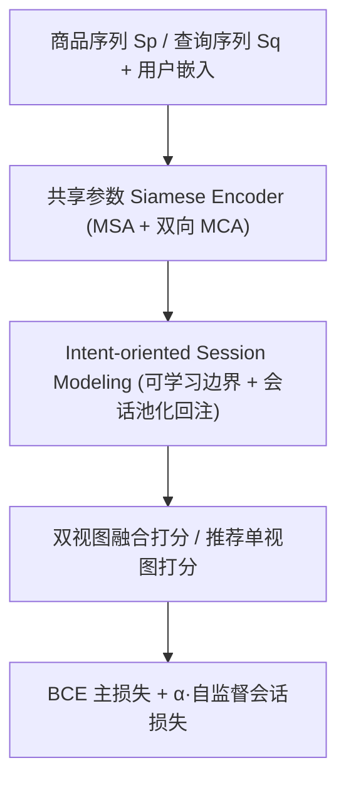
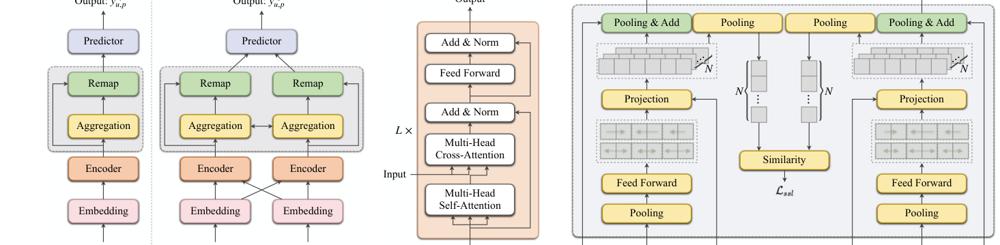

# UnifiedSSR: A Unified Framework of Sequential Search and Recommendation (搜索与推荐统一序列建模框架)

- **会议/期刊**: WWW 2024
- **作者与机构**: Jiayi Xie, Shang Liu, Gao Cong, Zhenzhong Chen（武汉大学遥感信息工程学院 / 南洋理工大学）
- **推荐链路定位**: 召回（序列式候选打分，搜索与推荐共用）
- **研究方向**: 跨域与多场景推荐 / 序列与会话推荐
- **论文原文**: [https://arxiv.org/abs/2310.13921v1](https://arxiv.org/abs/2310.13921v1)
- **开源代码**: [https://github.com/JennyXieJiayi/UnifiedSSR](https://github.com/JennyXieJiayi/UnifiedSSR)

## TL;DR (1分钟核心速览)

搜索与推荐长期分模型训练，数据稀疏且行为关联被浪费；已有联合模型要么仅在损失层拼接两个独立模型（JSR），要么把推荐当作"查询为空"的搜索特例（USER、SRJGraph），抹平了两场景的差异。UnifiedSSR 用双分支参数共享的 Siamese Transformer 并行编码"商品序列 / 查询序列"，推荐场景直接关掉查询分支；再以可学习边界切出意图会话，用"会话间相斥 + 双视图会话对齐"的自监督约束意图发现。三数据集在采样式排名协议（100 候选）下，搜索 NDCG@10 最高 +10.94%、推荐 NDCG@10 最高 +8.59%。

## Background & Motivation (背景与核心矛盾)

- **主流范式**: 搜索侧用 HEM/ZAM/CAMI 等个性化商品搜索模型，推荐侧用 GRU4Rec/SASRec/FMLP-Rec 等序列模型；联合建模则多为 JSR 式联合损失，或 USER/SRJGraph 式把两场景异构序列塞进一个 Transformer/一张图。
- **前人局限**: ① 损失层拼接忽略了跨场景行为相关性，表征互不相通；② "空查询"假设把推荐行为强行同构为搜索行为，丢失了"推荐无明确意图、搜索有显式意图"这一本质差异；③ 商品交互受曝光偏差污染、查询文本非结构化难学，两视图可靠性不对称。
- **核心洞察 (Key Insight)**: 用户意图在时间轴上连续成段、随后漂移或突跳，因此**变长语义会话**才是承载意图的单元；同时搜索中同一时刻的 $\langle$查询, 商品$\rangle$ 是同一意图的两个视图，天然构成"判别 + 对齐"的自监督信号。
- **本文切入点**: 一套共享参数的双分支架构同时承载"跨场景共享（推荐商品 / 搜索商品）"与"跨视图共享（搜索商品 / 查询）"，并让会话边界可学习。

## Method (核心方法设计)

### 1. 整体框架 (Overall Architecture)

输入三条行为序列：推荐场景商品序列 $\mathcal{S}^r_p$、搜索场景商品序列$\mathcal{S}^s_p$与查询序列$\mathcal{S}^s_q$。Embedding 模块把商品、查询词、用户映射到$d$维共享隐空间（查询用词向量均值池化 + 位置编码）；随后 L 层参数共享 Siamese Encoder 并行编码两条序列（层内自注意力 + 双向交叉注意力）；Intent-oriented Session Modeling 依据上下文预测每段会话的中心偏移与长度，池化出会话向量并加回逐位置表征；最后任务专属 Predictor 用内积打分，搜索场景采用可学习权重$w$融合商品/查询两视图：$\hat{y}_{u,p}=(w\mathbf{f}^{p}_{s}+(1-w)\mathbf{f}^{q}_{s})^{\top}\mathbf{e}_p$。训练为"多场景联合预训练 + 单任务微调"两阶段。

<figure class="paper-figure" markdown="span">
  <figcaption>图2：所提出的 UnifiedSSR 框架概览。(a) 展示了 UnifiedSSR 的架构：推荐时停用查询分支（左），搜索时使用完整双分支（右）。信息共享机制包括两方面：跨场景参数共享，用于在两个场景中学习用户交互过的商品；跨视图参数共享，用于在搜索场景中学习用户交互过的商品和用户发出的查询。(b) 展示了 Siamese Encoder 层的结构。(c) 展示了搜索场景中完整的 Intent-oriented Session Modeling。</figcaption>
</figure>

### 2. 关键设计拆解 (Key Designs)

1. **双分支 Siamese Encoder（跨场景 + 跨视图参数共享）**: 为同时保留共性与差异，商品分支在两场景共用同一套参数（推荐时关闭查询分支，交叉注意力退化为自注意力），搜索场景的商品分支与查询分支亦共用参数；每层先各自 MSA，再做**互为 Query 的双向 MCA**：$\mathbf{H}^{p}_{s}=\mathrm{FFN}\big(\mathrm{MCA}(\hat{\mathbf{H}}^{p}_{s},\hat{\mathbf{H}}^{q}_{s},\hat{\mathbf{H}}^{q}_{s})\big)$，$\mathbf{H}^{q}_{s}$ 对称计算。好处是查询的强意图信号可注入商品表征、商品的可靠曝光信号反哺查询表征，缓解查询文本非结构化与商品曝光偏差的双向噪声。

2. **Intent-oriented Session Modeling（可学习意图边界 + 双路自监督）**: 不再用固定时间间隔切会话，而是由上下文回归每段中心偏移与半长：$\Delta x=\tanh(f(\mathbf{H}^{p})),\ s=\mathrm{ReLU}(\tanh(f(\mathbf{H}^{p})+b))$，会话区间更新为$(x_i+\Delta x_i-s_i,\ x_i+\Delta x_i+s_i)$；段内均值池化得$\mathbf{I}^{p}\in\mathbb{R}^{N\times d}$，再按指示函数回注$\mathbf{F}^{p}_{t}=\mathbf{H}^{p}_{t}+\sum_{i}\mathbf{I}^{p}_{i}\cdot\mathbb{I}[\mathbf{H}^{p}_{t}\in\mathcal{I}^{p}_{i}]$。自监督信号从两视角给出：
$\mathcal{L}_{ssl}=\sum_{i=1}^{N-1}\big[\mathrm{Sim}(\mathbf{I}^{p}_{i},\mathbf{I}^{p}_{i+1})+\mathrm{Sim}(\mathbf{I}^{q}_{i},\mathbf{I}^{q}_{i+1})\big]-\sum_{i=1}^{N}\mathrm{Sim}(\mathbf{I}^{p}_{i},\mathbf{I}^{q}_{i})$。
第一项压低相邻会话相似度（意图切换应可区分），第二项拉高同序号跨视图会话相似度（同一意图下的查询与商品应一致）——这等价于给会话表征施加了一个"时间轴上的对比解耦 + 跨视图对比对齐"，无需任何意图标注。

3. **训练目标与推理开销**: 主损失为 BCE + 随机负采样：$\mathcal{L}_{predict}=-\big[\log\sigma(\hat{y}_{u,p})+\sum_{p^{-}\in\mathcal{P}_{neg}}\log(1-\sigma(\hat{y}_{u,p^{-}}))\big]$，总目标$\mathcal{L}_{joint}=\mathcal{L}_{predict}+\alpha\mathcal{L}_{ssl}$（$\alpha=0.1$）。先交替用两场景数据联合预训练，再用少量任务数据微调；推理时按场景激活分支，仅需一次 L 层编码 + 内积检索，推荐场景计算量与 SASRec 同阶，额外开销仅为会话池化。

## Experimental Setup & Evaluation Protocol (实验设置与评估协议)

- **数据集与预处理**（过滤交互数 < 10 的用户与商品，等价 10-core；序列截断长度 100，超长切非重叠子序列）：

| 数据集 | #Users | #Items | #Interactions | 稀疏度 | 特征/场景说明 |
| :--- | :---: | :---: | :---: | :---: | :--- |
| JDsearch | 131,701 | 411,566 | 16,101,041 | $2.98\times10^{-4}$ | 京东真实日志，含真实查询；无查询记录划为推荐（S 126,179 / R 174,348 样本） |
| Amazon-CL | 323,714 | 393,214 | 5,385,648 | $4.23\times10^{-5}$ | 评论数据，按用户历史 1:1 均分为搜索/推荐；类目+标题+品牌+TF-IDF 评论关键词合成查询 |
| Amazon-EL | 192,586 | 180,446 | 756,077 | $2.17\times10^{-5}$ | 同上（S/R 各 96,529 样本） |

- **数据划分与防穿越 (Splitting Strategy)**: 全局时序划分。每用户序列先按 8:2 切为"联合预训练集"与"任务集"，任务集内再取**最近一次交互作测试、次近作验证、其余作训练**（Leave-One-Out 变体），严格按时间戳顺序，无未来信息泄漏。
- **排名评测协议 (Ranking Protocol)**: **Sampled Ranking** —— 每个测试样本由模型对 **100 个候选商品**（1 正 + 99 负）打分，取 Top-K 计算 HR@5/10 与 NDCG@5/10；未做全库 Full-Ranking，也未报告显著性检验。
- **对比基线与超参**: 搜索基线 HEM / ZAM / CAMI，推荐基线 GRU4Rec / SASRec / FMLP-Rec，联合基线 JSR / JSR-Seq（本文自建序列版）/ SESRec（改造以支持查询）。嵌入维度 $d=32$（Amazon）/64（JDsearch），FFN 隐层$2d$，层数$L=2$（Amazon）/3（JDsearch），会话数$N=2$/4，$\alpha=0.1$，Adam + warmup-decay，batch 128，100 epoch；另设 UnifiedSSR-S / -R 两个只用单场景数据端到端训练的对照。

## Key Experimental Results (实验关键数据)

### 1. 主实验对比 (Main Results)

| 方法 | JD-S HR@10 | JD-S NDCG@10 | CL-S HR@10 | CL-S NDCG@10 | JD-R HR@10 | JD-R NDCG@10 | CL-R HR@10 | CL-R NDCG@10 |
| :--- | :---: | :---: | :---: | :---: | :---: | :---: | :---: | :---: |
| ZAM | 0.7664 | 0.3501 | 0.6751 | 0.3510 | – | – | – | – |
| CAMI | 0.5051 | 0.3299 | 0.7539 | 0.5582 | – | – | – | – |
| GRU4Rec | – | – | – | – | 0.8020 | 0.6949 | 0.5610 | 0.3571 |
| SASRec | – | – | – | – | 0.8034 | 0.6769 | 0.5526 | 0.3665 |
| FMLP-Rec | – | – | – | – | 0.8054 | 0.7089 | 0.5802 | 0.3634 |
| JSR | 0.8543 | 0.7490 | 0.8060 | 0.6752 | 0.8174 | 0.7162 | 0.6021 | 0.4011 |
| JSR-Seq | 0.8781 | 0.8270 | 0.7785 | 0.7088 | 0.8340 | 0.7304 | 0.6655 | 0.4655 |
| SESRec | 0.9267 | 0.8019 | 0.8455 | 0.7115 | 0.8361 | 0.7322 | 0.5932 | 0.4252 |
| **UnifiedSSR** | **0.9723** | **0.9057** | **0.8992** | **0.7894** | **0.8983** | **0.7749** | **0.7004** | **0.4957** |
| Improv.% | +4.93% | +9.51% | +6.35% | +10.94% | +7.44% | +5.82% | +5.24% | +6.49% |

（Amazon-EL 上 UnifiedSSR 搜索 +1.96% / 推荐 +6.82% HR@10，提升幅度最小。）

### 2. 消融实验 (Ablation Study)

| 变体 (Amazon-CL) | Search HR@10 | Search NDCG@10 | Rec HR@10 | Rec NDCG@10 |
| :--- | :---: | :---: | :---: | :---: |
| UnifiedSSR | **0.8992** | **0.7894** | **0.7004** | **0.4957** |
| w/o FT（仅联合预训练） | 0.8825 | 0.7654 | 0.6697 | 0.4640 |
| w/o CA（去交叉注意力） | 0.8920 | 0.7692 | 0.7010 | 0.4913 |
| w/o SE (a)（两分支不共享参数） | 0.8762 | 0.7701 | 0.6900 | 0.4874 |
| w/o SE (b)（跨场景商品分支不共享） | 0.8896 | 0.7782 | 0.6916 | 0.4866 |
| w/o ISM (a)（按最大时间间隔切会话） | 0.8941 | 0.7800 | 0.6956 | 0.4910 |
| w/o ISM (b)（去会话增强模块） | 0.8901 | 0.7697 | 0.6913 | 0.4854 |

### 3. 关键实验发现 (Key Findings)

1. **微调阶段对推荐侧的边际价值远大于搜索侧**：去掉任务微调后，搜索 NDCG@10 仅从 0.7894 掉到 0.7654（−3.0%），而推荐从 0.4957 掉到 0.4640（−6.4%）。说明"联合预训练提供的共享表征"对无显式查询、意图更模糊的推荐场景是主要增益源，搜索的查询分支本身已提供强监督。
2. **共享参数比交叉注意力更关键，且收益不对称**：w/o SE (a) 使搜索 HR@10 降 2.3 个点（0.8992→0.8762），w/o SE (b) 使推荐降 0.88 个点；w/o CA 在推荐上 HR@10 甚至微升（0.7010 vs 0.7004）但 NDCG@10 降 0.44 个点——交叉注意力主要改善排序位置质量而非命中率，且在意图不明确的推荐场景可能引入查询噪声。
3. **可学习意图会话优于启发式切分**：w/o ISM (b)（无会话）搜索 NDCG@10 0.7697 → 时间间隔切分 w/o ISM (a) 0.7800 → 完整模型 0.7894，呈单调递增；即"学出来的段界"比"按时间间隔切"多贡献约 1 个点，验证意图边界不等于时间边界。超参上 $\alpha$从 0 到 0.1 提升、$\alpha\ge0.2$（搜索）/$\ge0.4$（推荐）反而劣于$\alpha=0$，说明自监督过强会挤压表征容量。

## Highlights & Limitations (亮点、对比与审稿批判)

- **与代表作对比 (vs. Prior Work)**: vs. JSR 仅用联合损失耦合两个 MLP，本文把共享下沉到 Encoder 参数层；vs. USER / SRJGraph 把推荐视为"空查询搜索"的同构融合，本文用"可关闭的查询分支"显式保留两场景差异；vs. 同期 SESRec（仅用搜索增强推荐），本文实现双向互惠，搜索侧提升甚至更大（+10.94% vs 推荐 +6.49%）。
- **可迁移亮点**: ① 用"双向交叉注意力 + 参数共享"做两视图互蒸馏，天然可迁移到"曝光日志 + 点击日志"或"标题 + 封面图"等双视图召回；② 用 $\sum_{i}\mathrm{Sim}(s_i,s_{i+1})-\sum_i\mathrm{Sim}(s_i,s'_i)$ 形式把"段间判别 + 跨视图对齐"写成单一可微目标，无需伪标签即可替代固定窗口切分。
- **审稿级局限批判**: ① 评测仅 100 候选择样排序，且未做显著性检验，随机负采样下 NDCG 数值与 Full-Ranking 不可比，SOTA 优势可能被高估；② Amazon 的"查询"是元数据合成的伪查询，与真实搜索意图分布差距大，JDsearch 上部分指标（如 Amazon-EL 搜索仅 +1.96%）已接近饱和；③ 跨场景共享并非总是正向——Amazon-EL 搜索上 UnifiedSSR-S（0.9340）反超全模型（0.9304），说明负迁移未被处理；④ 两阶段训练 + 会话边界回归带来的额外超参（$L$、$N$、$\alpha$）在三数据集上取值不一致，调参成本偏高。

## Rating (四维评分)

- **方法创新性 (Novelty)**: ⭐⭐⭐ （双分支参数共享属工程化组合创新，亮点在可学习意图边界 + 双路会话自监督，有明确的表征解耦直觉但缺乏理论分析）
- **评估协议与实验扎实度 (Protocol & Experiments)**: ⭐⭐⭐ （三数据集双场景覆盖完整、消融与超参分析细致，但仅 100 候选择样排序、无 Full-Ranking 与显著性检验）
- **写作与数学规范度 (Clarity & Rigor)**: ⭐⭐⭐⭐ （符号体系清晰、公式与模块一一对应，Session 提取机制的动机与实现交代完整，复杂度分析略缺）
- **工业落地与复现价值 (Industrial & Practical Value)**: ⭐⭐⭐⭐ （代码开源、架构与真实电商搜索/推荐共享用户商品库的形态高度一致，推荐侧推理开销与 SASRec 同阶，可直接接入现有序列召回链路）

