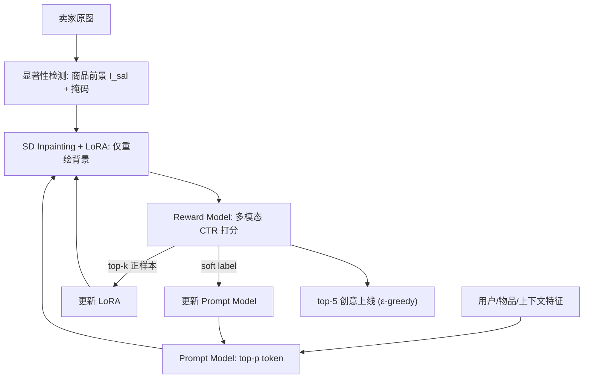
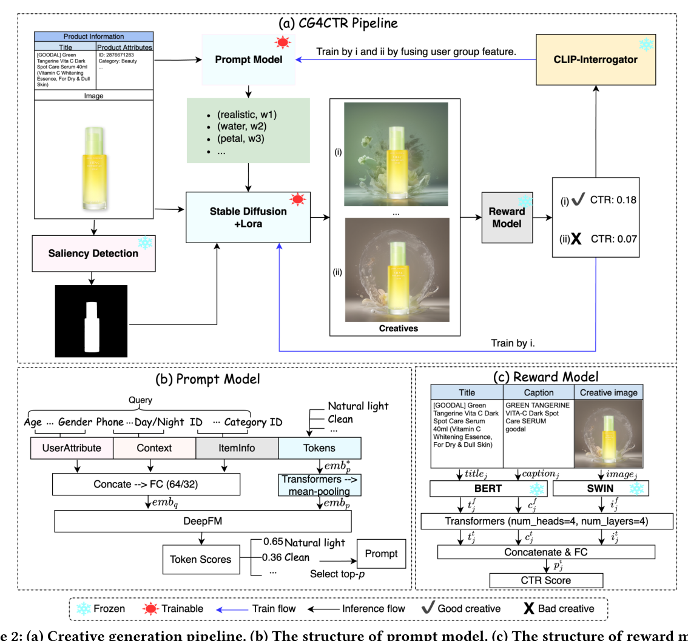

# A New Creative Generation Pipeline for Click-Through Rate with Stable Diffusion Model (面向点击率优化的 Stable Diffusion 创意生成流水线 CG4CTR)

- **会议/期刊**: WWW 2024
- **作者与机构**: Hao Yang, Jianxin Yuan, Shuai Yang, Linhe Xu, Shuo Yuan, Yifan Zeng（Shopee Discovery Ads，虾皮广告）
- **推荐链路定位**: 创意生成（广告素材侧）+ 创意级精排打分
- **研究方向**: CTR/CVR 预估与特征交叉 / 多模态推荐
- **论文原文**: [https://arxiv.org/abs/2401.10934v1](https://arxiv.org/abs/2401.10934v1)
- **开源代码**: [https://github.com/HaoYang0123/Creative_Generation_Pipeline](https://github.com/HaoYang0123/Creative_Generation_Pipeline)

## TL;DR (1分钟核心速览)

本文针对广告场景中"卖家自制创意图背景简陋、传统 AIGC 生成不考虑用户且与 CTR 排序任务割裂优化"的痛点，提出 CG4CTR 流水线：用显著性检测保商品像素、SD-Inpainting 只重绘背景，Prompt 模型按用户分组选 token，多模态 Reward 模型（BERT+Swin+Transformer）预测 CTR 并驱动 **self-cycling** 交替微调 LoRA 与 Prompt 模型。在 Shopee 五类目线上 A/B（$\epsilon$-greedy 分流）中整体 CTR +10.4%、收入 +9.7%；Reward 模型在 1.0M 商业创意数据上 Top-1 CTR uplift 由 VAM 的 18.01% 提升至 23.81%，MSE 降至 2.052。

## Background & Motivation (背景与核心矛盾)

- **主流范式**: 广告创意生成走"先生成后排序"两段式——GAN/VAE 或布局生成模型产出素材，再由 VAM、CACS、Rank 等创意排序模型按预估 CTR 挑选曝光。
- **前人局限**: ①生成阶段完全不含用户信息，也**不以 CTR 为目标**，产出的"低质创意"会稀释曝光、拉低整体流量效率；②扩散模型直接生成会**改写商品本体像素**（鞋变袜），在广告合规上不可接受；③生成与排序两阶段分任务独立优化，误差无法回传。
- **核心洞察 (Key Insight)**: 作者发现**只修改背景、保持商品视觉像素不变**就已能显著提升 CTR；且不同人群对背景风格偏好系统性不同（年轻→冷色/电子风，年长→暖色/极简风），因此"用户条件化 prompt"是低成本高回报的杠杆。
- **本文切入点**: 把 Reward 模型当作可微目标之外的"裁判"，用自循环把 CTR 信号注入生成阶段，使生成与排序在闭环中互为监督。

## Method (核心方法设计)

### 1. 整体框架 (Overall Architecture)

对每个 item：先取卖家原图，经显著性检测网络得到商品前景 $I_{sal}$与掩码；Prompt 模型以用户/物品/上下文特征为 Query，从 CLIP-Interrogator 构建的词表中选 top-$p$token 组成 prompt；SD 在 inpainting 模式下仅重绘背景，配 LoRA 微调；每 item 生成$q=10$张后由 Reward 模型打分，保留 top-$k=5$ 作正样本、其余作负样本；偶数轮更新 Prompt 模型（用 Reward 分数作软标签），奇数轮更新 LoRA（仅用正样本），迭代 10 轮收敛后上线。

<figure class="paper-figure" markdown="span">
  <figcaption>图 2：(a) 创意生成流程。(b) prompt model 的结构。(c) reward model 的结构。</figcaption>
</figure>

### 2. 关键设计拆解 (Key Designs)

1. **保商品 Inpainting 与 LoRA 微调（解决"改写商品"与"训练成本"双重矛盾）**：标准 SD 全图重绘会破坏商品本体，故将掩码前景的 VAE 隐变量与噪声隐变量拼接后再去噪，损失与常规扩散一致：
$Z'_t=\mathrm{concat}\big(\mathrm{scheduler}(\mathrm{VAE}(I),t,\varepsilon),\ \mathrm{VAE}(I_{sal})\big),\quad \mathcal{L}_{LoRA}=\mathbb{E}\|\varepsilon-\varepsilon_\theta(Z'_t,t,\tau_\theta(y))\|_2^2$。
只对 UNet 加 LoRA 低秩旁路，既让模型适配商业数据分布，又把可训练参数压到可在工业频次下迭代的量级。

2. **用户条件化 Prompt 模型（把 CTR 目标前移到素材生成）**：输入 Query 为 one-hot 的用户属性、物品属性、上下文属性拼接嵌入；候选 token 多热编码后过 Transformer + MeanPooling 得 prompt 表示，二者拼接后经 DeepFM 输出**每个 token 的 CTR 估计**，取 top-$p$组装 prompt。训练采用硬+软双监督：$\mathcal{L}_{prompt}=(1-\lambda_p)\mathrm{CE}(p,y)+\lambda_p\mathrm{CE}(p,y^{RM})$，$\lambda_p=0.1$。硬标签来自真实点击，软标签来自 Reward 模型的连续打分，物理直觉是**用 reward 的平滑信号降低生成空间里昂贵在线探索的方差**，同时让新出现的高分 token 组合不至于因无历史点击而被永久压制。

3. **多模态 Reward 模型与排序损失（为自循环提供可信裁判）**：标题/描述经（商业数据继续预训练的）BERT 编码，图像经 Swin 编码，三者各过 FC 降维后送入多层 Transformer 做**图文交叉注意力**——因同 item 下所有创意标题相同，标题本身冗余，其价值恰在于与视觉特征算相似度（图文一致的创意往往 CTR 更高）。输出层损失兼顾序与值：$\mathcal{L}_{reward}=(1-\lambda_r)\mathcal{L}_{list}+\lambda_r\mathcal{L}_{point}$，其中$\mathcal{L}_{list}$按曝光量$w_{ij}$加权、$\mathcal{L}_{point}$为 MSE 修正绝对偏差，$\lambda_r=0.1$；训练时冻结 BERT/Swin，Adam，batch 2048，lr 5e-4，30 epochs，线上推理无负采样、$q$ 张全打分。

## Experimental Setup & Evaluation Protocol (实验设置与评估协议)

| 数据集 | #Items | #Creatives | 划分方式 | 说明 |
| :--- | :---: | :---: | :---: | :--- |
| 商业数据（Reward） | 286k | 1.0M | **按 item 随机 5% 作测试**（item-level 切分，杜绝同 item 创意泄漏） | 标题+图像+Caption+真实点击/曝光 |
| 公开数据（阿里 Tianchi） | 500k | 1.7M | 同上比例 | 无标题，用同 item 图像特征均值模拟标题 |
| Prompt 模型点击数据 | — | 20M 训练 / 2M 测试 | 按样本随机切分 | 每样本平均 8.5 tokens，2 epochs 防过拟合 |

- **排名评测协议**: 非传统 RecSys 的 Full-Ranking / Sampled Ranking，而是广告创意域专用的 **Top-$k$CTR Uplift**（$\text{CTR-score}_k/\text{CTR-score}_{base}-1$，按曝光加权累加）与 **MSE** 双指标；top-$k$ 只验证序、MSE 验证值校准。
- **线上协议**: 五个类目（女鞋/女包/旅行/美妆/手机）与"卖家原图"基线对比，$\epsilon$-greedy 流量分配；每 item 生成 10 张、Reward 保留 top-5 上线。
- **对比基线与超参**: 基线为 VAM（视觉感知创意排序）、Rank（内容召回+CTR 精排两段式）；Prompt 模型 lr 1e-3、batch 2048；未报告显著性检验。

## Key Experimental Results (实验关键数据)

### 1. 主实验对比 (Main Results)

Reward 模型离线对比（Top-$k$ CTR uplift ↑ / MSE ↓）：

| 方法 | 商业 Top-1 | Top-3 | Top-5 | MSE | 公开 Top-1 | Top-3 | MSE |
| :--- | :---: | :---: | :---: | :---: | :---: | :---: | :---: |
| VAM | 18.01% | 6.59% | 1.72% | 2.518 | 6.26% | 1.23% | 3.544 |
| Rank | 19.87% | 5.51% | 1.71% | 2.615 | 7.32% | 1.70% | 3.545 |
| **CG4CTR (Ours)** | **23.81%** | **7.56%** | **3.29%** | **2.052** | **11.29%** | **2.76%** | **3.047** |
| Improv. (vs 最优基线) | +19.8% | +14.7% | +91.3% | −18.5% | +54.2% | +62.4% | −14.0% |

线上 A/B（CTR 提升% / 收入提升%）：

| 版本 | 全量 | 女鞋 | 女包 | 旅行 | 美妆 | 手机 |
| :--- | :---: | :---: | :---: | :---: | :---: | :---: |
| w/o self-cycling | 4.21 / 3.82 | 2.2 / 3.5 | 11.3 / 3.1 | 6.0 / 4.3 | 2.7 / 4.8 | 3.7 / 4.5 |
| Middle（5 轮） | 8.1 / 7.2 | 6.6 / 7.8 | 10.7 / 4.2 | 2.2 / 7.4 | 2.7 / 1.1 | 12.7 / 12.9 |
| **Ours（10 轮）** | **10.4 / 9.7** | 7.0 / 9.0 | **12.9 / 4.3** | 9.9 / 12.6 | **11.8 / 7.9** | **14.2 / 14.5** |

### 2. 消融实验 (Ablation Study)

| 组件 | 变体 | 商业 Top-1 ↑ | 商业 Top-5 ↑ | 商业 MSE ↓ | 公开 Top-1 ↑ |
| :--- | :--- | :---: | :---: | :---: | :---: |
| 输入模态 | 仅图像 | 18.32% | 2.06% | 2.314 | 9.07% |
| | 图像+标题 | 22.26% | 2.52% | 2.300 | 10.99% |
| | 图像+Caption | 21.59% | 2.58% | 2.404 | 9.91% |
| 融合结构 | w/o transformers | 21.29% | 1.79% | 2.145 | 11.20% |
| 预训练 | w/o pre-train | 21.05% | 2.51% | 2.263 | 10.91% |
| 损失 | 仅 list-wise | 21.91% | 2.51% | 2.424 | 10.66% |
| | 仅 point-wise | 21.35% | 2.60% | 2.111 | 10.81% |
| — | **Ours（全量）** | **23.81%** | **3.29%** | **2.052** | **11.29%** |

Prompt 模型消融（历史 CTR / 线上 CTR / 线上收入）：w/o user 9.4% / 7.2% / 6.9%；Individuation（含用户分组）12.5% / 10.4% / 9.7%；结构上 w/o transformer 历史 CTR 10.9%、w/o DeepFM 11.7%、Ours 12.5%。

### 3. 关键实验发现 (Key Findings)

1. **多模态融合是 Reward 模型最大增益源**：仅图像 Top-1 只有 18.32%，加入标题后升至 22.26%（+3.94pp），完整三模态+Transformer 达 23.81%；但 w/o transformer 虽 Top-1 掉 2.5pp，MSE 却是更优的 2.145——说明注意力模块主要提升**同 item 内的相对排序**而非绝对值校准。
2. **双损失互补且 list-wise 主导排序**：仅 list-wise 时 Top-1 尚可（21.91%）但 MSE 恶化到 2.424；仅 point-wise MSE 好（2.111）却牺牲 Top-5；$\lambda_r=0.1$ 的组合同时拿到最优 Top-1 与 MSE，验证了"序为主、值为辅"的加权设计。
3. **自循环轮数与用户条件是线上收益的两大来源**：自循环从 0 轮到 10 轮使全量 CTR 提升由 4.21% 单调升至 10.4%；而去掉用户分组后线上 CTR 从 10.4% 掉到 7.2%（相对 −31%），词云显示年轻组倾向 "electronic/realistic"、年长组倾向 "pure/minimal"，证明个性化 prompt 并非噪声。

## Highlights & Limitations (亮点、对比与审稿批判)

- **与代表作对比**: 相比 VAM（纯视觉感知排序）与 Rank（内容召回+CTR 精排两段独立优化），本文把 CTR 目标前移到生成期，且用同一 Reward 模型同时充当线上筛选器与离线裁判，实现生成-排序闭环；相比通用 SD/DALL·E 类 T2I 与 RLHF 增强扩散方法（DPOK 等），本文放弃全图重绘与高成本策略梯度，转而用 inpainting + LoRA + 自循环采样，既合规（商品不变）又工程可行。
- **可迁移亮点**: ①"显著性掩码 + inpainting 只改非主体区域"的思路可平移到短视频封面、电商主图、落地页头图等一切"主体不可变、背景可发挥"的素材生产任务；②用精排模型打分反哺上游生成模型的自循环范式，可推广到标题/文案/semantic ID 生成。
- **审稿级局限批判**: ①**评估协议非标准**——无 Full-Ranking 与采样负例对比，Reward 只报创意内相对 Top-$k$ uplift，且线上未给显著性检验与置信区间；②**缺少关键消融**：未拆解 inpainting、LoRA、显著性掩码各自的贡献，也未与 RLHF/DPOK 类扩散对齐基线对比；③生成 10 张、保留 5 张的推理与存储开销、SD 单图延迟未披露，"10 轮自循环"的离线训练成本亦无量化；④Reward 训练标签为曝光加权的真实 CTR，本身存在位置偏置与冷启动创意缺失偏差，闭环可能放大"高曝光-高预估"的自我强化。

## Rating (四维评分)

- **方法创新性 (Novelty)**: ⭐⭐⭐⭐ （把 inpainting 保主体 + Prompt 用户条件化 + Reward 自循环三者拼成可运行的 CTR 导向闭环，单点不算全新但组合与自循环机制在广告创意域属首次落地）
- **评估协议与实验扎实度 (Protocol & Experiments)**: ⭐⭐⭐ （有真实线上 A/B 与两套数据，但 Top-$k$ uplift 非标准协议、无显著性检验、Reward 组件消融不完整）
- **写作与数学规范度 (Clarity & Rigor)**: ⭐⭐⭐ （公式清晰、伪代码完整，但符号重复使用较多，部分损失权重与轮次策略仅给数值缺推导）
- **工业落地与复现价值 (Industrial & Practical Value)**: ⭐⭐⭐⭐⭐ （代码开源、依赖均为公开模型，LoRA 低秩适配 + 按 item 切分的评测方式对广告业务可直接复用）

