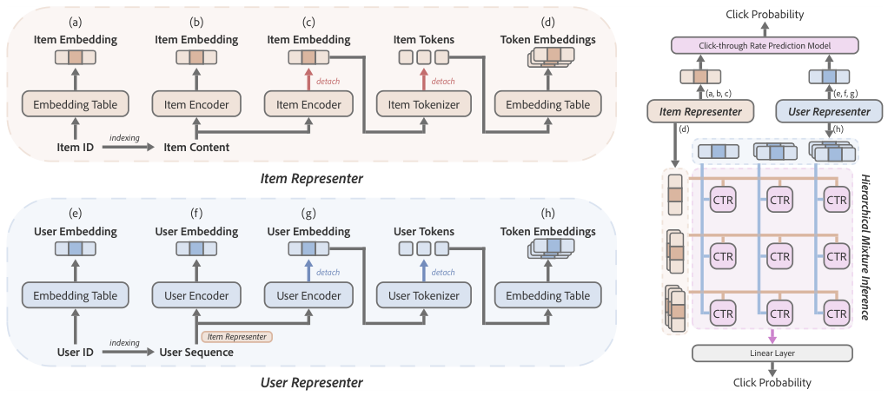
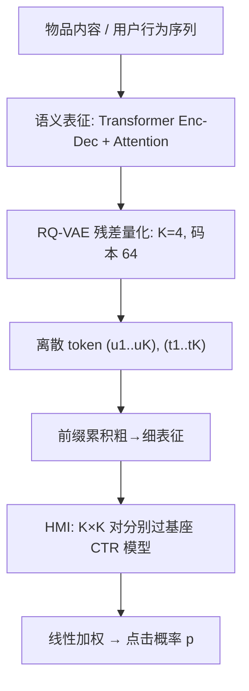

# Discrete Semantic Tokenization for Deep CTR Prediction (面向深度 CTR 预估的离散语义分词)

- **会议/期刊**: WWW 2024 Companion (短论文, 4 页)
- **作者与机构**: Qijiong Liu, Jiahao Wu, Xiao-Ming Wu (PolyU)；Hengchang Hu, Min-Yen Kan (NUS)；Jieming Zhu (华为诺亚方舟实验室)
- **推荐链路定位**: 精排 (CTR 预估) 的表征层，兼容召回侧语义 ID
- **研究方向**: CTR 预估与特征交叉 / 生成式推荐与离散语义 ID
- **论文原文**: [https://arxiv.org/abs/2403.08206v2](https://arxiv.org/abs/2403.08206v2)
- **开源代码**: [https://github.com/Jyonn/SemanticTokenizer](https://github.com/Jyonn/SemanticTokenizer)

## TL;DR (1分钟核心速览)

工业 CTR 模型引入物品内容时陷于两难：**content-encoding 范式**把预训练编码器塞进模型，用户序列要逐条现算，单样本延迟 65–68ms 无法上线；**embedding-based 范式**离线缓存稠密向量，却要 572G 内存（$N{\times}D$级别）。本文提出第三种范式 *semantic-token*：先用 RQ-VAE 把物品内容与用户行为序列各压成$K{=}4$个层级离散 token，再用分层混合推理 HMI 对$K^2$ 个用户–物品 token 对分别打分并学习权重。MIND 上 DCN 取得 AUC 0.6122（SOTA embedding 范式的 98%），内存从 572.20G 压到 2.98G（约 200 倍），延迟持平 3ms。

## Background & Motivation (背景与核心矛盾)

- **主流范式**: ID 类特征 + 浅层用户序列编码器（DIN 系）是工业标配；为补足语义，学界把 BERT 类编码器当作端到端 item encoder 接入。
- **前人局限**: ① content-encoding 中用户表征依赖行为序列，必须先把序列里每个物品都编码完，训练/推理延迟随序列长度线性爆炸；② embedding-based 虽用离线缓存换时间，但预训练维度 $D{=}768$ 的物品与用户向量常驻内存，工业规模下不可承受。
- **核心洞察 (Key Insight)**: 语义 ID 只需保留"可区分 + 有层级"的粗粒度信息，$K{=}4$ 个 6-bit 码字（码本 64）即可逼近原向量；而 RQ-VAE 的残差结构天然给出粗→细的层级，正好对应 CTR 中"主题级匹配 vs 细节级匹配"的不同粒度。
- **本文切入点**: 把语义分词从"物品侧、生成式检索"扩展到**用户+物品双侧**，并用 HMI 取代简单拼接，把离散化带来的精度损失在打分层补回来。

## Method (核心方法设计)

### 1. 整体框架 (Overall Architecture)

两阶段串行：先物品分词、后用户分词（用户序列中的每个物品用其 item token 初始化）。Stage 1 语义表征：物品把属性拼成文本过 Transformer 编码器，用户序列用 encoder–decoder 自编码器 + additive attention 得到定长向量 $\mathbf{z}$，以重构损失$\mathcal{L}_{sr}$训练，使任意用户历史都能随机访问到稠密表示。Stage 2 用 RQ-VAE 将$\mathbf{z}$离散化为$K$个 token。线上只查$K$张极小码本表得到 token embedding，喂入 HMI：对每个用户–物品 token 对$(i,j)$ 过一个基座 CTR 模型（DCN/DeepFM），再由线性层融合为最终点击率。

<figure class="paper-figure" markdown="span">
  <figcaption>图 1：我们的 UIST CTR 预测框架：包含基于语义的物品 (d) 与用户 (h) 分词器，以及分层混合推理模块。</figcaption>
</figure>

### 2. 关键设计拆解 (Key Designs)

1. **残差量化分词 (RQ-VAE)**：痛点是把 768 维稠密向量直接缓存太贵。逐层取最近码字并只对残差继续量化：$i_k=\arg\min_{j} g(\mathbf{v}_k,\mathbf{C}^k_j)$，$\mathbf{v}_{k+1}=\mathbf{v}_k-\mathbf{C}^k_{i_k}$，$\mathbf{v}\approx\bar{\mathbf{v}}=\sum_{k=1}^{K}\mathbf{C}^k_{i_k}$。直觉：低层码字记"主成分/主题"，高层码字只补细节，因此截断到前几个 token 也仍有语义，天然支持"粗召回—细精排"的信息复用。
2. **分层混合推理 (HMI)**：痛点是把 token 相加或用同层 token 打分，混叠了不同粒度的语义。改为前缀累积 $\bar{\mathbf{e}}^x_i=\sum_{j\le i}\mathbf{e}^x_j,\ x\in\{u,t\}$，对全部$K\times K$个$(\bar{\mathbf{e}}^u_i,\bar{\mathbf{e}}^t_j)$组合分别由基座模型$\mathcal{M}$打分，再$p=\mathrm{Linear}\big(\mathcal{M}(\bar{\mathbf{e}}^u_i,\bar{\mathbf{e}}^t_j)\big)$ 自适应加权。直觉：点击信号本身监督"该看多粗的粒度"，避免固定聚合的语义错配。
3. **训练目标与开销**：总损失 $\mathcal{L}=\mathcal{L}_{et}+(\lambda)\mathcal{L}_{sr}+\mathcal{L}_{rec}$，其中量化损失
$\mathcal{L}_{et}=\|\mathbf{z}-\bar{\mathbf{z}}\|^2+\sum_{k}\big(\|sg[\mathbf{v}_k]-\mathbf{C}^k_{i_k}\|^2+\beta\|\mathbf{v}_k-sg[\mathbf{C}^k_{i_k}]\|^2\big)$，
$\mathcal{L}_{rec}$为 BCE。分词器离线训练（无负采样需求，直接用曝光日志点击标签），线上只做查表；代价是 HMI 需跑$K^2{=}16$ 次轻量基座前向，但均为共享参数的极小 MLP，实测总延迟仍为 3ms。

## Experimental Setup & Evaluation Protocol (实验设置与评估协议)

- **数据集与预处理**: 单数据集 MIND（新闻推荐，MIND-small 量级），未额外做 k-core 过滤，物品即新闻、用户即匿名行为会话：

| 数据集 | #Users | #Items | #Interactions | 稀疏度/密度 | 特征/场景说明 |
| :--- | :---: | :---: | :---: | :---: | :--- |
| MIND | 94K | 65K | $\approx 2.3\times10^{5}$曝光 | 极稀疏 ($<10^{-4}$) | 新闻标题/摘要文本 + 点击行为序列，CTR 二分类 |

- **数据划分与防穿越 (Splitting Strategy)**: 沿用 MIND 原生按时间戳切分 train/valid/test（论文正文未单独声明，属沿用官方划分，存在"未明确交代"的规范瑕疵）。
- **排名评测协议 (Ranking Protocol)**: 曝光级打分评估，**不涉及采样负例排序**；正负样本直接来自日志点击标签，指标为 AUC 与 NDCG@5，另测单样本推理延迟（ms）。结果取 5 次独立运行均值。
- **对比基线与超参设置**: 对比 7 种**表征范式**（content / ID / embedding / semantic-token）分别插入 3 个基座 CTR 模型 DCN、DeepFM、FinalMLP；模型维 $d{=}256$，预训练维$D{=}768$，Transformer 层数 6，残差深度$K{=}4$，码本 64，Adam，lr=1e-3。未报告显著性检验。

## Key Experimental Results (实验关键数据)

### 1. 主实验对比 (Main Results)

| 范式 | 用户/物品表征 | 内存 | DCN AUC | DCN NDCG@5 | 延迟 | DeepFM AUC | FinalMLP AUC |
| :--- | :---: | :---: | :---: | :---: | :---: | :---: | :---: |
| Content-encoding | (b)/(f) | 29.81M | – | – | 66ms | – | – |
| ID-based | (a)/(f) | 95.36G | 0.5762 | 0.2808 | 12ms | 0.5665 | 0.5777 |
| ID-based | (a)/(e) | 190.72G | 0.5886 | 0.2862 | 3ms | 0.5749 | 0.5840 |
| Embedding-based | (c)/(f) | 286.10G | 0.6301 | 0.3220 | 13ms | 0.6195 | 0.6259 |
| Embedding-based | (c)/(g) | 572.20G | **0.6324** | **0.3247** | 3ms | **0.6219** | **0.6237** |
| Semantic (IST) | (d)/(f) | 1.49G | 0.6297 | 0.3224 | 33ms | 0.6183 | 0.6241 |
| Semantic (UIST) | (d)/(h) | **2.98G** | 0.6122 | 0.3085 | 3ms | 0.6077 | 0.6093 |

相对最强 embedding 范式 (c)/(g)：IST 达 99% 精度（AUC −0.27 点），UIST 达 98%（AUC −2.02 点），内存压缩 **191.9×**，延迟持平 3ms。

### 2. 消融实验 (Ablation Study)

| 双 token 聚合方式 | DCN AUC | DCN NDCG@5 | DeepFM AUC | DeepFM NDCG@5 |
| :--- | :---: | :---: | :---: | :---: |
| Add（直接相加） | 0.5795 | 0.2836 | 0.5723 | 0.2774 |
| Layer（同层配对） | 0.6044 | 0.2963 | 0.5980 | 0.2929 |
| **HMI（本文）** | **0.6122** | **0.3085** | **0.6077** | **0.3028** |

### 3. 关键实验发现 (Key Findings)

1. **压缩几乎不损精度、但用户侧分词有代价**：物品侧 IST 与 SOTA 仅差 0.0027 AUC 却省 192 倍内存；加做用户分词后 UIST 再降 0.0175 AUC（0.6297→0.6122），说明稠密用户向量比物品向量更"难量化"，用户侧语义细节对 CTR 更关键。
2. **HMI 是离散化的补偿器**：相比直接相加，HMI 带来 +3.27 点 AUC（0.5795→0.6122）、+2.49 点 NDCG@5；仅按同层配对也能涨 2.49 点，证明"粒度对齐"本身即是主要增益来源，而非参数量。
3. **范式级效率对比给出清晰边界**：content-encoding 延迟 66ms 直接出局；ID-based 双表 3ms 却 AUC 仅 0.5886；只有 semantic-token 同时命中"3ms 延迟 + 3G 内存 + 0.61 AUC"三者，明确指向工业可部署区间。

## Highlights & Limitations (亮点、对比与审稿批判)

- **与代表作对比 (vs. Prior Work)**: 相比 NP/PREC 类 embedding-based 工作，本文把"缓存稠密向量"换成"缓存 4 个离散码"，瓶颈从内存转为码本容量；相比 TIGER 等 semantic ID 工作（仅物品侧、面向生成式检索），本文把分词推广到**用户行为序列**并提出 token 对级混合打分，落点是精排 CTR 而非生成式召回。
- **可迁移亮点**: ① 用前缀累积 $\bar{\mathbf{e}}_i$ 构造粗→细表征，可无缝迁到多粒度召回/排序级联；② 曝光日志直接监督 token 对权重，是一种免额外标注的"粒度软路由"，可替代人工设计的多粒度特征桶。
- **审稿级局限批判**: ① 仅 MIND-small 单数据集、单语言新闻场景，且未与任何 semantic-ID/生成式基线对比，说服力受限于"自证范式"；② 精度相对最强 embedding 范式仍掉 2 个点 AUC，用户分词路径是明确短板；③ 论文未给出分词器离线训练成本、码本利用率与 $K$的敏感性分析，且延迟统计是否包含 HMI 的$K^2$ 次前向并不完全清晰。

## Rating (四维评分)

- **方法创新性 (Novelty)**: ⭐⭐⭐⭐ （把 RQ-VAE 语义 ID 从物品侧扩到用户侧，并提出 token 对级混合推理，范式层面有新意，但各组件均为已有技术组合）
- **评估协议与实验扎实度 (Protocol & Experiments)**: ⭐⭐⭐ （5 次运行取均值、三基座交叉验证较稳，但仅单数据集、划分方式未明写、缺显著性检验与 SOTA 语义 ID 基线）
- **写作与数学规范度 (Clarity & Rigor)**: ⭐⭐⭐⭐ （RQ-VAE 与 HMI 公式定义干净、内存复杂度对照表清晰；4 页短文导致总损失权重与实现细节略欠）
- **工业落地与复现价值 (Industrial & Practical Value)**: ⭐⭐⭐⭐⭐ （200 倍内存压缩 + 3ms 延迟 + 已开源，直接对应工业内存/时延双约束，迁移成本极低）

