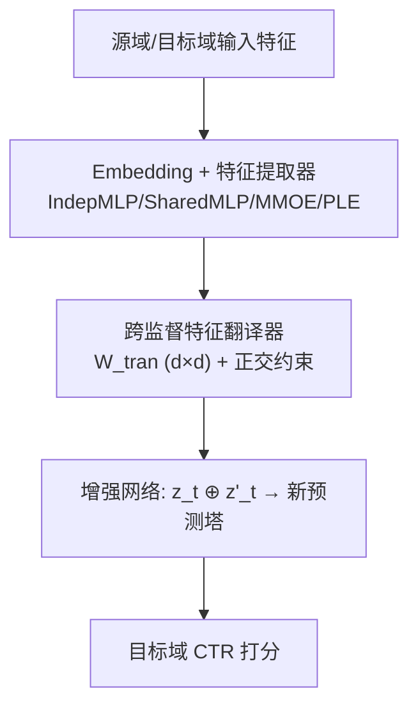

# Enhancing Cross-domain Click-Through Rate Prediction via Explicit Feature Augmentation (基于显式特征增强的跨域点击率预估)

- **会议/期刊**: WWW 2024 (The Web Conference)
- **作者与机构**: Xu Chen, Zida Cheng, Jiangchao Yao, Chen Ju, Weilin Huang, Jinsong Lan, Xiaoyi Zeng, Shuai Xiao（阿里巴巴 & 上海交通大学）
- **推荐链路定位**: 精排（CTR 预估）／图像搜商品检索排序
- **研究方向**: CTR 预估与特征交叉 / 跨域与多场景推荐
- **论文原文**: [arXiv:2312.00078v2](https://arxiv.org/abs/2312.00078v2)
- **开源代码**: 暂未开源

## TL;DR (1分钟核心速览)

跨域 CTR 的知识迁移长期依赖参数共享（隐式）或"超域 + 静态用户兴趣"（KEEP，需源域覆盖目标域绝大多数用户/物品，且兴趣与上下文无关）。CDAnet 改为两阶段串行训练：先用"跨监督翻译器"把目标域样本的隐特征线性翻译到源域空间、用源域塔 + **目标域标签** 监督，再学习正交约束防坍缩；随后把翻译后的特征与原特征拼接送入新建目标塔微调。整个过程不需要跨域重叠用户/物品，且翻译随输入特征上下文变化。在 Amazon、Taobao 两个公开基准与淘宝 image2product 生产数据上 AUC 全面优于 MMOE/PLE/KEEP，线上 A/B 取得 CTR 绝对 +0.11pt、成交 +0.64%、GMV +1.26%。

## Background & Motivation (背景与核心矛盾)

- **主流范式**: 跨域 CTR（CDCTR）分两支——联合训练（ShareBottom / STAR / DDTCDR / MMOE / PLE）靠共享底层参数传递知识；预训练-微调（CTNet / KEEP）先在源域训练再迁移参数，单阶段单目标以缓解梯度冲突。
- **前人局限**: ① 联合训练依赖跨域**重叠特征字段**共享 embedding，工业场景中两域字段常几乎不重叠（如 ad 有用户画像、rec 只有 ID），迁移近乎失效；② KEEP 虽显式抽取用户兴趣，但要求存在"超域"覆盖目标域大部分用户/物品，且抽出的兴趣对任意上下文**恒定不变**。
- **核心洞察 (Key Insight)**: 跨域样本之间**不存在配对关系**，因此无法沿用 image2image 翻译的像素级监督；但"用户若喜欢科幻电影，多半也喜欢科幻小说"——把目标域样本映射到源域后，其**点击标签应当保持**，这就是可用的监督信号。
- **本文切入点**: 用"标签保持"的跨监督替代配对监督，学到与上下文相关的翻译特征并作为增强视图拼接回目标域。

## Method (核心方法设计)

### 1. 整体框架 (Overall Architecture)

CDAnet 由**翻译网络**与**增强网络**串行构成。翻译阶段：源/目标域输入分别经 embedding 层（重叠字段共享子 embedding、非重叠字段独立）与各自特征提取器（可为 IndepMLP、SharedMLP、MMOE 或 PLE，灵活可插）得到隐特征 $\boldsymbol{z}_s,\boldsymbol{z}_t\in\mathbb{R}^d$；跨监督翻译器学习$d\times d$线性映射$\boldsymbol{W}^{tran}_s,\boldsymbol{W}^{tran}_t$，交叉送入对方的预测塔并用自身标签监督。增强阶段：复用 embedding、特征提取器与翻译器参数（预测塔重新初始化），把$\boldsymbol{z}_t$与翻译后的$\boldsymbol{z}'_t$拼接送入新塔做单目标微调，推理时仅需一次$d\times d$ 矩阵乘。

<figure class="paper-figure" markdown="span">
  ![图1：我们的跨域增强网络（CDAnet）架构。在转换阶段，转换网络通过两个特征提取器将来自两个域的输入编码为潜在特征，然后学习特征转换器。两个提取器可以相互独立，即它们之间不使用额外的特征迁移技术。或者，我们可以使用一些参数共享技术\[14, 17, 22, 23\]来额外引入隐式特征迁移方式。特征转换器学习在两个空间之间转换潜在特征。在增强阶段，转换网络](../../../../assets/papers/2312.00078v2/figure_1.png)<figcaption>图1：我们的跨域增强网络（CDAnet）架构。在转换阶段，转换网络通过两个特征提取器将来自两个域的输入编码为潜在特征，然后学习特征转换器。两个提取器可以相互独立，即它们之间不使用额外的特征迁移技术。或者，我们可以使用一些参数共享技术[14, 17, 22, 23]来额外引入隐式特征迁移方式。特征转换器学习在两个空间之间转换潜在特征。在增强阶段，转换网络</figcaption>
</figure>

### 2. 关键设计拆解 (Key Designs)

1. **跨监督特征翻译器（Cross-supervised Feature Translator）**：痛点是无配对样本可做监督。做法是把目标域隐特征翻译到源域空间后，交给**源域预测塔** $R_s$打分，却用**目标域标签**$y_t$计算损失，形成"跨塔跨标签"的对称监督：$\mathcal{L}_{cross}^t=\mathrm{BCE}\big(\sigma(R_s(\boldsymbol{W}^{tran}_t\boldsymbol{z}_t)),y_t\big)$，$\mathcal{L}_{cross}^s$同理。直觉：迫使翻译结果落入"源域塔能读懂、且判断仍与目标域真实兴趣一致"的区域，从而把源域学到的特征判别结构注入目标域表示。由于$R_s$ 只在翻译阶段参与，增强阶段不复用，避免双目标梯度干扰。
2. **正交映射约束（Orthogonal Mapping Constraint）**：若只做跨监督，多个 $\boldsymbol{z}_t$可能被映射到同一点（模式坍缩）。为此约束翻译矩阵近似正交：$\mathcal{L}_{orth}=\|\mathrm{T}(\boldsymbol{W}^{tran}_s)\boldsymbol{W}^{tran}_s\boldsymbol{z}_s-\boldsymbol{z}_s\|_F^2+\|\mathrm{T}(\boldsymbol{W}^{tran}_t)\boldsymbol{W}^{tran}_t\boldsymbol{z}_t-\boldsymbol{z}_t\|_F^2$，即$\boldsymbol{W}^\top\boldsymbol{W}\approx\mathbf{I}$。正交变换保长度与夹角，因此翻译前后样本间相似度结构得以保持。
3. **上下文感知增强与训练目标**：增强特征 $\boldsymbol{z}^{aug}_t=\boldsymbol{z}_t\oplus\boldsymbol{z}'_t\in\mathbb{R}^{2d}$，损失$\mathcal{L}_{aug}=\mathrm{BCE}(\sigma(R^{aug}_t(\boldsymbol{z}^{aug}_t)),y_t)$。翻译阶段总损失$\mathcal{L}_{trans}=\underbrace{\mathcal{L}_{vani}^s+\mathcal{L}_{vani}^t}_{\text{各自 CTR BCE}}+\alpha(\mathcal{L}_{cross}^s+\mathcal{L}_{cross}^t)+\beta\mathcal{L}_{orth}$，$\alpha$取 0.01（Amazon）/0.03（Taobao），$\beta=0.1$。由于整条输入（用户、物品、查询等多字段）一起被翻译，翻译结果天然随上下文变化，解决了 KEEP 的"静态兴趣"问题；且无需负采样设计，负例即真实曝光未点击样本。

## Experimental Setup & Evaluation Protocol (实验设置与评估协议)

- **数据集与预处理**:

| 数据集 | #Users | #Items | #Train 样本 | 正样本率 | 特征/场景说明 |
| :--- | :---: | :---: | :---: | :---: | :--- |
| Amazon movie | 29,680 | 16,494 | 1,685,836 | 20.8% | 类型/导演/片名(Glove-6B)，rating>3 为正 |
| Amazon book | 52,690 | 47,302 | 7,133,107 | 20.8% | 分类/作者/书名，rating>3 为正 |
| Taobao ad | 141,917 | 165,689 | 3,576,414 | 6.6% | 用户画像+广告类目/品牌，buy 为正 |
| Taobao rec | 186,731 | 379,817 | 12,168,878 | 7.0% | 仅 user/item ID 与类目，buy 为正 |

- **数据划分与防穿越**: 公开基准按**时间顺序 8:1:1** 切分为 train/val/test，属时间戳切分，避免未来行为泄漏；工业数据取 text2product 6 个月、image2product 1 年行为。
- **排名评测协议**: 以 **AUC** 逐样本评估点击概率区分度；负例来自真实曝光未点击（Amazon rating≤3、Taobao no-buy），**非随机负采样排序**，故不构成采样偏差，但也未报告 NDCG@K 等 Top-K 指标。
- **对比基线与超参**: 单域 MLP、ShareBottom；联合训练 STAR / DDTCDR / MMOE / PLE；预训练-微调 KEEP（仅生产数据，公开集无超域）。隐特征维度 $d=128$，专家数 2、每专家 2 层，塔 2–3 层；网格搜索所有模型层数与超参，多次实验取均值（未报告显著性检验）。

## Key Experimental Results (实验关键数据)

### 1. 主实验对比 (Main Results)

| Model | Amazon Book→Movie | Amazon Movie→Book | Taobao Rec→Ad | Taobao Ad→Rec |
| :--- | :---: | :---: | :---: | :---: |
| MLP | 0.6595 | 0.7604 | 0.6161 | 0.6865 |
| ShareBottom | 0.6604 | 0.7603 | 0.6160 | 0.5020 |
| STAR | 0.6503 | 0.7626 | 0.6149 | 0.6795 |
| DDTCDR | 0.6636 | 0.7807 | 0.6162 | 0.6756 |
| MMOE | 0.7025 | **0.7899** | 0.6177 | 0.6930 |
| PLE | 0.6993 | 0.7846 | 0.6164 | 0.6933 |
| CDAnet+IndepMLP | 0.7207 | 0.7735 | **0.6205** | **0.7047** |
| CDAnet+PLE | 0.7213 | 0.7838 | 0.6201 | 0.7023 |
| CDAnet+MMOE | **0.7225** | 0.7811 | 0.6200 | 0.7034 |
| **Improv.%** (最佳 CDAnet vs 最佳基线) | **+2.85%** | −0.77% | **+0.45%** | **+1.64%** |

生产数据（text2product→image2product）：Base AUC 0.7845，KEEP 0.7858 (+0.13%)，CDAnet 0.7866 (**+0.21%**)；线上 A/B：CTR 9.50%→9.61%（+0.11pt），成交数 +0.64%，GMV +1.26%。

### 2. 消融实验 (Ablation Study)

| 变体 (以 CDAnet+MMOE 为例) | Amazon movie | Amazon book | Taobao ad | Taobao rec |
| :--- | :---: | :---: | :---: | :---: |
| w/o $\mathcal{L}_{orth}$ | 0.7153 | 0.7734 | 0.6190 | 0.7022 |
| w/o $\mathcal{L}_{cross}$ | 0.7188 | 0.7757 | 0.6191 | 0.7003 |
| w/o 翻译网络（随机初始化直训增强网络） | 0.6464 | 0.7649 | 0.6075 | 0.7001 |
| w/o 增强网络（直接用翻译网络评估） | 0.6818 | 0.7686 | 0.6168 | 0.6811 |
| CDAnet (full) | **0.7225** | **0.7811** | **0.6200** | **0.7034** |

### 3. 关键实验发现 (Key Findings)

1. **增益与"跨域字段重叠度"强负相关**：Taobao 两域特征几乎不共享，ShareBottom 在 Ad→Rec 上直接崩到 0.5020（低于单域 MLP 0.6865），而 CDAnet 达 0.7047（+3.2% 绝对），说明显式翻译可完全绕开对重叠 embedding 的依赖；反之 Amazon 两域共享 user ID，MMOE 在 Movie→Book 上 0.7899 反超 CDAnet 的 0.7811，即目标域本身数据充足时，隐式共享仍是更强正则。
2. **能力来源是"翻译得到的知识"而非模型容量**：随机初始化跳过翻译阶段后，Amazon movie 从 0.7225 掉到 0.6464（−0.0761），跌幅远大于去掉增强网络（0.6818）；同时去掉 $\mathcal{L}_{orth}$的损失（−0.0072）约为去掉$\mathcal{L}_{cross}$（−0.0037）的两倍，印证正交约束是防坍缩的主要支撑。
3. **线上收益集中体现在高客单与稀缺品类**：GMV 增幅（+1.26%）显著高于成交数增幅（+0.64%），分价格层看 EPQ 得分提升在中高价层更大（L2 +3.62%、L3 +3.60% vs L1 +2.10%），成交提升从 L1 的 +0.08% 递增至 L5 的 +0.17%，说明源域长期积累缓解了高价商品曝光稀疏的学习难题；分用户群（G1–G5）CTR 提升稳定在 +0.09~+0.13pt，无群体性劣化。

## Highlights & Limitations (亮点、对比与审稿批判)

- **与代表作对比 (vs. Prior Work)**: 相比 STAR/MMOE/PLE 的**参数共享隐式迁移**，CDAnet 迁移的是可拼接的显式特征向量；相比 KEEP 的**超域依赖 + 静态兴趣 + 冻结提取模块**，CDAnet 只要求两域"相关"、翻译随输入上下文变化，且翻译器与塔参数高度解耦（塔重初始化以适配两阶段特征漂移）。论文还给出语义可解释性验证：把 movie 隐特征翻译到 book 空间后做 5-NN 检索，返回书名与电影主题高度一致（如 "The Addams Family" → 情感/爱情类小说），说明模型未用任何跨域物品对齐信息便自动捕捉到语义对应。
- **可迁移亮点**: ① "用对侧塔 + 本侧标签"构造跨监督，可推广到任意无配对样本的跨域/跨模态蒸馏；② 正交约束 $\boldsymbol{W}^\top\boldsymbol{W}\approx\mathbf{I}$ 作为廉价防坍缩正则，可直接插入任何线性投影/适配器模块。
- **审稿级局限批判**: ① 翻译器仅为 $d\times d$线性映射，表达能力受限，作者亦承认部分隐特征成分"不可翻译"会引入负迁移，但全文未给出可迁移性的度量或筛选机制；② 实验只报 AUC 单指标，未报告方差/显著性检验，且 Amazon Movie→Book 上被 MMOE 反超却未深入分析边界条件；③ 对$\alpha,\beta$仅给固定值（0.01/0.03、0.1），缺少敏感性曲线；④ 推理链路需额外一次$d\times d$ 乘与拼接，参数量与延迟开销未量化。

## Rating (四维评分)

- **方法创新性 (Novelty)**: ⭐⭐⭐⭐ （把 image2image 翻译范式改造为"标签保持"的跨监督翻译，思路清晰且与 KEEP 形成明确差异，但线性翻译算子本身较简单）
- **评估协议与实验扎实度 (Protocol & Experiments)**: ⭐⭐⭐ （两公开基准 + 百亿级生产数据 + 线上 A/B 与分组分析较完整，但仅用 AUC、按时间 8:1:1 划分、缺显著性检验与方差报告）
- **写作与数学规范度 (Clarity & Rigor)**: ⭐⭐⭐⭐ （公式与两阶段训练流程定义清楚，正交约束的动机解释到位；但对目标函数为何能收敛、$\alpha/\beta$ 敏感性缺少讨论）
- **工业落地与复现价值 (Industrial & Practical Value)**: ⭐⭐⭐⭐⭐ （已在淘宝 image2product 全量上线服务数亿用户，CTR/成交/GMV 三指标正向，且与 MMOE/PLE 可自由组合；遗憾未开源）

