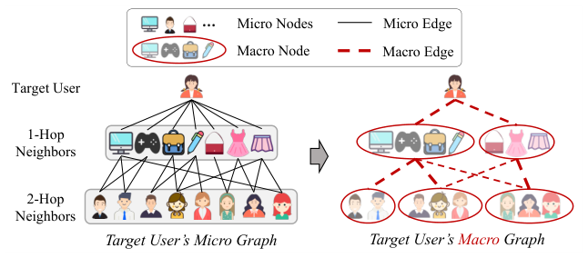
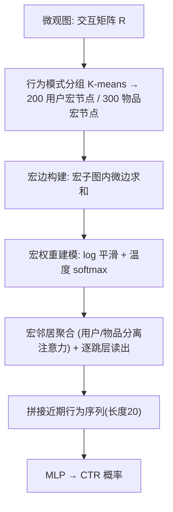
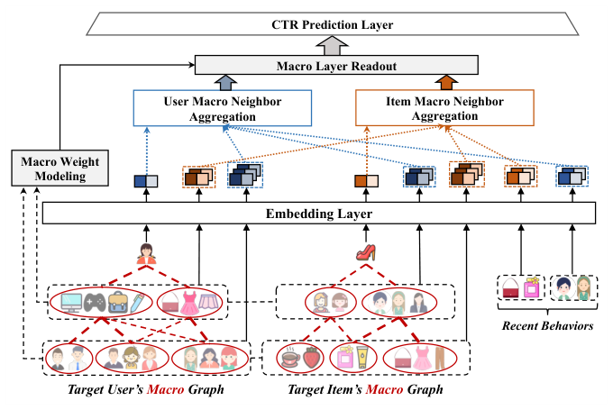

# Macro Graph Neural Networks for Online Billion-Scale Recommender Systems (面向在线十亿级推荐系统的宏图神经网络)

- **会议/期刊**: WWW 2024 (The Web Conference)
- **作者与机构**: Hao Chen (港理工)、Yuanchen Bei (浙大) 等；阿里巴巴、人大、暨大、中南大学
- **推荐链路定位**: 精排 (CTR 预估)
- **研究方向**: CTR/CVR 预估与特征交叉 / 图神经网络与知识图谱推荐
- **论文原文**: [https://arxiv.org/abs/2401.14939v2](https://arxiv.org/abs/2401.14939v2)
- **开源代码**: [https://github.com/YuanchenBei/MacGNN](https://github.com/YuanchenBei/MacGNN)

## TL;DR (1分钟核心速览)

十亿级场景下 GNN 做 CTR 必须采样邻居，淘宝真实数据表明采样数百个邻居只覆盖约 5% 的用户 1-hop 与 0.2% 的物品 1-hop，采样偏差严重且用户/物品邻居分布差异巨大。本文放弃"采样微图"路线，改用 K-means 按行为模式把上亿微节点压成 200 个用户宏节点 + 300 个物品宏节点，在宏图上做宏边求和权重建模与分离式注意力聚合。在曝光日志 AUC/GAUC/Logloss 协议下，三个公开集 + 十亿级工业集全面超越 12 个基线（AUC 平均 +1.00%），线上 PCTR +3.13%、GMV +5.13%、响应时间比 SIM 快 20.97%。

## Background & Motivation (背景与核心矛盾)

- **主流范式**: GNN 推荐把用户与点击/购买过的物品连成二部图（本文称"微观推荐图" MIG），CTR 侧则用 PinSage 式随机采样、GLSM/GMT 式重要性检索、或 DIN/SIM 式行为序列截断与检索来控复杂度。
- **前人局限① 采样偏差**: 流行物品的 2-hop 子图可达十亿级，采样几百个邻居只能覆盖极小比例，无法表征完整行为谱；且"采样邻居数"与"真实交互数"脱钩（百万级交互用户与百级交互用户采样量相同）。
- **前人局限② 两跳/物品侧信息被牺牲**: 传统 CTR 模型（DIN/DIEN/SIM/UBR4CTR）只看用户侧 1-hop 序列，物品侧子图由于效率被直接丢弃；图方法又因递归卷积在线上极慢（LightGCN/GMT 推理耗时约为本文的 3 倍/2 倍）。
- **核心洞察 (Key Insight)**: 问题的根不是"采样策略不够聪明"，而是"节点粒度太细"。若把行为模式相近的微节点聚成宏节点，邻居数可从十亿降到数百（图 1(b) 显示宏图邻居数集中在百级以内），采样偏差被结构性消除。
- **本文切入点**: 定义宏推荐图 MAG（宏节点 / 宏边 / 宏子图），并配套设计 MacGNN 在宏层面聚合，同时以 20 条近期行为补足短期兴趣。

<figure class="paper-figure" markdown="span">
  <figcaption>图2：宏观图构建示意图。</figcaption>
</figure>

## Method (核心方法设计)

### 1. 整体框架 (Overall Architecture)

输入是用户-物品交互矩阵 $R$；先以每个微节点的归一化交互向量为"行为表征"做 K-means，得到$K$ 个宏节点（用户侧 200、物品侧 300），再在每个目标用户/物品的宏子图内，用微边累加定义宏边权重；随后宏权重建模给出每个宏邻居的重要性，用户型与物品型邻居分别用不共享参数的注意力聚合，逐跳读出后与 20 条近期行为序列表示、原始 ID 嵌入拼接，送入 MLP 输出点击概率，BCE 端到端训练。离线日更（或小时更）全量宏边、实时增量宏边相加即得完整权重，线上仅需查宏结构与宏嵌入。

<figure class="paper-figure" markdown="span">
  <figcaption>图3：所提出MacGNN的模型架构。</figcaption>
</figure>

### 2. 关键设计拆解 (Key Designs)

1. **行为模式宏节点 + 子图相关宏边**：直接把十亿节点当邻居不可行，故以行为向量 $\boldsymbol{b}_v=\boldsymbol{r}_v/\|\boldsymbol{r}_v\|_2$聚类最小化组内行为差距$\sum_{k}\sum_{x_v=k}\|\boldsymbol{b}_v-\boldsymbol{\mu}_k\|_2$；宏边不是固定拓扑，而是在**每个目标子图内**按微边求和$\tilde{R}^{(k)}_{v;p,q}=\sum_{a\in C^{(k-1)}_{v;p},\,b\in C^{(k)}_{v;q}}r_{ab}$。这样宏边天然携带"该用户对该物品群"的个性化强度，而非全局静态连接。
2. **宏权重建模（log 平滑 + 温度 softmax）**：热点宏节点权重会淹没冷门宏节点，故先 $s^{(k)}_{v;q}=\log\!\big(1+\sum_{p\in\tilde{N}^{(k-1)}_v}\tilde{R}^{(k)}_{v;p,q}\big)$压缩量级，再$w^{(k)}_{v;q}=\mathrm{softmax}(s^{(k)}_{v;q}/\tau)$归一化。对数平滑让幂律分布的交互量回到可比尺度，温度$\tau$ 控制"集中看少数宏群"还是"平滑覆盖多宏群"。
3. **分离式宏邻居聚合与层读出**：用户/物品语义不同，故 $Q_u,K_u,V_u$与$Q_i,K_i,V_i$完全分离，$\alpha_{u,p}=\mathrm{softmax}\big((Q_u\tilde{E}_p)(K_uE_u)^\top/\sqrt{d}\big)$，$\tilde{Z}_{u,p}=\alpha_{u,p}\cdot V_u\tilde{E}_p$，再$\tilde{E}^{(l_u)}_u=\sum_{j}w_{u,j}\tilde{Z}_{u,j}$。相比递归 GCN 的多层邻接传播，这里每个宏邻居只需一次注意力查询，层读出是加权求和而非矩阵乘链，是线上可用的关键。

- **训练目标、负采样与推理效率**: $\mathcal{L}=\mathcal{L}_{bce}+\lambda\|\boldsymbol{\theta}\|_2^2$，$\mathcal{L}_{bce}$为曝光日志上的点击/未点击二分类交叉熵；**无需负采样**（真实曝光即样本），也无需图采样。复杂度上界由微观 GNN 的$O(|R|^2/(mn))$降为$O(\tilde{n}+\tilde{m})$，工业集下节点数相差约$6\times10^6$ 倍。

## Experimental Setup & Evaluation Protocol (实验设置与评估协议)

- **数据集与预处理**:

| 数据集 | #Users | #Items | #Interactions | 稀疏度 | 特征/场景说明 |
| :--- | :---: | :---: | :---: | :---: | :--- |
| MovieLens | 71,567 | 10,681 | 10,000,054 | 1.3e-2 | 21 类，电影评分转点击 |
| Electronics | 192,403 | 63,001 | 1,689,188 | 1.4e-4 | 801 类，Amazon 评论 |
| Kuaishou | 7,176 | 10,728 | 12,530,806 | 1.6e-1 | 31 类，短视频交互 |
| Industrial | 1.7e8 | 3.1e8 | 1.18e11 | 2.2e-6 | 27,452 类，淘宝首页推荐 |

- **数据划分与防穿越 (Splitting Strategy)**: 沿用 CTR 惯例的**按曝光样本随机划分**训练/测试（非 Leave-One-Out、非全局时间戳切分）；图结构由训练期交互构建，评测样本为用户-物品曝光对。
- **排名评测协议 (Ranking Protocol)**: 非全库排序，也不是采样排序，而是**逐点二分类评估**：候选即线上真实曝光集合，标签为点击/未点击，未曝光物品不计入；指标 AUC、GAUC、Logloss，五次不同随机种子取均值±标准差。
- **对比基线与超参设置**: 三类 12 个基线——特征交叉（Wide&Deep、DeepFM、AFM、NFM）、用户兴趣（DIN、DIEN、UBR4CTR、SIM）、图方法（PinSage、LightGCN、GLSM、GMT）。所有模型嵌入维度 $d=10$（Xavier 初始化），MLP 结构$[200,80,2]$，batch 1024，Adam，学习率搜索$\{1\text{e-}2,5\text{e-}3,1\text{e-}3\}$，$\lambda\in\{1\text{e-}4,5\text{e-}5,1\text{e-}5\}$。宏节点数$K$：用户 200、物品 300，$\tau$ 为敏感性超参。

## Key Experimental Results (实验关键数据)

### 1. 主实验对比 (Main Results)

| 模型 | ML AUC↑ | ML GAUC↑ | ML Logloss↓ | Elec AUC↑ | Elec GAUC↑ | Kuaishou AUC↑ | Kuaishou GAUC↑ | Ind. AUC↑ | Ind. GAUC↑ |
| :--- | :---: | :---: | :---: | :---: | :---: | :---: | :---: | :---: | :---: |
| Wide&Deep | 0.7237 | 0.6922 | 0.6072 | 0.8242 | 0.8247 | 0.8202 | 0.7761 | 0.8123 | 0.6908 |
| DeepFM | 0.7215 | 0.6910 | 0.6080 | 0.8064 | 0.8066 | 0.8207 | 0.7753 | 0.8169 | 0.6982 |
| DIN | 0.7248 | 0.6974 | 0.6143 | 0.8295 | 0.8307 | 0.8208 | 0.7792 | 0.8225 | 0.6963 |
| DIEN | 0.7262 | 0.6958 | 0.6112 | 0.8313 | 0.8323 | 0.8273 | 0.7783 | 0.8231 | 0.7008 |
| SIM | 0.7255 | 0.6950 | 0.6254 | 0.8296 | 0.8305 | 0.8273 | 0.7800 | 0.8313 | 0.7103 |
| LightGCN | 0.7305 | 0.7077 | 0.6122 | 0.8329 | 0.8333 | 0.8139 | 0.7803 | 0.8309 | 0.7093 |
| GLSM | 0.7320 | 0.7096 | 0.6088 | 0.8318 | 0.8324 | 0.8170 | 0.7811 | 0.8326 | 0.7149 |
| GMT | 0.7353 | 0.7097 | 0.6003 | 0.8313 | 0.8322 | 0.8215 | 0.7803 | 0.8343 | 0.7178 |
| **MacGNN** | **0.7458** | **0.7198** | **0.5886** | **0.8444** | **0.8458** | **0.8306** | **0.7813** | **0.8408** | **0.7233** |
| **Improv.%** | **+1.43%** | **+1.42%** | **-1.95%** | **+1.38%** | **+1.50%** | **+0.40%** | **+0.13%** | **+0.78%** | **+0.77%** |

线上 A/B（淘宝首页，四周均值）：vs SIM 提升 PCTR +3.13%、UCTR +1.32%、GMV +5.13%、停留时长 +1.01%，响应时间降低 20.97%；vs GMT 提升 PCTR +2.35%、UCTR +1.09%、GMV +3.53%、停留 +0.69%，响应时间降低 38.13%。

### 2. 消融实验 (Ablation Study)

| 变体 | ML AUC | ML GAUC | ML Logloss | Elec AUC | Elec GAUC | Elec Logloss |
| :--- | :---: | :---: | :---: | :---: | :---: | :---: |
| MacGNN 完整 | **0.7458** | **0.7198** | **0.5886** | **0.8444** | **0.8458** | **0.4892** |
| w/o weighting（去宏权重） | 0.7396 | 0.7132 | 0.5923 | 0.8418 | 0.8417 | 0.4938 |
| w/o recent（去近期行为） | 0.7212 | 0.6936 | 0.6176 | 0.8316 | 0.8333 | 0.5127 |
| w/o highorder（去高阶邻居） | 0.7401 | 0.7126 | 0.5929 | 0.8302 | 0.8319 | 0.5083 |
| w/o itemgraph（去物品侧图） | 0.7239 | 0.6871 | 0.6073 | 0.8189 | 0.8199 | 0.5259 |

### 3. 关键实验发现 (Key Findings)

1. **物品侧宏图是被忽视的最大增益源**：去掉物品侧图后 Electronics AUC 从 0.8444 跌至 0.8189（-3.02%），跌幅超过所有其它消融项，说明"只看用户历史"的 DIN/SIM 范式存在结构性信息缺口；而 MacGNN 因宏图只有百级节点，才第一次让物品侧图在线上可负担。
2. **宏图本身优于任何采样策略**：图方法整体优于特征交叉与兴趣序列方法，但采样型 UBR4CTR/SIM 在 Kuaishou 甚至不如 DIEN，说明"按规则检索少量相似节点"并不稳定增益；MacGNN 在四个数据集上全部最优，Kuaishou 上 AUC 提升幅度虽仅 +0.40%，但 GAUC 与 Logloss 仍稳定改善，表明其收益来自覆盖完整行为谱而非单点调参。
3. **效率与效果同向而非权衡**：线上推理耗时与最快的 Wide&Deep 几乎持平，却比 LightGCN 快约 3 倍、比 GMT 快约 2 倍，比 SIM 的响应时间低 20.97%；这直接反驳了"图模型必然慢、必须激进采样"的工程假设，说明降粒度比降采样更划算。

## Highlights & Limitations (亮点、对比与审稿批判)

- **与代表作对比**: 相较 PinSage/GLSM/GMT 一类"保留微图 + 更聪明的采样/检索"路线，本文从表示粒度层面重构图（采样偏差被消除而非缓解）；相较 DIN/DIEN/SIM 一类"只看用户侧序列"的 CTR 模型，本文额外引入物品侧与两跳宏结构；相较 LightGCN 一类的协同过滤图卷积，本文不做递归传播而用单次宏注意力，换取线上可部署性。
- **可迁移亮点**: ①「离线全量 + 实时增量」的边权相加更新机制（因宏边定义为求和，天然可增量）可平移到任何需要实时更新图结构的工业系统；②对数平滑 + 温度 softmax 处理幂律分布邻居权重，是通用的重尾归一化技巧。
- **审稿级局限批判**: ①宏节点聚类离线日更，对新兴趣迁移/突发爆款存在滞后，且 $K$（200/300）与$\tau$ 的敏感性、聚类质量对效果的影响仅在附录，缺乏分组误差的理论刻画；②宏边为标量求和，丢失了同一宏群内部的行为多样性（不同用户同群合并后强度不可区分）；③线上 A/B 文字存在"38.13% faster than SIM"的表述笔误（表格对应 GMT），且四个公开集聚类数、增量更新频率等工业超参未在正文充分披露，复现成本被低估。

## Rating (四维评分)

- **方法创新性 (Novelty)**: ⭐⭐⭐⭐ （"把微图聚成宏图"这一粒度级重构思路清晰且有工业洞察，但 K-means + 注意力的组件本身较为常规，缺少理论证明）
- **评估协议与实验扎实度 (Protocol & Experiments)**: ⭐⭐⭐⭐ （三公开集 + 十亿级工业集 + 线上 A/B + 12 基线 + 5 次种子标准差齐全，但采用逐点曝光二分类而非全库排序，未报告分组/长尾分桶）
- **写作与数学规范度 (Clarity & Rigor)**: ⭐⭐⭐ （宏节点/宏边/宏子图定义完整、公式自洽，但部分符号重复使用、复杂度上界论证偏粗略，线上指标存在笔误）
- **工业落地与复现价值 (Industrial & Practical Value)**: ⭐⭐⭐⭐⭐ （已服务淘宝首页两月、覆盖十亿用户与 12 万亿交互，代码开源，离线全量 + 实时增量的架构可直接借鉴）

