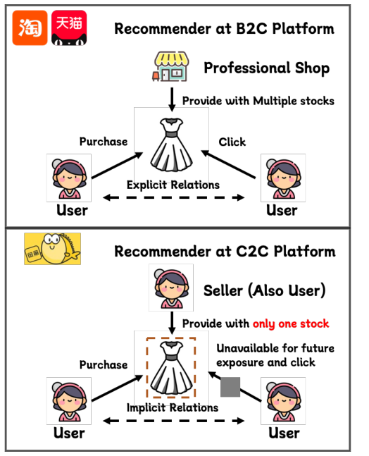
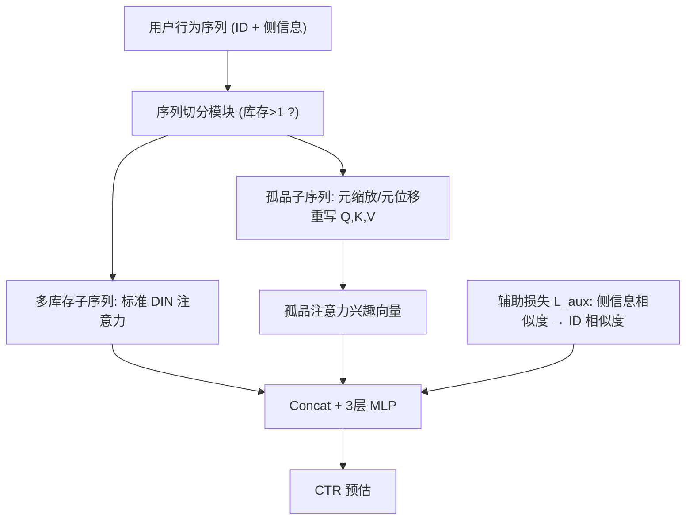
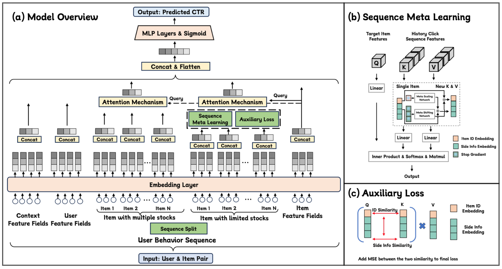

# MetaSplit: Meta-Split Network for Limited-Stock Product Recommendation (面向有限库存商品的元切分网络)

- **会议/期刊**: WWW 2024 Companion (Industry Track)
- **作者与机构**: Wenhao Wu, Jialiang Zhou, Ailong He, Shuguang Han, Jufeng Chen, Bo Zheng（西安交通大学 / 阿里巴巴集团闲鱼）
- **推荐链路定位**: 精排（CTR 预估）
- **研究方向**: CTR/CVR 预估与特征交叉 / 冷启动与长尾推荐
- **论文原文**: [https://arxiv.org/abs/2403.06747v5](https://arxiv.org/abs/2403.06747v5)
- **开源代码**: 暂未开源

## TL;DR (1分钟核心速览)

C2C 平台（闲鱼）上大量商品是"孤品"（库存=1），售出即消失，导致其 ID Embedding 无法收敛，且用户行为序列中孤品与多库存商品混杂，注意力机制会系统性压低孤品权重。本文提出 MSNet：按库存切分历史序列，对孤品分支用元缩放（侧信息校准侧信息）与元位移（侧信息补 ID）网络增强表征，并加一条 ID-侧信息相似度一致性辅助损失让已售商品仍可更新参数。在 8 天 100 亿样本生产集上 AUC 相对 DIN 提升 1.05%、GAUC 1.93%，线上 A/B 全站 CTR +3.56%，孤品 CTR +3.72%。

## Background & Motivation (背景与核心矛盾)

- **主流范式**: 工业 CTR 采用 Embedding + MLP（DIN/DIEN 类），用 Target-Attention 将用户历史行为序列池化为定长兴趣向量，依赖训练充分的 Item ID Embedding 表达物品个性。
- **前人局限**: ① C2C 孤品只被售卖一次，交互极稀疏，ID Embedding 收敛慢甚至无法收敛，直接套用冷启动方法（Meta-E / MWUF / GroupID）忽略了"库存量"这一结构性差异；② 序列中多库存商品占据高频曝光，注意力被高频信号主导——论文实测 DIN 注意力打分中，目标为多库存商品时对多库存历史打 0.35、对孤品仅 0.17；目标为孤品时对多库存历史打 0.09、对孤品仅 0.07，孤品既不被目标匹配也不被自身强化。
- **核心洞察 (Key Insight)**: 孤品的问题不是"新"，而是"一次性 + 稀疏"——它同时缺 ID 收敛机会与序列话语权；而多库存商品的 ID Embedding 又会在售罄后彻底停止更新，造成表征陈旧。
- **本文切入点**: 按库存把一条序列切成两条、分别建模，并用元学习让孤品借侧信息"长出自己的 ID"，再用辅助损失给已下架商品续上梯度。

<figure class="paper-figure" markdown="span">
  <figcaption>图1：展示B2C平台与C2C平台之间区别的示例。</figcaption>
</figure>

## Method (核心方法设计)

### 1. 整体框架 (Overall Architecture)

输入为 209 维多域特征：非序列特征（用户 ID、上下文）与最近 30 天、截断 50 长的点击序列。序列切分模块以库存阈值 1 为界，把历史商品分为多库存子序列 $\boldsymbol{E}_{B\_Seq}$与孤品子序列$\boldsymbol{E}_{C\_Seq}$；多库存分支沿用标准 DIN 注意力，孤品分支先经序列元学习模块重写 Query/Key 的侧信息与 Value 的 ID，再送入同一注意力。两路兴趣向量与非序列 embedding 拼接后过 3 层 MLP（512-256-128）输出 CTR，训练时叠加一条 ID-侧信息相似度对齐的辅助损失。

<figure class="paper-figure" markdown="span">
  <figcaption>图3：MSNet的示意框架大致可分为三个组件：序列切分模块、序列元学习模块和辅助损失。图(a)给出模型概览，其中序列切分模块位于底部。图(b)展示序列元学习模块，图(c)则详细说明辅助损失。</figcaption>
</figure>

### 2. 关键设计拆解 (Key Designs)

1. **序列切分模块（Sequence Split）**：痛点是高频多库存信号淹没低频孤品信号。做法是在样本构造阶段（或训练时 mask）按库存把序列拆为两支，各自独立注意力池化后再 concat，使孤品的梯度不再被高频商品稀释：

$\boldsymbol{E}_{Item}=\text{Concat}[\boldsymbol{E}(F_{ID}),\boldsymbol{E}(F_{Side})],\quad \boldsymbol{E}_{Seq}\Rightarrow\{\boldsymbol{E}_{B\_Seq},\boldsymbol{E}_{C\_Seq}\}$

直觉上这是"分而治之"的频偏矫正，等效于在序列层做了一次免参数的重加权。

2. **序列元学习模块（Meta Scaling & Shifting）**：孤品 ID 未收敛，故让侧信息（类目等泛化特征）在匹配阶段承担更多责任。缩放网络用 ID 生成字段级权重去调制侧信息，位移网络反过来用侧信息生成"元 ID"，并按范数比例 $v$ 与原 ID 做软融合：

$\boldsymbol{\delta}_{w}=\text{DNN}(\text{sg}[\boldsymbol{E}(S_{ID})]),\quad \text{Re\_}\boldsymbol{E}(S_{Side})=\boldsymbol{\delta}_{w}\otimes\boldsymbol{E}(S_{Side})$

$\boldsymbol{\delta}_{\text{MetaID}}=\text{DNN}(\text{sg}[\boldsymbol{E}(S_{Side})]),\quad v=\frac{\|\boldsymbol{\delta}_{\text{MetaID}}\|}{\|\boldsymbol{\delta}_{\text{MetaID}}\|+\|\boldsymbol{E}(S_{ID})\|}$

$\text{Re\_}\boldsymbol{E}(S_{ID})=v\odot\boldsymbol{\delta}_{\text{MetaID}}\oplus(1-v)\odot\boldsymbol{E}(S_{ID})$

$v$由 Embedding 范数自适应决定：ID 越弱（范数小）越信元 ID，ID 越强越信原 ID，无需人工调参即可平滑过渡。最终$\text{Final\_}\boldsymbol{E}(K)=\text{Concat}[\boldsymbol{E}(S_{ID}),\text{Re\_}\boldsymbol{E}(S_{Side})]$，$\text{Final\_}\boldsymbol{E}(V)=\text{Concat}[\text{Re\_}\boldsymbol{E}(S_{ID}),\boldsymbol{E}(S_{Side})]$。

3. **辅助损失与训练推理**：注意力加权池化使低贡献孤品只拿到极小梯度，且商品售出后彻底 out-of-distribution。作者假设"同类目商品应有相似 ID"，用侧信息相似度作教师、对教师侧做 stop-gradient，只把梯度灌回 ID：

$\mathcal{L}_{aux}=\text{MSE}(\text{sg}[\cos(T_{Side},S_{Side})],\ \cos(T_{ID},S_{ID})),\quad \mathcal{L}=\mathcal{L}_{CE}+\alpha\mathcal{L}_{aux}$

训练用 CTR 任务常规点击/未点击样本，无额外负采样；推理开销仅增加一个小 MLP，线上响应时间增幅 <5%。

## Experimental Setup & Evaluation Protocol (实验设置与评估协议)

- **数据集与预处理**: 阿里闲鱼推荐平台 8 天真实点击日志，无公开可用的孤品 CTR 数据集（作者自述）。

| 数据集 | #Users | #Items | #Interactions | 稀疏度/密度 | 特征/场景说明 |
| :--- | :---: | :---: | :---: | :---: | :--- |
| Xianyu Production | 未披露 | 未披露 | 100 亿（日均 15 亿） | 极稀疏（孤品单交互） | 209 维特征；含多库存/孤品两类商品与用户点击序列 |

- **数据划分与防穿越 (Splitting Strategy)**: 前 7 天训练、第 8 天测试的**时间切分**；测试集再按用户随机分 10 组，报告均值与标准差，避免单次划分波动。
- **排名评测协议 (Ranking Protocol)**: 工业日志隐含曝光偏差，采用 AUC / GAUC（按曝光量加权）与 RelaImpr 衡量排序能力，另用 PCOC（越接近 1 越好）与 Calib-N（越小越好）衡量**概率校准**——这是工业 CTR 计价所必需的指标。
- **对比基线与超参设置**: 四类基线——常规 DNN（DNN、Wide&Deep、DeepFM、DIN）、元学习（GroupID、Meta-E、MWUF）、门控（GateNet、FiBiNet、POSO）、去偏（LogQ、ClassRebalance）。统一 3 层 MLP（512-256-128）、注意力隐层 128、AdagradDecay、lr=1e-4、batch=4096；提升均通过双侧 t 检验 $p<0.05$。

## Key Experimental Results (实验关键数据)

### 1. 主实验对比 (Main Results)

| 方法 | Overall AUC | RI | GAUC | RI | 孤品 AUC | RI | 孤品 Calib-N↓ |
| :--- | :---: | :---: | :---: | :---: | :---: | :---: | :---: |
| DNN | 0.7358 | -4.57% | 0.6557 | -6.09% | 0.7359 | -4.61% | 0.00183 |
| Wide&Deep | 0.7412 | -2.39% | 0.6624 | -2.05% | 0.7414 | -2.39% | 0.03377 |
| DeepFM | 0.7449 | -0.89% | 0.6646 | -0.72% | 0.7451 | -0.89% | 0.00234 |
| DIN (base) | 0.7471 | 0.00% | 0.6658 | 0.00% | 0.7473 | 0.00% | 0.00305 |
| GroupID | 0.7475 | 0.16% | 0.6665 | 0.42% | 0.7478 | 0.20% | 0.00997 |
| Meta-E | 0.7480 | 0.36% | 0.6672 | 0.84% | 0.7481 | 0.32% | 0.00258 |
| MWUF | 0.7479 | 0.32% | 0.6669 | 0.66% | 0.7481 | 0.32% | 0.00199 |
| LogQ | 0.7485 | 0.57% | 0.6673 | 0.90% | 0.7484 | 0.44% | 0.08762 |
| POSO | 0.7464 | -0.28% | 0.6663 | -0.30% | 0.7465 | -1.05% | 0.00024 |
| **MSNet** | **0.7497** | **+1.05%** | **0.6690** | **+1.93%** | **0.7498** | **+1.01%** | 0.00065 |

### 2. 消融实验 (Ablation Study)

| 变体 | AUC | RelaImpr | GAUC | RelaImpr |
| :--- | :---: | :---: | :---: | :---: |
| Base (DIN) | 0.7471 | 0.00% | 0.6658 | 0.00% |
| w/o seq-split | 0.7484 | +0.53% | 0.6671 | +0.78% |
| w/o seq-meta | 0.7481 | +0.40% | 0.6669 | +0.66% |
| w/o auxiliary loss | 0.7489 | +0.73% | 0.6679 | +1.26% |
| **MSNet (full)** | **0.7497** | **+1.05%** | **0.6690** | **+1.93%** |

**线上 A/B（10 天，MD5 分流）**：全站 CTR **+3.56%**、点击数 +3.31%；孤品 CTR **+3.72%**、点击数 **+5.20%**、曝光占比绝对 **+1.00%**；多库存 CTR +3.64% 但曝光占比 -1.00%。

### 3. 关键实验发现 (Key Findings)

1. **三个模块缺一不可且互补**：单去辅助损失即 +0.73%，单去元学习仅 +0.40%，而三者叠加达 +1.05%；在 GAUC 上辅助损失贡献最大（去之跌至 +1.26% vs 全量 +1.93%），说明"给被忽略的孤品灌梯度"比"换表征"更直接地改善了用户级排序一致性。
2. **元学习基线增益有限，验证了库存维度才是关键**：Meta-E / MWUF 仅 +0.32%~0.36%，GroupID 甚至靠热门商品 ID 替换而失真；本文 +1.05% 说明把"库存量"作为切分先验比单纯补冷启 ID 更有效。
3. **校准指标揭示隐患**：LogQ 虽 AUC +0.57%，但孤品 Calib-N 恶化到 0.0876（PCOC 失衡），而 MSNet 的 Calib-N 为 0.00065，线上可直接用于计费门槛；线上孤品曝光占比 +1.00%、多库存 -1.00%，表明模型确实把流量从高频商品回拨给孤品，而非单纯抬高全局 CTR。

## Highlights & Limitations (亮点、对比与审稿批判)

- **与代表作对比 (vs. Prior Work)**: 与 MWUF 的本质区别在于**逐样本序列级应用**元网络并把缩放/位移拆成两路互补（MWUF 面向独立冷启商品 embedding）；与 LogQ/ClassRebalance 的区别是不改损失权重调频偏，而是从序列结构上物理隔离高频与低频信号；与 POSO 的区别是不引入个性化 MLP，仅增强 embedding 层，可插拔到任意 DIN 变体。
- **可迁移亮点**: ①"按物品属性切分子序列 + 分支差异化建模"可推广到新品/长尾、直播短生命周期商品、跨域多场景序列；②stop-gradient 相似度蒸馏让已下架/不可见样本继续更新表征，适用于任何一次性资源（如限量券、短期房源）。
- **审稿级局限批判**: ① 数据集完全闭源且统计量（用户数、物品数）未披露，仅单一工业集验证，缺乏公开基准与跨平台泛化证据；② 库存阈值硬编码为 1，"多库存"内部跨度极大（2 件 vs 万件）却共用 DIN 分支，且辅助损失权重 $\alpha$ 与元网络隐层规模均未做敏感性分析；③ 绝对增益（AUC +0.26pt）虽在工业尺度可观，但消融差距仅 0.001~0.002 AUC，稳定性依赖百亿级样本支撑。

## Rating (四维评分)

- **方法创新性 (Novelty)**: ⭐⭐⭐⭐ （首次显式提出"有限库存商品推荐"问题，序列切分 + 范数自适应元位移组合新颖，但元缩放/位移骨架沿用 MWUF）
- **评估协议与实验扎实度 (Protocol & Experiments)**: ⭐⭐⭐⭐ （百亿级生产集 + 10 组重采样 + t 检验 + 10 天线上 A/B，且报告 PCOC/Calib-N 校准指标；不足是无公开数据与超参敏感性分析）
- **写作与数学规范度 (Clarity & Rigor)**: ⭐⭐⭐ （框架与公式清晰可复现，但存在符号前后不一致与个别指标描述笔误，理论分析（如频偏成因）仅有注意力打分实测，缺乏形式化论证）
- **工业落地与复现价值 (Industrial & Practical Value)**: ⭐⭐⭐⭐ （仅增强 embedding 层、线上延迟增幅 <5%、已在闲鱼全量部署，工程迁移成本低；扣分于代码未开源）

