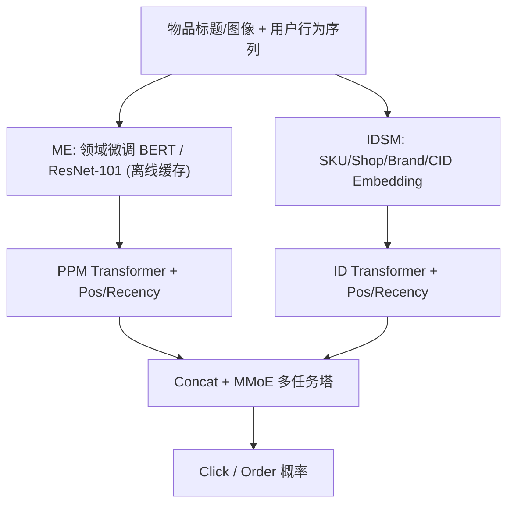
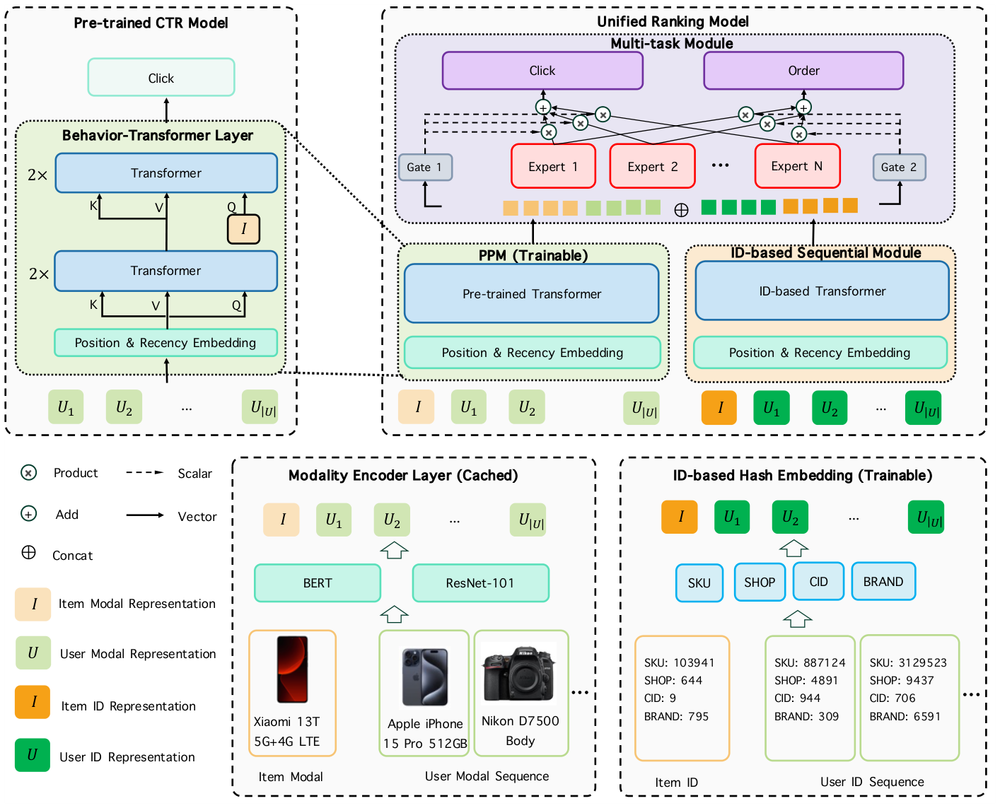
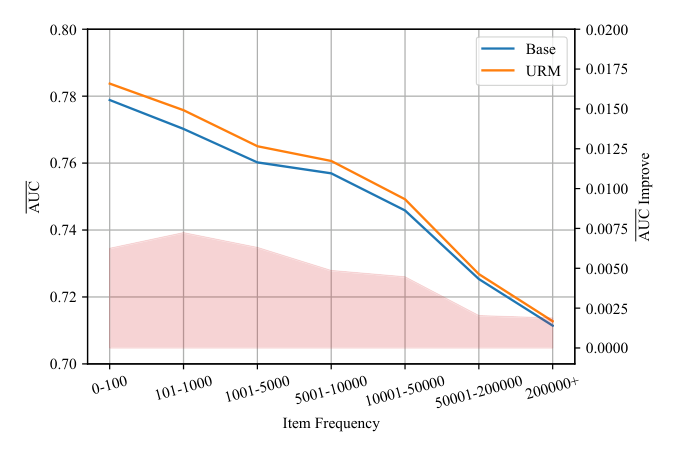

# PPM: A Pre-trained Plug-in Model for Click-through Rate Prediction (面向点击率预估的预训练插件模型)

- **会议/期刊**: WWW 2024 (Companion, Industry Track)
- **作者与机构**: Yuanbo Gao, Peng Lin, Dongyue Wang, Feng Mei, Xiwei Zhao, Sulong Xu, Jinghe Hu (京东集团)
- **推荐链路定位**: 精排 (CTR/CVR 多任务排序)
- **研究方向**: CTR 预估与特征交叉 / 多模态推荐
- **论文原文**: [论文原文链接](https://arxiv.org/abs/2403.10049v1)
- **开源代码**: 暂未开源

## TL;DR (1分钟核心速览)

工业 IDRec 在冷启动物品上失效、且因迭代效率只能用近 1–2 周数据训练。本文提出 PPM：以物品标题/图像的多模态特征为输入、以 CTR 为监督做大规模预训练，再把它**并联**进 IDRec 序列塔形成统一排序模型 URM；训练/ serving 时把模态编码器输出离线缓存，仅 Behavior-Transformer 与预测层可训，因而在**不增加在线延迟**的前提下端到端联合训练。京东线上 A/B 中 UCTR +1.09%、UCVR +0.28%、长尾曝光 +10%，且 50% 数据 + PPM 基本追平 100% 数据无 PPM。

## Background & Motivation (背景与核心矛盾)

- **主流范式**: 以 SKU/Shop/Brand/Category 等离散 ID + 双向 Transformer 序列建模（DIN/DSIN/MAIN）为工业精排主力，多模态信息通常只作为**冻结的辅助 embedding** 侧特征拼接。
- **前人局限**: ① 冷启/长尾物品缺乏交互统计，ID embedding 近乎随机初始化；② 受迭代效率约束只取近期少量样本训练，长周期行为无法利用；③ 若直接端到端加载预训练用户模型，参数量带来的在线延迟不可接受，而"提前缓存表征+不联合训练"又会损失精度。
- **核心洞察 (Key Insight)**: 预训练模型的价值主要来自"**通用多模态语义 + 大规模行为先验**"，而非其在线前向计算；因此只要把**昂贵的模态编码前向离线化**、保留轻量的行为建模层可训，即可兼得表征增益与低延迟。
- **本文切入点**: 把预训练 CTR 模型做成一个"插件塔"，与 ID 序列塔并行输入 MMoE，缓存冻结输入、放开局部参数。

## Method (核心方法设计)

### 1. 整体框架 (Overall Architecture)

URM 由两条并行塔构成：左塔为 ID-based Sequential Module (IDSM)，输入 `[SKU|Shop|Brand|CID]` embedding；右塔为 PPM，输入物品标题 BERT 向量与图像 ResNet 向量。两塔各自叠加 Position + Recency embedding 后过 2 层双向 Transformer，输出 $U_{ID},I_{ID}$与$U_{MO},I_{MO}$，连同其他特征拼接后进入多门 MMoE，分别输出点击与下单两个塔。PPM 的模态编码器（ME）输出预先落 HDFS 缓存，训练时只更新 PPM 的 Transformer 层与预测层，从而与 IDRec 端到端联合优化却不引入在线重计算。

<figure class="paper-figure" markdown="span">
  <figcaption>图1：所提出的PPM与统一排序模型（URM）的架构。</figcaption>
</figure>

### 2. 关键设计拆解 (Key Designs)

1. **ID-free 多模态 CTR 预训练 (PPM Pretrain)**：通用 BERT/ResNet 的语义空间与电商商品语义错位（标题含大量型号词、图像为白底商品图）。作者用两个电商自监督任务做域适应：文本侧沿用 SimCSE 式对比学习，以"搜索 query—点击商品文本"为正对：
$\mathcal{L}_{QM}=-\sum_i \log \frac{e^{\mathrm{sim}(h_{x_i},h_{y_i})/\tau}}{\sum_{j=1}^{B} e^{\mathrm{sim}(h_{x_i},h_{y_j})/\tau}}$视觉侧以商品图预测关键实体$\mathcal{L}_{EP}=-\sum_i \log P(E_i|I_i)$。预训练阶段直接以真实点击日志做二分类交叉熵监督，使表征天然对齐下游 CTR 目标，而非纯内容相似。
2. **缓存式插件化联合训练 (Cache-based Plug-in)**：把 PPM 视作"输入已被冻结的塔"，仅保留其 Transformer 与 MLP 可训，输入表征离线生成：
$E_{MO}=[E_{\text{title}}|E_{\text{image}}]+E_{\text{position}}+E_{\text{recency}}$
由此梯度仍可回传至行为建模层完成域适应，但线上只需跑 2 层轻量 Transformer，延迟与基线同量级——这是相较"仅拼冻结多模态 embedding"（无联合训练）与"整模型端到端加载"（延迟爆炸）的关键折中。
3. **双塔 MMoE 融合与训练目标**：ID 语义与多模态语义互补且异质，故不共享 Transformer，仅在 MMoE 入口融合：
$g_k=\mathrm{softmax}(xW_k+b_k),\quad x=[U_{ID}|I_{ID}|U_{MO}|I_{MO}|D]$
$f_k(x)=\sum_{i=1}^{n}g_{ki}(x)f_i(x)$
损失为点击/下单两任务的加权交叉熵，负样本即线上"曝光未点击"日志（pointwise，无显式负采样与 hard negative 构造）；线上 serving 仅执行缓存查表 + 轻量塔前向 + MMoE，实现零延迟增量。

## Experimental Setup & Evaluation Protocol (实验设置与评估协议)

- **数据集与预处理**: 全部为京东线上真实生产日志，无 5-core 过滤；预训练约 6 个月数据，URM 分别用 1 周 (Small) 与 2 周 (Large) 数据训练：

| 数据集 | #Users | #Items | #Interactions | 说明 |
| :--- | :---: | :---: | :---: | :--- |
| Pretrain | 505,439,104 | 93,322,811 | 12,418,618,242 | 6 个月，无 ID 特征，仅多模态 |
| Small | 113,482,552 | 23,888,962 | 546,746,823 | 1 周，联合训练 |
| Large | 163,660,999 | 38,502,046 | 1,295,355,022 | 2 周，联合训练 |

- **数据划分与防穿越 (Splitting Strategy)**: 采用**全局时间戳切分**（离线增量更新：PPM 用 T-2、URM 用 T-1 数据滚动训练），测试集为后续时段真实曝光样本，未见随机比例划分与 Leave-One-Out。
- **排名评测协议 (Ranking Protocol)**: 面向线上日志的 **pointwise 打分评估**，指标为点击/下单两任务的 AUC 与 P@2（每用户 top-2 占比）；因样本来自真实曝光分布，**未做 Full-Ranking 全库未交互排序，也未报告采样负例比**，属工业日志内评估而非无偏排序评测。
- **对比基线与超参设置**: Wide&Deep、DeepFM、DIN、DSIN、MAIN 及 URM 自身 wo./w. PPM 共 12 组；ID 与多模态 embedding 维度均为 64，Transformer 层数 2、头数 4，batch 20000，Adam lr $4\times10^{-4}\to10^{-4}$，Tesla A100 + TensorFlow2；未报告显著性检验。

## Key Experimental Results (实验关键数据)

### 1. 主实验对比 (Main Results)

Average AUC / Average P@2（Click 与 Order 均值）：

| 模型 | Small wo.PPM | Small w.PPM | Large wo.PPM | Large w.PPM | ΔAUC (Large) |
| :--- | :---: | :---: | :---: | :---: | :---: |
| Wide&Deep | 0.6062 / 0.1770 | 0.6873 / 0.1857 | 0.6070 / 0.1775 | 0.6935 / 0.1899 | **+0.0865** |
| DeepFM | 0.6095 / 0.1785 | 0.6852 / 0.1857 | 0.6140 / 0.1812 | 0.6939 / 0.1903 | +0.0799 |
| DIN | 0.7089 / 0.2091 | 0.7272 / 0.2171 | 0.7205 / 0.2135 | 0.7306 / 0.2184 | +0.0100 |
| DSIN | 0.7166 / 0.2122 | 0.7265 / 0.2163 | 0.7243 / 0.2159 | 0.7295 / 0.2181 | +0.0052 |
| MAIN | 0.7016 / 0.2072 | 0.7102 / 0.2127 | 0.7106 / 0.2114 | 0.7141 / 0.2145 | +0.0036 |
| **URM (本文)** | 0.7438 / 0.2292 | **0.7477 / 0.2324** | 0.7482 / 0.2324 | **0.7532 / 0.2338** | +0.0050 |

在线 A/B（京东首页推荐，连续 10 天，同流量对照）：UCTR **+1.09%**，UCVR **+0.28%**，长尾商品曝光占比 **+10%**。

### 2. 消融实验 (Ablation Study)

| 变体 | Click AUC | Order AUC | Avg AUC (Improv.) | Avg P@2 |
| :--- | :---: | :---: | :---: | :---: |
| Base（仅原始 BERT/ResNet 特征共享 Transformer） | 0.7252 | 0.7612 | 0.7432 (-) | 0.2308 |
| Base + QM&EP（域微调，无 PPM 塔） | 0.7279 | 0.7685 | 0.7482 (+0.0050) | 0.2324 |
| + PPM（随机初始化） | 0.7277 | 0.7735 | 0.7506 (+0.0074) | 0.2336 |
| + PPM（冻结参数） | 0.7318 | 0.7710 | 0.7514 (+0.0082) | 0.2332 |
| **+ PPM（微调，URM）** | **0.7343** | **0.7722** | **0.7532 (+0.0100)** | **0.2338** |

### 3. 关键实验发现 (Key Findings)

1. **增益与基线强度成反比**：越依赖纯 ID 统计的模型受益越大（Wide&Deep AUC +0.0865、DeepFM +0.0799），而本就含序列行为建模的 URM 仅 +0.0050（0.7482→0.7532）。说明 PPM 本质是**用多模态语义替代冷启/稀疏下的 ID 统计量**，而非引入全新信号，故与强序列塔存在明显功能重叠。
2. **迭代效率收益可以量化兑现**：Small + PPM 的 DIN/DSIN（0.7272/0.7265）已超过 Large 无 PPM 的 DIN/DSIN（0.7205/0.7243），即"一半数据 + PPM ≈ 全量数据"；URM 上两者差距也被压到 0.1% 以内（0.7477 vs 0.7482），工程上等价于训练成本减半。
3. **域适应与可训练性缺一不可**：QM&EP 微调单独贡献 +0.0050，加 PPM 塔后再 +0.0026~0.0050；冻结 PPM 反而低于微调（0.7514 vs 0.7532），证明下游域偏移必须靠有限参数更新吸收；但随机初始化 PPM 已达 +0.0074，说明"双塔分离建模异质特征"本身也有结构性收益。
4. **冷启/长尾是最大受益区**：按目标物品在训练集出现频次分桶，URM 在 0–100 频次桶的 AUC 提升最大（约 +0.02），并随频次升高单调收窄；线上长尾曝光 +10% 与之相互印证。

<figure class="paper-figure" markdown="span">
  <figcaption>图2：所提出的URM与Base模型在冷启动和热启动设置下的性能。红色阴影区域表示URM相较于Base模型观察到的𝐴𝑈𝐶提升。</figcaption>
</figure>

## Highlights & Limitations (亮点、对比与审稿批判)

- **与代表作对比 (vs. Prior Work)**: 相较 Wide&Deep/DeepFM 等 ID-only 精排，本文引入的是**可联合训练的预训练塔**而非静态侧特征；相较 PPM 类"预训练用户模型"（如 S³-Rec/U-BERT 系）与"冻结多模态 embedding"两派，本文核心区别是把预训练模型的**输入前向离线缓存**、只保留轻量可训层，从而在工业延迟约束下实现真正的端到端，而非"先缓存后割裂训练"。同时，MDL 式的多模态蒸馏路线追求"去掉大模型"，本文则选择"保留大模型的结构但缓存其计算"。
- **可迁移亮点**: ① "**缓存输入 + 放开上层**"是一种通用的重模型轻量化接入范式，可直接迁移到 LLM 语义 ID 塔、跨域预训练塔的精排融合；② 用 CTR 监督（而非纯对比/掩码）做 ID-free 预训练，使表征与排序目标同向，值得在冷启动召回中复用。
- **审稿级局限批判**: ① **评估协议偏弱**：仅用线上日志 AUC/P@2，无 Full-Ranking 无偏排序、无采样负例比说明、无显著性检验，且全部结论建立在京东单域数据上，缺乏公开数据集与开源代码，复现性受限；② **延迟论证不完整**：只声明"延迟未显著增加"，未给出 P99 延迟、缓存命中率与存储开销（12.4B 交互级缓存）的定量数据；③ 缓存特征以 T-2 更新，存在固有**表征陈旧性**，对突发爆款/新品的影响未做分析；④ 冷启动实验以"物品频次分桶"近似，并非严格 zero-shot 新物品。

## Rating (四维评分)

- **方法创新性 (Novelty)**: ⭐⭐⭐ （双塔 + 缓存插件的组合偏工程化拼装，QM&EP 与 MMoE 均为既有模块，创新点集中在"缓存冻结输入、放开局部参数"的部署范式；无理论分析支撑）
- **评估协议与实验扎实度 (Protocol & Experiments)**: ⭐⭐⭐ （有 12 组基线对比、5 组消融、冷启分桶与 10 天线上 A/B，链条完整；但仅单域私有数据、日志内 AUC、无全库排序与显著性检验，复现门槛高）
- **写作与数学规范度 (Clarity & Rigor)**: ⭐⭐⭐⭐ （架构与训练/增量更新流程交代清晰，公式简洁；但多处符号未定义（如 $D$、$N$ 的门控维度易混淆），缺复杂度与延迟量化分析）
- **工业落地与复现价值 (Industrial & Practical Value)**: ⭐⭐⭐⭐ （已承载京东主流量，UCTR +1.09%、训练数据减半的效果极具落地说服力；可惜未开源，缓存一致性维护成本需自行评估）

