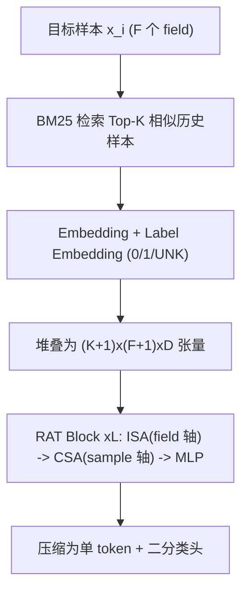
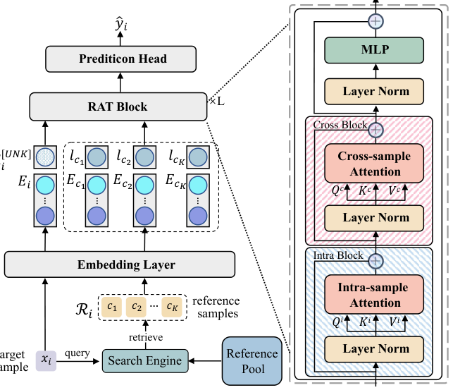

# RAT: Retrieval-Augmented Transformer for Click-Through Rate Prediction (检索增强 Transformer 的点击率预估)

- **会议/期刊**: WWW 2024 (Companion, short paper)
- **作者与机构**: Yushen Li, Jinpeng Wang, Tao Dai, Jieming Zhu, Jun Yuan, Rui Zhang, Shu-Tao Xia（清华大学深圳国际研究生院、深圳大学、华为诺亚方舟实验室、鹏城实验室）
- **推荐链路定位**: 精排（CTR 预估）
- **研究方向**: CTR/CVR 预估与特征交叉 / 冷启动与长尾推荐
- **论文原文**: [https://arxiv.org/abs/2404.02249v2](https://arxiv.org/abs/2404.02249v2)
- **开源代码**: [https://github.com/YushenLi807/WWW24-RAT](https://github.com/YushenLi807/WWW24-RAT)

## TL;DR (1分钟核心速览)

传统 CTR 模型只在**单条样本内部**做跨列（cross-column）特征交叉，特征稀疏时交互模式难以被充分记忆。RAT 借鉴检索增强（RA）范式，用 BM25 从历史日志中检索 $K=5$条相似样本作为参考上下文，引入**跨行（cross-row）交互**，并用「样本内注意力 + 跨样本注意力」的级联 Transformer 块分别建模两种交互，把朴素联合注意力的$O((K+1)^2(F+1)^2)$降为$O((K+1)^2+(F+1)^2)$。在 ML-tag / KKBox / Tmall 三个数据集上，AUC 相对 xDeepFM 平均提升 1.13%，Tail 10% 用户子集 AUC 提升达 1.01%（相对 DeepFM）。

## Background & Motivation (背景与核心矛盾)

- **主流范式**: DeepFM / DCNv2 / xDeepFM / AOANet 等以样本内的特征交叉网络（显式或隐式高阶）刻画 field 之间的交互，逐样本独立打分。
- **前人局限**: ① 交互模式极度稀疏，模型必须"记住"所有交互组合，对长尾/冷启动用户鲁棒性差；② 已有的 RA-CTR 探索（RIM、DERT、PET）顾此失彼——RIM/DERT 在每个 feature field 上聚合检索样本的标签，丢失了细粒度跨样本交互；PET 通过超图 + 星扩展把行列转为异构图，但任意两个特征节点必须经由标签节点中转，样本内交互建模不灵活。
- **核心洞察 (Key Insight)**: 表格数据中"行"（样本）之间的关系本身就是一种可用的参考上下文；检索到的相似样本若被显式建模，等价于为稀疏特征提供了一组动态的"近邻证据"。
- **本文切入点**: 保留检索样本的完整 field 序列，用**轴分解的级联注意力**同时吃到样本内与跨样本的细粒度交互，而不是把它们压成 field 级统计量或强行塞进异构图。

## Method (核心方法设计)

### 1. 整体框架 (Overall Architecture)

给定目标样本 $x_i$的$F$个 field，先用 BM25 从参考池$\mathcal{P}$中检索 Top-$K$相似样本，将目标样本与$K$个参考样本各自编码为$(F+1)$个 token（额外加一个 label embedding：0/1 表示参考样本的点击与否，目标样本用 `[UNK]` 槽位占位），堆叠成$ (K+1)\times(F+1)\times D $的张量。随后$L$ 个 RAT Block 交替在 **field 轴**（intra-sample）与 **sample 轴**（cross-sample）上做多头注意力，最终把表示压缩为一个 token 送入 MLP 输出点击概率。检索采用 GPU 实现以替代 Elasticsearch CPU 方案。

<figure class="paper-figure" markdown="span">
  <figcaption>图2：RAT的整体框架。</figcaption>
</figure>

### 2. 关键设计拆解 (Key Designs)

1. **无训练 BM25 检索 + 防穿越协议**：参考池为历史日志，打分沿用经典 BM25，仅用"该 field 取值是否相同"这一指示量加权 IDF，因此**无需任何训练**、可离线预计算候选：

$$s(x_t,x_c)=\sum_{f=1}^{F}\log\frac{N_\mathcal{P}-N_\mathcal{P}(x_t^f)+0.5}{N_\mathcal{P}(x_t^f)+0.5}\cdot\mathbb{I}\{x_t^f=x_c^f\}$$

防穿越的关键是**时序约束**：只有当候选样本时间戳早于查询时才可被检索；验证/测试阶段以整个训练集为参考池，因训练集在时间上严格早于验证/测试集，故仍然安全。

2. **轴分解的级联注意力 (Intra-Cross Cascade Attention)**：这是本文最核心的增量。朴素做法是把 $K$个检索样本展开成额外 field 做联合自注意力，复杂度$O((K+1)^2(F+1)^2)$ 且**性能反而更差**（噪声交互干扰）。RAT 把注意力拆成两个连续子层，分别沿 field 轴与 sample 轴施加：

$$H_i^{\ell}=\mathrm{ISA}(\mathrm{LN}(X_i^{\ell}))+X_i^{\ell},\quad H_i'^{\ell}=\mathrm{CSA}(\mathrm{LN}(H_i^{\ell}))+H_i^{\ell},\quad X_i^{\ell+1}=\mathrm{MLP}(\mathrm{LN}(H_i'^{\ell}))+H_i'^{\ell}$$

复杂度降为 $O((K+1)^2+(F+1)^2)$。物理直觉：轴分解相当于一个**归纳偏置**——先在同一行内部收敛出"这条样本长什么样"，再在列方向跨行比对"相似样本的标签证据是否一致"，避免了全连接式注意力在稀疏特征上的噪声放大。

3. **训练目标、负采样与推理开销**：CTR 二分类交叉熵 $\mathcal{L}=-\frac{1}{N}\sum(y\log\hat{y}+(1-y)\log(1-\hat{y}))$，无负采样环节（全量曝光样本直接监督）。推理时每条请求需一次 BM25 Top-K 检索（K=5）+ 一个$6\times(F+1)$ 的小 Transformer，参数量与传统模型同量级（ML-tag 0.34M、Tmall 16.87M），单样本运行时间 9.65 μs（ML-tag），比联合注意力变体快约 6%。

## Experimental Setup & Evaluation Protocol (实验设置与评估协议)

- **数据集与预处理**:

| 数据集 | #Samples | #Fields | Missing Ratio | Positive Ratio | 场景说明 |
| :--- | :---: | :---: | :---: | :---: | :--- |
| ML-tag | 2,006,859 | 3 | 0% | 33.33% | MovieLens 标签点击，field 极少的稀疏场景 |
| KKBox | 7,377,418 | 19 | 6.08% | 50.35% | 音乐订阅流失/点击，高维缺失 field |
| Tmall | 54,925,331 | 9 | 0.36% | 50% | 阿里电商展示广告点击 |

- **数据划分与防穿越**: ML-tag 按 7:2:1 比例划分，KKBox 按 8:1:1；Tmall 采用**全局时间戳切分**（沿用 RIM 设置）以严格避免信息泄漏。检索侧同样施加"仅检索早于查询时刻的样本"的时序约束。
- **排名评测协议**: 本文是**逐样本二分类打分**任务，未采用 Full-Ranking 或 Sampled Ranking 候选集构造，指标为 **AUC** 与 **Logloss**（CTR 领域标准协议，‰ 级 AUC 提升在统计显著时即可带来可观收益）。
- **对比基线与超参设置**: 非 RA 基线 DeepFM / DCNv2 / AOANet / xDeepFM；RA 基线 RIM / PET（DERT 因无开源实现且是 RIM 的稠密检索特例被排除）。所有方法统一用 FuxiCTR + BARS benchmark 复现，RA 模型统一 $K=5$、BM25 检索以对齐变量。原文未报告显著性检验（$p$ 值）。

## Key Experimental Results (实验关键数据)

### 1. 主实验对比 (Main Results)

| Model | ML-tag AUC↑ | ML-tag Logloss↓ | KKBox AUC↑ | KKBox Logloss↓ | Tmall AUC↑ | Tmall Logloss↓ | ΔAUC vs xDeepFM |
| :--- | :---: | :---: | :---: | :---: | :---: | :---: | :---: |
| DeepFM | 0.9685 | 0.2130 | 0.8429 | 0.4895 | 0.9401 | 0.3341 | -0.24% |
| DCNv2 | 0.9691 | 0.2147 | 0.8303 | 0.5073 | 0.9391 | 0.3377 | -0.75% |
| AOANet | 0.9694 | 0.2105 | 0.8313 | 0.5046 | 0.9391 | 0.3369 | -0.70% |
| xDeepFM | 0.9697 | 0.2409 | 0.8475 | 0.4846 | 0.9406 | 0.3513 | 0.00% |
| PET (RA) | 0.9692 | 0.2602 | 0.8316 | 0.5044 | 0.9520 | 0.3175 | -0.24% |
| RIM (RA) | 0.9711 | 0.1832 | 0.8465 | 0.4907 | 0.9534 | 0.3131 | +0.46% |
| **RAT (Ours)** | **0.9809** | **0.1421** | **0.8500** | **0.4812** | **0.9589** | **0.3091** | **+1.13%** |

**长尾子集（ML-tag，按用户样本量排序取尾部 10% / 20%）**：

| Type | Model | Tail 10% AUC↑ | Tail 10% Logloss↓ | Tail 20% AUC↑ | Tail 20% Logloss↓ |
| :--- | :--- | :---: | :---: | :---: | :---: |
| Non-RA | DeepFM | 0.9487 | 0.2714 | 0.9616 | 0.2319 |
| Non-RA | xDeepFM | 0.9482 | 0.2866 | 0.9611 | 0.2436 |
| RA | RIM | 0.9543 | 0.2574 | 0.9654 | 0.2200 |
| RA | **RAT** | **0.9583** | **0.2250** | **0.9727** | **0.1799** |

### 2. 消融实验 (Ablation Study)

对比四种 intra/cross 交互块设计（`JM`=全展开联合注意力，`CE`=两个独立 Transformer 块级级联，`PA`=双分支并行注意力）：

| 变体 | ML-tag AUC↑ | KKBox AUC↑ | Tmall AUC↑ | ML-tag Runtime (μs)↓ | Tmall Runtime (μs)↓ | Params (Tmall) |
| :--- | :---: | :---: | :---: | :---: | :---: | :---: |
| RAT_JM | 0.9667 | 0.8415 | 0.9581 | 10.31 | 12.60 | 16.87M |
| RAT_CE | 0.9736 | 0.8483 | 0.9575 | 9.88 | 9.91 | 16.88M |
| RAT_PA | 0.9777 | 0.8484 | 0.9582 | 9.60 | 9.78 | 16.87M |
| **RAT** | **0.9809** | **0.8500** | **0.9589** | 9.65 | 9.72 | 16.87M |

### 3. 关键实验发现 (Key Findings)

1. **"检索增强"本身有效，但细粒度建模才是增益来源**：所有 RA 模型（除 PET）均优于非 RA 基线，但 PET 在 ML-tag/KKBox 上甚至不及 xDeepFM（0.9692 vs 0.9697、0.8316 vs 0.8475），印证其"特征节点必须经标签节点中转"的结构缺陷；RAT 依靠 Transformer 细粒度建模把 ML-tag AUC 从 RIM 的 0.9711 推到 0.9809（相对 +1.01%），说明参考样本的**利用方式**比是否检索更关键。
2. **轴分解注意力同时赢在效果与效率**：联合建模 RAT_JM 在 ML-tag 上仅 0.9667，比级联版低 1.47% 相对值，且 Tmall 单样本耗时 12.60 μs 高于 RAT 的 9.72 μs（约慢 23%）。作者归因于联合注意力引入了大量**跨样本 × 跨 field 的噪声交互**，分解相当于注入了一个鲁棒性归纳偏置；同时级联顺序（RAT）略优于并行分支（RAT_PA，0.9809 vs 0.9777），说明"先样本内收敛、再跨样本比对"的次序是有效的。
3. **长尾场景收益被放大**：在 Tail 10% 用户上，RAT 的 AUC 0.9583 相对 DeepFM 的 0.9487 提升 1.01%，明显高于全量测试集上 1.16% 的提升所对应的非长尾部分；Tail 20% 上 RAT 达 0.9727，比最强 RA 基线 RIM 高 0.76% 相对值，Logloss 从 0.2200 降到 0.1799（-18.2%），为"检索近邻缓解特征稀疏/冷启动"提供了直接证据。

## Highlights & Limitations (亮点、对比与审稿批判)

- **与代表作对比 (vs. Prior Work)**: 相较 RIM/DERT 把检索样本按 field 聚合成标签统计量，RAT 保留了每条参考样本的完整 token 序列，因此能刻画"哪个 field 与哪个 field 在近邻中共同出现"；相较 PET 的超图消息传递需要经标签节点中转，RAT 的 field 轴注意力可在样本内任意 field 间直连，跨样本侧则用 sample 轴注意力替代图传播，结构更简洁且可并行。
- **可迁移亮点**: ① 把"label embedding（0/1/UNK）"作为独立 field 注入输入，使参考样本的监督信号能被注意力直接读取，这一 trick 可无缝迁移到任何 in-context 式推荐/排序模型；② 用**时序约束 + 训练集作参考池**规避检索环节的标签穿越，是 RA-Rec 类工作通用的合规做法。
- **审稿级局限批判**: ① 评估仅有 AUC/Logloss，缺失 GAUC、RelaImpr 等工业界更看重的排序指标，且未做显著性检验，‰ 级差异的稳健性存疑；② 每请求一次 BM25 Top-K + 6×(F+1) token 的 Transformer 前向，相较 DeepFM 类模型推理成本仍偏高，原文只报告了 GPU 微秒级 runtime，未给出端到端 QPS/延迟与检索索引更新开销；③ 作为 4 页短文，$K$、$L$、$D$ 的敏感度分析与线上 A/B 均缺失，参考池规模增大后的检索质量衰减也未讨论。

## Rating (四维评分)

- **方法创新性 (Novelty)**: ⭐⭐⭐⭐ （首次把跨行检索样本与轴分解级联注意力统一进 CTR 框架，"分解优于联合"的实证结论有反直觉价值，但整体仍是 RA + Transformer 的组合式创新）
- **评估协议与实验扎实度 (Protocol & Experiments)**: ⭐⭐⭐ （三个真实数据集 + 长尾分桶 + 效率对比较完整，但仅 AUC/Logloss、无显著性检验、无超参敏感度分析，短文篇幅限制了说服力）
- **写作与数学规范度 (Clarity & Rigor)**: ⭐⭐⭐⭐ （BM25 公式、级联块公式与复杂度对比交代干净，防泄漏协议说明清晰，符号定义紧凑无冗余）
- **工业落地与复现价值 (Industrial & Practical Value)**: ⭐⭐⭐⭐ （代码已开源、基于 FuxiCTR 可直接复现，GPU 化 BM25 实现有工程价值；但线上检索索引维护与延迟预算仍需额外验证）

