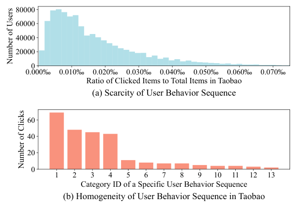
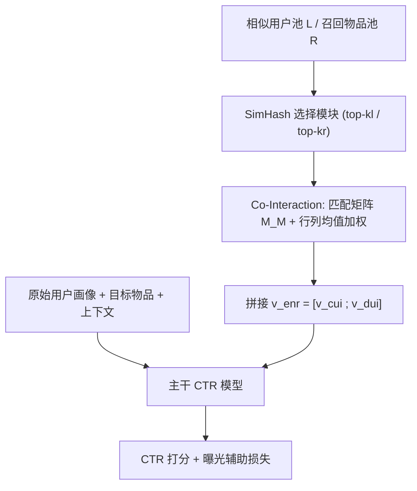
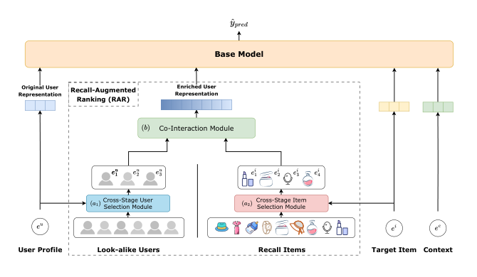

# Recall-Augmented Ranking: Enhancing Click-Through Rate Prediction Accuracy with Cross-Stage Data (召回增强排序：利用跨阶段数据提升点击率预估精度)

- **会议/期刊**: WWW 2024 (Companion, Short Track, 4 pages)
- **作者与机构**: Junjie Huang, Weinan Zhang, Yong Yu (上海交通大学) ; Guohao Cai, Jieming Zhu, Zhenhua Dong, Ruiming Tang (华为诺亚方舟实验室)
- **推荐链路定位**: 精排 (CTR Ranking)，横跨召回-精排阶段的数据复用
- **研究方向**: CTR 预估与特征交叉 / 多任务学习与级联一致性
- **论文原文**: [https://arxiv.org/abs/2404.09578v1](https://arxiv.org/abs/2404.09578v1)
- **开源代码**: 暂未开源（基于 FuxiCTR 复现）

## TL;DR (1分钟核心速览)

精排普遍只吃用户自身行为序列，而行为序列相对亿级物品池存在极端的**稀疏性**与**同质性**，Target Attention 还会不断强化同质循环（买口红只会推口红，不会推香水）。本文提出 RAR：把召回阶段天然产生的 u2u 相似用户集与 i2i 召回物品集作为两路新数据源，用 SimHash 高效选出 top-$k_l$相似用户与 top-$k_r$ 召回物品，再用 **set-to-set 匹配矩阵 + 曝光辅助损失** 聚合成"共同兴趣/多样兴趣"双向量，即插即用地拼接到 8 类主流 CTR 主干上。在 KKBox / MovieLens / CandiCTR-Pub 三个数据集、AUC 与 gAUC 双指标下，xDeepFM+RAR 于 CandiCTR-Pub 取得 AUC 61.19→64.06（+4.7%）的最大单点收益。

## Background & Motivation (背景与核心矛盾)

- **主流范式**: 以用户历史行为序列 + Target Attention 抽取兴趣向量，再与物品/上下文特征做高阶交叉（DeepFM/DCN-V2/DeepIM 等），并在召回-排序级联中逐级截断候选集。
- **前人局限**: ① **稀疏性**——Taobao 上绝大多数用户点击数占全库物品比例低于 0.5%；② **同质性**——单用户点击几乎集中在 4–5 个类目（图 2），Target Attention 对重复相似物品反复加权，形成"越推越窄"的自强化循环，长尾与跨域兴趣完全缺位。
- **核心洞察 (Key Insight)**: 召回阶段本质上已完成了**跨实例建模**（产出相似用户列表与相似物品列表），这些信息在排序阶段被丢弃；若把 u2u 与 i2i 两个集合"喂回"精排，即可在不动主干的前提下跳出单用户序列的视野盲区。
- **本文切入点**: 不研究如何构造这两个集合（沿用现成召回/Look-alike 结果），只研究**如何选择与如何聚合**跨阶段集合，且必须廉价到可在线部署。

<figure class="paper-figure" markdown="span">
  <figcaption>图2：Taobao 数据集中用户行为序列稀缺性与同质性的观察。</figcaption>
</figure>
图 2：Taobao 数据集中用户行为序列的稀疏性 (a) 与同质性 (b) 统计。

## Method (核心方法设计)

### 1. 整体框架 (Overall Architecture)

RAR 作为外挂式框架包在任意 CTR 主干之外：输入为目标用户 $u$与目标物品$i$的原始特征/行为序列（主干照旧），同时把跨阶段候选池（相似用户池$\mathcal{L}$、召回物品池$\mathcal{R}$）送入两个 Selection Module，通过 SimHash 汉明距离快速筛选出$k_l$个相似用户$E'_L$与$k_r$个召回物品$E'_R$；二者经 MLP 投影后在 Co-Interaction Module 中做 set-to-set 匹配矩阵计算，分别沿列/行均值池化得到物品权重与用户权重，聚合出"用户共同兴趣"$v_{cui}$与"用户多样兴趣"$v_{dui}$，拼接为增强表征$v^u_{enr}$ 与主干原始用户向量合并后共同进入 CTR 打分。全模型端到端联合训练，推理时仅多做一次哈希查表与三次矩阵乘。

<figure class="paper-figure" markdown="span">
  <figcaption>图3：RAR 在现有 CTR 预测模型中的应用。</figcaption>
</figure>
图 3：RAR 嵌入现有 CTR 模型的整体结构。

### 2. 关键设计拆解 (Key Designs)

1. **SimHash 跨阶段选择模块（把 O(l·d) 内积检索压到 O(1) 比位）**：直接内积 top-k 检索在亿级池上乘法开销不可接受。作者用局部敏感哈希把 embedding 投到二值指纹：$\mathrm{sig}_{i_k}[m]=\mathrm{sgn}\big(\sum_{n=1}^{d_2}\boldsymbol{e}_{i_k}[n]\cdot P[n][m]\big)$，随后符号位归一为$\pm1$，用汉明距离替代内积比较。直觉是相似向量在随机投影下以高概率落到相同桶，从而用 XOR+popcount 在$O(1)$ 内完成近邻筛选，同时把存储从浮点压到比特。

2. **Co-Interaction 匹配矩阵 + 曝光辅助监督（set-to-set 细粒度加权）**：选择后的集合若简单 sum-pooling 会丢失"哪些召回物品对该用户真正重要"的层级信息。作者先做 $\boldsymbol{E}'^{H}_{L}=\mathrm{MLP}(\boldsymbol{E}'_{L})$、$\boldsymbol{E}'^{H}_{R}=\mathrm{MLP}(\boldsymbol{E}'_{R})$，再构造$M_M=\mathrm{Sigmoid}(\boldsymbol{E}'^{H}_{L}\cdot \boldsymbol{E}'^{H\,T}_{R})$；由于曝光信号极稀疏，定义弱监督标签$y_{ep}^{ui}=0$若物品$i$从未曝光给$L'_u$中任一用户、否则为 1，用$M_M$拟合$y_{ep}^{ui}$来"教"模型识别哪些 i2i 召回是跨用户共识。最后$w_i=\mathrm{Mean}(M_M,\text{axis}=0)$、$w_u=\mathrm{Mean}(M_M,\text{axis}=1)$，得到$v_{cui}=w_u\cdot E'_L$（共同兴趣）与$v_{dui}=w_i\cdot E'_R$（多样兴趣）。物理直觉：行列双向池化把"用户侧共识"与"物品侧相关性"解耦成两条互补通道。

3. **训练目标、负采样与推理效率**：$\mathcal{L}=\alpha\mathcal{L}_{clk}+(1-\alpha)\mathcal{L}_{ep}$，两项均为 point-wise 交叉熵，$\alpha\in[0,1]$平衡主任务与曝光辅助任务（无额外负采样设计，沿用主干的曝光样本）。复杂度$\mathcal{O}\big(B\cdot(l+r)\cdot d+B\cdot k_l\cdot k_r\cdot d\big)$，因$k_l\ll l,\,k_r\ll r$可近似为$\mathcal{O}(B(l+r)d)$，即与"扫一遍池子"同阶。

## Experimental Setup & Evaluation Protocol (实验设置与评估协议)

- **数据集与预处理**: KKBox（音乐）、MovieLens（电影标签）、CandiCTR-Pub（工业大规模，本身自带召回集）；后两者用预训练 DSSM 双塔做 user-item / user-user 内积构造召回物品集与相似用户集。**原文未披露 #Users/#Items 规模与 5-core 等过滤规则**，下表仅列场景属性：

| 数据集 | #Users | #Items | #Interactions | 稀疏度/密度 | 特征/场景说明 |
| :--- | :---: | :---: | :---: | :---: | :--- |
| KKBox | 未披露 | 未披露 | 未披露 | 未披露 | 音乐订阅推荐，需人工构造 L/R 两集合 |
| MovieLens | 未披露 | 未披露 | 未披露 | 未披露 | 电影标签行为，需人工构造 L/R 两集合 |
| CandiCTR-Pub | 未披露 | 未披露 | 未披露 | 未披露 | 工业级 CTR，原生含召回物品集 |

- **数据划分与防穿越 (Splitting Strategy)**: 沿用 BARS / FuxiCTR 公开基准的数据管线，**未显式声明 Leave-One-Out 或全局时间戳切分**（也是本文可复现性上的一个薄弱点）。
- **排名评测协议 (Ranking Protocol)**: 采用 **AUC + gAUC**（按用户分组的加权 AUC）双指标；二者在整个评测样本上计算排序一致性，属于**全样本未采样排序**口径，无正负采样比问题。
- **对比基线与超参设置**: 8 个主干（IPNN、WDL、DeepFM、DCN、xDeepFM、AutoInt+、DeepIM、DCN-V2）+ 2 个 SOTA 外部基线（FRNet 的 cross-feature 建模、CIM 的候选集 Transformer 上下文编码）；每个主干分别对比 Raw / +FRNet / +CIM / +RAR。**未报告显著性检验**。

## Key Experimental Results (实验关键数据)

### 1. 主实验对比 (Main Results)

| 数据集 | 主干 | Raw gAUC | +FRNet | +CIM | **+RAR** | RAR vs Raw (gAUC / AUC) |
| :--- | :--- | :---: | :---: | :---: | :---: | :---: |
| KKBox | IPNN | 78.75 | 78.27 | 78.31 | **80.15** | +1.8% / +1.4% (85.25→**86.45**) |
| KKBox | DCN-V2 | 78.64 | 78.62 | 79.45 | **80.12** | +1.9% / +1.6% (85.17→**86.49**) |
| KKBox | xDeepFM | 78.60 | 78.65 | 78.72 | **80.12** | +1.9% / +1.5% (85.25→**86.50**) |
| MovieLens | IPNN | 95.53 | 95.14 | 95.28 | **95.92** | +0.4% / +0.5% (96.53→**97.02**) |
| MovieLens | xDeepFM | 95.27 | 95.21 | 95.16 | **95.82** | +0.6% / +0.6% (96.20→**96.81**) |
| CandiCTR-Pub | DCN | 52.78 | 52.55 | 53.75 | **54.50** | +3.3% / +2.6% (60.95→**62.53**) |
| CandiCTR-Pub | DeepFM | 52.82 | 52.48 | 53.94 | **54.50** | +3.2% / +4.8% (60.99→**63.92**) |
| CandiCTR-Pub | xDeepFM | 52.87 | 52.48 | 53.93 | **54.40** | +2.9% / **+4.7%** (61.19→**64.06**) |
| CandiCTR-Pub | DeepIM | 52.72 | 52.42 | 53.48 | **54.44** | +3.3% / +2.4% (61.23→**62.72**) |

关键点：+RAR 在**全部 8 个主干 × 3 个数据集上一致正向**；而 +FRNet 在多处反而低于 Raw（如 KKBox IPNN 78.75→78.27），+CIM 仅在工业集上稳定增益。论文口径的"Best RelImp"为 KKBox 2.0%/1.6%、MovieLens 0.7%/0.7%、CandiCTR-Pub 3.5%/5.0%。

### 2. 消融实验 (Ablation Study)

CandiCTR-Pub，三个主干（DCN-V2 / xDeepFM / DeepIM）平均：

| 变体 | gAUC(%) | AUC(%) | Avg RelImp (gAUC / AUC) | 说明 |
| :--- | :---: | :---: | :---: | :--- |
| Raw | 52.75 | 61.16 | 0% / 0% | 无跨阶段数据 |
| RAR-user | 54.12 | 62.68 | +2.6% / +2.5% | 去掉相似用户通道，仅留召回物品 |
| RAR-select | 52.97 | 62.56 | +0.4% / +2.3% | 去掉 Selection，直接截断池子 |
| RAR-aux-wght | 52.51 | 61.59 | −0.4% / +0.7% | 去掉 Co-Interaction 与辅助损失，sum-pooling |
| RAR-wght | 53.94 | 62.87 | +2.3% / +2.8% | 去掉加权向量、保留辅助损失 |
| **RAR** | **54.38** | **63.16** | **+3.1% / +3.3%** | 全量 |

### 3. 关键实验发现 (Key Findings)

1. **两路数据源并非等价**：仅保留 i2i 召回物品通道（RAR-user）已能带来 +2.5% AUC，说明"跳出自身序列看召回邻居"是主要收益来源；补齐 u2u 相似用户后再涨约 0.8%，共同兴趣是增量而非主体。
2. **选择模块是廉价但必要的降噪器**：RAR-select（不选而直接截断）gAUC 仅 +0.4% 却 AUC +2.3%，说明"从大池里按相似度挑"而非"随机/顺序截断"决定了阈值以上的排序质量；再叠加 SimHash，使训练时长从 CIM_long 的 ~29 min 降到 ~18 min（+24% vs +100%），单步推理 27.5 ms（+53% vs +167%）。
3. **辅助曝光损失与加权向量缺一不可**：去掉匹配矩阵与辅助损失（RAR-aux-wght）gAUC 反降 0.4%，是唯一负收益变体；只保留辅助损失而无加权（RAR-wght）恢复至 +2.3%，说明 $y_{ep}$ 监督本身提供层级信号，但必须配合行列双向池化才能兑现为最终增益。

## Highlights & Limitations (亮点、对比与审稿批判)

- **与代表作对比 (vs. Prior Work)**: 与 FRNet（特征级 cross-feature 关联）相比，RAR 关联的是**跨阶段实例集合**而非特征域；与 CIM（把候选物品编码为上下文向量）相比，RAR 额外引入 u2u 相似用户这一数据源，且用哈希选择把上下文从 305 条压到 $k_r$ 条，训练耗时仅为其 62%、推理 57%，同时 AUC 在 CandiCTR-Pub 上高约 1.2–1.3 个点。
- **可迁移亮点**: ① 用**召回阶段的 u2u/i2i 列表作为精排的"免费额外特征"**，是零标注成本的表征增强，任何级联系统都能改造；② 用"是否曾被曝光给相似用户"构造弱监督标签 $y_{ep}$，把稀疏曝光信号转成稠密集合监督，可迁移到列表重排与跨域对齐任务。
- **审稿级局限批判**: ① 数据集统计、划分方式与显著性检验全部缺失，4 页短文导致可复现性偏弱，且 $k_l,k_r,\alpha$ 的敏感性完全未做分析；② 收益高度依赖"召回集质量"，论文承认不研究集合构造，若上游召回本身同质（真实系统常见），RAR 可能只是把同质循环从精排前移到召回；③ 在线部署需维护相似用户/召回物品的实时缓存与 SimHash 索引，短文中未给出工程一致性与冷启动用户的兜底方案。

## Rating (四维评分)

- **方法创新性 (Novelty)**: ⭐⭐⭐⭐ （"set-to-set 共交互 + 跨阶段集合回灌"在 CTR 中确属首次，但本质是注意力加权的工程组合，缺理论支撑）
- **评估协议与实验扎实度 (Protocol & Experiments)**: ⭐⭐⭐ （8 主干 × 3 数据集 × 双指标覆盖面好，但无统计检验、无数据集统计、无超参敏感性）
- **写作与数学规范度 (Clarity & Rigor)**: ⭐⭐⭐⭐ （4 页内公式、复杂度与消融闭环完整，SimHash 推导清楚；符号表与正文略有错位）
- **工业落地与复现价值 (Industrial & Practical Value)**: ⭐⭐⭐⭐ （即插即用、训练仅 +24%/推理 +53%，且有 wall-time 对比；但代码未开源、依赖上游召回链路）

