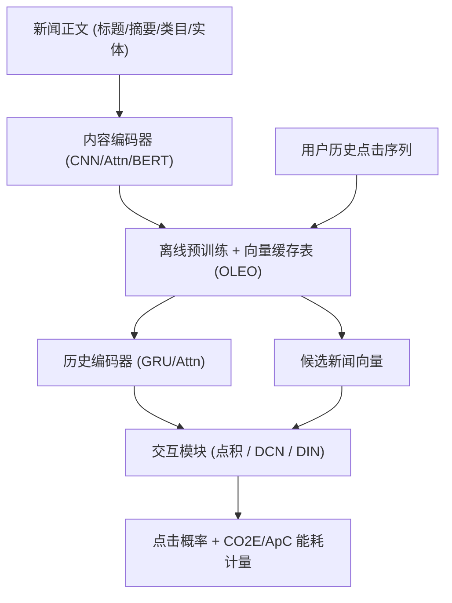
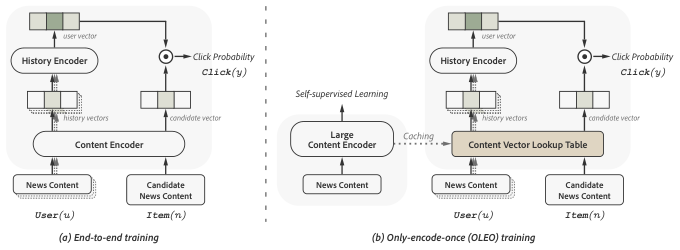

# Benchmarking News Recommendation in the Era of Green AI (绿色 AI 时代的新闻推荐基准评测)

- **会议/期刊**: WWW 2024 (Companion)
- **作者与机构**: Qijiong Liu (PolyU)、Jieming Zhu / Quanyu Dai (Huawei Noah's Ark Lab)、Xiao-Ming Wu (PolyU)
- **推荐链路定位**: 精排 (CTR 点击率预估) + 训练范式级基础设施
- **研究方向**: 去偏公平、可信隐私与工业架构 / CTR 预估与特征交叉
- **论文原文**: [https://arxiv.org/abs/2403.04736v2](https://arxiv.org/abs/2403.04736v2)
- **开源代码**: [https://github.com/Jyonn/Legommenders](https://github.com/Jyonn/Legommenders)（GreenRec 已并入 Legommenders 模块化框架）

## TL;DR (1分钟核心速览)

新闻推荐普遍把内容编码器塞进端到端训练，导致同一篇新闻在一个 epoch 内被重复编码约 **1818 次**（MIND 场景），既拖慢训练又制造大量碳排；同时各论文自定数据划分，结果不可复现。本文构建首个新闻推荐 Green AI 基准 **GreenRec**，提出 **only-encode-once (OLEO)** 解耦范式（先自监督预训练编码器 → 缓存新闻向量表 → 只训历史编码器与交互层），并定义 **ApC = (AUC−50)/CO2E×100** 的精度-碳排兑换率指标。在 MIND-small/large 上以 5 变体 × 6 基座共 30 个模型、约 2000 GPU 小时完成评测：OLEO 系（PREC 变体）精度逼近端到端 PLM-NR SOTA，ApC 最高提升 **2992%**。

## Background & Motivation (背景与核心矛盾)

- **主流范式**: 新闻推荐由内容编码器（CNN / Attention / BERT）、历史编码器与交互模块三件套构成，业界与学界默认采用三者联合优化的端到端训练。
- **前人局限一（效率）**: 端到端范式的时间复杂度为 $O(M\times L\times t_c + K\times(t_u+t_i))$；当用户历史长度$M\times L$远大于新闻数$N$时，昂贵的$t_c$（PLM 编码）被反复支付，形成纯粹的冗余计算与碳排。
- **前人局限二（可复现）**: MIND-small 只给训练/验证集，MIND-large 只给在线测试集，大量工作直接在验证集上报数或使用私有预处理，导致跨论文比较失效。
- **核心洞察 (Key Insight)**: 新闻内容是**静态、与用户无关**的，用户-新闻交互只改变用户侧表征。因此"内容编码"与"偏好建模"本不需要在同一个反向传播图里联合求梯度。
- **本文切入点**: 把内容编码一次性预计算成可查表的向量库（解耦训练），并引入碳排效率指标把"精度-能耗"做成可比较的二维评价。

## Method (核心方法设计)

### 1. 整体框架 (Overall Architecture)

GreenRec 不是单一模型而是**评测框架 + 训练范式**：输入一条曝光日志（用户 ID + 历史新闻序列 + 候选新闻），先由内容编码器得到候选与历史新闻的语义向量；在 OLEO 范式下这些向量来自**离线预训练并固化的查表 (lookup table)**，仅经可学习投影矩阵对齐维度后送入历史编码器（GRU / Attention）与交互层（点积或 DCN/DIN 式特征交叉），输出点击概率。训练阶段只反传历史编码器与交互层，编码器梯度被彻底切断；推理时新闻向量可直接命中缓存，线上只需算用户塔。评测端同时记录 GPU 功耗 $p$、时长$t$与区域碳强度$c$，输出 CO2E 与 ApC。

<figure class="paper-figure" markdown="span">
  <figcaption>图 1：新闻推荐的两种训练范式。</figcaption>
</figure>

### 2. 关键设计拆解 (Key Designs)

1. **OLEO 解耦训练范式（把 O(N) 的重复编码降到 1 次）**: 痛点起因于 $M\times L \gg N$时内容编码被重复触发；核心改动是把总代价拆成固定的$O(N\times t_c)$预训练项 + 与新闻内容无关的$O(K\times(t_u+t_i))$ 推荐训练项，新闻表征以**冻结向量 + 可学习投影**接入下游。物理直觉：内容语义是物品侧先验，不随点击标签漂移，冻结它等价于给物品塔做一次性的"特征物化 (feature materialization)"，与工业界预计算 embedding / 特征缓存的工程习惯同源。
2. **ApC 可持续性指标（把精度与碳排压成单一标量）**: 现有工作只报 AUC，无法回答"多花的电是否值得"。定义
$$\text{CO2E}=p\times t\times c,\qquad \text{ApC}=\frac{\text{AUC}-50}{\text{CO2E}}\times 100$$
其中 $p$为硬件功耗（RTX 3090, 350W）、$t$为运行时长、$c$ 为区域碳效率（722 g CO2-eq/kWh）。减去 50 是剔除随机猜测基线，使指标度量"每单位碳排换来的有效判别增益"，从而让 30 个异构基线可在同一坐标轴上比较。
3. **30 模型变体网格 = 可归因的受控消融**: 6 个基座（NAML / LSTUR / NRMS 三个新闻推荐器 + BST / DCN / DIN 三个 CTR 模型）各派生 5 个变体：ID-based（去掉内容编码器换随机 embedding 表）、Text-based（CTR 模型换成内容池化层）、PLM-NR（内容编码器换 BERT 端到端微调）、PREC（OLEO + 预训练编码器）、BERT-OLEO（直接复用现成 BERT 抽取向量的 OLEO）。这套正交网格把"内容 vs ID""端到端 vs 解耦""自训 vs 复用 PLM"三因素解耦，任何精度差异都可归因到单一因素。

## Experimental Setup & Evaluation Protocol (实验设置与评估协议)

- **数据集与预处理**:

| 数据集 | #Users | #Items(News) | #Interactions | #Samples | 密度 | 说明 |
| :--- | :---: | :---: | :---: | :---: | :---: | :--- |
| MIND-small | 94,057 | 65,238 | 347,727 | 8,381,093 | 0.1366% | 轻量复现用 |
| MIND-large | 750,434 | 104,151 | 3,958,501 | 95,447,571 | 0.1221% | 大规模验证 |

- **数据划分与防穿越 (Splitting Strategy)**: 作者**重构了官方划分**——把 MIND-small 与 MIND-large 原有验证集按 **1:1 比例重新切分为新的验证集与测试集**，以修复"直接在验证集上报数"的泄漏式比较；划分脚本随仓库发布，属固定可复现的离线划分而非时间戳切分。
- **排名评测协议 (Ranking Protocol)**: 沿用 MIND 官方的 **impression 级 Sampled Ranking**——每条曝光日志内 1 条正样本 + 4 条负样本（真实曝光未点击），指标为 AUC、MRR、nDCG@5；**未采用 Full-Ranking 全库排序**，因此绝对数值不可与全库排序结果直接横比。
- **对比基线与超参**: 30 个模型变体，全部 embedding 维度固定 $d=64$；Adam 优化器，学习率网格$\{1e^{-5}\sim5e^{-4}\}$，batch 网格$\{64\sim5000\}$；OLEO 变体保持预训练向量冻结、仅训练投影矩阵；每方法 **5 次运行取均值**；能耗在单卡 RTX 3090 (350W) 上实测，累计约 2000 GPU 小时。原文未报告显著性检验。

## Key Experimental Results (实验关键数据)

### 1. 主实验对比 (Main Results)

原文 Table 3 以"基座 × 变体"矩阵给出 AUC / MRR / nDCG@5 / CO2E / ApC 全量数值，正文仅给出趋势性结论。按其报告的相对关系整理如下（数值请以原文 Table 3 为准）：

| 代表模型 / 变体 | 训练范式 | 精度 (AUC 相对) | 碳排 CO2E (相对) | ApC (相对) |
| :--- | :--- | :---: | :---: | :---: |
| NAML / LSTUR / NRMS (ID-based) | 无内容编码 | 最差 (基准以下) | 最低 | 中 |
| NAML / LSTUR / NRMS (Text-based) | 端到端，轻量 CNN/Attn | 中等 | 中等 | 中 |
| BST / DCN / DIN (Text-based) | 端到端 + 特征交叉 | 中上 | 中等 | 中 |
| **PLM-NR (BERT 端到端)** | 端到端 + PLM 微调 | **最优** | **最高** (量级跃升) | 低 |
| **PREC (BERT + OLEO)** | 解耦 (预训练+查表) | 接近最优 | 大幅低于 PLM-NR | **最优 (ApC ↑ 最高 2992%)** |
| BERT-OLEO (复用现成 BERT) | 解耦，免预训练 | 明显低于 PLM-NR | 最低档 | 高 |

### 2. 消融实验 (Ablation Study)

以同一基座内的变体替换作为受控消融（"去掉某组件/换某训练方式"）：

| 消融维度 | 对照设置 | 观测到的精度变化 | 观测到的效率变化 |
| :--- | :--- | :--- | :--- |
| w/o 内容编码 (ID-based) | Text-based → ID-based | 显著下降，五变体中最低 | 碳排下降但精度损失不可接受 |
| w/o 特征交叉 (NRMS vs DCN/DIN) | 点积匹配 → CTR 交叉网络 | 小幅提升，CTR 结构可迁移至新闻域 | 近似持平 |
| w/o 解耦 (PLM-NR vs PREC) | 端到端微调 → OLEO 查表 | 基本持平（PREC 可比） | CO2E 大幅下降，ApC 增益最大 |
| w/o 领域预训练 (BERT-OLEO vs PREC) | 复用通用 BERT → 领域自监督预训练 | 明显下降（通用语义不足） | 略优于 PREC |

### 3. 关键实验发现 (Key Findings)

1. **解耦训练是零精度代价的节能手段，但前提是"领域预训练"**：PREC（OLEO + 预训练）精度与端到端 PLM-NR 基本持平，而 ApC 提升最高 **2992%**；与之对照，直接复用通用 BERT 的 BERT-OLEO 虽然更省电却出现明显精度下滑——说明 OLEO 的红利来自"预训练任务与新闻语义对齐"，而非单纯冻结参数。
2. **内容模态不可抛弃，端到端 + PLM 的精度优势伴随能耗惩罚**：ID-based 变体在五变体中精度垫底，证明新闻正文语义是核心信号；但 PLM-NR 的 CO2E 相对轻量编码器呈量级上升，使其 ApC 反而落到末位——精度排行榜与绿色排行榜出现**排序反转**，这正是单一 AUC 评价的盲区。
3. **基线选择会掩盖范式差异，跨论文数字不可比**：同一基座仅替换训练范式即可造成精度与能耗的同时大幅变动，而既有文献因数据划分不一致（MIND-small 直接报验证集）产生冲突结论；本文重构 1:1 验证/测试划分后，30 个模型才首次落在同一可比坐标系内。

## Highlights & Limitations (亮点、对比与审稿批判)

- **与代表作对比 (vs. Prior Work)**: 与 RecBole / FuxiCTR / BARS 等通用推荐基准相比，GreenRec 是唯一同时覆盖 content-aware CTR、新闻推荐方法、解耦训练与端到端训练、以及 Green AI 能耗评测的框架（原文 Table 1 六项全 ✓）；与 PLM-NR 相比，本文不改模型而改**训练范式与评测维度**，把"精度 SOTA"扩展为"精度-碳排帕累托前沿"；与 PREC 相比，本文将其单点方法泛化为 30 变体的系统性验证。
- **可迁移亮点**: (a) "物品侧静态特征物化 + 冻结 + 可学习投影"可直接搬到电商图文、短视频封面、广告创意等昂贵视觉/文本编码场景；(b) ApC 这类"剔除随机基线后除以资源消耗"的归一化思路，可平移为延迟归一化指标 (AUC/ms) 用于线上 SLA 约束下的模型选型。
- **审稿级局限批判**: (a) 评测仅覆盖 MIND 两个版本，且沿用 1 正 4 负的采样排序协议，缺少 Full-Ranking 与冷启动物品分桶上的效率-精度权衡证据；(b) 能耗以单卡 350W × 时长 × 区域碳强度的**离线粗估**度量，未计数据加载、超参搜索（每模型 6×6 网格）与多次重复实验的摊销，也未做显著性检验，ApC 的绝对数值稳定性存疑；(c) OLEO 冻结内容向量后无法随点击反馈做端到端微调，对新闻热点漂移（如突发事件的语义演化）缺乏在线适应机制，文中未讨论该失效场景。

## Rating (四维评分)

- **方法创新性 (Novelty)**: ⭐⭐⭐ （OLEO 本身源自作者前作 PREC 的范式化推广，理论增量有限，但对"训练范式即能效杠杆"的系统化表述具有基准层面的新意）
- **评估协议与实验扎实度 (Protocol & Experiments)**: ⭐⭐⭐⭐ （30 变体 × 2 数据集 × 5 次重复、2000 GPU 小时与公开划分脚本相当扎实，扣分在于仅采样排序、仅 MIND、缺显著性检验）
- **写作与数学规范度 (Clarity & Rigor)**: ⭐⭐⭐⭐ （复杂度分析与 ApC 定义简洁清晰、动机量化到位，但关键结果表挤在附录式 Table 3，正文仅给趋势描述，削弱了可核查性）
- **工业落地与复现价值 (Industrial & Practical Value)**: ⭐⭐⭐⭐⭐ （代码与预处理脚本全开源，OLEO 与工业特征缓存/物品塔物化实践高度同构，可直接降低新闻、内容社区的 GPU 预算）

