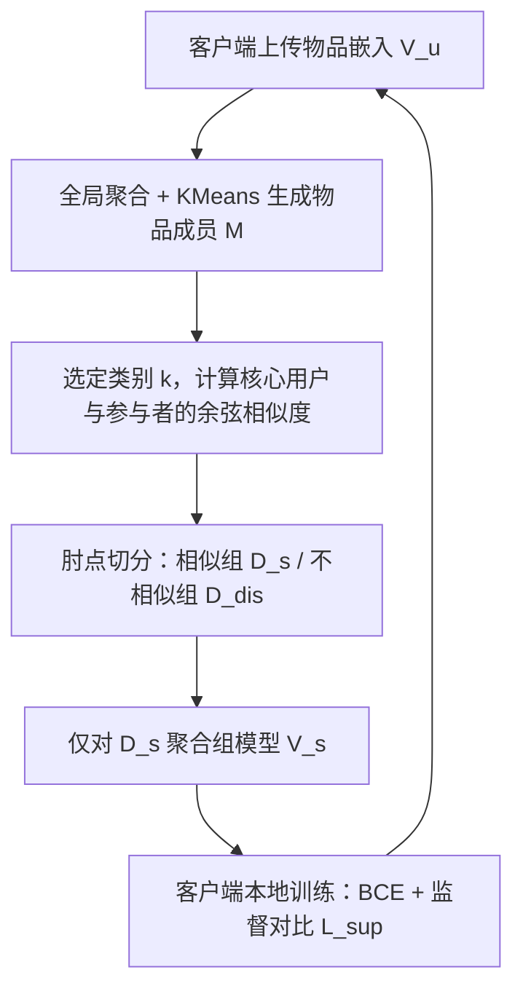
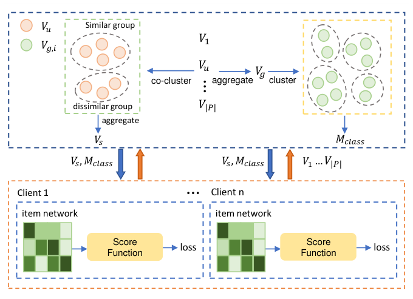

# Co-clustering for Federated Recommender System（联邦推荐系统中的协同聚类机制）

- **会议/期刊**: WWW 2024 (The ACM Web Conference 2024)
- **作者与机构**: Xinrui He, Shuo Liu, Jacky Keung, Jingrui He；UIUC / City University of Hong Kong
- **推荐链路定位**: 精排（联邦个性化排序）
- **研究方向**: 去偏公平、可信隐私与工业架构 / 自监督对比学习与交互去噪
- **论文原文**: [arXiv:2411.01690](https://arxiv.org/abs/2411.01690v1)
- **开源代码**: [CoFedRec](https://github.com/Xinrui17/CoFedRec)

## TL;DR (1分钟核心速览)

针对联邦推荐中用户非IID异构、且隐私约束下无法直接聚类用户的问题，CoFedRec 用全局物品嵌入生成物品成员，再按某一物品类别计算用户余弦相似度并以肘点切成相似/不相似组，仅聚合相似组；本地加入基于物品成员的监督对比项。在4个数据集、1:99采样排序下，ML-100K HR@10 从72.85提升到77.52、NDCG@10 从43.89提升到50.65。

## Background & Motivation (背景与核心矛盾)

- **主流范式**: 联邦推荐多用 FedAvg 聚合全局物品嵌入，客户端本地微调；PFedRec 进一步保留本地 score function 以增强个性化。
- **前人局限**: 单一全局模型默认IID，用户偏好差异会引入负迁移；基于用户表征的聚类有隐私泄露风险。更关键的是，服务器只能拿到高维物品嵌入/梯度，KMeans 在此类矩阵对象上受维度灾难与稀疏性困扰。
- **核心洞察 (Key Insight)**: 作者在 ML-100K 上验证：KMeans $k=2$时出现 1 vs 942 的极端切分，$k=10$ 时 8/10 簇仅含单用户。用户并非在所有物品上兴趣一致，但在特定物品类别上更可能共享偏好。
- **本文切入点**: 不聚用户表征，而是以“物品类别”为锚点做用户协同聚类；再用服务器生成的物品成员把全局物品关系注入本地训练。

## Method (核心方法设计)

### 1. 整体框架 (Overall Architecture)

每轮服务器先聚合参与客户端的物品嵌入，KMeans 得到物品成员 $M$；随机选核心用户与物品类别$k$，按$M_k$上的余弦相似度将客户端切成相似组/不相似组，仅对相似组求组模型；客户端下载组模型与$M$，以 BCE+监督对比训练，最后回传物品网络。推理仍在本地 score function 上完成，服务器不接触原始交互。

<figure class="paper-figure" markdown="span">
  <figcaption>图1：CoFedRec 的整体框架。粉色点表示参与客户端上传的个体模型，绿色点表示全局聚合结果的物品嵌入向量。CoFedRec 的两个关键部分是：(i) 协同聚类机制，将参与客户端聚类为相似组和不相似组，并在相似组内生成智能组模型；(ii) 将基于全局物品成员关系的监督对比项整合到本地训练阶段的损失函数中，以纳入全局物品洞察。</figcaption>
</figure>

### 2. 关键设计拆解 (Key Designs)

1. **类别锚定的用户协同聚类**：为避免直接扁平化高维物品矩阵，服务器先做 $\boldsymbol{V}_g=\frac{1}{N}\sum_{u=1}^{N}\boldsymbol{V}_u$并在全局物品嵌入上 KMeans 得到$M=\mathrm{KMeans}(\{\boldsymbol{V}_{g,i}\},K)$。选定类别$k$后，核心用户$c$与参与者$u$的相似度为$s_u=\sum_{i\in M_k}\frac{\boldsymbol{V}_{c,i}\cdot \boldsymbol{V}_{u,i}}{\|\boldsymbol{V}_{c,i}\|\|\boldsymbol{V}_{u,i}\|}$。将$s_u$排序后，用首尾连线$L(x)$的最大正交距离点作为肘点$d_e$：$u\in D_s$若$d_u\ge d_e$，否则$u\in D_{dis}$。直觉是类别子空间降低了稀疏性与维度灾难，且只上传物品网络，避免用户表征暴露。

2. **相似组聚合与异构组隔离**：仅对相似组做 $\boldsymbol{V}_s=\frac{1}{|D_s|}\sum_{u\in D_s}\boldsymbol{V}_u$，并把$\boldsymbol{V}_s$ 回传给该组客户端；不相似组保留本地模型等待下一轮。这样把“可能共享偏好”的邻居知识传给用户，同时阻断异构客户端的低质量知识，降低负迁移。

3. **全局物品成员的本地监督对比与训练目标**：服务器把 $M$分发给所有客户端，同一成员内的物品视为正对，不同成员为负对：$\mathcal{L}_{sup}=-\sum_{i\in I}\log\frac{1}{|Z(i)|}\sum_{z\in Z(i)}\frac{\exp(\boldsymbol{V}_{u,i}\cdot \boldsymbol{V}_{u,z}/\tau)}{\sum_{a\in I\setminus\{i\}}\exp(\boldsymbol{V}_{u,i}\cdot \boldsymbol{V}_{u,a}/\tau)}$，其中$Z(i)$为与$i$同成员的物品集合。总损失为$\mathcal{L}_u=\mathrm{BCE}+\lambda\mathcal{L}_{sup}$。训练每正样本采样4个负例；测试每用户1正+99随机未交互负例。推理无额外服务器模型，主要开销是每轮物品嵌入通信$O(|P|d|I|)$ 与物品侧 KMeans。

## Experimental Setup & Evaluation Protocol (实验设置与评估协议)

- **数据集与预处理**: 原始规模如下，预处理/过滤与训练集构造见原文附录 A.1：

| 数据集 | #Users | #Items | #Interactions | 密度 | 特征/场景说明 |
| :--- | :---: | :---: | :---: | :---: | :--- |
| MovieLens-100K | 943 | 1,682 | 100k | 6.30% | 电影评分 |
| MovieLens-1M | 6,040 | 3,706 | 1.0M | 4.47% | 电影评分 |
| FilmTrust | 1,508 | 2,071 | 35.5k | 1.14% | 电影/信任 |
| LastFM-2K | 1,892 | 17,632 | 92.8k | 0.28% | 音乐收听 |

- **数据划分与防穿越 (Splitting Strategy)**: 用户级训练/验证/测试划分，具体见附录 A.1；正文未声明全局时间戳切分。
- **排名评测协议 (Ranking Protocol)**: `Sampled Ranking`，每用户1个正样本+99个随机未交互负样本，报告 HR@10 / NDCG@10；训练负采样为每正样本4负例。未做 `Full-Ranking`，存在采样偏差。
- **对比基线与超参设置**: 集中式 MF/NCF；联邦式 FedMF、FedNCF、FedPerGNN、PerFedRec、PFedRec、GPFedRec 等。嵌入维度 $d$、本地 epoch、学习率按附录 A.3 设置；5次运行取最低值作保守估计；最优基线显著性$p<0.05$。

## Key Experimental Results (实验关键数据)

### 1. 主实验对比 (Main Results)

| 模型 | ML-100K HR | ML-100K NDCG | ML-1M HR | ML-1M NDCG | FilmTrust HR | FilmTrust NDCG | LastFM HR | LastFM NDCG |
| :--- | :---: | :---: | :---: | :---: | :---: | :---: | :---: | :---: |
| MF | 65.43 | 40.16 | 68.61 | 41.33 | 92.09 | 81.99 | 82.88 | 70.81 |
| NCF | 66.17 | 39.82 | 68.76 | 41.90 | 92.42 | 82.70 | 85.06 | 73.75 |
| FedMF | 65.11 | 39.13 | 67.52 | 38.12 | 89.49 | 76.31 | 68.44 | 52.97 |
| FedNCF | 60.13 | 34.31 | 65.78 | 38.67 | 92.34 | 79.87 | 80.19 | 70.11 |
| FedPerGNN | 35.84 | 19.15 | 43.87 | 24.33 | 92.01 | 82.53 | 72.06 | 57.51 |
| PerFedRec | 60.23 | 42.05 | 61.01 | 43.11 | 92.34 | **88.80** | 63.19 | 50.70 |
| PFedRec | 71.05 | 43.89 | 73.62 | 44.35 | 91.44 | 82.36 | 82.06 | 73.14 |
| GPFedRec | 72.85 | 43.77 | 72.17 | 43.61 | 90.14 | 80.88 | **83.44** | **74.11** |
| **CoFedRec** | **77.52** | **50.65** | **77.75** | **48.81** | **94.05** | 85.20 | 82.75 | 74.10 |

相对最强基线：ML-100K HR +6.41%、NDCG +15.40%；ML-1M HR +5.61%、NDCG +10.06%；FilmTrust HR +1.85%，但 NDCG 低于 PerFedRec 4.05%；LastFM HR -0.83%、NDCG -0.01%，接近但未全面领先。

### 2. 消融实验 (Ablation Study)

| 变体 | ML-100K HR | ML-100K NDCG | ML-1M HR | ML-1M NDCG |
| :--- | :---: | :---: | :---: | :---: |
| Origin (PFedRec) | 71.05 | 43.89 | 73.62 | 44.35 |
| + User_P | 75.93 | 47.23 | 73.92 | 45.72 |
| + Item_S | 72.75 | 44.26 | 73.66 | 44.67 |
| + Item_SC | 73.91 | 44.78 | 74.09 | 44.45 |
| **CoFedRec** | **77.52** | **50.65** | **77.75** | **48.81** |

### 3. 关键实验发现 (Key Findings)

- **用户协同聚类是主增益源**：仅加 User_P，ML-100K HR 提升4.88、NDCG 提升3.34；再叠加 Item_SC 后总增益达 HR +6.47、NDCG +6.76，说明类别锚定分组能找到高质量邻居。
- **全局物品成员优于仅做正对对齐**：Item_SC 在 ML-100K 上比 Item_S 高1.16 HR、0.52 NDCG；它同时利用“同成员拉近、异成员推远”，比只对齐正对更能保留全局物品结构。
- **可插拔性与鲁棒性较好**：接到 FedMF/FedNCF/PFedRec 上，ML-100K NDCG 分别提升27.52%/49.49%/15.40%；加入0.4比例虚拟评分噪声后，CoFedRec 仍有 HR 72.43、NDCG 45.31，优于多数基线。

## Highlights & Limitations (亮点、对比与审稿批判)

- **与代表作对比 (vs. Prior Work)**: FedAvg/PFedRec 用单一全局模型或本地个性化，未显式处理非IID；PerFedRec 依赖用户表征聚类，存在隐私与高维稀疏问题；GPFedRec 等图方法在联邦隐私约束下难以充分捕获高阶交互。本文以物品类别为锚点绕过用户表征聚类。
- **可迁移亮点**: 用“服务器生成的物品伪标签”做本地监督对比，可迁移到任何联邦/隐私约束下的表征对齐；按类别子空间做分组聚合，也可用于多场景用户分群。
- **审稿级局限批判**: 评测采用1:99采样排序而非全库排序，且划分细节依赖附录；缺少通信开销、KMeans 频率与随机选核心用户/类别带来的方差分析。隐私仅靠“不上传用户表征”实现，无形式化 DP 保证；FilmTrust NDCG 与 LastFM HR 未领先，说明方法对物品聚类质量与 $K$ 较敏感。

## Rating (四维评分)

- **方法创新性 (Novelty)**: ⭐⭐⭐⭐ （协同聚类+物品成员监督对比的组合有新意，但组件本身不新，理论支撑偏弱）
- **评估协议与实验扎实度 (Protocol & Experiments)**: ⭐⭐⭐ （4个数据集、5次运行与显著性检验较完整，但采样排序、缺少全库排序和开销分析）
- **写作与数学规范度 (Clarity & Rigor)**: ⭐⭐⭐⭐ （算法流程与公式清楚，但部分符号与附录依赖较多，隐私讨论偏定性）
- **工业落地与复现价值 (Industrial & Practical Value)**: ⭐⭐⭐ （开源可复现、隐私友好；但每轮通信与物品侧聚类开销、随机分组稳定性仍需线上验证）

