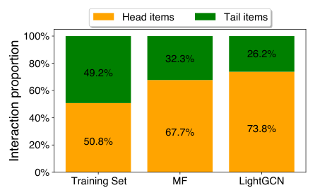
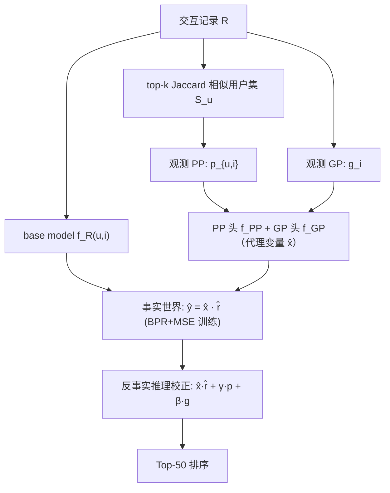

# Debiasing Recommendation with Personal Popularity (用个人流行度做推荐去偏)

- **会议/期刊**: WWW 2024 (Research Full Paper)
- **作者与机构**: Wentao Ning, Reynold Cheng, Ben Kao, Nan Huo (HKU)；Xiao Yan, Bo Tang (SUSTech)；Nur Al Hasan Haldar (Curtin University)
- **推荐链路定位**: 精排（模型无关的打分校准层，可套在 BPRMF / NCF / LightGCN 之上）
- **研究方向**: 去偏公平、可信隐私与工业架构 / 冷启动与长尾推荐
- **论文原文**: [https://arxiv.org/abs/2402.07425v2](https://arxiv.org/abs/2402.07425v2)
- **开源代码**: [https://github.com/Stevenn9981/PPAC](https://github.com/Stevenn9981/PPAC)

## TL;DR (1分钟核心速览)

现有全局流行度 (GP) 去偏方法只维护一套"全体用户共享的热门物品集合"，无法刻画个体兴趣，导致热门物品仍被过度推荐且推荐同质化。本文提出**个人流行度 (PP)**：在目标用户的 top-$k$Jaccard 相似用户圈内重新度量物品热度；并设计**模型无关的反事实框架 PPAC**，用一个混合 PP/GP 的代理变量做因果图分解，在推理阶段以$\gamma p_{u,i}+\beta g_i$校正排名分数（$\gamma>0,\beta<0$）。在等频采样的干预测试集 + 全库排序协议下，Recall@50 相对最强去偏基线最高提升 **46.8%**，NDCG@50 提升 **61.9%**。

## Background & Motivation (背景与核心矛盾)

- **主流范式**: GP 去偏分三类——IPS 逆倾向加权（IPS/IPS-C）、重排与正则（LapDQ、INRS、r-Adj）、因果图方法（PDA、DICE、MACR，把 GP/用户从众性作为混淆路径调整）。
- **前人局限**: ①GP 定义在全体用户上，热门集合对所有用户**完全相同**；一个与用户兴趣无关的物品仅因其 GP 高就会被推给该用户。②所有用户共享热门集合 $\Rightarrow$ 推荐列表高度同质化，形成"马太效应"闭环（图 1：MovieLens-1M 上头部 10% 物品在训练集占 50.8%，在 MF/LightGCN 的 top-50 列表中膨胀到 73.8%/67.7%）。
- **核心洞察**: 作者在 ML-1M 上验证 (图 3)：按 PP 排序后，前 20% 物品平均评分显著更高（PP 有信息量）；同时**没有任何用户**的 top-50 PP 集合与 top-50 GP 集合重叠度 $d_u<10$，约 85% 用户$d_u>20$ —— PP 捕捉的是 GP 之外的用户特定偏好。
- **本文切入点**: 把"流行度"从全局常量改写为 $(u,i)$ 的函数，再用反事实推理单独剥离 PP 与 GP 对打分的**直接效应**。

<figure class="paper-figure" markdown="span">
  <figcaption>图 1：在 MovieLens-1M 数据集中，头部和尾部物品在两个训练良好的模型（即 MF 和 LightGCN）的训练集及推荐列表中出现的频率。头部物品为训练集中用户交互次数最多的前 10% 物品，尾部物品为其余物品。</figcaption>
</figure>

## Method (核心方法设计)

### 1. 整体框架 (Overall Architecture)

PPAC 是一个"外挂式"两阶段框架，base model 不变。前处理阶段离线为每个用户用 Jaccard 相似度取 top-$k$相似用户，统计每个物品在该圈内的交互比例得到观测 PP$p_{u,i}$；模型侧并行训练三个头：base 打分头$f_R(u,i)$、PP 回归头$f_{PP}(u,i)$、GP 回归头$f_{GP}(i)$，三者相乘得到事实世界分数$\hat{y}_{u,i}$并用 BPR + MSE 联合训练。推理阶段不再用事实世界分数，而是按反事实公式加性校正为$\hat{x}_{u,i}\hat{r}_{u,i}+\gamma p_{u,i}+\beta g_i$ 后排序。整个过程与 base model 解耦，可直接替换 MF/NCF/LightGCN。

### 2. 关键设计拆解 (Key Designs)

1. **个人流行度 PP（把热门集合变成用户私有）**：GP 为 $g_i=|\mathcal{U}_i|/|\mathcal{U}|$，与$u$无关；PP 改为$p_{u,i}=\frac{|\mathcal{S}_u^i|}{|\mathcal{S}_u|}$，其中$\mathcal{S}_u$是与$u$交互集 Jaccard 相似度最高的$k$个用户，$\mathcal{S}_u^i\subseteq\mathcal{S}_u$为其中交互过$i$ 者。直觉：CF 场景下"朋友都觉得好"比"全世界都觉得好"更接近真实兴趣，且天然把长尾物品在局部稠密圈中"重新加热"，从而削弱 GP 主导。
2. **代理变量 + 反事实直接效应控制（本文的因果增量）**：真实生成过程应按图 2(c) 同时含 $PP\to S$与$GP\to S$两条直接路径，但两条路径难以分别识别，故引入单一代理$X$混合二者（$X$同时指向$U,I$），再按 TE/NDE/TIE 分解得
$$\hat{S}=\underbrace{S_{x,u,i}}_{\text{事实}}=\hat{x}_{u,i}f_R(u,i),\quad \hat{x}_{u,i}=\sigma(f_{PP}(u,i))\cdot\sigma(f_{GP}(i)),$$
并保留 $\text{TIE}+\epsilon\,\text{NDE}=S_{x,u,i}+\gamma p_{u,i}+\beta g_i$（参考态常数项$\epsilon S_{x^*,u^*,i^*}$对所有候选相同、不影响排序故丢弃）。关键工程直觉：$\hat{x}$用**模型预测值**以学习更好表征，而校正项用**观测值**$p_{u,i},g_i$做精细调权；实验中$\gamma>0$放大 PP、$\beta<0$ 抑制 GP 最有效。
3. **训练目标、负采样与推理**：$\mathcal{L}=\mathcal{L}_{R}+\alpha(\mathcal{L}_{P}+\mathcal{L}_{G})+\lambda\|\Theta\|_2^2$，$\mathcal{L}_R$为 BPR（**Uniform 随机负采样**，每正样本 1 负），$\mathcal{L}_P,\mathcal{L}_G$为对观测 PP/GP 的 MSE 回归。推理开销 = base model 前向 + 两次 MLP + 一次查表，无额外候选生成；但 top-$k$相似用户与$p_{u,i}$ 需离线全量维护。

## Experimental Setup & Evaluation Protocol (实验设置与评估协议)

- **数据集与预处理**:

| 数据集 | #Users | #Items | #Interactions | 稀疏度 | 说明 |
| :--- | :---: | :---: | :---: | :---: | :--- |
| MovieLens-1M | 6,038 | 3,883 | 1,000,209 | 4.3% | 含 1–5 星显式评分，转隐式 |
| Gowalla | 29,858 | 40,981 | 5,946,257 | 0.49% | LBS 签到 |
| Yelp2018 | 31,668 | 38,048 | 8,827,696 | 0.73% | 商户点评 |

- **数据划分与防穿越**: **干预式划分（intervened split）**——从全量中采样 10% 作测试集、另 10% 作验证集，采样时强制**每个物品获得相同数量的交互**，剩余 80% 训练；构造"反事实环境"消除测试集自身的 GP 偏置（传统随机切分会继承严重 GP 偏置，掩盖去偏能力）。
- **排名评测协议**: 无偏 **Full-Ranking（全库未交互物品排序）**，报 top-50 的 Recall@50 与 NDCG@50；无采样负例。
- **对比基线与超参**: 3 个 base model（BPRMF / NCF / LightGCN）× 10 个基线（MostPop、IPS、IPS-C、LapDQ、INRS、DICE、PDA、MACR + 作者自建 MostPPop）；嵌入维度 $d=64$，GCN 层数 3，学习率 0.01，batch 8092；$\gamma=256$、$\beta=-128$、$\alpha=0.1$、$\lambda=10^{-4}$、$k=30$；配对$t$检验，$p<0.05$。

## Key Experimental Results (实验关键数据)

### 1. 主实验对比 (Main Results)

BPRMF 为基座（Recall@50 / NDCG@50）：

| 方法 | ML-1M | Gowalla | Yelp2018 |
| :--- | :---: | :---: | :---: |
| Base (BPRMF) | 0.2967 / 0.1864 | 0.1313 / 0.0480 | 0.0634 / 0.0233 |
| MostPop | 0.1349 / 0.0751 | 0.0023 / 0.0008 | 0.0051 / 0.0017 |
| IPS | 0.3077 / 0.1920 | 0.1296 / 0.0468 | 0.0712 / 0.0269 |
| LapDQ | 0.3149 / 0.1935 | 0.1221 / 0.0443 | 0.0712 / 0.0269 |
| DICE | 0.3074 / 0.1902 | 0.1115 / 0.0398 | 0.0664 / 0.0250 |
| MACR | 0.3058 / 0.1826 | 0.1349 / 0.0518 | 0.0764 / 0.0281 |
| MostPPop (本文参照) | 0.3058 / 0.1929 | 0.1461 / 0.0571 | 0.0793 / 0.0314 |
| **PPAC** | **0.3789 / 0.2294** | **0.1661 / 0.0675** | **0.0885 / 0.0361** |
| Improv. vs 最强基线 | +20.3% / +18.6% | +23.1% / +30.3% | +24.3% / +34.2% |

LightGCN 为基座：

| 方法 | ML-1M | Gowalla | Yelp2018 |
| :--- | :---: | :---: | :---: |
| Base (LightGCN) | 0.3757 / 0.2295 | 0.1480 / 0.0544 | 0.0852 / 0.0326 |
| IPS | 0.3759 / 0.2297 | 0.1639 / 0.0607 | 0.0868 / 0.0333 |
| LapDQ | 0.3807 / 0.2334 | 0.1540 / 0.0575 | 0.0879 / 0.0338 |
| DICE | 0.3816 / 0.2291 | 0.1468 / 0.0536 | 0.0867 / 0.0328 |
| MACR | 0.3867 / 0.2381 | 0.1662 / 0.0654 | 0.0884 / 0.0341 |
| **PPAC** | **0.4056 / 0.2481** | **0.1885 / 0.0780** | **0.1031 / 0.0414** |
| Improv. vs 最强基线 | +4.9% / +4.2% | +13.4% / +19.3% | +13.7% / +15.6% |

（NCF 上最高提升：Gowalla Recall +46.8%、NDCG +61.9%。）

### 2. 消融实验 (Ablation Study)

BPRMF 基座，逐步禁用各组件：

| 变体 | ML-1M R/N | Gowalla R/N | Yelp R/N |
| :--- | :---: | :---: | :---: |
| Base | 0.2967 / 0.1864 | 0.1313 / 0.0480 | 0.0634 / 0.0233 |
| w/o CI（用事实世界打分） | 0.3459 / 0.2089 | 0.1394 / 0.0495 | 0.0706 / 0.0270 |
| w/o PP（去 PP 头与 PP 项） | 0.3525 / 0.2129 | 0.1139 / 0.0429 | 0.0641 / 0.0250 |
| w/o GP（去 GP 头与 GP 项） | 0.3718 / 0.2251 | 0.1518 / 0.0587 | 0.0814 / 0.0323 |
| **PPAC** | **0.3789 / 0.2294** | **0.1661 / 0.0675** | **0.0885 / 0.0361** |

### 3. 关键实验发现 (Key Findings)

1. **PP 是主要收益来源，且不可被 GP 替代**：Gowalla 上 w/o PP 掉到 0.1139/0.0429，**低于** base model 的 0.1313/0.0480；而 w/o GP 仍保持 0.1518/0.0587。说明只保留 GP 校正反而把有用信号污染掉，PP 才是增益主体。
2. **"观测值 + 预测值"双轨设计不可省**：仅用预测值（PPAC-Pred）或仅用观测值（PPAC-Obs）在 Gowalla/BPRMF 上分别只有 0.0985、0.1585，均低于混合方案 0.1661，验证了"预测项学表征、观测项做调权"的分工；LightGCN 上 PPAC-Pred 更崩到 0.2847（ML-1M）。
3. **去偏确实发生在长尾侧而非牺牲精度**：图 7 显示 PPAC 降低了最热物品组的推荐频次，同时**所有物品组的 recall 均最高**，其中 0–10 次交互的最冷组提升最大——即收益来自"把局部热门的长尾物推给对口用户"，不是全局降权。

## Highlights & Limitations (亮点、对比与审稿批判)

- **与代表作对比**: 相比 **MACR**（多任务拆解用户兴趣/从众性/GP，但仍以 GP 为唯一流行度变量）与 **PDA**（因果图里只调 GP 一条直接路径），PPAC 的差异是"流行度变量本身被用户化"；相比 **IPS/LapDQ**（对 GP 加权或重排，属样本级/列表级启发式），PPAC 给出可解释的 TE/NDE 分解并落到可加性打分校准。
- **可迁移亮点**: ①"用户圈内重定义物品属性"这一思路可迁移到局部新颖性、局部曝光公平、局部 CTR 先验；②推理期"预测项 × 观测先验线性校正"的轻量插件范式，适合在已有精排模型上做 A/B 快速验证。
- **审稿级局限批判**: ①PP 需为每用户维护 top-$k$相似集与全量$p_{u,i}$（$O(|\mathcal{U}|^2)$相似度计算），论文未给复杂度分析或线上增量更新方案，$k=30$且对$k$呈明显单峰敏感；②评估用**人为等频采样的干预测试集**，虽能暴露去偏能力但与真实曝光分布偏离，且 ML-1M 仅 6k 用户、只报 top-50 全排序，缺少线上 A/B 与$\gamma=256/\beta=-128$ 这类极大幅值权重的稳定性讨论。

## Rating (四维评分)

- **方法创新性 (Novelty)**: ⭐⭐⭐⭐ （把流行度从全局常量重构为用户条件变量，并用代理变量化解双直接路径不可识别问题，思路干净且有实证动机支撑）
- **评估协议与实验扎实度 (Protocol & Experiments)**: ⭐⭐⭐⭐ （3 数据集 × 3 基座 × 10 基线 + 干预测试集 + 显著性检验 + 完整消融与分组分析，唯缺线上验证）
- **写作与数学规范度 (Clarity & Rigor)**: ⭐⭐⭐ （因果推导链条清晰，但 $X$代理变量与$\epsilon$ 的物理含义偏抽象，常数项丢弃与"预测/观测"混用的合理性主要靠实验背书）
- **工业落地与复现价值 (Industrial & Practical Value)**: ⭐⭐⭐⭐ （模型无关、代码开源、推理仅增两次 MLP；但相似用户集离线维护成本与超参敏感性需工程侧额外投入）

