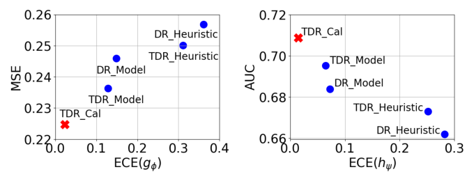
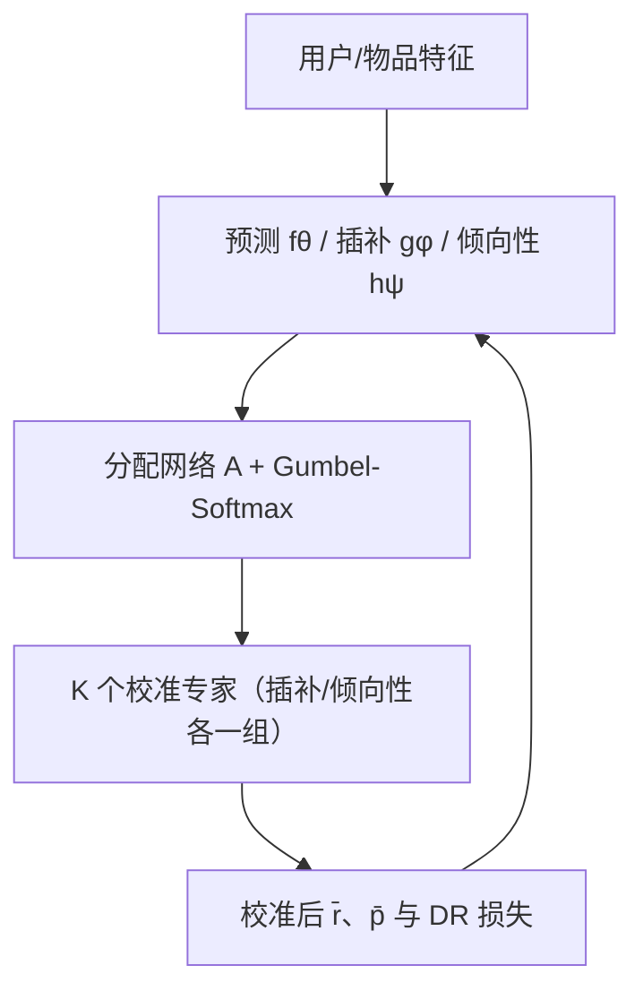
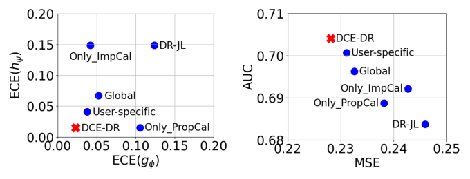

# Doubly Calibrated Estimator for Recommendation on Data Missing Not At Random (面向MNAR数据的双校准估计器)

- **会议/期刊**: WWW 2024
- **作者与机构**: Wonbin Kweon, Hwanjo Yu (POSTECH)
- **推荐链路定位**: 精排（训练损失/估计器层面）
- **研究方向**: 去偏公平、可信隐私与工业架构 / 协同过滤
- **论文原文**: [https://arxiv.org/abs/2403.00817v1](https://arxiv.org/abs/2403.00817v1)
- **开源代码**: [https://github.com/WonbinKweon/DCE_WWW2024](https://github.com/WonbinKweon/DCE_WWW2024)

## TL;DR (1分钟核心速览)

针对 MNAR 选择偏差下双稳健（DR）估计器依赖未校准插补误差与倾向性分数的问题，本文提出双校准估计器 DCE：用 $K$ 个校准专家和 Gumbel-Softmax 用户分配网络，分别校准插补与倾向性模型，并以三层联合学习优化。在 Coat、Yahoo!R3、KuaiRec 无偏测试集上，DCE-TDR 较 TDR-CL 的 MSE 降低 3.4%–5.5%，AUC 提升 1.5%–2.7%。

## Background & Motivation (背景与核心矛盾)

- **主流范式**: DR 估计器将 EIB 与 IPS 结合，只要插补误差或倾向性分数之一准确，就能无偏逼近全量理想损失；后续工作多通过改造插补项或倾向性项来提升鲁棒性。
- **前人局限**: 现有 DR 变体仍依赖逻辑回归/神经网络等基础模型估计插补与倾向性，这类模型易过度自信，产生未校准概率；同时，倾向性过低会以 $1/\hat{p}_{u,i}^2$ 放大方差，简单 clipping 只压制极端值，未解决过度自信根源。
- **核心洞察 (Key Insight)**: 作者证明 DR 的偏差与方差上界分别与校准误差成正比：$\mathrm{Bias}[\mathcal{E}_{DR}]\leq\rho_{\max}\cdot\mathrm{ECE}(h_\psi)$，$\mathrm{Var}[\mathcal{E}_{DR}]\leq\omega_{\max}\cdot(\mathrm{ECE}(g_\phi))^2$。图1 的经验结果也显示，模型化但未校准的 DR 甚至可能优于启发式 TDR，说明“估计量准不准”比“估计器形式多复杂”更关键。
- **本文切入点**: 不改造 DR 形式，而是直接校准插补模型和倾向性模型，使 DR 的偏差与方差同时下降。

<figure class="paper-figure" markdown="span">
  <figcaption>图1：不同插补/倾向性模型下DR估计器在Yahoo!R3数据集上的性能。</figcaption>
</figure>
图1：不同插补/倾向性模型下 DR 估计器在 Yahoo!R3 上的性能，说明校准误差与 DR 性能显著相关。

## Method (核心方法设计)

### 1. 整体框架 (Overall Architecture)

DCE 在预测模型 $f_\theta$、插补模型$g_\phi$、倾向性模型$h_\psi$之外，增加两组校准专家与分配网络。用户嵌入经$A(\cdot)$得到$K$维分配概率，再用 Gumbel-Softmax 采样得到软分配向量$\beta_u$；插补/倾向性原始输出经对应专家做 Platt 校准，分别得到校准伪标签$\bar{r}_{u,i}$与校准倾向性$\bar{p}_{u,i}$，再代入校准 DR 损失训练预测模型。倾向性模型先以$\mathcal{O}$vs$\mathcal{D}\setminus\mathcal{O}$ 二分类预训练；校准专家在验证集上以 BCE 训练；插补模型用校准倾向性加权优化；三层交替进行。

### 2. 关键设计拆解 (Key Designs)

1. **校准专家（Calibration Experts）**：全局校准会混合不同用户的 logit 分布，用户级校准又会让冷启动用户训练信号不足。DCE 设 $K$个专家，每个专家采用 Platt scaling$c_{\omega_k}(p)=\sigma(a_k\cdot\sigma^{-1}(p)+b_k)$；用户分配由$\alpha_u=A(\mathbf{E}_u)\in\mathbb{R}^K$ 给出，并用 Gumbel-Softmax 软采样：
   $\beta_{u,k}=\frac{\exp((\log\alpha_{u,k}+g_k)/\tau)}{\sum_{l=1}^K\exp((\log\alpha_{u,l}+g_l)/\tau)}$。
   这样组内共享训练信号、组间保留 logit 异质性，缓解冷启动并提升校准精度。

2. **三层联合学习（Tri-level Joint Learning）**：为避免校准器、插补器、预测器互相等待，DCE 分三层交替优化：第一层用校准倾向性 $\bar{p}_{u,i}=\sum_k\beta^{prop}_{u,k}c^{prop}_{\omega_k}(\hat{p}_{u,i})$加权训练插补模型；第二层在验证集上训练校准专家与分配网络；第三层用校准插补误差$\bar{e}_{u,i}$与$\bar{p}_{u,i}$ 训练预测模型：
   $\mathcal{E}_{DR}^{cal}(\theta)=\frac{1}{|\mathcal{D}|}\sum_{u,i\in\mathcal{D}}\left[\bar{e}_{u,i}+\frac{o_{u,i}(e_{u,i}-\bar{e}_{u,i})}{\bar{p}_{u,i}}\right]$。
   该设计把“校准”与“去偏”解耦，且可插件式替换任意 DR 损失。

3. **训练目标、负采样与推理效率**：训练目标为校准 DR 损失 $\mathcal{E}_{DR}^{cal}$，辅以校准 BCE 损失$\mathcal{L}_{cal}^{imp}$、$\mathcal{L}_{cal}^{prop}$；不引入额外负采样，倾向性模型直接用$\mathcal{O}$与$\mathcal{D}\setminus\mathcal{O}$构造正负例。推理阶段仅需预测模型$f_\theta$，校准专家只参与训练，因此线上开销与基座模型基本一致。

## Experimental Setup & Evaluation Protocol (实验设置与评估协议)

- **数据集与预处理**: Coat/Yahoo!R3 将显式评分 $>3$设为 1，否则为 0；KuaiRec 将观看比例$>1$ 设为 1，否则为 0。

| 数据集 | #Users | #Items | #Interactions | 稀疏度/密度 | 特征/场景说明 |
| :--- | :---: | :---: | :---: | :---: | :--- |
| Coat | 290 | 300 | 11,600 (6,960 train + 4,640 test) | 密度 13.33% | 显式评分转二值，小规模强稀疏 |
| Yahoo!R3 | 15,401 | 1,001 | 365,704 (311,704 + 54,000) | 密度 2.37% | 显式评分转二值，含无偏测试集 |
| KuaiRec | 7,163 | 10,596 | 318,284 (201,171 + 117,113) | 密度 0.42% | 短视频观看比例转二值，全量评分测试集 |

- **数据划分与防穿越 (Splitting Strategy)**: 从训练集留出 10% 作为验证/校准集；测试使用各数据集自带的无偏测试集，不将无偏测试集用于倾向性估计或训练。
- **排名评测协议 (Ranking Protocol)**: 在无偏测试集上做全量评估（非训练负采样排序），报告 MSE、AUC 与 NDCG@K；Coat/Yahoo!R3 用无偏测试集，KuaiRec 用全量评分测试集。
- **对比基线与超参设置**: 基线覆盖 IPS/SNIPS/AT、CVIB、Multi-DR/ESCM2-DR、DR-JL/MRDR-JL/BRD-DR/MR/DR-MSE/StableDR/TDR-CL；基座取 MF 或 NeuMF；嵌入维度 $d\in\{16,32,64\}$，专家数$K\in\{5,10,20\}$；Adam，学习率$[10^{-4},10^{-1}]$；配对 t 检验$p<0.05$。

## Key Experimental Results (实验关键数据)

### 1. 主实验对比 (Main Results)

| Method | Coat MSE | Coat AUC | Yahoo MSE | Yahoo AUC | Yahoo N@10 | KuaiRec MSE | KuaiRec AUC | KuaiRec N@100 |
| :--- | :---: | :---: | :---: | :---: | :---: | :---: | :---: | :---: |
| Naive | 0.2547 | 0.6828 | 0.2603 | 0.6528 | 0.7584 | 0.2738 | 0.7510 | 0.7571 |
| IPS | 0.2423 | 0.6935 | 0.2496 | 0.6757 | 0.7641 | 0.2699 | 0.7601 | 0.7768 |
| CVIB | 0.2311 | 0.7006 | 0.2438 | 0.6823 | 0.7709 | 0.2702 | 0.7540 | 0.7612 |
| DR-JL | 0.2302 | 0.7122 | 0.2459 | 0.6837 | 0.7731 | 0.2580 | 0.7683 | 0.7932 |
| Multi-DR | 0.2288 | 0.7201 | 0.2407 | 0.6863 | 0.7712 | 0.2557 | 0.7714 | 0.7985 |
| MRDR-JL | 0.2193 | 0.7192 | 0.2394 | 0.6842 | 0.7727 | 0.2542 | 0.7705 | 0.8023 |
| TDR-CL | 0.2173 | 0.7302 | 0.2363 | 0.6951 | 0.7763 | 0.2477 | 0.7885 | 0.8037 |
| DCE-DR | 0.2109 | 0.7384 | 0.2281 | 0.7041 | 0.7923 | 0.2430 | 0.8058 | 0.8122 |
| **DCE-TDR** | **0.2054** | **0.7412** | **0.2247** | **0.7087** | **0.8014** | **0.2394** | **0.8097** | **0.8249** |

DCE-TDR 相对最强基线 TDR-CL：Coat MSE $-5.5\%$、AUC$+1.5\%$；Yahoo!R3 MSE$-4.9\%$、AUC$+2.0\%$；KuaiRec MSE$-3.3\%$、AUC$+2.7\%$。DCE-DR 相对 DR-JL 在 Coat MSE 上降低$8.37\%$，说明校准增益可与标准 DR 正交叠加。

### 2. 消融实验 (Ablation Study)

| 变体（Yahoo!R3） | 校准倾向性 | 校准插补 | 相对 Full 的 MSE | 相对 Full 的 AUC | 结论 |
| :--- | :---: | :---: | :---: | :---: | :--- |
| DCE-DR (Full) | ✓ | ✓ | 基准 | 基准 | 双校准最优 |
| Global | 全局 | 全局 | 更高 | 更低 | 单一全局函数混合用户 logit |
| User-specific | 用户级 | 用户级 | 更高 | 更低 | 冷启动用户信号不足 |
| Only_ImpCal | ✗ | ✓ | 更高 | 更低 | 缺倾向性校准，偏差上界仍大 |
| Only_PropCal | ✓ | ✗ | 更高 | 更低 | 缺插补校准，方差上界仍大 |
| DR-JL | ✗ | ✗ | 最高 | 最低 | 未校准基线 |

<figure class="paper-figure" markdown="span">
  <figcaption>图2：Yahoo!R3上的消融研究。</figcaption>
</figure>
图2：Yahoo!R3 上的消融研究，双校准与专家分配均带来一致增益。

### 3. 关键实验发现 (Key Findings)

- **校准直接转化为去偏收益**：DCE-TDR 在三个数据集上均显著优于 TDR-CL，Coat MSE 从 0.2173 降至 0.2054，Yahoo!R3 从 0.2363 降至 0.2247，KuaiRec 从 0.2477 降至 0.2394，验证了“降低 ECE 即降低 DR 偏差/方差上界”的理论判断。
- **双校准缺一不可**：消融中仅校准插补或仅校准倾向性都弱于 Full，说明偏差主要由倾向性校准控制、方差主要由插补校准控制，二者同时校准才能兼顾偏差-方差权衡。
- **专家机制优于全局/用户级校准**：全局校准混合不同用户 logit 分布，用户级校准受冷启动限制；$K$ 个专家在组内共享信号、组间保留异质性，因而在图2中取得更低 ECE 与更高 AUC，且训练时间仅比 TDR-CL 高约 7%，参数量几乎相同（Coat 上 28,524 vs 28,354）。

## Highlights & Limitations (亮点、对比与审稿批判)

- **与代表作对比 (vs. Prior Work)**: DR-JL 只给出标准 DR 形式；TDR-CL 通过改造插补误差提升鲁棒性；StableDR 主要处理倾向性分数。DCE 的本质区别是“不改变 DR 估计器，而是把输入估计量校准准”，因此可与它们正交组合。
- **可迁移亮点**: 用校准专家 + Gumbel-Softmax 分配网络处理用户级异质校准，可迁移到 CTR/CVR 的延迟反馈、因果去偏和跨域倾向性建模；在验证集上做后校准、再回灌主损失的三层训练范式也具备通用性。
- **审稿级局限批判**: 其一，校准依赖验证集，若验证集分布偏移或过小，校准器可能过拟合；倾向性模型仍靠 $\mathcal{O}$vs$\mathcal{D}\setminus\mathcal{O}$二分类，极端低倾向性未被根本解决。其二，理论界含$\rho_{\max}$、$\pi_{\max}$，当$\bar{p}_{u,i}$很小时上界仍可能被放大；三层优化与$K$ 专家引入额外调参成本，虽训练开销可控，但工程上需谨慎处理专家塌缩与温度退火。

## Rating (四维评分)

- **方法创新性 (Novelty)**: ⭐⭐⭐⭐ （把模型校准引入 DR 双稳健估计，并给出偏差/方差上界，思路新颖；但本质仍是校准 + MoE 的组合）
- **评估协议与实验扎实度 (Protocol & Experiments)**: ⭐⭐⭐⭐ （三个真实无偏测试集、多类强基线、五次运行与配对 t 检验，消融完整；全排序切分细节与超参敏感性披露略少）
- **写作与数学规范度 (Clarity & Rigor)**: ⭐⭐⭐⭐ （定理、证明与校准定义清晰，公式规范；三层训练算法信息密度高，初读需对照算法 1）
- **工业落地与复现价值 (Industrial & Practical Value)**: ⭐⭐⭐⭐ （代码开源，推理不增加校准开销，训练开销低于 10%，可作为插件接入现有 DR 损失）

