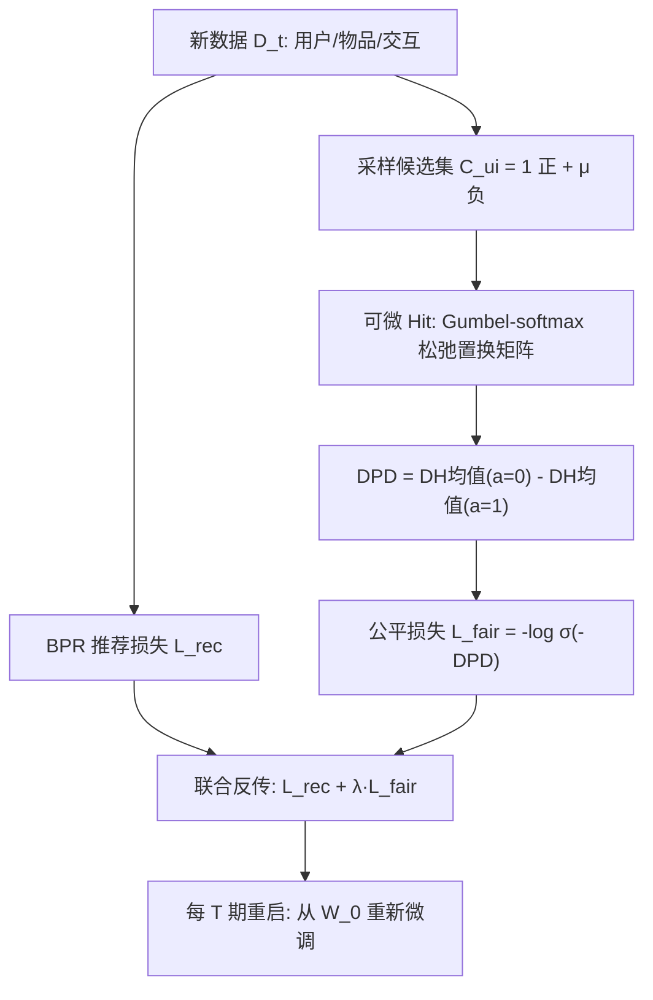
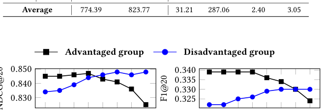

# Ensuring User-side Fairness in Dynamic Recommender Systems (动态推荐系统中的用户侧公平性保障)

- **会议/期刊**: WWW 2024 (The ACM Web Conference)
- **作者与机构**: Hyunsik Yoo, Zhichen Zeng, Jian Kang, Ruizhong Qiu, Zhining Liu, Hanghang Tong 等（UIUC / University of Rochester / Amazon）
- **推荐链路定位**: 精排（打分模型训练）+ 动态在线更新
- **研究方向**: 去偏公平、可信隐私与工业架构 / 用户侧群体公平
- **论文原文**: [https://arxiv.org/abs/2308.15651v3](https://arxiv.org/abs/2308.15651v3)
- **开源代码**: [https://github.com/hsyoo32/fade](https://github.com/hsyoo32/fade)

## TL;DR (1分钟核心速览)

动态推荐系统为追随用户兴趣漂移必须持续增量更新，但本文首次实证并理论化了一个被忽视的事实：**这种持续适应会让优势/劣势用户群体（性别、体型）之间的性能差距随时间不减反增**。作者先用泛化误差分析证明「增量微调 + 定期重启」优于全量重训，再提出 FADE：以 Gumbel-softmax 松弛置换矩阵构造可微 Hit（DH），替代 Sinkhorn 版 NeuralNDCG，并将去掉绝对值符的 DPD 作为端到端公平正则。在 Movielens/ModCloth 按时间切 7 期、采样 100 负例的排序协议下，|PD| 平均下降 48.91%，NDCG@20/F1@20 仅降 2.44%，训练速度比重训快约 270 倍。

## Background & Motivation (背景与核心矛盾)

- **主流范式**: 动态推荐靠「只用新数据增量微调」应对分布漂移；公平侧则已有大量**物品侧**方法（用物品流行度校准预测分），以及**用户侧**的对抗表征学习与后处理重排（如约束重排 [20]）。
- **前人局限**: 物品侧去偏与用户侧公平的目标本质不同（前者求曝光均等、后者求服务质量均等），无法直接移植；而后处理重排 (i) 本质是 0-1 整数规划，需反复重排、时间昂贵，(ii) 公平约束与推荐质量优化分离，无法反传梯度以适配漂移，(iii) 依赖的候选列表本身已严重不公，短列表下几乎无可救药。
- **核心洞察 (Key Insight)**: 图 1 显示预训练 → 逐期微调时总体性能上升（+4.61%），但群体差距同时扩大；理论分解进一步说明泛化误差含「分布漂移项」与「有限样本学习误差项」两部分——微调以 $\gamma^{t_{te}-t-1}$ 指数衰减前者，却使后者随期数累积，故必须周期性重启。
- **本文切入点**: 把公平作为**可微正则项**嵌入微调损失，使公平性在每次模型更新中同步、廉价地被优化，而非事后修补。

## Method (核心方法设计)

### 1. 整体框架 (Overall Architecture)

在每个时间期 $t$，FADE 仅加载新数据$\mathcal{D}_t$与上一期参数$\mathbf{W}_{t-1}$，构造两路损失：BPR 推荐损失$\mathcal{L}^{rec}$，以及基于**采样候选集**（1 正 +$\mu$负）的公平损失$\mathcal{L}^{fair}$。公平损失内部先对每个用户按连续松弛置换矩阵取 DH@1 作为质量代理，再按敏感属性$a$分组求均值差得 DPD，最后送入 sigmoid 交叉熵。两损失联合反传更新$\mathbf{W}_t$，每$T$ 期从零重启以避免学习误差累积；推理阶段与普通 MF/NCF 完全一致，无额外排序开销。

### 2. 关键设计拆解 (Key Designs)

**1) 微调 v.s. 重训的理论判别（决定更新范式）**：重训把新旧数据等权，漂移项按样本量加权而无法衰减；微调则把历史影响按 $\gamma$ 指数遗忘。定理 3.1/3.2 给出的界为

$$\mathcal{L}^{ft}_{t_{te}} \le \mathcal{L}^{*}_{t_{te}} + 2\gamma^{t_{te}-1}d_{0,t_{te}} + 2\sum_{t=1}^{t_{te}-1}(1-\gamma)\gamma^{t_{te}-t-1}d_{t,t_{te}} + \mathcal{O}\!\left(\sqrt{\tfrac{\gamma^{2(t_{te}-1)}\log m_0}{m_0}}\right)$$

其中 $d_{t,t_{te}}=d^{H\Delta H}_{t,t_{te}}+d^{comb}_{t,t_{te}}$统一刻画协变量漂移与概念漂移。直觉：$\gamma<1$时旧期漂移被指数压制，但$m_1\ll m_0$使学习误差项随期数线性膨胀，故**微调必须配重启周期$T$**。

**2) Differentiable Hit（DH）：让 top-$K$指标可导且不消失梯度**：NeuralNDCG 的 Sinkhorn 归一化在长尾分数下梯度趋零且迭代昂贵。本文用连续排序：先写确定性置换矩阵$P_u[k,j]=1$当$j=\arg\max[(N+1-2k)\mathbf{s}_u-\mathbf{A}_u\mathbf{1}]$（$\mathbf{A}_u$为分数绝对差矩阵，$k$行对应第$k$ 名），再用 Gumbel-softmax 松弛为

$$\tilde{P}_u[k,:]=\mathrm{softmax}\!\left(\frac{(N+1-2k)\mathbf{s}_u-\mathbf{A}_u\mathbf{1}}{\tau}\right),\quad \mathrm{DH}(\mathcal{C}_u;k)=\tilde{P}_u[k,:]\cdot\mathbf{Y}_t[u,:]^{\top}$$

每行直接是「某物品排第 $k$位」的概率，只需$\mathcal{O}(\mu^2)$且对$\mathbf{s}_u$ 处处可导，避免 Sinkhorn 的梯度消失。

**3) 无绝对值的自适应公平损失（稳定性来源）**：朴素做法最小化 $|\mathrm{DPD}|$在零点不可导、训练震荡。由$\mathrm{DPD}_{\mathcal{D}_t}=\frac{\sum_{(u,i):a=0}\mathrm{DH}(\mathcal{C}_{ui};1)}{|\{\mathcal{E}_t|a=0\}|}-\frac{\sum_{(u,i):a=1}\mathrm{DH}(\mathcal{C}_{ui};1)}{|\{\mathcal{E}_t|a=1\}|}$，定义

$$\mathcal{L}^{fair}_{\mathcal{D}_t}=-\log\sigma(-\mathrm{DPD}_{\mathcal{D}_t}),\qquad \mathcal{L}_{\mathcal{D}_t}=\mathcal{L}^{rec}_{\mathcal{D}_t}+\lambda\mathcal{L}^{fair}_{\mathcal{D}_t}$$

命题 3.3 证明：当 $\mathrm{DPD}<0$（劣势组反而更好）时该损失的梯度影响自动衰减，交由「天然偏向优势组」的$\mathcal{L}^{rec}$把 DPD 推回 0；即去掉$|\cdot|$后仍具单边自适应能力。总复杂度$\mathcal{O}(|\mathcal{E}_t|(\mu^2+\mu d))\approx\mathcal{O}(|\mathcal{E}_t|\mu d)$，与 BPR 同阶；负采样为逐交互均匀采样（$n=4$给 BPR，$\mu=4$ 给公平损失）。

## Experimental Setup & Evaluation Protocol (实验设置与评估协议)

- **数据集与预处理**（评分 >2 置 1 二值化）：

| 数据集 | #Users | #Items | #Interactions | 密度 | 特征/场景说明 |
| :--- | :---: | :---: | :---: | :---: | :--- |
| Movielens | 6,039 | 3,628 | 836,478 | 3.82% | 电影；$a$=性别，男 4,330 人为优势组 |
| ModCloth | 37,142 | 1,014 | 83,147 | 0.22% | 女装电商；$a$=体型，Small 28,374 人为优势组 |

- **数据划分与防穿越**: **全局时间戳排序后切分**——前 60%(ML)/70%(ModCloth) 作预训练 $\mathcal{D}_0$，其余动态数据等量切成$T=7$期；最后一期$\mathcal{D}_T$仅测试。两套任务：Task-R（用截至$t$的模型测$t{+}1\ldots T$ 全部剩余期）与 Task-N（只测紧邻下一期）。
- **排名评测协议**: **Sampled Ranking**——每用户随机采 100 个未交互物品与真实正例混合排序，报告 NDCG@20 与 F1@20，并统计群体差 $\mathrm{PD}_t=\mathrm{Perf}(a{=}0)-\mathrm{Perf}(a{=}1)$。
- **对比基线与超参**: 骨干为 MF 与 NCF，均配 BPR；基线含 Pretrain / Retrain / Finetune 三个无公平版本及其 Fair 变体、FADE-Abs（用 $|\mathrm{DPD}|$），以及 Adver（对抗剥离敏感属性）与 Rerank（约束重排），后两者也套用微调以保证公平比较。$d$沿用骨干默认，学习率 1e-3，L2=1e-4，Adam；$\tau=3$、$\mu=4$、每期 10 epoch、$\lambda\in[0,4]$ 网格搜索。

## Key Experimental Results (实验关键数据)

### 1. 主实验对比 (Main Results)

原文主结果以图 2 的「性能–|PD|」散点呈现（右下角最优），下表汇总其跨数据集/骨干的平均相对量：

| 方法 | 更新范式 | 推荐性能(相对 Finetune) | \|PD\| 变化 | 平均单期耗时(s) |
| :--- | :--- | :---: | :---: | :---: |
| Pretrain | 冻结 | −4.61% | 高 | — |
| Retrain | 全量重训 | +1.38% | 比 Finetune 高 14.79% | 774.39 |
| Finetune | 增量微调 | 基准 | 基准 | **2.40** |
| Pretrain-Fair | 冻结+公平 | 略降 | 中 | — |
| Retrain-Fair | 重训+公平 | — | 比 Retrain **↓47.60%** | 823.77 |
| Adver | 微调+对抗 | −1.49% | 比 FADE 高 36.53% | 31.21 |
| Rerank | 微调+重排 | ≈Finetune | 与 Finetune 接近（收益有限） | 287.06 |
| FADE-Abs | 微调+$\|\mathrm{DPD}\|$ | ≈FADE | 高于 FADE，训练不稳 | ≈3.05 |
| **FADE (Ours)** | 微调+重启+DH | **−2.44%** | **比 Finetune ↓48.91%；比 Retrain-Fair 再↓16.47%** | **3.05** |

### 2. 消融实验 (Ablation Study)

| 消融变体 | 替换内容 | 关键结果 |
| :--- | :--- | :--- |
| w/o $\mathcal{L}^{fair}$ (Finetune) | 仅 BPR | \|PD\| 高约 1.96×，且逐期上升 |
| $\mathcal{L}^{fair}\!\to\!\|\mathrm{DPD}\|$ (FADE-Abs) | 加绝对值 | 训练震荡，\|PD\| 与性能均劣于 FADE |
| DH → NeuralNDCG | Sinkhorn 松弛 | 效果持平，速度慢约 **4×** |
| 微调 → 重训 (Retrain-Fair) | 同损失换范式 | \|PD\| 更高，慢约 **270×** |
| w/o 周期重启 | 无限微调 | 多期后性能退化（原文 Fig.8/10） |

### 3. 关键实验发现 (Key Findings)

1. **公平损失本质是「组间再分配」而非净损耗**：优势组性能平均 −3.37%、劣势组 +2.06%，整体仅 −2.44%，说明 FADE 把容量从冗余侧转移到欠拟合侧，而非削弱模型。
2. **微调范式本身即是公平增益**：Finetune 相对 Retrain 同时取得性能 +1.38% 与 |PD| −14.79%，且快 323×；加入公平损失后 FADE 仍比 Retrain-Fair 的 |PD| 低 16.47%，性能只差 0.61%，验证了定理 3.1 对漂移项的指数压制效应。
3. **后处理路线在动态场景双输**：Rerank 与 Finetune 结果几乎重合（候选列表已不公、无处可救），且慢 94.11×；Adver 因目标错位（只剥离敏感属性）PD 高出 36.53%。

<figure class="paper-figure" markdown="span">
  <figcaption>图 4：缩放参数 𝜆 对优势群体和劣势群体性能的影响。</figcaption>
</figure>

## Highlights & Limitations (亮点、对比与审稿批判)

- **与代表作对比 (vs. Prior Work)**: 相比 Li 等 [20] 的约束重排——本文把公平约束变成可反传正则，从「事后修列表」转为「事前改参数」，效率提升两个数量级；相比 NeuralNDCG [28]——用单次 softmax 替代多轮 Sinkhorn，兼顾梯度稳定与 $\mathcal{O}(\mu^2)$ 成本；相比物品侧动态去偏（流行度校准）——目标函数根本不同，解决的是服务质量而非曝光配额。
- **可迁移亮点**: (i) DH 可作为任何 top-$K$ 可微代理的通用构件（Recall/Precision/NDCG 皆可包装），比 NeuralNDCG 快约 4×；(ii) 「去掉绝对值 + 依赖竞争损失自适应回零」的损失设计，可直接迁移到多任务/多目标权衡的稳定性问题。
- **审稿级局限批判**: (i) 敏感属性仅考虑单一二元变量，且仅两个数据集、Sampled-100 负例评估，缺少 Full-Ranking 与多属性交叉（交叉群体样本稀少时会加剧噪声）；(ii) 重启周期 $T$缺乏自适应准则，仅靠经验曲线判断，且$\mu^2$项在更大候选集时开销上扬；论文未报告线上 A/B 与长周期（$T\gg7$）稳定性。

## Rating (四维评分)

- **方法创新性 (Novelty)**: ⭐⭐⭐⭐ （首次把用户侧公平放进动态场景，并用泛化误差界把「微调+重启」从经验变为可证结论；DH 是精巧的工程化改进而非全新理论）
- **评估协议与实验扎实度 (Protocol & Experiments)**: ⭐⭐⭐⭐ （7 期时间切分、双任务、双骨干、8 个基线与效率/超参分析齐全，但仅采样排序与小规模数据，缺显著性检验）
- **写作与数学规范度 (Clarity & Rigor)**: ⭐⭐⭐⭐ （漂移度量与两条定理表述清晰、命题 3.3 给出直觉解释，部分假设与证明挤在附录，正文界的形式略繁）
- **工业落地与复现价值 (Industrial & Practical Value)**: ⭐⭐⭐⭐⭐ （代码开源、损失与骨干解耦、额外开销仅约 1.27×、可直接挂到现有增量训练管线，落地门槛低）

