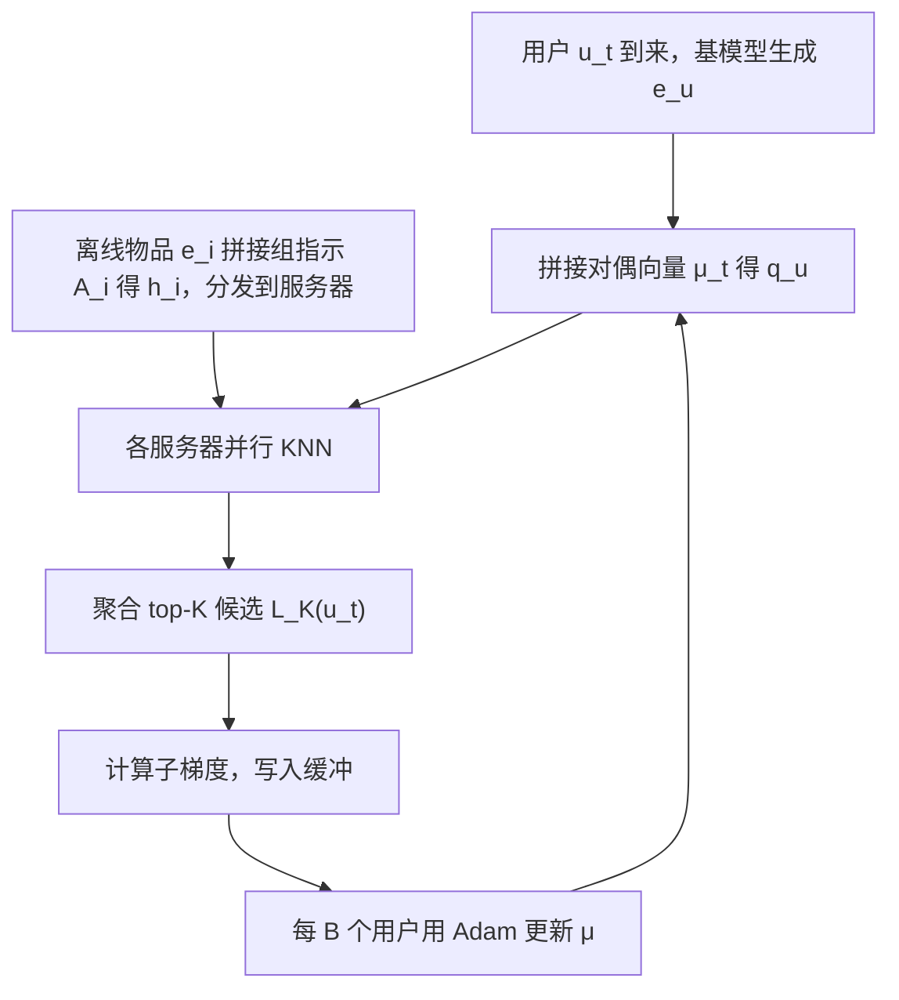
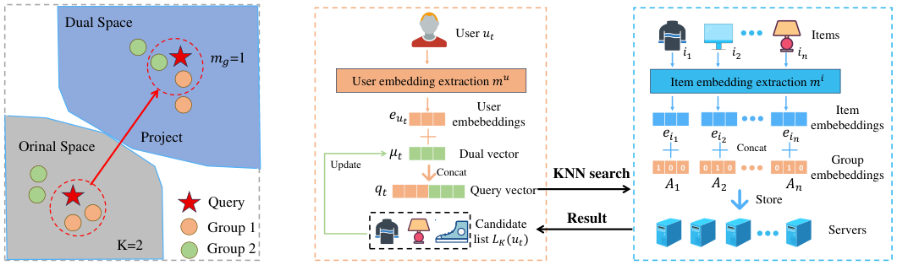

# FairSync: Ensuring Amortized Group Exposure in Distributed Recommendation Retrieval (分布式推荐召回中的摊销组曝光公平保障)

- **会议/期刊**: WWW 2024
- **作者与机构**: Chen Xu, Jun Xu, Yiming Ding, Xiao Zhang, Qi Qi；中国人民大学高瓴人工智能学院
- **推荐链路定位**: 召回
- **研究方向**: 去偏公平、可信隐私与工业架构 / 协同过滤与双塔召回
- **论文原文**: [论文原文链接](https://arxiv.org/abs/2402.10628v1)
- **开源代码**: [开源代码仓库链接](https://github.com/XuChen0427/FairSync)

## TL;DR (1分钟核心速览)

FairSync 针对两阶段推荐中“召回阶段无法像精排那样遍历全库来保障组曝光”的痛点，把摊销组曝光约束写成分布式资源分配问题，并在对偶空间用组级向量 $\boldsymbol{\mu}$ 调制用户/物品嵌入，使各服务器仅靠 KNN 即可协同满足全局公平。在 Amazon-Book 与 Taobao 全库 KNN 评测中，它保持 100% ESP，较 Uncalibrated 将 ComiRec-DR 的 Recall 提升 3.4%/9.6%。

## Background & Motivation (背景与核心矛盾)

- **主流范式**: 工业推荐采用“召回—精排”两阶段；摊销组公平要求某组在时间窗内累计曝光不低于 $m_g$，现有公平工作多集中在精排。
- **前人局限**: 精排公平方法通常需遍历、聚合全部物品，而召回阶段百万物品分布式存储，全量遍历不可行；启发式规则/组权重也难保证全局约束。
- **核心洞察 (Key Insight)**: 作者模拟发现，召回阶段各组的最低曝光与精排阶段最低曝光呈强正相关——召回若拿不到足够组候选，精排无法补偿。
- **本文切入点**: 将全局组曝光约束转入对偶空间，只广播 $|\mathcal{G}|$ 维“公平价格”向量，让各服务器本地 KNN 即可协同达成全局公平。

## Method (核心方法设计)

### 1. 整体框架 (Overall Architecture)

FairSync 保持任意双塔召回骨干不变：离线把物品嵌入 $\boldsymbol{e}_i$与组指示向量$\mathbf{A}_i$拼接为$\boldsymbol{h}_i$并分发索引；在线用户到来后，将用户嵌入$\boldsymbol{e}_{u_t}$与当前对偶向量$\boldsymbol{\mu}_t$拼接为查询$\boldsymbol{q}_{u_t}$，各服务器并行做 KNN 并聚合 top-$K$候选。系统根据本批候选的组曝光计算子梯度，每$B$个用户更新一次$\boldsymbol{\mu}$，以低维组级信号替代全库遍历。

<figure class="paper-figure" markdown="span">
  <figcaption>图2：FairSync 框架。子图 (a) 用一个示例直观展示 FairSync 的工作原理。子图 (b) 展示用户 𝑢𝑡 到达时的在线召回过程，子图 (c) 描述对偶空间构建过程中的离线物品嵌入。</figcaption>
</figure>

### 2. 关键设计拆解 (Key Designs)

1. **对偶空间重参数化：把 $T\times|\mathcal{I}|$约束压成$|\mathcal{G}|$维价格**：原始问题含二元召回变量与累计曝光约束$e_g=\sum_t\sum_{i\in I_g}x_{u_t,i}\ge m_g$，无法分布式求解。利用强对偶得到$\boldsymbol{\mu}\in\mathbb{R}^{|\mathcal{G}|}$，并把距离改写为$d_{\text{Dual}}(\boldsymbol{q}_{u_t},\boldsymbol{h}_i)=d(\boldsymbol{e}_{u_t},\boldsymbol{e}_i)+\mu_g,\ i\in I_g$，其中$\boldsymbol{q}_{u_t}=\boldsymbol{e}_{u_t}\|-\boldsymbol{\mu}_t$、$\boldsymbol{h}_i=\boldsymbol{e}_i\|\mathbf{A}_i$。直觉：$\mu_g$是组$g$ 的“曝光影子价格”，曝光不足的组获得距离折扣，无需访问全部物品。
2. **在线子梯度与批量更新：公平信号异步同步**：对偶目标为 $\min_{\boldsymbol{\mu}}\sum_{t,k}[r_{u_t,i_k}-\mathbf{A}\boldsymbol{\mu}]_+ +\sum_g m_g\mu_g+\max_g\mu_g(TK-\sum_gm_g)$。每次召回后按当前 top-$K$中各组出现次数计算子梯度$s_g$，存入缓冲，每$B$个用户用均值梯度经 Adam 更新$\boldsymbol{\mu}$。这样避免每个请求都同步多服务器，兼顾公平收敛与召回时延。
3. **分布式 KNN 与推理效率**：物品侧仅需将 $\boldsymbol{h}_i$建 ANN 索引，在线查询为一次内积 KNN；公平层不重训基模型、不引入额外负采样，训练沿用各基模型默认设置。原文报告$B>8$时每用户推理与基模型相当且低于 0.25 ms，$B\le 8$ 时多耗约 0.2–1 ms。

## Experimental Setup & Evaluation Protocol (实验设置与评估协议)

- **数据集与预处理**:

| 数据集 | #Users | #Items | #Interactions | 稀疏度/密度 | 特征/场景说明 |
| :--- | :---: | :---: | :---: | :---: | :--- |
| Amazon-Book | 459,133 | 313,966 | 8,898,041 | 0.0062% | 图书域；组=类别；序列截断20；<50物品组合并为 infrequent group |
| Taobao | 976,779 | 1,708,530 | 85,384,110 | 0.0051% | 电商行为；组=category ID；序列截断50；<200物品组合并 |

- **数据划分与防穿越**: 按全局时间戳排序，前 80% 交互训练基模型，剩余 20% 均分验证/测试，后 10% 测试；无未来交互泄漏。
- **排名评测协议**: 无偏 `Full-Ranking` 全库 KNN 召回，候选规模 $K=20/50$，非采样负例排序；指标为 Recall@K、NDCG@K、HR@K，以及 ESP（累计曝光达到$m_g$的组比例，主实验$m_g=200$）。
- **对比基线与超参**: 公平策略含 regularized-fair、IPW、K-neighbor、Uncalibrated；骨干含 YoutubeDNN、GRU4Rec、MIND、ComiRec-SA、ComiRec-DR。学习率 $[10^{-2},10^{-4}]$，批量$B\in[1,512]$，Adam+Faiss；显著性$p<0.05$。

## Key Experimental Results (实验关键数据)

### 1. 主实验对比 (Main Results)

下表为 top-20、$m_g=200$；加粗表示 ESP=100% 方法中的最优。

| 方法 | Amazon R | Amazon N | Amazon H | Amazon ESP | Taobao R | Taobao N | Taobao H | Taobao ESP |
| :--- | :---: | :---: | :---: | :---: | :---: | :---: | :---: | :---: |
| YouTubeDNN+Uncalib. | 4.44 | 4.53 | 9.96 | 100 | 2.99 | 13.46 | 26.18 | 100 |
| GRU4Rec+Uncalib. | 3.90 | 3.94 | 8.58 | 100 | 4.29 | 17.08 | 32.26 | 100 |
| MIND+Uncalib. | 6.45 | 6.39 | 13.33 | 100 | 4.20 | 17.23 | 32.80 | 100 |
| ComiRec-SA+Uncalib. | 5.12 | 3.70 | 10.59 | 100 | 4.97 | 21.53 | 37.65 | 100 |
| ComiRec-DR+Uncalib. | 4.76 | 5.10 | 10.68 | 100 | 4.99 | 21.29 | 38.30 | 100 |
| ComiRec-DR+regularized | 4.92 | 5.26 | 10.99 | 37.58 | 5.51 | 23.49 | 42.25 | 63.24 |
| ComiRec-DR+IPW | 4.91 | 5.24 | 10.97 | 33.33 | 5.51 | 23.49 | 42.25 | 63.24 |
| ComiRec-DR+K-neighbor | 0.09 | 0.14 | 0.25 | 100 | 0.19 | 1.01 | 1.85 | 100 |
| **FairSync (ComiRec-DR)** | **4.92** | **5.28** | **11.00** | **100** | **5.47** | **23.35** | **42.20** | **100** |

FairSync vs. 同骨干 Uncalibrated：Amazon-Book 的 Recall/NDCG/HR 相对提升 **3.4%/3.5%/3.0%**；Taobao 提升 **9.6%/9.7%/10.2%**，且 ESP 从 100% 保持 100%。

### 2. 消融实验 (Ablation Study)

原文未给组件级 `w/o` 消融，核心敏感性实验为在线批量 $B$：

| 设置 | 每用户推理时延 | ESP | 精度趋势 |
| :--- | :---: | :---: | :--- |
| $B\le 8$| 比基模型多 0.2–1 ms | 100% |$B$ 从 1 到 8 时精度下降 |
| $8<B\le 64$| 与基模型相当，<0.25 ms | 100% | 随$B$ 增大精度回升 |
| $B>64$ | <0.25 ms | 无法保证 | 时延低但公平约束失守 |

### 3. 关键实验发现 (Key Findings)

1. **公平与精度可兼得**：FairSync 在所有骨干/数据集上均达 100% ESP；regularized-fair/IPW 的 ESP 仅 33.3–83.6%，K-neighbor 虽 100% 但 Recall 仅 0.09–0.19，基本不可用。
2. **最佳骨干上增益稳定**：ComiRec-DR+FairSync 在 Taobao top-20 将 Recall 从 4.99 提至 5.47（+9.6%），HR 从 38.30 提至 42.20（+10.2%），同时 ESP 为 100%。
3. **$B$是效率—公平折中**：$B>8$后推理低于 0.25 ms，接近基模型；但$B>64$时 ESP 失守，$B\le 8$ 又增加 0.2–1 ms 时延，实际应调在 8–64 区间。

## Highlights & Limitations (亮点、对比与审稿批判)

- **与代表作对比**: FairRec/P-MMF/LTP-MMF 等在精排遍历物品、优化对偶变量；FairSync 面向召回，仅广播组级 $\boldsymbol{\mu}$。IPW/regularized 无法保证最低曝光；K-neighbor/Uncalibrated 可保证但精度大幅下滑；FairSync 同时保证 ESP=100% 并保持/超过精度。
- **可迁移亮点**: “全局约束→低维对偶价格→拼接进双塔查询”可无侵入接入任意 ANN/双塔召回器，适合新供应商扶持、类目流量调控等工业场景。
- **审稿级局限批判**: ① 强对偶基于资源分配松弛，离散 top-$K$的积分间隙未充分讨论；②$\boldsymbol{h}_i$拼接$|\mathcal{G}|$维组指示，组数很大时索引维度/内存开销上升；③$B$ 对公平与时延敏感，且仅公开数据集离线评测，缺线上 A/B 与动态组、个体公平讨论。

## Rating (四维评分)

- **方法创新性 (Novelty)**: ⭐⭐⭐⭐ （把摊销组曝光转为分布式召回对偶优化，强对偶+低维广播思路清晰，组公平本身非全新）
- **评估协议与实验扎实度 (Protocol & Experiments)**: ⭐⭐⭐⭐ （两大数据集、五种召回骨干、全库 KNN、$p<0.05$；但无组件消融和线上 A/B）
- **写作与数学规范度 (Clarity & Rigor)**: ⭐⭐⭐⭐ （框架、公式与算法流程清楚；负采样与嵌入维度等实现细节偏简）
- **工业落地与复现价值 (Industrial & Practical Value)**: ⭐⭐⭐⭐ （开源、Faiss 可落地、$B>8$亚毫秒；需调$B$ 且组数大时索引膨胀）

