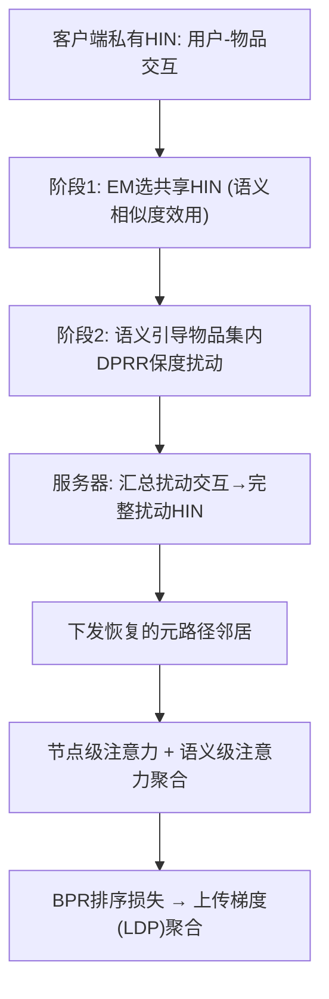

# Federated Heterogeneous Graph Neural Network for Privacy-preserving Recommendation (面向隐私保护的联邦异构图神经网络推荐)

- **会议/期刊**: WWW 2024 (The Web Conference)
- **作者与机构**: Bo Yan, Haoyu Wang, Junping Du, Chuan Shi (北京邮电大学), Yang Cao (北海道大学), Wenchuan Yang (国防科技大学)
- **推荐链路定位**: 召回 (端到端联邦训练的用户/物品表征学习)
- **研究方向**: 去偏公平、可信隐私与工业架构 / 图神经网络与知识图谱推荐
- **论文原文**: [https://arxiv.org/abs/2310.11730v4](https://arxiv.org/abs/2310.11730v4)
- **开源代码**: 暂未开源

## TL;DR (1分钟核心速览)

中心化 HIN 推荐依赖跨用户可见的元路径，但在联邦场景下用户只持有自己的私有子图，元路径语义"断裂"，已有 FedRec（FedMF/FedGNN/FedSog）又只用二部图、无法缓解稀疏。本文提出 FedHGNN：先把 HIN 切分为客户端私有 HIN + 服务器共享 HIN，给出 $\epsilon$-语义隐私与$\epsilon$-语义引导交互隐私两级形式化定义，再用"指数机制选共享 HIN + 组内保度随机响应"的两阶段扰动一次性发布交互以重建元路径邻居，最后用节点级/语义级双层 HGNN 训练。在 ACM/DBLP/Yelp/Douban Book 上按 Leave-One-Out 全库排序，相对最强 FedRec 基线 HR@10 提升 6%–20%，原文报告最高 34%（HR@10）与 42%（NDCG@10）。

## Background & Motivation (背景与核心矛盾)

- **主流范式**: HIN 推荐用元路径（如 UMU、UMDMU）刻画高阶语义，GNN 沿"元路径邻居聚合"融合多语义，是缓解交互稀疏的主流手段。
- **前人局限**: ①HIN 方法假设数据集中存储、全图可见，GDPR 时代不成立；②现有 FedRec（FedMF/FedGNN/FedSog）仅建模用户-物品二部图，分布存储进一步加剧稀疏，且**没有语义信息**可用。
- **核心矛盾**: 联邦下用户只能看到一跳邻居，元路径 $u\!-\!m\!-\!u$与$u\!-\!m\!-\!d\!-\!m\!-\!u$ 的中间节点在他人客户端或服务器，语义直接断裂；而直接上传邻接表又暴露交互，且用户"看了哪些类型/导演的片"这类高阶偏好（semantic privacy）同样敏感。
- **核心洞察 (Key Insight)**: 共享知识（电影-类型、电影-导演、物品聚类）本身不隐私，可在服务器共享；只要在**语义引导物品集内**做保度扰动，就能既保住"模式-度分布"又满足 DP。
- **本文切入点**: 一次性本地两阶段扰动发布交互 $\to$服务器拼回完整扰动 HIN$\to$ 全员获得恢复的元路径邻居，再做联邦 HGNN 训练。

## Method (核心方法设计)

### 1. 整体框架 (Overall Architecture)

FedHGNN 分两段：**发布阶段（仅一次）** 与 **联邦训练阶段（多轮）**。发布阶段每个客户端先按语义相似度用指数机制从服务器共享 HIN 集合中选出 $|\mathcal{G}^u_s|$个共享 HIN（得到扰动后的$\tilde{g}_u$），据此切出语义引导物品集$I^u_s$ 并划分为若干子集，对每个子集做保度随机响应 DPRR，上传扰动交互；服务器汇总成完整扰动 HIN 后分发给所有客户端，从而恢复元路径邻居。训练阶段客户端以恢复的元路径邻居做节点级注意力 + 语义级注意力聚合，BPR 排序损失本地优化，仅上传嵌入梯度与模型参数（再叠加 LDP 与伪交互物品），服务器聚合成全局模型。

### 2. 关键设计拆解 (Key Designs)

1. **两阶段语义保持发布（Semantic-preserving Publishing）**：痛点是不扰动则泄露交互、全局 RR 扰动则暴露高阶模式且使图变稠。第一级用指数机制选共享 HIN，效用为与该用户共享 HIN 集合的最大余弦相似度（归一化到 $[0,1]$），敏感度$\Delta q=1$，故
$\Pr(G_s)=\frac{\exp\left(\epsilon_1 q(g,u,G_s)/(2\Delta q)\right)}{\sum_{G'_s\in\mathcal{G}_s}\exp\left(\epsilon_1 q(g,u,G'_s)/(2\Delta q)\right)}$不重复抽取$|\mathcal{G}^u_s|$次，每步耗$\epsilon_1/n$，由 EM 的串行组合给出$\epsilon_1$-语义隐私；直觉是"越相似的共享知识被选中的概率越高"，从而在高阶模式被扰动的同时最大化保留下来的语义。
2. **组内保度随机响应 DPRR**：痛点是在语义引导物品集整体做 RR 仍会引入大量无关物品、并使度分布膨胀（HGNN 对"扰动放大"敏感）。故按每个共享 HIN 对应子集 $I^u_{s_i}$分别扰动，先以$p=1/(1+e^{\epsilon_2})$做 RR，再以$q_{us_i}$ 保留 1：
$\Pr(\tilde{a}^{us_i}_j=1)=\begin{cases}(1-p)q_{us_i}, & a^{us_i}_j=1\\ p\,q_{us_i}, & a^{us_i}_j=0\end{cases},\quad q_{us_i}=\frac{d_{us_i}}{d_{us_i}(1-2p)+|I_{us_i}^u|\,p}$即期望度严格等于真实度$d_{us_i}$；$q$截断到$[0,1]$，若子集内无交互则从$I_{us_i}^u$随机补足到真实度$d_u$，既避免"整段语义丢失"又保住多样性。RR + 后处理翻转的组合给出$\epsilon_2$-语义引导交互隐私。
3. **双层 HGNN 与训练目标**：节点级用元路径专属自注意力 $\alpha^{\rho_k}_{u_iu_j}=\mathrm{softmax}(\sigma(\mathbf{a}^T_{\rho_k}[\mathbf{W}_{\rho_k}h_{u_i}\|\mathbf{W}_{\rho_k}h_{u_j}]))$聚合同元路径邻居，语义级用$\beta_{\rho_k}=\mathrm{softmax}_{\rho_k}(|U|^{-1}\sum_{u_i}\mathbf{q}^T\tanh(\mathbf{W}z^{\rho_k}_{u_i}+\mathbf{b}))$融合多语义得$z_{u_i}=\sum_{\rho_k}\beta_{\rho_k}z^{\rho_k}_{u_i}$。总损失为 BPR：$\mathcal{L}_{u_i}=-\sum_{v_j\in I_{u_i}}\sum_{v_k\notin I_{u_i}}\ln\sigma(\hat{y}_{u_iv_j}-\hat{y}_{u_iv_k})$，负样本**均匀采样**；上传梯度加 LDP，无需负采样近似，故推理时只做一次前向内积，全库打分开销与 lightGCN 同级。

## Experimental Setup & Evaluation Protocol (实验设置与评估协议)

- **数据集与预处理**: 4 个真实 HIN，物品侧采用共享知识聚类（每个物品只属一个共享 HIN，$n=20$）：

| 数据集 | #Nodes | #私有/共享边 | 元路径 | 场景 |
| :--- | :---: | :---: | :---: | :--- |
| ACM | P 4025 / A 17431 / C 14 | P-A 13407, P-C 4025 | P-A-P, P-C-P, A-P-A | 学术 |
| DBLP | P 14328 / A 4057 / C 20 | P-A 19645, P-C 14328 | P-A-P, P-C-P, A-P-A | 学术 |
| Yelp | U 8743 / B 3985 / C 511 | U-B 14896, B-C 11853 | U-B-U, U-B-C-B-U, B-U-B | 电商/本地 |
| Douban Book | U 6793 / B 8322 / G 2936 / A 10801 | U-B 21179, U-G 664847, B-A 8171 | U-B-U, U-G-U, B-U-B, B-A-B | 图书社交 |

- **数据划分与防穿越 (Splitting Strategy)**: 沿用 PerFedRec 的 `Leave-One-Out`，每用户留 1 个最新交互作测试、1 个作验证。
- **排名评测协议 (Ranking Protocol)**: 原文未声明采样负例比例，按 PerFedRec 惯例为 **全库排序（每个测试正样本对其余全部物品打分）**；指标 HR@5/10、NDCG@5/10。
- **对比基线与超参设置**: 中心化基线 HERec、HAN、NGCF、lightGCN、RGCN、HGT；联邦基线 FedMF、FedGNN、FedSog、PerFedRec、PFedRec、SemiDFEGL。隐层 $d=64$，学习率 0.01，$\epsilon_1=\epsilon_2=1$，每轮参与客户端 32 个，节点特征随机初始化（所有方法一致）以排除特征泄漏。

## Key Experimental Results (实验关键数据)

### 1. 主实验对比 (Main Results)

| 模型 | ACM H@10 | ACM N@10 | DBLP H@10 | DBLP N@10 | Yelp H@10 | Yelp N@10 | Douban H@10 | Douban N@10 |
| :--- | :---: | :---: | :---: | :---: | :---: | :---: | :---: | :---: |
| HAN (中心化) | 0.4727 | 0.3537 | 0.4498 | 0.3503 | 0.4077 | 0.2316 | 0.3602 | 0.2084 |
| HGT (中心化) | **0.5035** | 0.3001 | **0.4763** | 0.2748 | **0.4635** | **0.2733** | **0.4973** | **0.2802** |
| FedGNN | 0.3450 | 0.2202 | 0.3252 | 0.1963 | 0.2596 | 0.1477 | 0.2227 | 0.1257 |
| FedSog | 0.3642 | 0.2438 | 0.2691 | 0.1630 | 0.2715 | 0.1508 | 0.3464 | 0.2053 |
| PerFedRec | 0.3229 | 0.2055 | 0.2619 | 0.1352 | 0.2370 | 0.1277 | 0.2727 | 0.1658 |
| PFedRec | 0.3533 | 0.2240 | 0.3863 | 0.2332 | 0.2249 | 0.1294 | 0.3638 | 0.2295 |
| SemiDFEGL | 0.3083 | 0.1710 | 0.2518 | 0.1253 | 0.2800 | 0.1497 | 0.1367 | 0.0804 |
| **FedHGNN** | 0.4185 | **0.2980** | 0.4373 | 0.2778 | 0.2977 | 0.1834 | 0.4380 | 0.2511 |
| **Improv.** vs 最强FedRec | +14.9% | +22.2% | +13.2% | +19.1% | +6.3% | +21.6% | +20.4% | +9.4% |

### 2. 消融实验 (Ablation Study)

（`*`=不做两阶段扰动；`+S`=按语义引导子集扰动，否则在整条邻接表上扰动；`+E`=仅加第一级 EM）

| 变体 | ACM H@10 | ACM N@10 | DBLP H@10 | DBLP N@10 | Yelp H@10 | Yelp N@10 |
| :--- | :---: | :---: | :---: | :---: | :---: | :---: |
| FedHGNN* (无扰动) | 0.3961 | 0.2567 | 0.3934 | 0.2410 | 0.3482 | 0.2201 |
| +RR | 0.1118 | 0.0491 | 0.1237 | 0.0602 | 0.1232 | 0.0575 |
| +DPRR | 0.2268 | 0.1492 | 0.2394 | 0.1413 | 0.2079 | 0.1185 |
| +SRR | 0.4998 | 0.2845 | 0.3154 | 0.1757 | 0.1803 | 0.0789 |
| +SDPRR | **0.5027** | **0.3230** | **0.4557** | **0.2801** | 0.3245 | 0.1976 |
| +E | 0.4004 | 0.2835 | 0.3701 | 0.2176 | 0.3242 | 0.1875 |
| +E+SDPRR* | 0.4069 | 0.2852 | 0.4227 | 0.2619 | 0.2624 | 0.1563 |
| **FedHGNN** | 0.4185 | 0.2980 | 0.4373 | 0.2778 | 0.2977 | 0.1834 |

### 3. 关键实验发现 (Key Findings)

1. **"适度扰动=语义化数据增广"**：ACM/DBLP 上 +SDPRR（语义引导集内保度扰动、不加 EM）反而超过无扰动的 FedHGNN*（HR@10 0.5027 vs 0.3961、0.4557 vs 0.3934），因为保度扰动补足了部分不活跃用户被 EM 丢弃的交互；Yelp 上则相反（0.3245 vs 0.3482），说明收益依赖数据集稀疏度与共享知识质量。
2. **度保持与"模式保持"缺一不可**：纯 RR 因使图变稠触发 HGNN 的扰动放大而崩盘（ACM HR@10 仅 0.1118），整表 DPRR 保度但不保模式也只有 0.2268，只有在语义引导子集内扰动才跃迁到 0.42+，直接验证了作者"degree-preserving + feature-preserving 同时必要"的论断。
3. **EM 一级扰动的代价可接受但必要**：+E+SDPRR* (0.4069) 与完整 FedHGNN (0.4185) 接近，说明相似度驱动的 EM 把高阶模式损失压到约 3 个百分点 NDCG，而 EM 之后仍须在**每个**共享 HIN 内保留交互（+E+SDPRR* 0.4227 < FedHGNN 0.4373），否则多样性丢失。隐私-效用曲线显示 $n\approx20$饱和（$n$再增大隐私变弱但不再涨点），$\epsilon_1$单调影响（0.5$\to$16 时 HR 涨约 15 点），$\epsilon_2\approx1$ 为最优点（过度扰动反而掉点）。

## Highlights & Limitations (亮点、对比与审稿批判)

- **与代表作对比 (vs. Prior Work)**: 相对 FedMF/FedGNN/FedSog/PerFedRec，本文首次把**元路径语义**引入联邦推荐，且隐私定义同时覆盖"高阶模式"与"模式内交互"，比只保证邻接表 DP 的图发布工作（RR/DPRR 单阶段）更贴合 HIN；相对中心化 HAN/HGT，它用一次扰动换来了分布式可训练性，并在 ACM/Douban 的 NDCG@10 上超过 HAN。
- **可迁移亮点**: ①"EM 选共享知识 + 组内保度 RR"的两阶段发布范式可平移到跨域/多场景联邦推荐的知识选择；②保度扰动带来的隐式数据增广，可作为稀疏场景的低成本去噪手段。
- **审稿级局限批判**: ①原文未显式交代排序协议与显著性检验，全库排序还是采样排序会影响提升幅度的解读，且"最高 34%/42%"未与表内最强 FedRec 基线逐项对齐；②发布阶段只做一次，用户的持续行为漂移需重发布并重新累计隐私预算；$n=20$、$q_{us_i}$ 截断与"随机补足度"是启发式，对稠密图/长尾物品的鲁棒性未做分桶分析；无开源代码，联邦通信与 LDP 噪声下的实际收敛开销难以复核。

## Rating (四维评分)

- **方法创新性 (Novelty)**: ⭐⭐⭐⭐ （首个 HIN-based FedRec，两级 DP 定义 + 语义保持两阶段扰动是清晰的新增量，虽各算子本身沿用 EM/RR 但组合动机扎实）
- **评估协议与实验扎实度 (Protocol & Experiments)**: ⭐⭐⭐⭐ （4 数据集 × 12 基线 + 8 变体消融 + $n$/$\epsilon$ 敏感性分析较完整，扣分在排序协议与显著性未明示）
- **写作与数学规范度 (Clarity & Rigor)**: ⭐⭐⭐⭐ （两级隐私定理与敏感度推导紧凑自洽，EM 效用函数选择余弦的敏感度论证清晰；部分符号如 $d_{us_i}$/补足策略说明略含糊）
- **工业落地与复现价值 (Industrial & Practical Value)**: ⭐⭐⭐ （一次性发布 + 常规梯度聚合工程友好，但共享 HIN 聚类与隐私预算会计在业务上需额外治理，且暂无开源实现）

