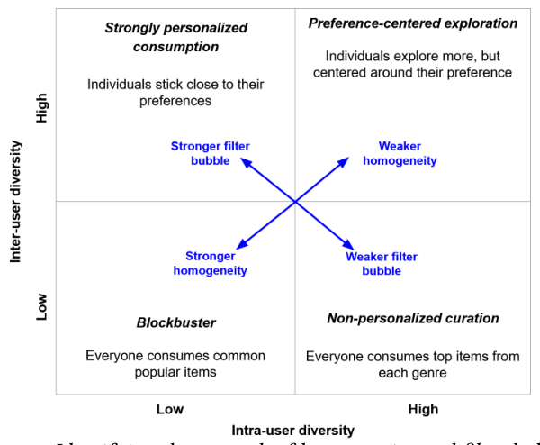
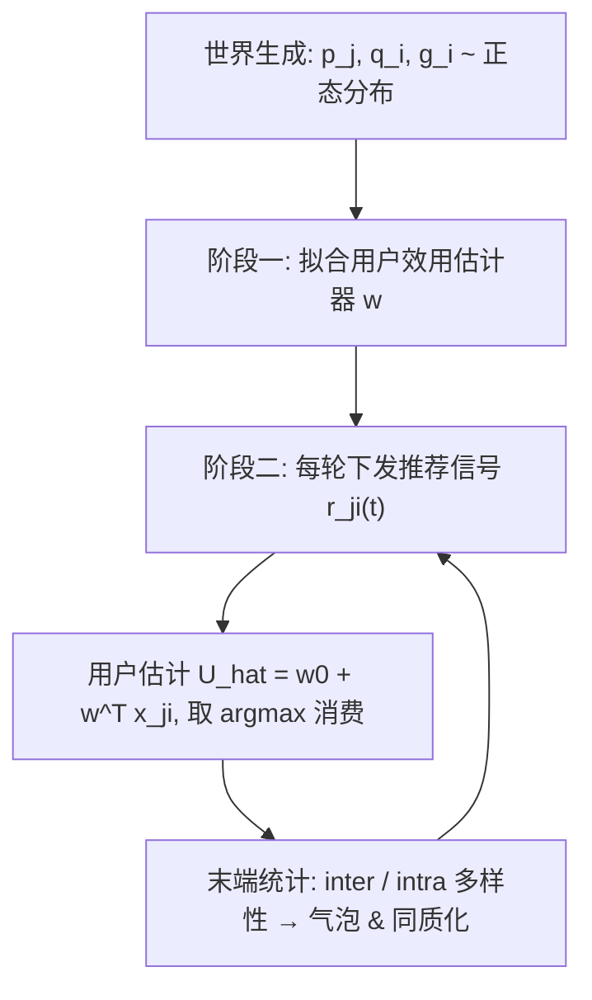

# Filter Bubble or Homogenization? Disentangling the Long-Term Effects of Recommendations on User Consumption Patterns (过滤气泡还是同质化？解耦推荐系统对用户消费模式的长期影响)

- **会议/期刊**: ACM Web Conference 2024 (WWW '24)
- **作者与机构**: Md Sanzeed Anwar, Grant Schoenebeck, Paramveer S. Dhillon（University of Michigan）
- **推荐链路定位**: 端到端（推荐策略长期生态效应的仿真评估，非单点排序模块）
- **研究方向**: 去偏公平、可信隐私与工业架构 / 评测基准与因果分析
- **论文原文**: [https://arxiv.org/abs/2402.15013v2](https://arxiv.org/abs/2402.15013v2)
- **开源代码**: 暂未开源

## TL;DR (1分钟核心速览)

既有研究把"同质化"与"过滤气泡"当成一对天然权衡，因而无法看清推荐算法究竟在改变什么。本文提出把二者解耦为**用户间多样性 (inter-user)** 与**用户内多样性 (intra-user)** 两个正交分量，并给出过滤气泡 $=\mathrm{Var}[\mu_j]/\mathbb{E}[\sigma_j^2]$、同质化$=1/\sqrt{\mathrm{Var}[\mu_j]^2+\mathbb{E}[\sigma_j^2]^2}$ 的新操作性定义。基于 1000 用户 × 510 物品 × 100 轮的智能体仿真（15 次重复）发现：传统消费驱动推荐仅靠**压缩用户间多样性**来"缓解"过滤气泡，对用户内多样性几乎无影响；据此提出的分箱消费推荐与偏斜热门推荐可分别实现"inter↓+intra↑"与"inter↑+intra↑"。

## Background & Motivation (背景与核心矛盾)

- **主流范式**: 以消费计数、SVD 协同相似度及其混合信号作为推荐依据，在仿真或日志数据上观测用户长期消费分布如何漂移。
- **前人局限**: Nguyen 等与 Aridor 等把"同质化"定义为用户平均消费的重叠度、把"过滤气泡"定义为个体消费的集中度，于是二者在数学上互为倒数，**天然只能呈现一条权衡曲线**；同时他们只看"平均消费了什么"，完全忽略"单个用户消费跨度有多宽"。
- **核心洞察 (Key Insight)**: 把全体用户消费的联合分布拆成"均值之间的方差"与"个体内部方差"后，四种组合（高/低 inter × 高/低 intra）对应截然不同的气泡—同质化强度，二者并不必然互斥。作者用图 4/图 5 进一步指出：消费驱动推荐把**小众用户**的平均消费强行拉向 genre 众数（偏差最大），却只轻微改变其消费方差——这正是"以同质化换气泡缓解"的物理证据。
- **本文切入点**: 用可控的智能体仿真替代不可干预的观测数据，先解耦度量，再据此反推两种能**独立操纵两类多样性**的推荐策略。

<figure class="paper-figure" markdown="span">
  <figcaption>图1：在不同用户间多样性和用户内多样性水平下，识别同质性与过滤气泡效应的强度。这里的动态现象促使我们提出同质性和过滤气泡效应的新定义。</figcaption>
</figure>

## Method (核心方法设计)

### 1. 整体框架 (Overall Architecture)

仿真世界 $\mathcal{W}=(m,k_{init},k_{new},T,\mathcal{P},\mathcal{Q},\mathcal{G},\mathcal{N}_{qual},\mathcal{N}_{genre})$：每个用户$j$有偏好$p_j\sim\mathcal{P}$，每个物品$i$有质量$q_i\sim\mathcal{Q}$与类型$g_i\sim\mathcal{G}$，全部为实数值，便于把"偏离众数"直接定义为小众。流程分两阶段：**阶段一**用一批同分布物品的交互数据拟合用户效用估计器（线性回归系数$w_0,\mathbf{w}$）；**阶段二**正式运行$T=100$轮，每轮系统对每个未消费物品下发推荐信号$r_{ji}(t)$，用户据此估计效用并取 argmax 消费一件物品（消费后不可重复），最后在末端消费集合上计算多样性指标。

### 2. 关键设计拆解 (Key Designs)

1. **多样性二维解耦与气泡/同质化重定义**：痛点是把二者视为倒数的旧定义锁死了分析维度 $\to$定义$\mu_j=\frac{1}{T}\sum_{i\in C_j}g_i$、$\sigma_j^2=\mathrm{Var}\{g_i\mid i\in C_j\}$，进而
$$\text{Filter Bubble}=\frac{\mathrm{Var}_{j\in\mathcal{U}}[\mu_j]}{\mathbb{E}_{j\sim\mathcal{U}}[\sigma_j^2]},\qquad \text{Homogeneity}=\frac{1}{\sqrt{\mathrm{Var}_{j\in\mathcal{U}}[\mu_j]^2+\mathbb{E}_{j\sim\mathcal{U}}[\sigma_j^2]^2}}$$
直觉：气泡强 = 大家各据一方（inter 高）且各自看得很窄（intra 低）；同质化强 = 平均消费挤在一起且都很窄。分子分母独立可动，因此旧"权衡"只是新平面上的一个特例方向。作者用"全体消费标准差之倒数"作外部效标，二者 Pearson 相关 $0.93$，验证定义的合理性。

2. **分箱消费推荐 (Binned Consumption)**：痛点在于原始消费计数隐含"大片偏好"，跨类型不可比 $\to$ 在**同类型内部**做标准化后作为信号
$$r_{ji}(t)=\frac{d_i(t)-\mu}{\sigma},\quad \mu,\sigma \text{ 取自 }\{d_{i'}(t)\mid g_{i'}=g_i\}$$
这样每个类型只推自己的"代表作"，抹平类型间热度差，效果近似"只知道质量、不知道类型"，从而把用户推向各类型的本地热门，拓宽个体消费跨度（intra↑），同时仍向众数收敛（inter↓）。

3. **偏斜热门推荐 (Skewed Top Pick)**：目标是**同时放大**两类多样性而非消除气泡 $\to$按$q_{ji}\cdot|g_i|^{\delta}$降序排名，进入前$k_{top\%}$（取$25\%$）则$r_{ji}=1$，否则$0$。$\delta=1$时排名偏向$|g_i|$ 大的小众物品，把近众数用户推向众数两侧的小众内容（intra↑），而小众用户仍守在自身偏好附近不被拉走（inter↑）。

**训练目标、负采样与推理效率**：本文无排序模型训练损失，唯一"学习"环节是用户侧效用估计的最小二乘回归
$$\hat{U}(j,i,t)=w_0+\mathbf{w}^\top\big[q_{ji},\ |p_j-g_{ji}|,\ r_{ji}(t)\big],\qquad U(j,i)=q_i-|p_j-g_i|$$
其中 $q_{ji}=q_i+\xi_{ji}$、$g_{ji}=g_i+\delta_{ji}$为带噪私有信号。无负采样概念；推理开销由仿真规模决定（$m=1000$、$n=510$、$T=100$、每种算法重复 15 次），单次仿真为$O(T\cdot m\cdot n)$ 次效用估计，作者实测改用 MLP 替代线性回归结论定性不变。

## Experimental Setup & Evaluation Protocol (实验设置与评估协议)

- **数据集与预处理**: 本文不使用真实数据集，而是单一合成世界（附录称结论在双峰分布下可复现）：

| 世界 $\mathcal{W}$ | #Users | #Items | #Interactions | 稀疏度/密度 | 特征/场景说明 |
| :--- | :---: | :---: | :---: | :---: | :--- |
| 合成仿真 | 1,000 | 510 ($k_{init}=10$,$k_{new}=5\times 100$) | 100,000 (每人每轮 1 次) | 全交互（每轮可选集 ~ 数百） |$q_i\sim\mathcal{N}(100,10)$,$g_i,p_j\sim\mathcal{N}(0,10)$，五类噪声方差均为 10 |

- **数据划分与防穿越 (Splitting Strategy)**: 无 train/test 划分；采用**两阶段时间切分**——先在 10 个"训练世界"上拟合用户效用估计器，再在独立世界回放 $T=100$ 轮推荐，避免用未来轮次信号污染估计器。
- **排名评测协议 (Ranking Protocol)**: 非检索式评测。用户面对"全部未消费物品"做 argmax 选择，等价于**全库 Full-Ranking 无采样**；评测指标为基于末端消费集合计算的 inter/intra 多样性、气泡比、同质化值，以及附录中的用户效用。
- **对比基线与超参设置**: 7 种算法——4 个理想化基线（无推荐、真类型、真质量、完美推荐）+ 3 个消费驱动基线（Consumption、SVD、Hybrid）；每种算法 15 次重复取聚合值。作者未报告显著性检验（$p$ 值），仅以 15 次重复的聚合趋势作结论，这是评估上的一个缺口。

## Key Experimental Results (实验关键数据)

### 1. 主实验对比 (Main Results)

原文主结果以图 3–图 5 呈现（未给出数值表），图 3 坐标范围约为 inter$\in[5,45]$、intra$\in[25,65]$。下表按"相对无推荐基线"的方向给出可比结论（↑显著升、↓显著降、≈基本不变）：

| 算法 | 类别 | 用户间多样性 (inter) | 用户内多样性 (intra) | 过滤气泡效应 | 同质化 | 相对无推荐的效用 |
| :--- | :--- | :---: | :---: | :---: | :---: | :---: |
| No Recommendation | 基线 | 参照 | 参照 | 参照 | 参照 | 参照 |
| True Genre | 理想基线 | ↑ | ↓ | **↑ 最强** | ↓ | 低（只追偏好） |
| True Quality | 理想基线 | ↓ | ↑ | ↓ | ↓ | 高 |
| Perfect Recommendation | 理想基线 | ↑ | ↓ | ↑ | ↓ | **最高** |
| Consumption | 消费驱动 | **↓↓** | ≈ | ↓↓ | **↑↑** | 高 |
| SVD | 消费驱动 | ↓↓ | ≈ | ↓ | ↑ | 高 |
| Hybrid | 消费驱动 | ↓↓ | ≈ | ↓ | ↑ | 高 |
| **Binned Consumption (本文)** | 新策略 | ↓ | **↑↑** | **↓↓（最优）** | ≈/↑ | 见附录 D |
| **Skewed Top Pick, $\delta=1$ (本文)** | 新策略 | ↑ | ↑ | ↑（**有意加剧**） | **↓↓** | 见附录 D |

### 2. 消融实验 (Ablation Study)

原文无标准消融，下表汇总其"设计验证"型对照：

| 设计要素 | 变体 / 对照 | 关键结果 | 结论 |
| :--- | :--- | :--- | :--- |
| 同质化新定义 | vs. $1/\mathrm{std}(\text{全体消费})$| Pearson$=0.93$ | 新定义为旧度量的一致替代 |
| 用户效用估计器 | 线性回归 vs. MLP | 定性结论一致 | 结论不依赖估计器容量 |
| $\delta$（偏斜强度） |$\delta=1$vs.$\delta\uparrow$|$\delta$ 过大时用户忽略推荐，退化为"无推荐" | 偏斜需落在用户可接受的信号区间 |
| 信号粒度 | 全局消费 (Consumption) vs. 类型内标准化 (Binned) | 前者 intra≈、后者 intra↑↑ | "去大片偏好"是 intra 提升的关键算子 |
| genre 分布 | 单峰正态 vs. 双峰 | 结论可复现 | 结论对分布形态鲁棒 |

### 3. 关键实验发现 (Key Findings)

1. **"缓解气泡"其实是"制造同质化"**：Consumption/SVD/Hybrid 只在 inter 轴上大幅左移、intra 轴几乎不动，气泡比下降完全由分子驱动；图 4 显示小众用户的平均消费偏差被拉向 genre 众数 $0$ 最严重，说明旧结论建立在"平均消费"单一视角上。
2. **信息完备性决定气泡方向**：只给真实类型（True Genre）时 inter↑、intra↓，气泡反而比无推荐更强；只给真实质量（True Quality）时 inter↓、intra↑，气泡减弱——"质量信号"天然具有跨类型去偏作用，这解释了 Binned 推荐为何有效。
3. **两种新策略实现了旧框架下不可能的组合**：Binned 在降低 inter 的同时把所有人的消费方差推高（intra↑↑，对应图 8 中各偏好分箱方差整体抬升），Skewed Top Pick ($\delta=1,k_{top\%}=25\%$) 则让 inter 与 intra 同时上升，且比无推荐更好地把近众数用户推向众数两侧的小众内容而不拉走小众用户。

## Highlights & Limitations (亮点、对比与审稿批判)

- **与代表作对比 (vs. Prior Work)**: Nguyen 等与 Aridor 等把同质化与气泡定义为互为倒数的量，只能得到一条权衡线；本文把它们展开为二维平面，指出旧结论只是平面上某个方向的特例。与 Fleder & Hosanagar、Chaney 等只看"重叠度/基尼系数"的流行度偏置研究相比，本文额外引入 intra 轴，从而能区分"大家吃同一家网红店"与"每人自己也只吃一家店"。
- **可迁移亮点**: ① inter/intra 双轴诊断面板可直接用于线上多样性 A/B 的归因，判断某策略是"压缩人群差异"还是"拓宽个体视野"；② 类型内标准化信号 $r=(d_i-\mu)/\sigma$ 是一种极轻量的去流行度偏置打分技巧，可插在召回后的打分层。
- **审稿级局限批判**: ① 全部结论来自单一合成世界（正态 + 双峰），用户效用被简化为线性回归，物品外生且无生产者、无平台竞争，与真实内容生态相距较远；② 每种算法仅 15 次重复、未做显著性检验，且未报告效用与多样性的联合指标，因此"新算法是否牺牲用户满意度"只能靠附录 D 定性阅读，削弱了工程可采纳性。

## Rating (四维评分)

- **方法创新性 (Novelty)**: ⭐⭐⭐⭐ （把气泡/同质化从"倒数权衡"重构为 inter×intra 二维解耦，度量定义具外部效标验证，但本质是仿真框架而非新模型）
- **评估协议与实验扎实度 (Protocol & Experiments)**: ⭐⭐⭐ （全库 argmax、15 次重复、两阶段防穿越设计规范，但无真实数据、无显著性检验、主结果仅以图呈现）
- **写作与数学规范度 (Clarity & Rigor)**: ⭐⭐⭐⭐ （度量定义层层递进、参数表完整、含义直觉解释清晰，公式与仿真设定的边界交代明确）
- **工业落地与复现价值 (Industrial & Practical Value)**: ⭐⭐⭐ （无开源代码，仿真为合成数据、部署成本需重估，但多样性诊断面板与类型内标准化打分极易迁移）

