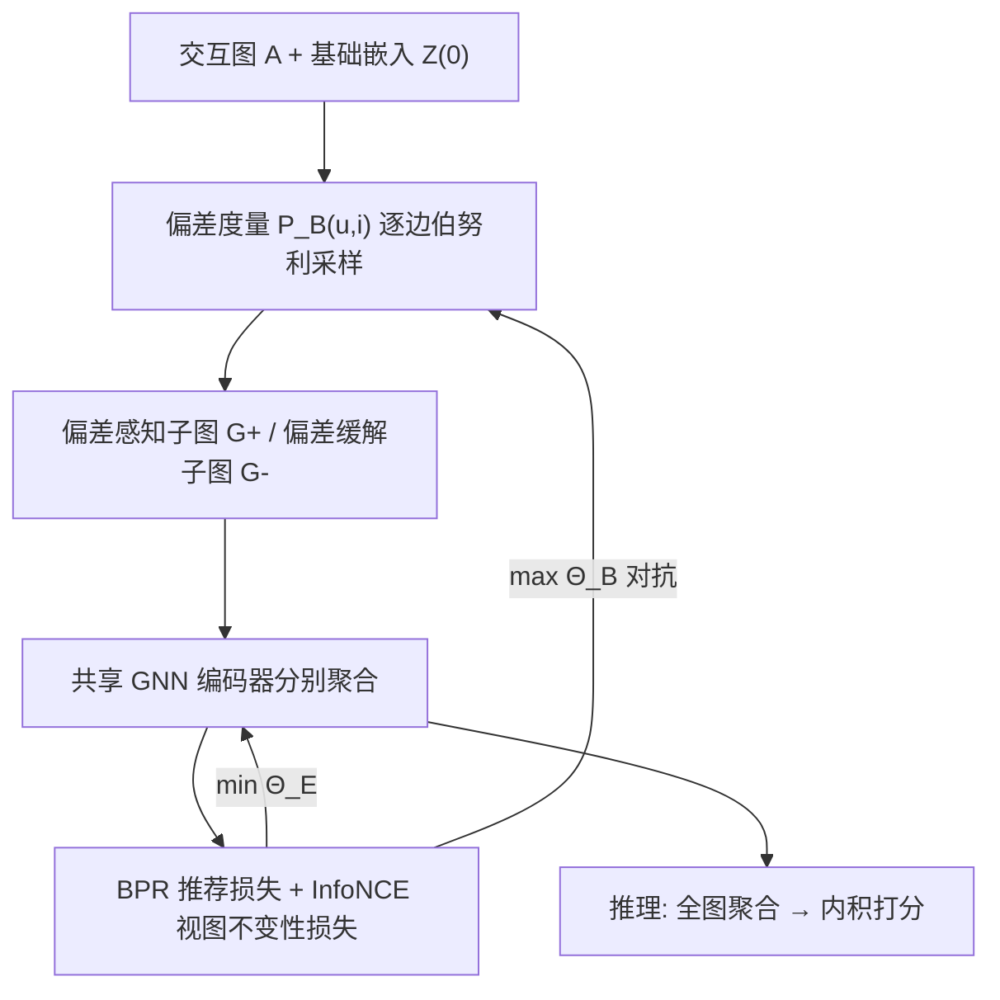
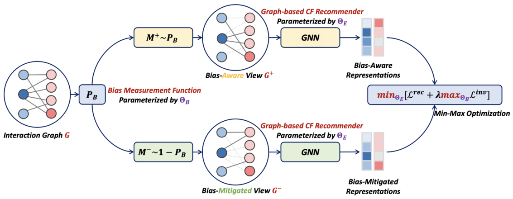

# General Debiasing for Graph-based Collaborative Filtering via Adversarial Graph Dropout (基于对抗图丢弃的图协同过滤通用去偏)

- **会议/期刊**: WWW 2024
- **作者与机构**: An Zhang, Wenchang Ma, Pengbo Wei (NUS), Leheng Sheng (清华), Xiang Wang (USTC)
- **推荐链路定位**: 召回（图协同过滤表征学习）
- **研究方向**: 去偏公平、可信隐私与工业架构 / 图神经网络与知识图谱推荐
- **论文原文**: [https://arxiv.org/abs/2402.13769v1](https://arxiv.org/abs/2402.13769v1)
- **开源代码**: [https://github.com/Arthurma71/AdvDrop](https://github.com/Arthurma71/AdvDrop)

## TL;DR (1分钟核心速览)

图协同过滤的多层邻域聚合会**放大**交互图中的偏差：层数越深，头部物品表征越向原点塌缩、敏感属性（如性别）用户越被强行聚类（图 1）。本文提出 AdvDrop，用一个可学习的逐边偏差度量 $P_B(u,i)$对原始图做伯努利边丢弃，切出"偏差感知 / 偏差缓解"两个子视图，在视图间施加 InfoNCE 不变性约束，并以对抗最大化反向驱动$P_B$ 识别偏差。在 Coat/Yahoo/KuaiRec/Douban 的无偏、时序切分与 Yelp2018 的 OOD 划分上，NDCG 相对 LightGCN 分别提升 6.61%/1.15%/8.38%/15.25%。

## Background & Motivation (背景与核心矛盾)

- **主流范式**: 以 LightGCN 为代表的图协同过滤在用户-物品二部图上做多层邻域聚合，把高阶连通性编码进表征；去偏侧则多以单一预定义因子为靶（流行度 IPS、用户从众、敏感属性对抗 CFC）。
- **前人局限**: (1) **数据偏差视角**——只针对一种人为指定的偏差，无法覆盖潜在混淆因子带来的未知分布漂移；(2) **放大视角**——忽略 GNN 聚合自身的偏差放大，专为某类偏差设计的子图采样/传播改造在其它偏差上会失效。实证上 InvPref 配 LightGCN 全面弱于配 MF，说明"GNN 固有偏差"确实存在。
- **核心洞察 (Key Insight)**: 偏差放大是聚合算子的结构性副作用而非单纯数据噪声，因此去偏必须发生在**信息传播过程内部**；且偏差度量不应由人假设，而应从交互数据中自适应学出来。
- **本文切入点**: 把去偏重构成"学一个边级偏差分布 + 在两个偏差视图间做不变性学习"的 min-max 问题，作为可插拔模块挂到任意图 CF 主干上。

<figure class="paper-figure" markdown="span">
  ![图1：MF \[40\]、LightGCN \[26\] 和我们提出的 AdvDrop 所学习到的用户与物品表示的 T-SNE \[46\] 可视化。注意，MF、LightGCN-2 和 LightGCN-4 分别采用零层、两层和四层图卷积层。子图 1a–1d 展示了关于两组用户性别（即女性、男性）的表示分布，而子图 1e–1h 描绘了关于三组物品流行度（即头部、中部、尾部）的表示分布。](../../../../assets/papers/2402.13769v1/figure_1.png)<figcaption>图1：MF [40]、LightGCN [26] 和我们提出的 AdvDrop 所学习到的用户与物品表示的 T-SNE [46] 可视化。注意，MF、LightGCN-2 和 LightGCN-4 分别采用零层、两层和四层图卷积层。子图 1a–1d 展示了关于两组用户性别（即女性、男性）的表示分布，而子图 1e–1h 描绘了关于三组物品流行度（即头部、中部、尾部）的表示分布。</figcaption>
</figure>

## Method (核心方法设计)

### 1. 整体框架 (Overall Architecture)

输入为二部交互图 $\mathbf{A}$与节点基础嵌入$\mathbf{Z}^{(0)}$。每轮先由偏差度量函数$P_B$对每条边采样伯努利掩码，得到偏差感知子图$\mathcal{G}^{+}$与偏差缓解子图$\mathcal{G}^{-}$，同一 GNN 编码器分别在其上聚合，得到两套视图表征；随后交替执行两个阶段——**去偏表征学习**（固定$P_B$，最小化 BPR 损失与视图间 InfoNCE 不变性损失，更新编码器参数$\Theta_E$）与**偏差识别**（固定编码器，最大化同一不变性损失以更新$P_B$参数$\Theta_B$）。推理时不做任何丢弃，用完整图前向一次得到最终表征。

<figure class="paper-figure" markdown="span">
  <figcaption>图3：AdvDrop 的整体框架。• 偏差识别。为获得偏差度量函数 𝑃𝐵，AdvDrop 框架提出一种对抗学习方法。具体而言，我们通过对抗性最大化偏差感知节点表示与偏差缓解节点表示之间的散度来学习 𝑃𝐵。这使我们能够识别并量化推荐系统中的偏差。</figcaption>
</figure>

### 2. 关键设计拆解 (Key Designs)

1. **可学习且非对称的偏差度量 $P_B$**：痛点是不知哪条交互由流行度/曝光而非真实兴趣驱动。作者用基础嵌入的拼接直接回归该概率：
$b_{ui}=P_B(u,i)=\sigma(\mathbf{W}_B[\mathbf{z}_u^{(0)}||\mathbf{z}_i^{(0)}]+\mathbf{b}_B)$，并刻意令$P_B(u,i)\neq P_B(i,u)$，以刻画"用户→物品"与"物品→用户"两个消息传递方向上偏差强度的差异。相比人工先验（如按流行度分桶），该形式能同时覆盖预定义与潜在混淆因子。

2. **双视图边丢弃与视图级不变性约束**：掩码服从 $\mathbf{M}^{+}\sim\prod_{\{(u,i)|A_{ui}=1\}}\mathrm{Bern}(m^{+}_{ui};P_B(u,i))$、$\mathbf{M}^{-}\sim\prod \mathrm{Bern}(m^{-}_{ui};1-P_B(u,i))$，$\mathbf{A}^{\pm}=\mathbf{A}\odot\mathbf{M}^{\pm}$。在两个视图上分别聚合后，对同一节点的两套表征做 InfoNCE：
$\mathcal{L}_{inv}=\sum_{u}-\log\frac{\exp(s(\mathbf{z}^{+}_{u},\mathbf{z}^{-}_{u})/\tau)}{\sum_{u'}\exp(s(\mathbf{z}^{+}_{u},\mathbf{z}^{-}_{u'})/\tau)}+(\text{物品侧同式})$。
直觉是：无论边被如何按偏差重采样，同一节点仍应保持同一"真实偏好"，被迫保留的一致性即为去偏后的不变信号。

3. **对抗识别 + ARM 无偏梯度**：直接把 $\mathcal{L}_{inv}$对$\Theta_B$最大化会因掩码离散而不可导。作者采用 augment-REINFORCE-merge 估计器，用对偶均匀采样$\boldsymbol{v}_1,\boldsymbol{v}_2$ 得到
$\nabla_{f_B}\mathcal{L}_{inv}=\mathbb{E}_{\boldsymbol{v}_1,\boldsymbol{v}_2}\big[(\mathcal{L}_{inv}^{P_B,>}-\mathcal{L}_{inv}^{P_B,<})(\boldsymbol{v}_1-\boldsymbol{v}_2)\big]$，
从而把"让两视图差异最大"变成可反传的梯度。**训练目标**为 $\min_{\Theta_E}\big[\mathcal{L}_{rec}+\lambda\max_{\Theta_B}\mathcal{L}_{inv}\big]$，其中$\mathcal{L}_{rec}=\mathcal{L}^{+}_{BPR}+\mathcal{L}^{-}_{BPR}$ 在两子图上分别计算；负采样沿用 BPR 的均匀单负样本，无额外难负样本挖掘；推理无 dropout、无额外前向，仅训练期多一次视图编码。

## Experimental Setup & Evaluation Protocol (实验设置与评估协议)

- **数据集与预处理**: 五个公开基准，覆盖"通用偏差 + 多种特定偏差"，规模统计详见原文附录 A.2：

| 数据集 | 规模/场景 | 划分与测试方式 | 覆盖偏差类型 |
| :--- | :--- | :--- | :--- |
| Coat | 小型、含自报告无偏评分 | 无偏测试集（MAR） | 通用偏差 |
| Yahoo (Yahoo!R3) | 大规模、含随机曝光子集 | 无偏测试集（MAR） | 通用偏差 |
| KuaiRec | 用户-物品矩阵**完全观测** | 全库无偏测试 | 通用偏差 |
| Douban Movie | 影评隐式反馈 | **全局时间戳切分** | 时序分布漂移 |
| Yelp2018 | 商户点评 | Test ID / Test OOD 双划分 | 流行度偏差 |

- **数据划分与防穿越**: 四个数据集分别采用 MAR 无偏留出、用户级留出与**全局时间戳切分**；Yelp2018 额外按流行度构造 ID（同分布）与 OOD（分布外）两个测试划分，用于检验泛化而非记忆。
- **排名评测协议 (Ranking Protocol)**: 采用 NDCG@K 与 Recall@K 排序指标（Coat/Yahoo 取 K=3，KuaiRec/Douban/Yelp2018 取 K=20），KuaiRec 因完全观测矩阵天然构成**全库未交互排序**；另引入 Prediction Bias 量化不同敏感属性组间的预测差异。
- **对比基线与超参设置**: 通用去偏基线 IPS-CN、DR、CVIB、InvPref、AutoDebias；特定偏差基线 CDAN、sDRO（流行度）与 CFC（属性公平）。主干统一为 LightGCN，嵌入维度与层数沿用附录默认设置，$\lambda$控制不变性强度，所有提升均通过$p\ll0.05$ 显著性检验。

## Key Experimental Results (实验关键数据)

### 1. 主实验对比 (Main Results)

| 模型 | Coat NDCG@3 | Coat Recall@3 | Yahoo NDCG@3 | Yahoo Recall@3 | KuaiRec NDCG@20 | KuaiRec Recall@20 | Douban NDCG@20 | Douban Recall@20 |
| :--- | :---: | :---: | :---: | :---: | :---: | :---: | :---: | :---: |
| LightGCN | 0.499 | 0.394 | 0.610 | 0.640 | 0.334 | 0.073 | 0.059 | 0.030 |
| IPS-CN | 0.516 | 0.406 | 0.598 | 0.628 | 0.014 | 0.002 | 0.056 | 0.031 |
| DR | 0.506 | 0.416 | 0.611 | 0.637 | 0.037 | 0.010 | 0.060 | 0.033 |
| CVIB | 0.488 | 0.386 | 0.597 | 0.632 | 0.342 | 0.079 | 0.062 | 0.032 |
| InvPref | 0.365 | 0.293 | 0.594 | 0.621 | – | – | 0.060 | 0.029 |
| AutoDebias | 0.502 | 0.401 | 0.601 | 0.627 | 0.327 | 0.072 | 0.058 | 0.030 |
| **AdvDrop** | **0.532** | **0.418** | **0.617** | **0.643** | **0.362** | **0.089** | **0.068** | **0.036** |
| Improv. | +6.61% | +6.09% | +1.15% | +0.47% | +8.38% | +21.92% | +15.25% | +20.00% |

特定偏差场景：Yelp2018 流行度偏差下，Test ID NDCG@20 由 LightGCN 0.0371 提升到 **0.0608**（优于 CDAN 0.0496、sDRO 0.0492）；Test OOD 由 0.0028 提升到 **0.0066**（CDAN 仅 0.0037），OOD 相对增益接近 136%。Coat 属性公平任务中，AdvDrop 在 NDCG@3 达 0.532（高于 LightGCN 0.499）的同时，性别预测偏差由 0.420 降至 0.142、物品颜色偏差由 0.589 降至 0.053，接近 CFC（0.012/0.011）的下界但准确率远高。

### 2. 消融实验 (Ablation Study)

| 变体 (Yelp2018) | Test ID NDCG@20 | Test ID Recall@20 | Test OOD NDCG@20 | Test OOD Recall@20 |
| :--- | :---: | :---: | :---: | :---: |
| AdvDrop (完整) | **0.0608** | **0.0817** | **0.0066** | **0.0073** |
| w/o $P_B$（随机丢弃 + 对比） | 0.0575 | 0.0781 | 0.0060 | 0.0060 |
| w/o $P_B$&$\mathcal{L}_{inv}$（等价 LightGCN） | 0.0371 | 0.0528 | 0.0027 | 0.0024 |

### 3. 关键实验发现 (Key Findings)

1. **对抗识别阶段主要买的是 OOD 泛化**：去掉可学习 $P_B$、退化为随机视图丢弃（近 SGL/RDrop）后，ID Recall@20 仅从 0.0817 降到 0.0781（-4.4%），但 OOD 从 0.0073 掉到 0.0060（-17.8%）；再连对比损失一并去掉则直接跌回主干水平——说明不变性项保精度、偏差识别项保分布外迁移，二者缺一不可。
2. **$P_B$学到了与流行度单调相关的可解释偏差谱**：按流行度四等分统计平均$P_B$，只有最热门一组超过 0.5，且随流行度递增，其余三组均在阈值下——模型无需显式注入流行度先验即自动把"热门驱动"的边判为高偏差。
3. **训练呈"先去偏、后提效"的有序过程**：Coat 上 AdvDrop 的 NDCG@3 先小跌后回升，同时 Prediction Bias 先累积再被消除，且不同属性（年龄、活跃度、物品性别、流行度）的去偏时点分别先于、重合、滞后于性能回升，提示多种偏差存在隐式消除次序。

## Highlights & Limitations (亮点、对比与审稿批判)

- **与代表作对比 (vs. Prior Work)**: 与 IPS-CN/DR 依赖人工曝光概率或倾向得分估计不同，AdvDrop 不需要任何测试分布假设；与 CVIB/InvPref 在固定环境划分上做不变学习不同，它的"环境"由可学习边掩码动态生成，因而能同时覆盖数据偏差与 GNN 放大偏差；与 SGL 这类随机图增广不同，丢弃概率由对抗目标塑形而非均匀随机构造。
- **可迁移亮点**: (1) 以"逐边可学习丢弃概率 + 视角不变性"作为通用去偏插件，可直接套在 NGCF/LightGCN 之外的序列图或异构图主干上；(2) ARM 对偶采样估计器为所有"离散子图/掩码采样参与对抗训练"的场景提供了可反传方案。
- **审稿级局限批判**: (1) 训练需双视图编码 + 两阶段交替优化，并额外反传一次对抗梯度，论文自认带来可观计算开销与对抗训练固有不稳定，超参 $\lambda$与两阶段 epoch 比例需调；(2) 偏差度量$P_B$建立在基础嵌入$\mathbf{Z}^{(0)}$ 上，若基础嵌入本身在冷启动或极稀疏节点上不可靠，则学到的掩码可能失真；且"偏差/无偏"的划分仍是二值化的软假设，缺少收敛性理论保证。

## Rating (四维评分)

- **方法创新性 (Novelty)**: ⭐⭐⭐⭐ （把去偏从"针对某一因子"提升为"可学习偏差分布 + 视图不变性"的通用 min-max 框架，非对称 $P_B$ 与 ARM 梯度估计是有辨识度的组合）
- **评估协议与实验扎实度 (Protocol & Experiments)**: ⭐⭐⭐⭐ （五个数据集横跨 MAR 无偏、全观测、时序切分与 ID/OOD 四类测试，含公平性与流行度专项，消融与 $P_B$ 可视化闭环，显著性检验完备）
- **写作与数学规范度 (Clarity & Rigor)**: ⭐⭐⭐⭐ （双阶段与总目标 $\min\max$ 表述清晰，ARM 定理与推论给出无偏性论证；不足之处是收敛性仅停留经验层面）
- **工业落地与复现价值 (Industrial & Practical Value)**: ⭐⭐⭐ （推理期无额外开销、即插即用且代码开源，但训练期双视图前向与对抗交替带来的算力成本在超大规模图上仍受制约）

