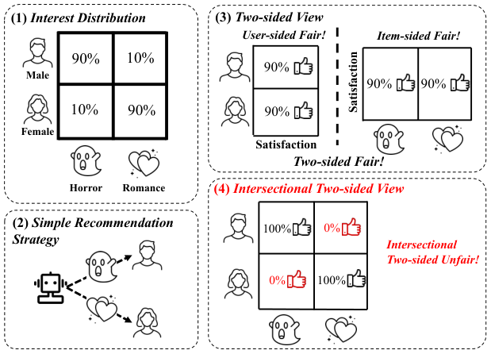
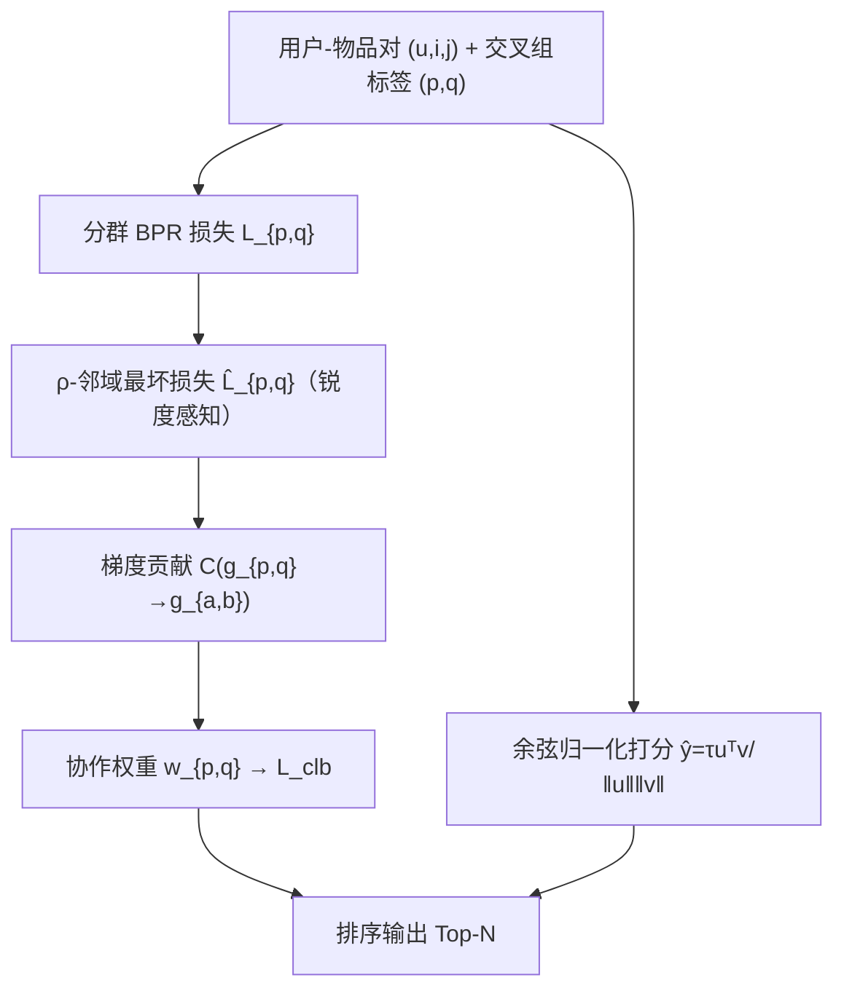
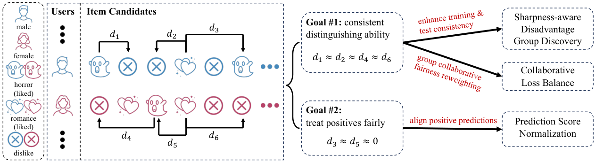

# Intersectional Two-sided Fairness in Recommendation (推荐中的交叉双边公平性)

- **会议/期刊**: WWW 2024 (The Web Conference)
- **作者与机构**: Yifan Wang, Peijie Sun, Weizhi Ma, Min Zhang, Shaoping Ma (清华大学) ; Yuan Zhang, Peng Jiang (快手)
- **推荐链路定位**: 精排/排序阶段（in-processing，与重排方法可叠加）
- **研究方向**: 去偏公平、可信推荐 / 协同过滤
- **论文原文**: [https://arxiv.org/abs/2402.02816v2](https://arxiv.org/abs/2402.02816v2)
- **开源代码**: [https://github.com/yfwang2021/ITFR](https://github.com/yfwang2021/ITFR)

## TL;DR (1分钟核心速览)

本文指出：即使推荐系统同时满足**用户单边公平**与**物品单边公平**（即双边公平），由「用户组 × 物品组」构成的**交叉双边群组**仍可能被系统性歧视（如图 1 玩具例：给男性推恐怖片、女性推爱情片，两边都"公平"，但"爱看恐怖片的女性"永远拿不到喜欢的内容）。作者提出 ITFR：以**锐度感知（sharpness-aware）最坏损失**作为群组区分能力的代理来定位劣势交叉群组，再用**基于梯度贡献的协作式损失再加权**替代朴素 GroupDRO，最后用**嵌入归一化打分**对齐各群组正样本的绝对分值。在真实数据上，ML1M 的交叉不公平度 CV@20 由 0.1145 降至 0.0646（−43.5%），Tenrec N@20 反而 +3.3%，实现"公平与精度兼得"。

## Background & Motivation (背景与核心矛盾)

- **主流范式**: 公平推荐按利益相关方分为用户公平（不同用户群性能一致）、物品公平（曝光公平或性能型公平）与双边公平（二者同时满足）。代表性工作多为正则化、DRO 再加权、对抗学习与公平重排（FairNeg / StreamDRO / DPR-REO / MultiFR / TFROM / PCT）。
- **前人局限（矛盾一）**: 双边公平是"边际公平"——只约束用户侧与物品侧的**边缘分布**，对联合分布 $g_{m,n}=(U_m,V_n)$ 无任何约束。论文在 ML1M 上实测 BPR：用户侧 Recall 0.5070 vs 0.5018、物品侧 Children's 0.4440 vs Horror 0.4101 均几乎一致，但交叉视角下 (Female & Children's) 达 0.5215、(Female & Horror) 仅 0.4125，**组间差约 26%**。
- **前人局限（矛盾二）**: 现有公平方法迁移到交叉视角后**适得其反**。FairNeg 把 Horror 全组拉高，却让劣势组 (Male & Children's) 由 0.5215 掉到 0.5042；StreamDRO 让弱势组 (Female & Horror) 进一步下滑；MultiFR 因只做**曝光型**物品公平，对性能型交叉不公平几乎无效。
- **核心洞察 (Key Insight)**: 交叉群组的效用由**两类竞争**决定——其正样本既要与全体负样本竞争（区分能力），又要与同列表中**其他群组的正样本**竞争（正样本间可比性）。因此交叉双边公平可解耦为两个目标：(i) 各交叉群组**一致的正负区分能力**；(ii) 各交叉群组正样本被**公平地对待**（预测分无可比性偏差）。
- **本文切入点**: 训练损失是区分能力的代理，但"低损失 ≠ 好测试性能"，且各群组损失互相影响，故用锐度感知损失定位劣势组、用群组协作梯度确定再加权权重，并额外归一化打分以填补目标 (ii)。

<figure class="paper-figure" markdown="span">
  <figcaption>图1：交叉双边不公平性示意图。在此玩具示例中，RS 策略满足双边公平性，但在交叉双边视角下表现出不公平。点赞表示推荐符合用户兴趣。</figcaption>
</figure>

## Method (核心方法设计)

### 1. 整体框架 (Overall Architecture)

ITFR 是套在任意 ID-based BPR 排序模型（如 MF/BPR）上的即插即用训练框架。输入为用户-物品对与「用户属性组 × 物品属性组」的 $P\times Q$交叉划分；每次迭代先按群组聚合并计算各交叉群组的 BPR 损失$L_{p,q}$，再沿梯度上升方向做$\rho$-邻域扰动得到锐度感知损失$\hat{L}_{p,q}$；随后用上轮累积梯度估计群组间相互贡献$C(g_{p,q})$，据此按 DRO 规则更新群组权重$w_{p,q}$，加权得到$\mathcal{L}_{clb}$ 回传；同时把内积打分替换为余弦缩放打分以对齐正样本分值。推理阶段无额外开销，只保留归一化打分。

<figure class="paper-figure" markdown="span">
  <figcaption>图2：我们的方法示意图。𝑑 表示两个交互之间预测分数的差异。</figcaption>
</figure>

### 2. 关键设计拆解 (Key Designs)

1. **锐度感知劣势群组发现（把"训练损失"换成"邻域最坏损失"）**：痛点是对单点 $\theta$的损失极易受随机扰动影响，损失曲面陡峭（sharp）时低损失并不代表真实区分能力，直接按损失大小再加权会误判劣势组。为此定义$\rho$-邻域内最坏损失并用单步梯度上升近似：$\hat{L}_{p,q}=\max_{\|\epsilon\|\le\rho}L_{p,q}(\theta+\epsilon),\ \theta^{*}_{p,q}=\theta+\rho\,\nabla_\theta L_{p,q}/\|\nabla_\theta L_{p,q}\|$。直觉：平坦极小值区域内的群组损失更"可信"，锐度被显式折算进劣势度度量。
2. **协作式损失再加权（用"对其他组的贡献"取代"自身损失大小"）**：痛点在于推荐场景中交叉群组共享用户/物品，优化一组必然牵动另一组，GroupDRO 只看 $L_i$自身大小会忽视这种耦合。定义贡献$C(g_{p,q}\to g_{a,b})\approx\alpha\nabla_\theta\hat{L}_{p,q}^{\top}\nabla_\theta\hat{L}_{a,b}$，并按劣势度加权求和$C(g_{p,q})=\sum_{a,b}\beta_{a,b}C(g_{p,q}\to g_{a,b}),\ \beta_{a,b}=L_{a,b}^{\gamma}/\sum L_{p,q}^{\gamma}$，再沿用 DRO 更新$w_{p,q}\leftarrow w_{p,q}\exp(\eta C(g_{p,q}))/\sum w_{a,b}\exp(\eta C(g_{a,b}))$，总损失$\mathcal{L}_{clb}=\sum_{p,q}w_{p,q}\hat{L}_{p,q}$。梯度内积即"一组下降能带动另一组下降多少"，把公平再分配变成**收益最大化的资源分配**；batch 内梯度正交时改用上一 epoch 累积梯度近似。
3. **预测分归一化（补齐正样本间的可比性）**：BPR 只约束正负**相对间距**，不约束绝对分值，即使各组间距一致，正样本分值仍可能系统性偏低。取 $\hat{y}_{u,v}=\tau\cdot u^{\top}v/(\|u\|\,\|v\|)$把打分压到$(-\tau,\tau)$，使系统偏差被限制在有界区间内；同时用户向量归一化令损失跨用户可比，物品向量归一化顺带缓解流行度偏置。训练负采样沿用 BPR 随机负采样，推理为纯内积/余弦检索，**零额外在线开销**。

## Experimental Setup & Evaluation Protocol (实验设置与评估协议)

- **数据集与预处理**: 剔除与公平属性无关的用户/物品，保留多组（非二组）属性划分。

| 数据集 | #Users | #Items | #Interactions | 稀疏度/密度 | 特征/场景说明 |
| :--- | :---: | :---: | :---: | :---: | :--- |
| Movielens-1M | 6,040 | 3,706 | 1,000,209 | 密度 ≈4.47% | 用户性别/年龄 × 电影类型（多组） |
| Tenrec-QBA | 见原文附录 A.2 | — | — | — | 腾讯内容推荐，用户属性 × 内容类目 |
| LastFM-2B | 见原文附录 A.2 | — | — | — | 音乐收听，性别/年龄 × 艺人标签 |
| ML1M-2（实证子集） | 4,403 | 568 | 144,420 | 密度 ≈5.77% | 性别(M/F) × {Children's, Horror} 二组 |

- **数据划分与防穿越 (Splitting Strategy)**: **随机比例划分** train:val:test = 7:1:2（非 Leave-One-Out、非时间戳切分），实证小节与主实验均采用该协议。
- **排名评测协议 (Ranking Protocol)**: **Full-Ranking 全库排序**（对全部未交互物品打分取 Top-20）。指标：精度 N@20/P@20/R@20；交叉公平 CV@20（全体交叉群组效用的变异系数，越低越好）、MIN@20（最差 25% 群组平均效用，越高越好）；单边公平 UCV@20、ICV@20。
- **对比基线与超参设置**: BPR、StreamDRO（用户公平）、DPR-REO 与 FairNeg（物品公平）、MultiFR（双边，重排/多目标）、GroupDRO（交叉群组再加权强基线）；重排兼容实验对比 TFROM、PCT。超参 $\rho$（锐度半径）、$\eta$（DRO 步长）、$\gamma$（劣势度锐化）、$\tau$（打分上界），显著性用配对 t 检验$p\le0.05/0.01$。

## Key Experimental Results (实验关键数据)

### 1. 主实验对比 (Main Results)

| 数据集 | 方法 | N@20↑ | MIN@20↑ | CV@20↓ | UCV@20↓ | ICV@20↓ |
| :--- | :--- | :---: | :---: | :---: | :---: | :---: |
| Movielens | BPR | 0.3611 | 0.2398 | 0.2026 | 0.0892 | 0.1925 |
| | DPR-REO | 0.3502 | 0.2593 | 0.1567 | 0.0906 | 0.1480 |
| | FairNeg | 0.3590 | 0.2626 | 0.1302 | 0.0953 | 0.1214 |
| | StreamDRO | 0.3607 | 0.2389 | 0.2040 | 0.0859 | 0.1923 |
| | MultiFR | 0.3594 | 0.2403 | 0.1982 | 0.0887 | 0.1876 |
| | GroupDRO | 0.3558 | 0.2737 | 0.1145 | 0.0604 | 0.1096 |
| | **ITFR** | 0.3605 | **0.3023** (+10.4%) | **0.0646** (−43.5%) | **0.0433** (−28.3%) | **0.0578** (−47.2%) |
| Tenrec | BPR | 0.1750 | 0.2703 | 0.1269 | 0.0453 | 0.1194 |
| | FairNeg | 0.1756 | 0.2789 | 0.1138 | 0.0445 | 0.1039 |
| | StreamDRO | 0.1759 | 0.2721 | 0.1223 | 0.0372 | 0.1154 |
| | MultiFR | 0.1735 | 0.2733 | 0.1180 | 0.0429 | 0.1120 |
| | GroupDRO | 0.1738 | 0.2711 | 0.1342 | 0.0460 | 0.1248 |
| | **ITFR** | **0.1818** (+3.3%) | **0.3075** (+10.2%) | **0.0793** (−29.5%) | **0.0319** (−14.2%) | **0.0713** (−31.3%) |
| LastFM | BPR | 0.1655 | 0.0538 | 0.3398 | 0.0762 | 0.3369 |
| | DPR-REO | 0.1617 | 0.0615 | 0.2989 | 0.0783 | 0.2960 |
| | FairNeg | 0.1662 | 0.0694 | 0.2896 | 0.0794 | 0.2866 |
| | GroupDRO | 0.1642 | 0.0896 | 0.1923 | 0.0650 | 0.1851 |
| | **ITFR** | **0.1704** (+2.5%) | **0.0956** (+6.6%) | **0.1772** (−7.8%) | 0.0648 (−0.3%) | **0.1680** (−9.8%) |

### 2. 消融实验 (Ablation Study)

| 变体 | CV@20 公平性 | N@20 精度 | 主要结论（见原文图 3 / 图 4） |
| :--- | :---: | :---: | :--- |
| w/o SA（去锐度感知） | 明显变差 | 略降 | Tenrec 上退化最剧烈，锐度项是识别劣势组的关键 |
| w/o CB（退化为 GroupDRO） | 变差 | 略降 | LastFM 上退化最大，协作梯度对稀疏多组场景最有用 |
| w/o PN（去归一化） | 变差 | **三个数据集全部下降** | PN 同时贡献公平与精度（缓解流行度偏置） |
| 仅 Goal 1（BPR + SA + CB） | 中等改善 | 中等 | Tenrec 上单靠 Goal 1 无法改善公平 |
| 仅 Goal 2（BPR + PN） | 几乎无改善 | **最高** | 目标 2 是"间接"手段，单独使用不足以矫正公平 |
| **ITFR（Goal 1 + Goal 2）** | **最优** | 次优/最优 | 两目标互补，缺一不可 |

### 3. 关键实验发现 (Key Findings)

1. **公平与精度并非零和**：ML1M 上 ITFR 把 CV@20 从最强基线 GroupDRO 的 0.1145 压到 0.0646（−43.5%），同时 P@20 0.2074 反超 BPR 1.4%；Tenrec 上精度与公平同时最优（N@20 +3.3%、CV@20 −29.5%），说明公平再加权本身起到了"难样本挖掘"的正则化效应。
2. **朴素群组再加权会失效**：GroupDRO 在 ML1M/LastFM 上很强（CV@20 0.1145/0.1923），但在 Tenrec 上 CV@20 反而劣于 BPR（0.1342 vs 0.1269）——仅平衡训练损失不足以保证测试公平，必须叠加锐度感知与打分归一化，ITFR 在该集才把 CV 降到 0.0793。
3. **单边公平的"溢出"是非对称的**：FairNeg 提升物品侧公平后，(Male & Children's) 由 0.5215 降至 0.5042、(Female & Children's) 由 0.5215→0.5042 同向受损，而 Horror 各交叉组普遍上升；这定量印证了"边缘公平难以控制联合分布"，也解释了为何需要显式的交叉群组建模。
4. **与重排解耦可叠加**：以 ITFR 作为输入再跑 TFROM/PCT，SystemKL 与 UserKL 不劣于 BPR 输入；虽然重排会损害交叉公平，但 ITFR 起点仍保持相对 BPR 的优势（Tenrec 图 5）。

## Highlights & Limitations (亮点、对比与审稿批判)

- **与代表作对比 (vs. Prior Work)**: ① vs **GroupDRO**：同为群组再加权，但 GroupDRO 只看自身损失大小、忽略群组耦合与损失曲面锐度，且无打分归一化，故在 Tenrec 崩盘；ITFR 用梯度内积估计"组间贡献"并引入 $\rho$-邻域最坏损失。② vs **MultiFR / TFROM / PCT**：它们优化的是曝光型物品公平 + 用户性能公平，属重排阶段，天然看不到"性能型"交叉不公平；ITFR 在排序阶段直接优化性能型双边公平，且与重排正交。③ vs **FairNeg / StreamDRO / DPR-REO**：单边方法只能优化边缘分布，交叉视角下常出现"补一边、伤另一边"。
- **可迁移亮点**: ① "梯度内积 ≈ 组间收益"的协作式再加权，可平移到多场景/多任务（MMoE 式）的损失平衡与难样本挖掘；② 打分余弦归一化作为**零成本、零推理开销**的插件，可缓解流行度偏置并稳定跨组可比性，适合直接接入工业排序层。
- **审稿级局限批判**: ① **计算与扩展性**：锐度感知需额外一次前向+反向，群组贡献矩阵理论复杂度随 $(PQ)^2$增长，且 batch 内梯度正交时要用上一轮累积梯度近似，近似误差无理论界，$P\times Q$达数百组时开销与方差都将失控。② **评估协议偏弱**：仅用随机 7:1:2 划分而非全局时间戳切分，存在未来交互泄漏，且 Top-20 全库排序下的效用为 recall 代理，未在线上 A/B 或曝光型指标上验证；超参$\rho,\eta,\gamma,\tau$ 四个耦合且只在附录给出敏感性分析，复现调参成本高。③ 目标 2 采用"间接有界化"而非直接对齐正样本分值，作者亦承认其单独效果有限。

## Rating (四维评分)

- **方法创新性 (Novelty)**: ⭐⭐⭐⭐ （首次形式化 Top-N 交叉双边公平，锐度感知 + 梯度协作贡献的组合在公平推荐中较新，但单点技术均借自 ML 领域）
- **评估协议与实验扎实度 (Protocol & Experiments)**: ⭐⭐⭐⭐ （3 数据集 + 6 基线 + 显著性检验 + 双目标/三组件双层消融 + 重排兼容实验完整，扣分在随机划分与缺线上验证）
- **写作与数学规范度 (Clarity & Rigor)**: ⭐⭐⭐⭐ （两目标分解与三组件映射清晰、近似细节诚实披露，但群组贡献近似的理论保证与复杂度分析偏薄）
- **工业落地与复现价值 (Industrial & Practical Value)**: ⭐⭐⭐⭐ （代码已开源、推理零额外开销、可直接叠加重排；训练侧额外反向与群组权重维护是主要成本）

