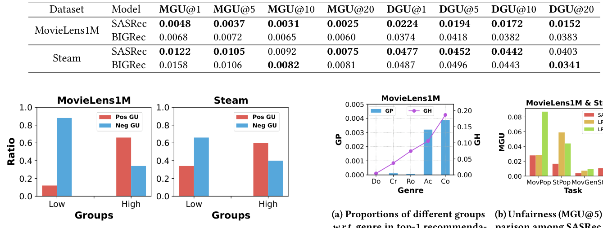
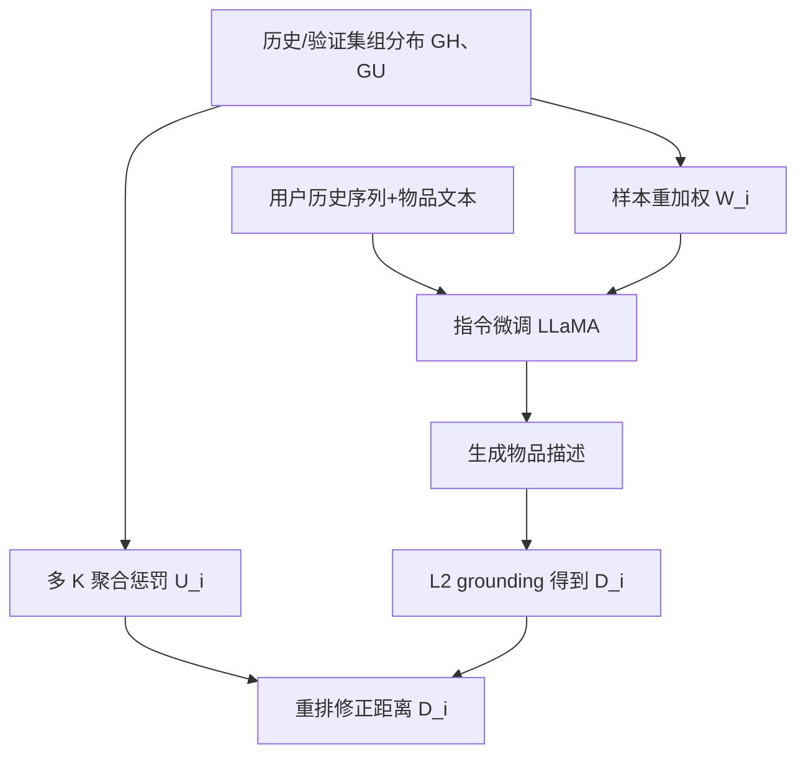

# Item-side Fairness of Large Language Model-based Recommendation System (基于大语言模型推荐系统的物品侧公平性)

- **会议/期刊**: WWW 2024
- **作者与机构**: Meng Jiang, Keqin Bao, Jizhi Zhang, Wenjie Wang, Zhengyi Yang, Fuli Feng, Xiangnan He；USTC / NUS
- **推荐链路定位**: 生成式端到端 + 后处理重排校准
- **研究方向**: 去偏公平、可信隐私与工业架构 / LLM4Rec
- **论文原文**: [https://arxiv.org/abs/2402.15215v1](https://arxiv.org/abs/2402.15215v1)
- **开源代码**: [https://github.com/JiangM-C/IFairLRS.git](https://github.com/JiangM-C/IFairLRS.git)

## TL;DR (1分钟核心速览)

本文首次系统量化 LLM 推荐系统（LRS）的物品侧公平性，发现其同时受历史交互失衡与 LLM 语义先验驱动，且比 SASRec 更偏向热门物品。作者提出 IFairLRS：训练期按目标/历史组分布比重加权，推理期用多 $K$ 聚合的 GU 惩罚项重排。MovieLens1M/Steam 全库排序下，MGU@1/DGU@1 相对 BIGRec 最多降约 30%/28%，NDCG@5 波动约 1%。

## Background & Motivation (背景与核心矛盾)

- **主流范式**: BIGRec 将用户交互序列转为自然语言指令微调 LLaMA，生成物品描述后再用 L2 grounding 映射到候选物品。
- **前人局限**: 传统物品侧公平方法依赖判别式排序分数或自适应组权重，而生成式 LRS 只最大化目标物品 token 的似然；LLMRank 仅定性观察热度相关性，未系统量化 popularity/genre 偏差，也无校准方法。
- **核心洞察 (Key Insight)**: BIGRec 在 top-1 过度推荐高热组；genre 上高流行类型呈正 GU、低流行类型呈负 GU。更关键的是，即使微调阶段删除 Comedy 类型，模型仍能凭预训练语义先验推荐该类型。
- **本文切入点**: 将 LRS 不公平拆成 in-learning 的训练分布偏差与 post-learning 的 grounding/排序偏差，分阶段校准。

<figure class="paper-figure" markdown="span">
  <figcaption>图 2：按类型划分的群体之间 GU@1 的比较。我们根据这些类型群体在历史序列中的交互比例将其分为两部分，每部分包含相同数量的群体。“Pos GU”表示 GU@1 &gt; 0，“Neg GU”表示 GU@1 &lt; 0。可以观察到，高流行度类型会被过度推荐（Pos GU），而低流行度类型往往被忽视（Neg GU）。</figcaption>
</figure>

## Method (核心方法设计)

### 1. 整体框架 (Overall Architecture)

IFairLRS 不改变 LRS 主干，而是在建链两阶段插入校准：训练前按组分布计算样本权重，对指令微调损失重加权；推理时先由 LLaMA 生成物品描述并用 L2 grounding 得到距离 $D_i$，再用历史/验证集估计的 GU 惩罚项修正距离并重排。整体闭环是“序列文本输入$\to$指令微调$\to$生成+grounding$\to$ 公平惩罚重排”，兼顾公平与准确性。

### 2. 关键设计拆解 (Key Designs)

1. **In-learning 样本重加权**：生成式 LRS 无法像判别模型那样直接对组排序分数加正则，因此转为训练前预计算权重。设目标集与历史集的组占比分别为 $GH_{ta}(G)$、$GH_{tr}(G)$，则$W_G=GH_{tr}(G)/GH_{ta}(G)$，多组物品取平均$W_i=\frac{1}{|\mathcal{G}_i|}\sum_{G\in\mathcal{G}_i}W_G$，损失为$\mathcal{L}_i=W_i\mathcal{L}(H_i,T_i)$。若某组在目标集中被放大，$W_G<1$ 即降权，从源头削弱热门组主导。
2. **Post-learning 惩罚重排**：grounding 在大 $K$时会过度纠偏，单一$K$的 GU 不稳定，故聚合多$K$：$U_G=\sum_{K\in\mathcal{K}}\gamma_K GU(G)@K$，$\gamma_K=K/\sum_{K'}K'$，再归一化$\hat{U}_G=U_G/\max_{G'}|\hat{U}_{G'}|$。对物品取$\hat{U}_i$后修正距离$\tilde{D}_i=D_i/(1-\hat{U}_i)^\alpha$：正 GU 物品被加大距离、降低曝光，负 GU 物品被提升，$\alpha$ 控制惩罚强度。
3. **训练目标、负采样与推理效率**：总损失即加权语言建模 $\mathcal{L}=\sum_i W_i\mathcal{L}_{LM}(H_i,T_i)$，无显式负采样，依赖生成 token 似然与 L2 grounding；重排仅增加$O(N|\mathcal{G}|)$ 校准开销，主要成本仍在 LLaMA 生成解码。

## Experimental Setup & Evaluation Protocol (实验设置与评估协议)

- **数据集与预处理**: 原文统计在附录 A，正文未列具体规模；Steam 剔除总交互少于 10,000 的类型，两数据集均限制每用户最多 10 条交互。

| 数据集 | #Users | #Items | #Interactions | 稀疏度 | 特征/场景说明 |
| :--- | :---: | :---: | :---: | :---: | :--- |
| MovieLens1M | — | — | — | — | 电影标题文本；电影类型；序列推荐 |
| Steam | — | — | — | — | 游戏标题文本；游戏类型；序列推荐 |

- **数据划分与防穿越**: 按交互时间戳切成 10 个时间片，再按 8:1:1 划分 train/valid/test；训练采样 65,536 条实例，保持原训练分布。
- **排名评测协议**: 采用无偏 `Full-Ranking`（all-ranking，全库未交互物品排序）；报告 MGU@K、DGU@K、NDCG@5、HR@5。
- **对比基线与超参**: 诊断阶段对比 SASRec 与 BIGRec；校准阶段对比 BIGRec、IFairLRS(RW)、IFairLRS(RR)。主干为 LLaMA，Adam，lr $1e-3$，batch 128，weight decay 网格搜索，$\alpha\in[0,0.1]$ 步长 0.01；实验重复 3 次取均值，未报告显著性检验。

## Key Experimental Results (实验关键数据)

### 1. 主实验对比 (Main Results)

原文主实验仅设 BIGRec 基线与 IFairLRS 两变体，诊断实验另含 SASRec；无更多 SOTA 基线，故不虚构。SASRec 在热门度分组上 top-1 公平性明显优于 BIGRec：MovieLens1M MGU@1 0.0238 vs 0.1044、DGU@1 0.0846 vs 0.3917；Steam MGU@1 0.0173 vs 0.0411、DGU@1 0.0647 vs 0.1586。

| 分组 | 数据集 | 模型 | MGU@1↓ | DGU@1↓ | MGU@20↓ | DGU@20↓ | NDCG@5↑ | HR@5↑ |
| :--- | :--- | :--- | ---: | ---: | ---: | ---: | ---: | ---: |
| 热门度 | MovieLens1M | BIGRec | 0.1044 | 0.3917 | 0.0128 | 0.0415 | **0.0299** | 0.0345 |
| 热门度 | MovieLens1M | +RW | **0.0990** | **0.3585** | 0.0160 | 0.0544 | 0.0295 | 0.0341 |
| 热门度 | MovieLens1M | +RR | 0.1074 | 0.4011 | **0.0125** | **0.0413** | 0.0297 | **0.0348** |
| 热门度 | Steam | BIGRec | 0.0411 | 0.1586 | 0.0900 | 0.3050 | 0.0311 | 0.0346 |
| 热门度 | Steam | +RW | **0.0371** | **0.1410** | 0.0959 | 0.3208 | 0.0311 | 0.0341 |
| 热门度 | Steam | +RR | 0.0417 | 0.1610 | **0.0377** | **0.1308** | **0.0312** | **0.0348** |
| 类型 | MovieLens1M | BIGRec | 0.0068 | 0.0374 | 0.0060 | 0.0383 | **0.0299** | **0.0345** |
| 类型 | MovieLens1M | +RW | **0.0050** | **0.0268** | 0.0056 | 0.0366 | 0.0291 | 0.0337 |
| 类型 | MovieLens1M | +RR | 0.0089 | 0.0439 | **0.0036** | **0.0184** | 0.0291 | 0.0336 |
| 类型 | Steam | BIGRec | 0.0158 | 0.0487 | 0.0081 | 0.0341 | 0.0311 | 0.0346 |
| 类型 | Steam | +RW | **0.0138** | **0.0483** | 0.0078 | 0.0331 | **0.0316** | **0.0348** |
| 类型 | Steam | +RR | 0.0184 | 0.0541 | **0.0065** | **0.0284** | 0.0311 | 0.0347 |

相对 BIGRec：RW 在热门度分组使 MGU@1 降 5.2%/9.7%、DGU@1 降 8.5%/11.1%（ML/Steam）；类型分组 MGU@1 降 26.5%/12.7%，DGU@1 在 ML 降 28.3%。RR 在 $K=20$ 更强：Steam 热门度 MGU@20 降 58.1%、DGU@20 降 57.1%；ML 类型 MGU@20 降 40%、DGU@20 降 52%。

### 2. 消融实验 (Ablation Study)

| 变体 | 作用阶段 | 热门度 MGU@1↓ (ML/Steam) | 类型 MGU@1↓ (ML/Steam) | 热门度 MGU@20↓ (ML/Steam) | 类型 MGU@20↓ (ML/Steam) |
| :--- | :--- | :--- | :--- | :--- | :--- |
| BIGRec | 基线 | 0.1044 / 0.0411 | 0.0068 / 0.0158 | 0.0128 / 0.0900 | 0.0060 / 0.0081 |
| +RW | in-learning | **0.0990 / 0.0371** | **0.0050 / 0.0138** | 0.0160 / 0.0959 | 0.0056 / 0.0078 |
| +RR | post-learning | 0.1074 / 0.0417 | 0.0089 / 0.0184 | **0.0125 / 0.0377** | **0.0036 / 0.0065** |

### 3. 关键实验发现 (Key Findings)

- **RW 主攻 top-1 校准，RR 主攻大 $K$平衡**：RW 在 @1 上稳定改善，说明训练分布比重建模有效；RR 在 @20 大幅降低 DGU，说明多$K$ 惩罚能缓解 grounding 的过度纠偏。
- **公平提升不以准确性为代价**：两策略相对 BIGRec 的 NDCG@5 波动约 1%，HR@5 波动约 5% 内；例如 Steam 热门度 RR 的 HR@5 由 0.0346 升至 0.0348。
- **LRS 偏差具有双源性与 $K$依赖性**：top-1 过度热门、低流行组被压制；$K$增大后 grounding 会拉回部分长尾，但也会把低流行偏见转移到其他组，故单一$K$ 的 GU 校准不可靠。

## Highlights & Limitations (亮点、对比与审稿批判)

- **与代表作对比 (vs. Prior Work)**: 相比 SASRec，本文揭示生成式 LRS 的热门与语义先验偏差更复杂；相比 BIGRec，IFairLRS 不改主干即可两阶段校准；相比 LLMRank 的定性观察，本文给出 MGU/DGU 量化与可执行方法。
- **可迁移亮点**: 用 $GH_{tr}/GH_{ta}$做生成式推荐样本重加权，可迁移到任何指令微调推荐；用多$K$ 聚合 GU 惩罚重排，可迁移到生成式检索的 grounding 后处理。
- **审稿级局限批判**: 公平锚定历史交互分布，若历史本身欠曝光弱势组，校准目标可能继承历史偏差；仅 LLaMA+BIGRec、两数据集、组级公平，未覆盖个体/长期公平，且无显著性检验，$\alpha$ 与组划分较敏感。

## Rating (四维评分)

- **方法创新性 (Novelty)**: ⭐⭐⭐⭐ （首次系统量化 LRS 物品侧公平，并把生成式 LRS 的不公平拆成训练分布与语义先验两源，重加权+重排设计简洁有效）
- **评估协议与实验扎实度 (Protocol & Experiments)**: ⭐⭐⭐⭐ （全库排序、时间切分防穿越、双数据集双分组较规范，但基线数量有限且缺显著性检验）
- **写作与数学规范度 (Clarity & Rigor)**: ⭐⭐⭐⭐ （GU/MGU/DGU 定义清晰，重加权与重排公式完整；部分实验正文百分比与表格数值存在轻微出入）
- **工业落地与复现价值 (Industrial & Practical Value)**: ⭐⭐⭐⭐ （开源代码，重排开销低、可直接接在生成式推荐后；但 LLaMA 指令微调与生成解码成本仍高，线上需蒸馏或小模型化）

