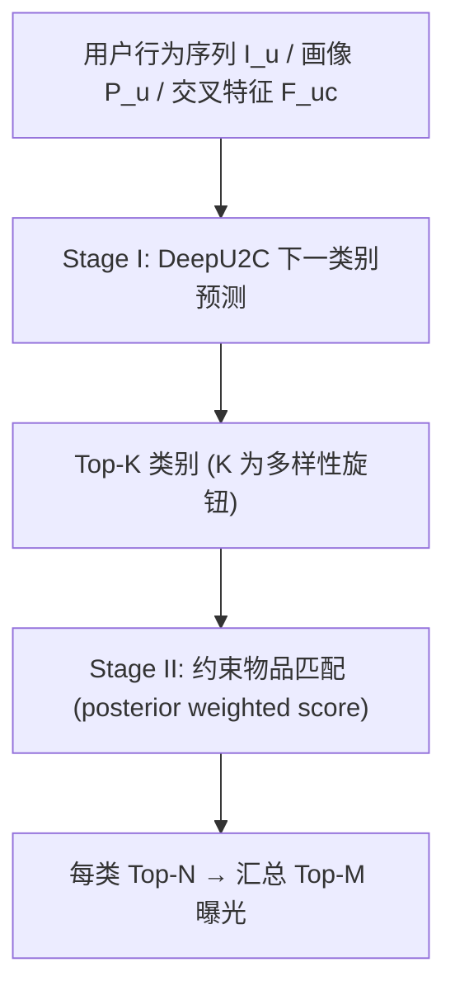
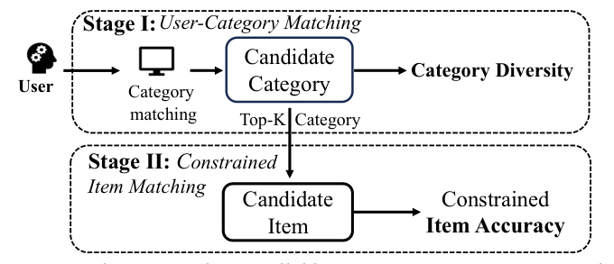
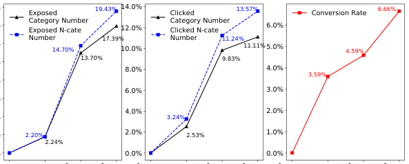

# On Practical Diversified Recommendation with Controllable Category Diversity Framework (可控类别多样性推荐框架)

- **会议/期刊**: WWW 2024 (The ACM Web Conference)
- **作者与机构**: Tao Zhang, Luwei Yang, Zhibo Xiao, Wen Jiang, Wei Ning（阿里巴巴集团）
- **推荐链路定位**: 召回（两阶段候选生成）
- **研究方向**: 去偏公平与工业架构 / 冷启动与长尾推荐
- **论文原文**: [论文原文链接](https://arxiv.org/abs/2402.03801v1)
- **开源代码**: [开源代码仓库链接](https://github.com/selous123/CCDF)

## TL;DR (1分钟核心速览)

针对准确率导向推荐导致的信息茧房/过滤气泡，本文把多样性拆成 **U-diversity**（在用户历史类别内的广度）与 **N-diversity**（用户未交互过的新类别新颖性），提出两阶段 CCDF：Stage I 用 DeepU2C（MHSA 行为编码 + Wide/Deep 双分支 + 交叉熵与 triplet 组合损失）做**下一类别预测**并取 top-K 类别；Stage II 在该 K 个类别约束下按后验加权分检索物品。K 是显式多样性旋钮。离线 Alibaba.com 上 N-diversity HR@5 达 0.245（较 DGCN +129%），线上 A/B 在 K=30 时曝光类别数 +17.39%、转化率 +6.66%。

## Background & Motivation (背景与核心矛盾)

- **主流范式**: 召回/精排以准确率为唯一目标（CF、Wide&Deep、DIN 等）；多样性方法则分两支——重排后处理（MMR、DPP）与图扩展候选（LightGCN、DGCN、DGRec、DDGraph）。
- **前人局限**: ① 重排类方法只在候选池已生成后重洗，无法扩展候选池本身；② 图方法虽扩大候选范围，但仅以"类别数量"衡量多样性，**忽略用户-类别关系**，且不区分"在历史兴趣内多样化"与"引入全新类别"。
- **核心洞察 (Key Insight)**: 真正打破气泡的不是在旧兴趣里多摆几类，而是给用户**历史上从未交互过的类别**（N-diversity）；而已有工作连这一维度都没显式建模。
- **本文切入点**: 把"类别多样性"与"物品精度"的职责分别下放到两个阶段，用 K 解耦并显式控制两者权衡。

## Method (核心方法设计)

### 1. 整体框架 (Overall Architecture)

输入用户行为序列 $I_u$、用户画像$P_u$与交叉特征$F_{uc_t}$，Stage I 的 DeepU2C 输出用户对候选类别的偏好分，取 top-K 类别作为"触发信息"；Stage II 在 K 个类别内用后验加权分（CTR/CVR/CPR）检索每类 Top-N 物品，汇总为最终 Top-M 曝光。K 越大，N-diversity 越强；训练与推理均与物品级排序解耦，便于在线部署。

<figure class="paper-figure" markdown="span">
  <figcaption>图1：提出的可控类别多样性框架（CCDF），分为两个阶段。上：用户-类别匹配。下：约束物品匹配。</figcaption>
</figure>

### 2. 关键设计拆解 (Key Designs)

1. **DeepU2C 下一类别预测（职责分离的记忆/泛化双分支）**：痛点是把"类别偏好"当年 item-ID 嵌入会过拟合历史类别。模型用 MHSA 编码行为序列，经 sum-pooling 与 profile 拼接后过 FFN 得 $\mathbf{e}_u$；Category Net 用两层 MLP 得$\mathbf{e}'_{c_t}$；Wide 层融合交叉特征与两者内积：
$$f(u,c_t)=\mathbf{w}^{\top}\cdot\left[\mathbf{e}_{F_{uc_t}}\oplus\langle\mathbf{e}_u,\mathbf{e}'_{c_t}\rangle\right]+b$$
Wide 分支记忆历史共现（利 U-diversity），Deep 分支拟合非线性泛化（利 N-diversity），物理直觉是两类任务对模型容量需求异质。

2. **交叉熵 + Triplet 组合损失**：纯 sampled softmax 只保证正类高于随机负类，类间相对序弱。作者在用户-类别异构图 $\mathcal{G}=(\mathcal{U}\cup\mathcal{C},\mathcal{E})$上采样$n_{nei}$个邻居类别，按交互次数$s_{uc}$ 决定正负方向做 margin 排序：
$$L_t=\frac{1}{n_{nei}}\sum_{c_j\in c_{nei}}\max\!\Big(\mathrm{sign}(s_{uc_t}-s_{uc_j})\cdot\big(f(u,c_j)-f(u,c_t)\big)+m,\ 0\Big)$$
总损失 $L=\sum L_c+\lambda L_t$，令模型不仅"猜对"还能"排对"，对未交互类别（N）泛化更稳。

3. **训练目标、负采样与推理效率**：负采样为 Uniform 类别随机采样（$n_{neg}=500$）与邻居类别采样（$n_{nei}=5$）；Stage II 采用业界常用的后验加权打分$\text{score}_i=1\cdot\text{CTR}_i+10\cdot\text{CVR}_i+100\cdot\text{CPR}_i$，每类保留$N=300$。在线推理中类别 Embedding 预先离线算好，实时仅算剩余部分，数千候选类别响应 <2ms，可满足工业召回时延。

## Experimental Setup & Evaluation Protocol (实验设置与评估协议)

- **数据集与预处理**：取两数据集交互量 top-50k 活跃用户；行为序列离线截断至 20、线上为 30。

| 数据集 | #Users | #Categories | #Interactions | 特征/场景说明 |
| :--- | :---: | :---: | :---: | :--- |
| Alibaba.com | 50,000 | 4,360 | 3,419,462 | 工业电商站，含类目体系 |
| Taobao | 50,000 | 3,266 | 2,628,956 | 公开电商数据集 |

- **数据划分与防穿越 (Splitting Strategy)**: 全局时间切分——倒数第二天为验证集、最后一天为测试集、其余为训练集，天然避免未来信息泄漏。
- **排名评测协议 (Ranking Protocol)**: 属**类别级 next-category 预测**而非 item 级 Full-Ranking：候选为全类别库，指标 $\mathrm{HR}@K=\frac{1}{|D_{test}|}\sum\mathbb{I}(\text{target}\in\text{top-}K)$；测试集按$c_t\in C(I_u)$ 与否拆为 U / N 两个子任务分别评估。
- **对比基线与超参设置**: Statistics、LightGCN、DGCN、DGRec 四类基线；Embedding 维度 64/32/8/8，MHSA 头数 $H=8$，隐层 64/32，$m=0.4$、$\lambda=1.0$，Adam、lr=0.001、batch=100，5 epoch 收敛；线上结果用 unpaired t-test 检验显著性。

## Key Experimental Results (实验关键数据)

### 1. 主实验对比 (Main Results)

Alibaba.com 主结果（加粗为最优）：

| Method | U@5 | U@15 | U@30 | N@5 | N@15 | N@30 |
| :--- | :---: | :---: | :---: | :---: | :---: | :---: |
| Statistics | 0.601 | 0.718 | 1.000 | 0.000 | 0.000 | 0.000 |
| LightGCN | 0.525 | 0.733 | 0.833 | 0.088 | 0.228 | 0.368 |
| DGCN | 0.449 | 0.674 | 0.790 | 0.107 | 0.241 | 0.372 |
| DGRec | 0.375 | 0.577 | 0.720 | 0.098 | 0.256 | 0.380 |
| **DeepU2C** | **0.688** | **0.810** | **0.843** | **0.245** | **0.458** | **0.610** |
| Improv.% | +14.5% | +12.8% | — | **+129.0%** | +78.9% | **+60.5%** |

Taobao 同趋势：DeepU2C U@5=0.781（vs LightGCN 0.525，+48.8%）、N@5=0.248（vs DGRec 0.085，+191.8%）。

### 2. 消融实验 (Ablation Study)

Alibaba.com 组件消融：

| Variant | U@5 | U@15 | U@30 | N@5 | N@15 | N@30 |
| :--- | :---: | :---: | :---: | :---: | :---: | :---: |
| DeepU2C | **0.688** | **0.810** | **0.843** | **0.245** | **0.458** | **0.610** |
| w/o triplet loss | 0.645 | 0.782 | 0.810 | 0.221 | 0.387 | 0.552 |
| w/o wide layer | 0.483 | 0.602 | 0.668 | 0.233 | 0.435 | 0.578 |
| w/o deep branch | 0.534 | 0.689 | 0.788 | 0.000 | 0.000 | 0.000 |

### 3. 关键实验发现 (Key Findings)

1. **N-diversity 是本文最大增量**：DeepU2C N@5 达 0.245，约为 DGCN（0.107）的 2.3 倍，N@30 相对 DGRec 提升 +60.5%；说明行为序列经 MHSA + 双分支建模后，对**从未交互类别**的泛化远强于图扩展式方法。
2. **Wide/Deep 职责分离被消融量化验证**：去掉 Wide 层使 U@5 由 0.688 骤降至 0.483（−29.8%），而 N 指标几乎不变；去掉 Deep 分支则 N@5/15/30 全归零，U 仅小幅下降——与"记忆 vs 泛化"假设严格吻合。
3. **线上 K 扫描给出经验安全区间**：K=10→30 时，曝光类别数从 +2.24% 升至 +17.39%，曝光 N 类别从 +2.20% 升至 +19.43%，转化率从 +3.59% 升至 +6.66%；多样性提升并未牺牲商业指标，反而带来转化增益，并形成"推荐多样化→激发搜索需求→搜索转化率 +3.57%~+5.54%"的推荐-搜索互补效应。

<figure class="paper-figure" markdown="span">
  <figcaption>图6：与基线相比，CCDF在不同top-𝐾参数下于在线A/B测试中的提升。𝐾是多样性的可控参数，设置为10、20和30。</figcaption>
</figure>

## Highlights & Limitations (亮点、对比与审稿批判)

- **与代表作对比 (vs. Prior Work)**: MMR/DPP 只在候选池后重排，本文把多样性前移到召回阶段并用 K 显式控制；DGCN/DGRec 依赖图扩展候选、以类别计数度量多样性，本文拆分 U/N 并**直接建模未交互类别偏好**；相比 Statistics 只看历史频次，DeepU2C 在 N-diversity 上从 0 提升至 0.245，差距本质来自序列建模与组合损失。
- **可迁移亮点**: ① "类别级 top-K 门控 + 物品级检索"的两阶段职责解耦，可迁移到电商、内容平台的多目标召回；② Wide/Deep + triplet 处理"记忆 vs 泛化"异构任务的组合损失范式，适用于任何需要同时兼顾熟悉与新颖的推荐场景。
- **审稿级局限批判**: ① 离线评测是**类别级 HR**，类别库远小于物品库，无法反映真实 item-level 召回效果，也未与 MMR/DPP 等重排基线直接对比；② Stage II 采用固定的 CTR/CVR/CPR 权重后验打分，与 Stage I 的类别分数脱节，$K$与每类$N$需人工调，超参敏感；③ 框架强依赖电商层级类目体系，无类目或类目质量差的平台迁移成本高；④ 在线 A/B 仅扫描$K\in\{10,20,30\}$，未系统探索最优多样性-转化平衡点。

## Rating (四维评分)

- **方法创新性 (Novelty)**: ⭐⭐⭐⭐ （U/N 双多样性定义与两阶段解耦+K 旋钮是清晰新颖的增量，但组件多为成熟模块的重组合）
- **评估协议与实验扎实度 (Protocol & Experiments)**: ⭐⭐⭐⭐ （双数据集+完整消融+两周线上 A/B+t 检验，但离线仅类目级 HR、缺乏 item 级全库排序与重排基线）
- **写作与数学规范度 (Clarity & Rigor)**: ⭐⭐⭐⭐ （符号与公式定义清晰、Wide/Deep 归因有量化表格支撑，组合损失中 sign 项设计解释略简）
- **工业落地与复现价值 (Industrial & Practical Value)**: ⭐⭐⭐⭐⭐ （真实生产部署、<2ms 响应、代码开源，两阶段解耦可直接嵌入现有召回链路）

