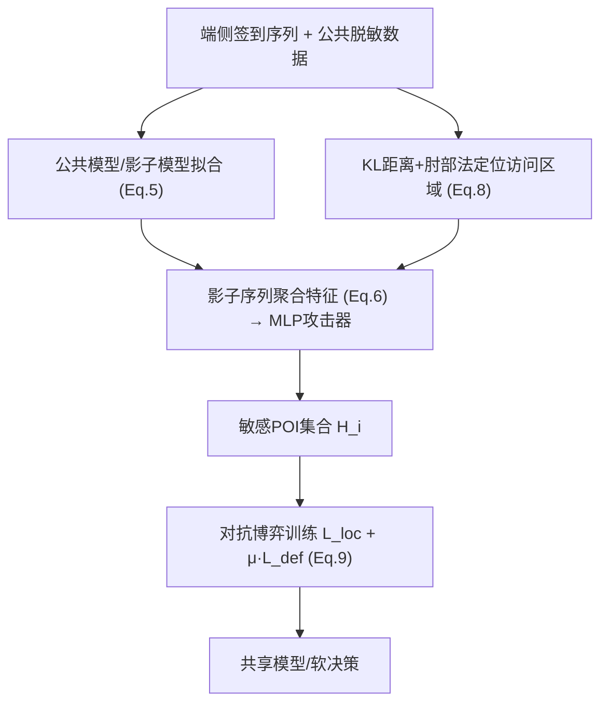
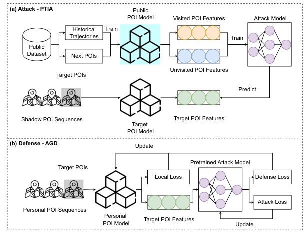

# Physical Trajectory Inference Attack and Defense in Decentralized POI Recommendation (去中心化POI推荐中的物理轨迹推断攻击与防御)

- **会议/期刊**: WWW 2024 (The Web Conference)
- **作者与机构**: Jing Long, Tong Chen, Hongzhi Yin 等 (The University of Queensland；Deep Neural Computing Company；UESTC；Griffith University)
- **推荐链路定位**: 端侧个性化训练 + 去中心化协同学习（知识共享出口，非排序环节）
- **研究方向**: 去偏公平、可信隐私与工业架构 / 时空轨迹与 POI 本地生活推荐
- **论文原文**: [https://arxiv.org/abs/2401.14583v1](https://arxiv.org/abs/2401.14583v1)
- **开源代码**: 暂未开源

## TL;DR (1分钟核心速览)

去中心化 POI 推荐的端侧模型仍需向同伴共享参数或参考集软决策，而现有推理攻击只针对电商物品参数、忽略"POI 信息同时存在于同序列相关 POI 中"，导致隐私威胁被低估。本文提出 PTIA：用影子模型统一适配两类协同学习框架，以影子序列聚合特征 + MLP 判别用户是否访问某 POI，并借 KL 散度定位访问区域加速攻击；进一步提出对抗博弈防御 AGD，把攻击者嵌入端侧训练循环以抹除敏感 POI 及其关联信息。在 Foursquare/Weeplace 上，PTIA 的攻击 F1 达 0.61/0.64（远超 IMIA 的 0.32），LDP 失效；AGD 将敏感 POI 的 F1 压至 0.14–0.16，HR@10 仅从 0.4297 降至 0.4083。

## Background & Motivation (背景与核心矛盾)

- **主流范式**: 为摆脱中心服务器成本与时延，POI 推荐转向去中心化协同学习：DCLR 在同组内端到端共享模型参数，MAC 只共享在公开参考集上的软决策，从而支持异构设备。
- **前人局限 (一)**: 现有推理攻击（IMIA 等）仅面向电商场景，只比较目标物品自身 embedding 在共享前后的偏移量，无法利用"同一条签到序列中相关 POI 的隐式泄露"。
- **前人局限 (二)**: 传统 LDP 对全部参数均匀加噪——低噪声挡不住攻击，高噪声（$\lambda=0.1$）虽降低攻击 F1 却让 HR@10 崩塌至 0.24，隐私-效用曲线不存在可用折中点。
- **核心洞察 (Key Insight)**: POI 是否被访问会同时体现在自身特征与序列上下文特征上；且所有端侧模型由同一分布初始化，被访问 POI 的参数必然偏离初始分布，可用于粗粒度"访问区域"定位。
- **本文切入点**: 先用影子模型把 KD 型框架"降维"成模型共享型，再做"区域级粗筛 + POI 级精判"的两段式攻击；防御侧则不再均匀扰动，而是只针对少量敏感 POI 做定向信息擦除。

## Method (核心方法设计)

### 1. 整体框架 (Overall Architecture)

攻击侧：攻击者先由公开脱敏数据集训练公共 POI 模型，据此预训练 MLP 攻击器；对 KD 型框架用参考集软决策拟合影子模型，对模型共享框架直接取目标模型 $\Theta_i$；随后用匿名序列构造影子序列，经$\Theta_i$得到聚合特征输入攻击器判别；为降低全库扫描开销，先用 KL 散度+肘部法圈定访问区域，只对区域内 POI 打分。防御侧：在端侧训练中并行维护攻击器$\mathcal{A}_i$，推荐器以$\mathcal{L}_{loc}+\mu\mathcal{L}_{def}$更新，攻击器以$\mathcal{L}_{ptia}$ 反向增强，形成博弈后再共享模型或软决策。

<figure class="paper-figure" markdown="span">
  <figcaption>图1：PTIA（部分a）与AGD（部分b）的概述。请注意，防御损失与攻击损失为相反数。</figcaption>
</figure>

### 2. 关键设计拆解 (Key Designs)

1. **跨框架统一的影子攻击器 (PTIA)**：MAC 只暴露软决策、攻击者拿不到模型，故先用参考集 $\mathcal{D}$ 上响应差异拟合影子模型，把两类框架归一到同一攻击接口；随后以多影子序列的模型输出均值作为判别输入，从而同时捕获目标 POI 显式特征与相关 POI 隐式特征：
$Input(u_i,p_m)=\frac{1}{V}\sum_{X\in\mathcal{S}(u_i,p_m)}\Theta_i(X)$
直觉：共同访问同一 POI 的两个用户兴趣相近，其轨迹互为互信息载体，多影子序列平均可降低单条序列噪声。

2. **基于初始化分布漂移的区域定位**：全库逐 POI 调用模型代价过高，于是按 k-means 把城市划为 5 个区域，用 $d_r=KL(e'_r\|e_r)$度量区域内 POI embedding 相对初始分布$e'_r$ 的偏移，降序排列后以肘部法截断，仅对入选区域执行细粒度判别。直觉：未被访问区域的参数几乎停留在初始化点，偏移量本身即弱监督信号。

3. **对抗博弈防御 (AGD)**：直接重置敏感 POI 的 embedding 既抹不干净相关 POI 中的残余信息、又会造成突变式精度损失；AGD 改为要求"敏感 POI 的被访问概率与无关 POI 不可区分"，
$\mathcal{L}_{def}=\frac{1}{G}\sum_{p\in H_i}\left|\mathcal{A}_i(p)-\frac{1}{O}\sum_{o=1}^{O}\mathcal{A}_i(p_o)\right|$仅当敏感 POI 参与训练时施加约束，$\mathcal{A}_i$ 被同步强化，故约束会沿序列上下文传播至相关 POI，实现"选择性遗忘"而非全局噪声化。

4. **训练目标与开销**：总损失 $\mathcal{L}=\mathcal{L}_{loc}+\mu\mathcal{L}_{def}$，$\mu=0.6$控制攻击者介入强度，$O=5$个无关 POI 作对照，攻击器随后用推荐器新产出样本以$\mathcal{L}_{ptia}$ 微调；端侧额外代价仅为一个小 MLP（64-32-8）的前向与若干次梯度更新，攻击可离线在区域内批量执行。

## Experimental Setup & Evaluation Protocol (实验设置与评估协议)

- **数据集与预处理**: 过滤交互数少于 10 的用户与 POI（10-core），数据覆盖纽约/洛杉矶/芝加哥。

| 数据集 | #Users | #POIs | #Interactions | 稀疏度/密度 | 特征/场景说明 |
| :--- | :---: | :---: | :---: | :---: | :--- |
| Foursquare | 7,507 | 80,962 | 1,214,631 | 均值 161.80 次/用户 | 436 个 POI 类别，含经纬度 |
| Weeplace | 4,560 | 44,194 | 923,600 | 均值 202.54 次/用户 | 625 个 POI 类别，含经纬度 |

- **数据划分与防穿越**: 采用 `Leave-One-Out`：每条序列最后一个 POI 作测试、倒数第二个作验证；额外随机抽取 15% 序列作攻击者先验知识，另 15% 作 MAC 的参考集（均要求覆盖全部 POI）；最大序列长度 200。
- **排名评测协议**: 采用 `Sampled Ranking (采样排序)`——每例真值与 200 个最近未访问 POI 组成候选集，指标为 HR@10；攻击侧采用分类 F1，若区域被误判则该区域 F1 计 0，防御侧只统计敏感 POI 的 F1。
- **对比基线与超参**: 攻击基线 Random / K-means / IMIA，防御基线 LDP / Embedding Reset；底座模型为 STAN，区域数 5，攻击器 3 层隐藏层 (64/32/8)，异构维度 $d\in\{8,16,32,64,128\}$各占 20%，学习率 0.002、dropout 0.2、batch 16、训练 50 epoch，$V=5$、$\mu=0.6$；结果为多次实验均值（未报告显著性检验）。

## Key Experimental Results (实验关键数据)

### 1. 主实验对比 (Main Results)

攻击 F1（越高越危险）：

| 框架 | 数据集 | Random | K-means | IMIA | PTIA | Improv. vs IMIA |
| :--- | :--- | :---: | :---: | :---: | :---: | :---: |
| DCLR | Foursquare | 0.0354 | 0.1695 | 0.3201 | **0.6103** | +90.7% |
| DCLR | Weeplace | 0.0751 | 0.1634 | 0.3172 | **0.6389** | +101.4% |
| MAC | Foursquare | — | 0.1741 | 0.2926 | **0.5321** | +81.8% |
| MAC | Weeplace | — | 0.1867 | 0.3185 | **0.5413** | +69.9% |

LDP 防御（F1 / HR@10）：

| 框架-数据集 | $\lambda=0$|$\lambda=0.001$|$\lambda=0.01$|$\lambda=0.1$ |
| :--- | :---: | :---: | :---: | :---: |
| DCLR-FSQ | 0.6103 / 0.4297 | 0.5988 / 0.3849 | 0.2768 / 0.2912 | 0.2001 / 0.2424 |
| DCLR-Wee | 0.6389 / 0.4664 | 0.6153 / 0.4478 | 0.4694 / 0.4237 | 0.3789 / 0.3557 |
| MAC-FSQ | 0.5321 / 0.4319 | 0.5059 / 0.4216 | 0.2976 / 0.4187 | 0.1914 / 0.3156 |
| MAC-Wee | 0.5413 / 0.4843 | 0.4791 / 0.4621 | 0.3242 / 0.4341 | 0.2813 / 0.3926 |

### 2. 消融实验 (Ablation Study)

两种防御在不同敏感 POI 数 $G$下的表现（DCLR / Foursquare，F1 / HR@10；$G=0$ 即无防御）：

| 防御方式 | $G=0$|$G=1$|$G=5$|$G=10$|$G=20$ |
| :--- | :---: | :---: | :---: | :---: | :---: |
| ER (Embedding Reset) | — / 0.4297 | 0.3213 / 0.4281 | 0.2938 / 0.3787 | 0.2427 / 0.3302 | 0.1849 / 0.3047 |
| AGD (本文) | — / 0.4297 | **0.1446** / **0.4327** | **0.1528** / 0.4185 | **0.1592** / **0.4083** | **0.1547** / **0.3523** |

（同为 AGD，MAC-Foursquare 在 $G=10$ 时为 0.1485 / 0.4189；Weeplace 上 DCLR 为 0.1623 / 0.4313，趋势一致。）

### 3. 关键实验发现 (Key Findings)

1. **"相关 POI"是攻击增益的主来源**：仅看目标 POI 参数变化的 IMIA 只能到 0.32，而引入序列上下文聚合的 PTIA 达 0.61（DCLR-Foursquare，+90.7%），说明隐私泄露在序列推荐中是"上下文级"而非"物品级"的，单点参数保护天然不足。
2. **LDP 存在不可用区**：$\lambda=0.001$时 F1 仅从 0.6103 降到 0.5988、但 HR@10 已从 0.4297 掉到 0.3849（$-10.4\%$）；要压制攻击到 0.20 以下必须$\lambda=0.1$，此时 HR@10 只剩 0.2424（$-43.6\%$），隐私与效用无法两全。
3. **AGD 的"选择性擦除"优于"突变重置"**：$G=10$时 ER 虽把 F1 压到 0.2427，但 HR@10 跌至 0.3302；AGD 反而把 F1 压得更低（0.1592，相对 ER 再降 34.4%）且 HR@10 保持 0.4083（相对无防御仅$-5.0\%$），证明对抗约束能穿透到相关 POI 而不破坏整体表征结构。

## Highlights & Limitations (亮点、对比与审稿批判)

- **与代表作对比 (vs. Prior Work)**: 相对 IMIA（电商物品级、只看目标物品参数差）与 Zhang 等的属性级推断，PTIA 首次把"序列内相关 POI 隐信息"和"区域级初始化漂移"纳入攻击面；相对 LDP 与 ER 两类防御，AGD 以定向博弈替代均匀加噪和确定性置位，是首个在 POI 协同学习出口处做定点隐私擦除的方案。
- **可迁移亮点**: ①"影子模型 + 参考集响应拟合"可把任何 KD 型联邦/去中心化框架统一成可攻击接口，适用于跨框架隐私审计；②用 KL 相对初始分布的偏移 + 肘部法做粗筛，可作为端侧隐私泄露的廉价预警信号，迁移到时序/会话推荐的成员推断。
- **审稿级局限批判**: ①推荐评测仅用 200 候选的采样排序，未做全库 Full-Ranking，且未报告显著性检验，结论的统计稳健性有限；②AGD 需在端侧额外训练并反复微调攻击器，每轮多一次前向与反向，端设备能耗/时延开销未量化，且 $\mu$、$V$、$G$三个超参需联合调（$\mu=0.6$ 为经验折中）；③敏感 POI 由全局访问频次随机抽取，与真实用户"想隐藏什么"的主观语义仍有偏差，隐私威胁模型中的攻击者能力（多影子序列可得性）假设偏强。

## Rating (四维评分)

- **方法创新性 (Novelty)**: ⭐⭐⭐⭐ （"上下文隐信息攻击 + 对抗定向擦除"的组合在 POI 隐私方向为首创，但单个组件均为成熟技术的重组）
- **评估协议与实验扎实度 (Protocol & Experiments)**: ⭐⭐⭐ （两类框架、两数据集、两防御基线覆盖完整，但仅采样排序、无全库排序与显著性检验，数据集也只有两个）
- **写作与数学规范度 (Clarity & Rigor)**: ⭐⭐⭐⭐ （攻击/防御两条线的公式与算法流程交代清楚，损失与超参含义明确，缺少复杂度与收敛性分析）
- **工业落地与复现价值 (Industrial & Practical Value)**: ⭐⭐⭐ （防御可直接插入端侧训练循环、对推荐精度伤害小，但未开源代码，且攻击器训练带来的端侧算力开销在真实 App 中需重新评估）

