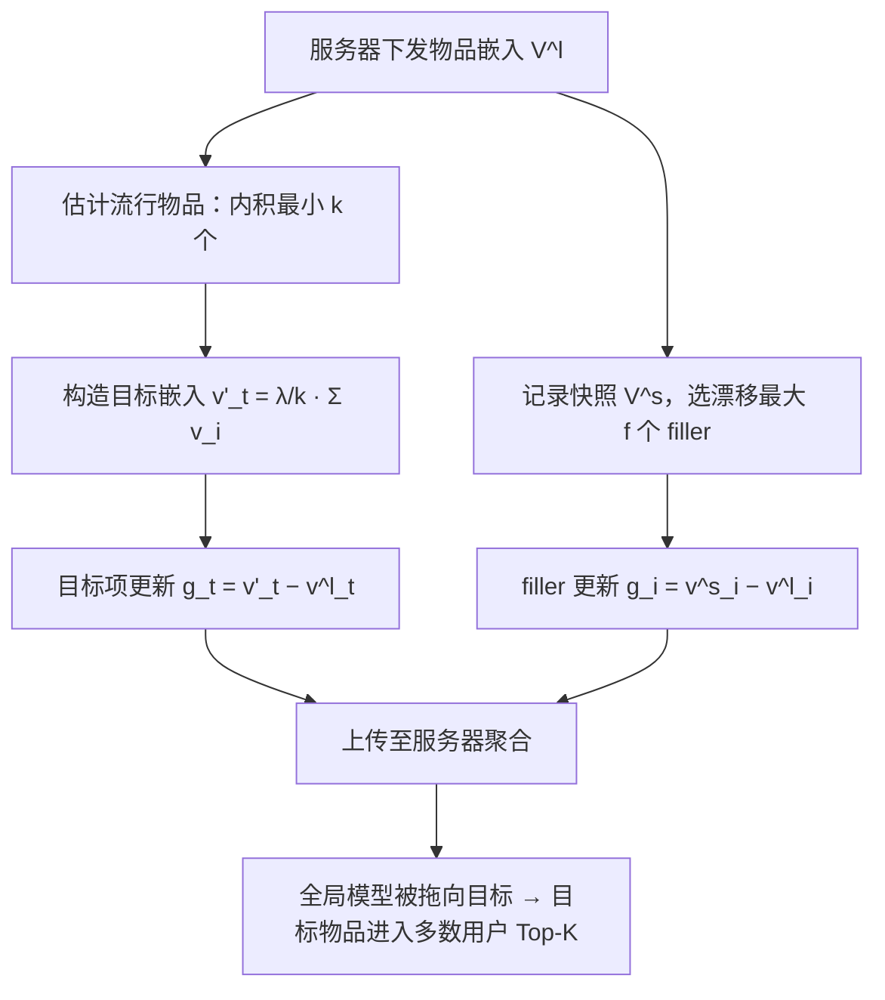
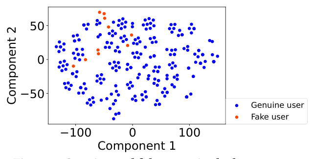

# Poisoning Federated Recommender Systems with Fake Users (假用户投毒联邦推荐系统)

- **会议/期刊**: WWW 2024 (The Web Conference, Singapore)
- **作者与机构**: Ming Yin, Yichang Xu (USTC)；Minghong Fang, Neil Zhenqiang Gong (Duke University)
- **推荐链路定位**: 召回（联邦矩阵分解的物品嵌入全局训练阶段，攻击面在 server↔user 上传的 item embedding 更新）
- **研究方向**: 去偏公平、可信隐私与工业架构 / 协同过滤与双塔召回
- **论文原文**: [https://arxiv.org/abs/2402.11637v1](https://arxiv.org/abs/2402.11637v1)
- **开源代码**: 暂未开源

## TL;DR (1分钟核心速览)

现有 FedRecs 投毒攻击几乎都要"额外知识"：真实用户交互数据（FedRecAttack）、全库物品流行度（PipAttack）或可模仿真实分布的合成数据（PSMU），而新注册的假用户根本拿不到这些信息。本文提出 PoisonFRS：假用户**完全不训练本地模型**，仅用服务器下发的物品嵌入反推 k 个流行物品、外推并放大出目标物品嵌入 $\boldsymbol{v}'_t$，每轮直接上传"把全局模型拽向目标"的更新向量，辅以锚定 filler 物品维持排序不被真实用户反超。在 Steam/Yelp/ML-10M/ML-20M 四个数据集、7 种聚合规则（含 Krum、HiCS）下，仅 0.03%–0.05% 假用户即可使目标物品 `HR@5` 达 0.70–1.00，而全部 8 个基线在 0.05% 规模下几乎全为 0。

## Background & Motivation (背景与核心矛盾)

- **主流范式**: FedRecs 每轮三步——服务器下发物品嵌入；用户用本地正负样本对 $\mathcal{R}=\{(p_i,n_i)\}$优化$L=-\sum_i \ln\sigma(\hat{y}_{p_i}-\hat{y}_{n_i})$并只上传物品嵌入增量$\boldsymbol{g}^l=-\eta\nabla_{\mathbf{V}}L$；服务器按某聚合规则 (FedAvg/Median/Trimmed-mean/Clip/Krum/HiCS) 聚合更新。
- **前人局限 1（信息不可得）**: 攻击效果与先验知识强耦合——FedRecAttack 需部分真实评分矩阵，PipAttack 需精确流行度分布，PSMU 需合成与真实分布一致的本地数据；而假用户是攻击时刻新注册的，没有任何历史。
- **前人局限 2（小规模失效）**: 一旦假用户比例压到 0.03%–0.05%，上述基线 HR@5 全部塌到 0，说明"依赖训练生成恶意梯度"的范式在稀疏真实数据（每用户平均交互极少）下梯度信号被真实用户淹没。
- **核心洞察 (Key Insight)**: 作者注意到**攻击其实不需要训练**——只要预先"算好"目标模型，每轮上传 $\boldsymbol{v}'_t-\boldsymbol{v}^l_t$就能把全局物品嵌入单调地拖过去；而"流行物品"可从物品嵌入几何中免费读出：大多数物品本身不受欢迎，故全体物品嵌入均值$\boldsymbol{v}_{avg}$近似"不受欢迎方向"，与之内积最小的$k$ 个物品即为流行物品。
- **本文切入点**: 用"几何外推 + 定向拖拽"替代"梯度训练"，把攻击的知识需求降为零（只要服务器下发的 $\mathbf{V}$）。

## Method (核心方法设计)

### 1. 整体框架 (Overall Architecture)

假用户在全局第 $s$轮（默认 50）才加入。加入瞬间做一次"侦察"：读取当轮全部物品嵌入$\mathbf{V}^s$，计算均值$\boldsymbol{v}_{avg}$并选出$k$个最流行候选，构造目标物品嵌入$\boldsymbol{v}'_t$；同时记录全部物品嵌入快照用于后续 filler 锚定。此后每一轮$l\ge s$，每个假用户只做两件事：对目标物品上传朝向$\boldsymbol{v}'_t$的差分更新，对$f$ 个"漂移最大"的 filler 物品上传"拉回快照"的反向更新；不上传用户嵌入、不做任何本地梯度计算、不产生任何交互数据。服务器无论用何种聚合规则，聚合结果都被这些固定方向的向量持续牵引。

### 2. 关键设计拆解 (Key Designs)

1. **零知识流行度估计与外推放大（Estimate-and-Amplify）**：痛点在于"无用户特征如何知道谁流行"。作者假设全体物品嵌入均值指向"不受欢迎方向"，故取内积最小者：$\mathcal{I}_{pop}=\arg\min_{|\mathcal{I}|=k}\sum_{i\in\mathcal{I}}\langle\boldsymbol{v}^s_i,\boldsymbol{v}_{avg}\rangle$。为使目标物品的预测分不仅"接近"流行物品而且"超过"它们，用最小化到$k$个流行嵌入的均方距离（解为均值）再乘放大因子$\lambda>1$：
$$\boldsymbol{v}'_t=\frac{\lambda}{k}\sum_{i\in\mathcal{I}_{pop}}\boldsymbol{v}^s_i,\quad \lambda>1$$
由于打分是内积，缩放嵌入等价于缩放打分，故 $\lambda$ 直接在排序层面"抬分"，无需知道真实用户喜好。
2. **免训练定向拖拽更新（No-Training Steering）**：现有攻击必须先"训练"才能得到梯度，而训练必然耦合用户嵌入与本地数据。PoisonFRS 直接构造差分：
$$\boldsymbol{g}^l_t=\boldsymbol{v}'_t-\boldsymbol{v}^l_t$$
每轮把目标物品嵌入朝固定靶点推进；即使聚合规则做了截断/中位数，方向一致性也使多次迭代累积生效——这正是它能穿透 Krum、Clip、HiCS 的物理直觉。
3. **Filler 锚定与隐蔽性（Filler Anchoring）**：若只攻击单品，真实用户会持续抬高自己的正样本使目标物品排名回落。故每轮选与快照偏差最大的 $f$个物品（排除目标项），上传$\boldsymbol{g}^l_i=\boldsymbol{v}^s_i-\boldsymbol{v}^l_i$把其嵌入"钉"在初始位置，冻结竞争格局。实验显示 300 轮内单假用户累计只触碰 83 个不同物品，落在真实用户更新物品数区间（28–2046，$\mu=76,\sigma=95$）之内，难以按"交互广度"识别。
- **训练目标、负采样与推理开销**: 攻击侧**无损失函数、无负采样、无本地数据**；每轮 CPU 开销仅为一次 $m$维内积扫描与$f$ 个向量减法，远低于 PSMU 每轮重训用户嵌入的成本。

## Experimental Setup & Evaluation Protocol (实验设置与评估协议)

- **数据集与预处理**: 四个跨域真实数据集，隐式反馈；统计如下（未做 5-core 过滤，保留原始稀疏性）：

| 数据集 | #Users | #Items | #Interactions | 稀疏度/密度 | 特征/场景说明 |
| :--- | :---: | :---: | :---: | :---: | :--- |
| Steam | 3,753 | 5,134 | 114,713 | 密度 0.60% | 游戏平台交互，最小规模 |
| Yelp | 14,575 | 25,602 | 569,947 | 密度 0.15% | 本地商户点评，极稀疏 |
| ML-10M | 69,878 | 10,673 | 10,000,054 | 密度 1.34% | 电影评分，物品数少而稠密 |
| ML-20M | 138,493 | 26,740 | 20,000,263 | 密度 0.54% | 大规模电影评分 |

- **数据划分与防穿越 (Splitting Strategy)**: `Leave-One-Out`——每个用户最后一条交互作为测试集，其余为训练；无时间戳全局切分。
- **排名评测协议 (Ranking Protocol)**: 无偏 `Full-Ranking`（在用户**未交互**物品全库上取 Top-$K$），主指标 `HR@5`，辅以 `HR@10`、`HR@50`、`NDCG`；攻击目标定义为**全库最不流行物品**（最坏情形，最能体现攻击增益）。
- **对比基线与超参设置**: 8 个基线 = 集中式攻击 5 个（Random / Popular / Bandwagon / RAPU-G / RAPU-R）+ FedRecs 专用 3 个（FedRecAttack / PipAttack / PSMU）；聚合规则 7 种（FedAvg、Median、Trimmed-mean、Clip($\beta$=3)、Krum、HiCS 等）。$d$未单独调参，$\lambda=10$、$k=5$、$s=50$、$f=59$、学习率 0.05、全局 300 轮、假用户比例 0.03%–0.5%（附录扩至 1%/3%/10%）。

## Key Experimental Results (实验关键数据)

### 1. 主实验对比 (Main Results)

假用户比例统一取 **0.05%**，`HR@5`（全库排序），加粗为最优：

| Dataset | None | Popular | FedRecAttack | PipAttack | PSMU | PoisonFRS (FedAvg) | PoisonFRS (Median) |
| :--- | :---: | :---: | :---: | :---: | :---: | :---: | :---: |
| Steam | 0.00 | 0.00 | 0.00 | 0.00 | 0.00 | **0.99** | **0.98** |
| Yelp | 0.00 | 0.00 | 0.20 | 0.00 | 0.00 | **0.73** | **0.70** |
| ML-10M | 0.00 | 0.00 | 0.00 | 0.00 | 0.00 | **1.00** | **0.99** |
| ML-20M | 0.00 | 0.00 | 0.00 | 0.00 | 0.00 | **0.99** | **0.99** |
| Improv. (Yelp, vs 最强基线) | — | — | 0.20 | 0.00 | 0.00 | **+0.53 (265%)** | +0.44 (169%) |

Random、RAPU-G、RAPU-R 在全部数据集/聚合规则下均 ≈0.00；提升假用户比例至 0.5% 后 FedRecAttack 才回升到 Steam 0.89 / Yelp 0.32、PipAttack 到 Yelp 0.12，仍显著低于 PoisonFRS 的 0.77–0.99。

### 2. 消融实验 (Ablation Study)

Yelp + FedAvg + 0.05% 假用户（$f$、$\lambda$、$k$ 均单变量变化，图 3 读数）：

| 配置 | 关键设定 | HR@5 | 说明 |
| :--- | :--- | :---: | :--- |
| 默认 PoisonFRS | $\lambda$=10,$k$=5,$s$=50,$f$=59 | **0.73** | 完整模型 |
| w/o 放大 ($\lambda$=1) | 仅取流行物品均值 | ≈0.20 | 打分不突出，目标项挤不进 Top-5 |
| $k$=1 | 单物品外推 | ≈0.58 | 单物品特征覆盖不全用户偏好 |
| $k$=5 →$k$=200 | 过度平均 | 单调下降 | 混入不受欢迎特征、向量抵消 |
| $f$=0 | 不锚定 filler | ≈0.70 且易被识破 | 真实用户抬分导致排名回落 |
| $s$=0（首轮即攻击） | 信息不足 | 显著劣于$s$=50 | 流行估计不准 |
| 加高斯噪声 $\mathcal{N}(0,\mathbf{I})$ | 0.03/0.05/0.1/0.5% | 0.72/0.73/0.76/0.79 | 与无噪声几乎同值 |

### 3. 关键实验发现 (Key Findings)

1. **信息量≈攻击力，但可被"几何外推"替代**：基线中 FedRecAttack（掌握部分真实评分）> PipAttack（掌握流行度）> PSMU（仅合成数据），恰与其先验知识量排序一致；而零知识的 PoisonFRS 在 Yelp 上把 0.05% 规模的 HR@5 从 0.20 拉到 0.73（+265%），说明流行度信息可从 $\boldsymbol{v}_{avg}$ 的正交反向免费重构。
2. **定向更新天然穿透拜占庭防御**：在 Median、Trimmed-mean、Clip、Krum、HiCS 下 HR@5 仍保持 0.70–0.99（Steam 0.98–0.99、Yelp 0.70–0.79），因为每轮方向一致、幅值温和（被 Clip 缩放后仍同向），而聚合器只能削弱单轮幅度、无法改变累积方向。
3. **攻击在潜空间不可分辨**：$t$-SNE 上真实用户与假用户对目标物品的更新完全交叠；且假用户累计只更新 83 个物品，落在真实用户 28–2046（$\mu$=76）区间内，配合高斯噪声后效果几乎无损（0.73→0.73），同时说明"更新幅度过滤"类防御对该攻击近乎无效。

<figure class="paper-figure" markdown="span">
  <figcaption>图4：潜在空间中的真实用户与虚假用户。</figcaption>
</figure>

## Highlights & Limitations (亮点、对比与审稿批判)

- **与代表作对比 (vs. Prior Work)**: 与 FedRecAttack（需真实评分矩阵、靠优化流行度损失生成梯度）相比，本文把"训练生成梯度"换成"闭式构造差分"，知识需求从部分交互降为零；与 PipAttack（需全库流行度）相比，用 $\langle\boldsymbol{v}_i,\boldsymbol{v}_{avg}\rangle$的符号替代流行度估计器，且额外做了$\lambda$ 放大以突破"仅追平流行物品"的天花板；与 PSMU（需合成同分布本地数据、每轮重训用户嵌入）相比，完全取消用户嵌入训练，速度与稀疏数据鲁棒性均更优。
- **可迁移亮点**: ①"全体嵌入均值 ≈ 负向先验"的几何技巧，可用于无监督热门探测、冷启动物品热度先验估计；②filler 锚定（把竞争物品嵌入钉在快照）是维持目标排序的通用手段，也可反向用于设计"排序稳定性正则"。
- **审稿级局限批判**: ①威胁模型偏理想——假设服务器无条件接纳新用户、且假用户可在第 $s$轮随时加入，未考虑注册成本、KYC 或基于更新相似度（多假用户同轮上传同向量）的检测；②防御评估仅限聚合规则与$t$-SNE 可视化，缺少聚类/相似度/梯度范数等主动检测器的定量对比；③攻击目标固定为"最不流行单品"、且仅报 HR/NDCG，未评估对整体推荐质量（如全局 NDCG 下降、非目标物品 Exposure 偏移）的副作用，也未讨论多目标同时提升时的相互干扰。

## Rating (四维评分)

- **方法创新性 (Novelty)**: ⭐⭐⭐⭐ （把投毒从"训练恶意梯度"重构为"闭式目标模型 + 定向拖拽"，并以物品嵌入均值几何免费估计流行度，思路简洁且反直觉）
- **评估协议与实验扎实度 (Protocol & Experiments)**: ⭐⭐⭐⭐ （4 个真实数据集、8 个基线、7 种聚合规则、全库排序与多指标/多攻击规模，消融覆盖 $\lambda,k,s,f$ 与噪声鲁棒性；扣分在缺少主动检测器对比）
- **写作与数学规范度 (Clarity & Rigor)**: ⭐⭐⭐⭐ （威胁模型、算法伪码与公式推导清晰，$\lambda$饱和性有实验支撑；Algorithm 3 中$\boldsymbol{g}^l_t$ 的符号前后不一致，filler 更新方向表述略含混）
- **工业落地与复现价值 (Industrial & Practical Value)**: ⭐⭐⭐⭐ （攻击开销极低、可在单机模拟多假用户，对 Amazon Personalize 类联邦推荐服务是直接可用的红队测试工具；但无开源代码，且实际平台注册风控会削弱可行性）

