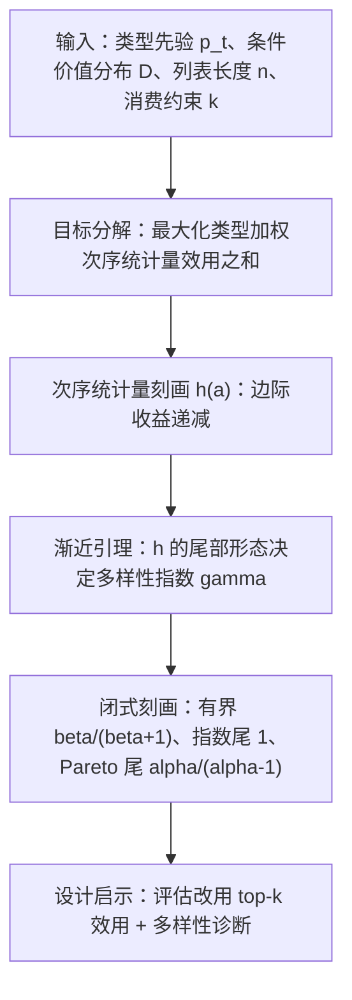
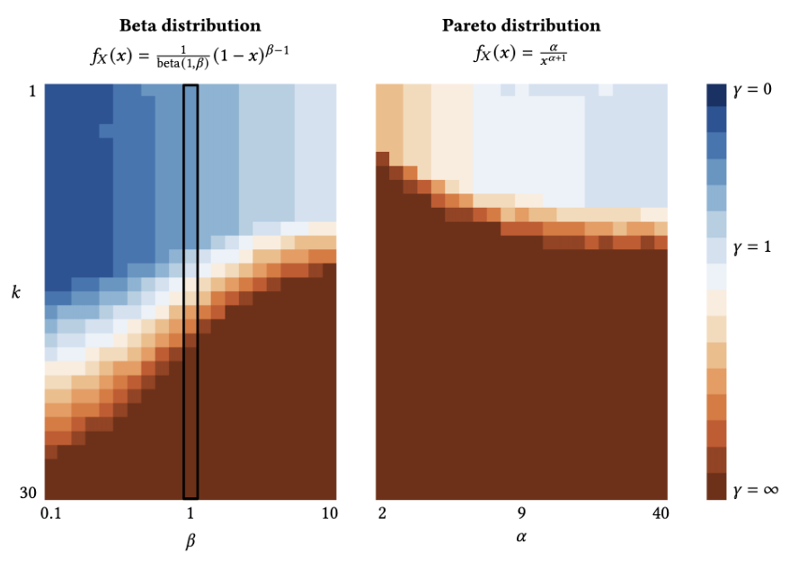

# Reconciling the accuracy-diversity trade-off in recommendations (调和推荐系统中的准确率-多样性权衡)

- **会议/期刊**: WWW 2024（arXiv 2023-07）
- **作者与机构**: Kenny Peng、Emma Pierson、Nikhil Garg（Cornell Tech），Manish Raghavan（MIT），Jon Kleinberg（Cornell）
- **推荐链路定位**: 重排 / 列表构建阶段的**目标函数与离线评估指标设计**（非模型架构）
- **研究方向**: 去偏公平与可信推荐 / 列表级重排
- **论文原文**: [https://arxiv.org/abs/2307.15142v1](https://arxiv.org/abs/2307.15142v1)
- **开源代码**: 暂未开源

## TL;DR (1分钟核心速览)

本文指出准确率-多样性权衡的根源在于常规准确率指标忽略了**用户消费约束**。作者构建极简模型：用户在 $n$条推荐中只消费价值最高的$k$条。证明计入该约束时最优解因边际收益递减而自然多样，按期望总效用（$k=n$）优化则完全同质。以$\gamma$-同质性统一刻画多样性，证明$n\to\infty$时其指数完全由条件价值分布尾部决定：有界$\beta/(\beta+1)$、指数尾$1$、Pareto 尾$\alpha/(\alpha-1)$。无真实数据集，以解析定理加$n=30$ 的数值模拟验证。

## Background & Motivation (背景与核心矛盾)

- **主流范式**: 工业界把准确率（CTR/NDCG/期望效用之和）与多样性（校准、MMR、覆盖度、DPP）视为两个目标，在重排阶段用加权融合、固定配额或约束优化显式注入多样性。
- **前人局限**: 其一，缺乏"为何存在权衡"的第一性解释，多样性只能凭启发式注入，无法说明其代价与最优量；其二，常规准确率指标把列表当作独立条目之**和**（等价 $k=n$），与"用户只翻前几条、只消费其中一两个"的真实行为不符。
- **核心洞察 (Key Insight)**: 一旦目标换成 top-$k$期望效用，$\max$ 算子使同类型物品的边际收益递减——第 5 部爱情片对"今晚只看一部"的用户几乎无用，于是最优解自动分散到其他类型。多样性是**目标函数的副产品**，不是外加偏好。
- **本文切入点**: 构造可完全解析的最小模型（单一偏好类型 + 已知价值分布 + 消费约束 $k$），渐近求出最优列表的类型表示，从而把"权衡"归因为**评估指标缺陷**而非用户偏好冲突。

## Method (核心方法设计)

### 1. 整体框架 (Overall Architecture)

模型三要素：类型先验 $p_t$（用户偏好类型$t$的概率）、条件价值分布$D$（偏好该类型时单件物品价值$X^{(t)}_i\sim D$，否则为 0）、消费约束$k$。系统只知分布不知实现值，需选$n$件物品使**前$k$件最高价值之和的期望**最大。由于条件独立，目标可分解为$\max_{\sum_t a_t=n}\sum_{t=1}^{m}p_t h(a_t)$，其中$h(a)$由次序统计量刻画。作者用$\gamma$-同质性度量解的类型结构，再用一条渐近引理把$h$的尾部形态映射为闭式的$\gamma$，得到"分布尾部$\to$ 多样性档位"的完整相图。

### 2. 关键设计拆解 (Key Designs)

1. **消费约束目标与边际收益递减**：若 $k=n$，由期望线性性目标退化为线性，最优解只堆最高$p_t$的类型（同质）；把$k$ 固定则
$h(a)=\sum_{i=1}^{\min\{k,a\}}\mu_D(a-i+1,a)$，
其中 $\mu_D(j,a)$是$a$个$D$样本第$j$大次序统计量的期望。$k$固定时$h$是凹函数（对数型或幂律型），凹目标在单纯形上的最优解按$p_t$加权"水位均衡"，故类型必然混合。物理直觉：多推荐一件同类型物品只在"它恰好刷新前$k$高"时才有增益，概率随$a$ 递减。

2. **$\gamma$-同质性与尾部相图**：定义类型表示$r_t(S)=|S_t|/|S|$，称序列$\{S_n\}$为$\gamma$-同质若
$r_t(S_n)\to p_t^{\gamma}\big/\sum_{i=1}^{m}p_i^{\gamma}$。
$\gamma=0$为均等表示、$\gamma=1$为比例表示（即 Steck 的 calibrated recommendation）、$\gamma=\infty$为完全同质。技术枢纽是引理：若$A-h(a)\sim B a^{\sigma}$（$\sigma<0$），则最优解满足$r_t\propto p_t^{1/(1-\sigma)}$。据此，有界 pdf 尾部$f_D(x)\sim c(M-x)^{\beta-1}$给$\sigma=-1/\beta$，得$\gamma=\beta/(\beta+1)$；指数尾给$h\sim B\log a$，得$\gamma=1$；Pareto$(\alpha)$给$h\sim B a^{1/\alpha}$，得$\gamma=\alpha/(\alpha-1)$。直觉：重尾意味着"再抽一个同类型样本仍可能刷新纪录"，边际收益不衰减，故更集中；有界分布一旦逼近上界$M$，追加样本几乎无增益，故更分散。

3. **跨类型成功率不均的悖论（Theorem 3）**：当类型内成功率恒为 $q_t$ 时，
$r_t(S_{n,1})\propto 1\big/\log\frac{1}{1-q_t}$，
且**与流行度 $p_t$无关**。$q_t$ 越小的类型反而被推荐越多——对应超市给冰淇淋的货架远多于牛奶：想买牛奶的人多但口味宽容，少量 SKU 即可满足；冰淇淋需求小却口味挑剔，需更多品类覆盖。

> 注：本文无训练目标、负采样与在线推理；其"推理开销"是解析闭式，可迁移的工程产物是**评估目标替换**——把离线指标由 $\sum_i \hat{y}_i$换成 top-$k$期望效用，并以$\gamma$-同质性诊断列表结构。

## Experimental Setup & Evaluation Protocol (实验设置与评估协议)

- **数据集与预处理**: 本文为理论工作，**不使用任何真实推荐数据集**，无 `5-core` 过滤与特征工程。验证由两部分构成：① 渐近解析（Thm 1–3、Cor 1、Prop 2、Prop 4）；② 数值模拟，参数设置如下表（$m=2$，$p=(0.7,0.3)$，$n=30$）：

| 模拟设定 | 类型数 $m$| 列表长度$n$| 先验$p$| 消费约束$k$| 分布$D$ | 估计方式 |
| :--- | :---: | :---: | :---: | :---: | :--- | :--- |
| 有限 $n$多样性估计 | 2 | 30 | (0.7, 0.3) | 全范围$1\le k\le 30$| Beta$(\cdot,\beta)$、Pareto$(\alpha)$| 每个次序统计量$10^6$ 次蒙特卡洛采样 |
| $n$增长曲线 | 2 | 0–50 | (0.6,0.4)…(0.9,0.1) |$k=1$| Ber$(0.4)$| 枚举$a_1+a_2=n$ 取最优 |

- **数据划分与防穿越 (Splitting Strategy)**: 不适用（无学习过程、无历史交互，不存在穿越风险）；模拟中采样仅用于估计次序统计量期望，与优化目标共享同一已知分布。
- **排名评测协议 (Ranking Protocol)**: 不适用 Full-Ranking / Sampled Ranking。评估量为**最优解的类型表示 $r_t$** 与$\gamma$指数，属确定性全枚举（对$a_1+a_2=n$ 的全部组合求精确最优），无负采样、无显著性检验（结果由定理保证而非统计推断）。
- **对比基线与超参设置**: 对比轴为"有消费约束 $S_{n,k}$vs 无消费约束$S_{n,n}$"，并以 Steck 的 calibrated recommendation（$\gamma=1$）作为参照标准；无 embedding 维度、无学习率等超参。

## Key Experimental Results (实验关键数据)

### 1. 主结果对比 (Main Results)

下表整合 Thm 1–3 的渐近结论（$n\to\infty$，$k$固定）。`Improv.` 一栏表示相对无约束基线$S_{n,n}$的多样性档位变化（$\gamma$ 越小越多样）：

| 条件价值分布 $D$| 尾部行为 |$S_{n,k}$（有消费约束）的$\gamma$|$S_{n,n}$（无约束基线）的$\gamma$ | 相对基线的多样性档位 Improv. |
| :--- | :--- | :---: | :---: | :--- |
| 有限离散分布 | 有限支撑 | 0（均等表示） | $\infty$| 由完全同质$\to$ 完全均等 |
| Beta$(\cdot,\beta)$型有界 pdf | 上界$M$，指数$\beta$|$\beta/(\beta+1)\in(0,1)$|$\infty$ | 介于均等与比例之间 |
| Exp$(\lambda)$| 指数尾 |$1$（比例表示） |$\infty$ | **恰好复原 Steck 校准标准** |
| Pareto$(\alpha),\ \alpha>1$| 重尾 |$\alpha/(\alpha-1)>1$|$\infty$ | 低于比例，重尾削弱多样性 |
| Ber$(q_i),\ q_i\propto i^{-\alpha},\ \alpha<1$| 缓衰减 |$0$|$1/\alpha>1$ | 均等 vs 低于比例 |
| Ber$(q_i),\ \alpha=1$| 临界 |$1/(1+c)$|$1$ | 比例 vs 比例 |
| Ber$(q_i),\ \alpha>1$| 快衰减 |$1/\alpha<1$|$1/\alpha$ | 二者一致，均优于比例 |
| Ber$(q_t)$跨类型不均 | — |$r_t\propto 1/\log\frac{1}{1-q_t}$|$\infty$（仅含$\arg\max_t p_tq_t$） | 低成功率类型被**过度**表示 |

### 2. 消融实验 (Ablation Study)

以"移除消费约束 / 改变约束强度 / 改变尾部"作为消融轴，数值模拟（$n=30$，$m=2$，$p=(0.7,0.3)$，$10^6$ 采样）结果：

| 消融设置 | 数值估计的最优 $\gamma$ | 对应理论值 | 结论 |
| :--- | :---: | :---: | :--- |
| $D=U[0,1]$，$k\le 0.4n$|$\approx 0.50$|$1/2$（Prop 2 精确界） | 与理论吻合，且对$k$ 不敏感 |
| $D=U[0,1]$，$k\to n$|$\to\infty$|$\infty$ | 移除消费约束即退化为同质 |
| $D=$Beta$(0.5,\cdot)$（尖峰） |$\approx 0.33$|$1/3$ | 更尖的有界分布更均等 |
| $D=$Beta$(3,\cdot)$（近平顶） |$\approx 0.75$|$3/4$ | 近平顶更接近比例 |
| $D=$Pareto$(2)$|$\approx 2.0$|$2$ | 重尾显著削弱多样性 |
| $D=$Pareto$(3)$|$\approx 1.5$|$1.5$| 尾部越重（$\alpha$ 越小）越同质 |

### 3. 关键实验发现 (Key Findings)

1. **消费约束是多样性的充分条件，不需任何显式多样性偏好**：在 $D=U[0,1]$、$p=(0.7,0.3)$下，Prop 2 给出误差界$|r_t(S_{n,k})-\sqrt{p_t}/\sum_i\sqrt{p_i}|\le (m+1)/n$，且只要$k\le(\sqrt{p_{\min}}/\sum_i\sqrt{p_i})n-m-1$（约$0.4n$）即成立；即$k$ 在常数比例内变动几乎不改变最优多样性，鲁棒性极强。
2. **多样性档位由尾部唯一决定，且存在 $\gamma=1$的临界点**：Exp 尾使边际收益恰为$h\propto\log a$，此时比例表示是严格最优——这解释了为何 Steck 的校准标准"看起来像先验"，实则等价于假设"价值服从指数尾"；换成 Beta$(\beta)$偏离比例，换成 Pareto$(\alpha)$则$\gamma=\alpha/(\alpha-1)\to\infty$（$\alpha\to1^+$）迅速坍缩为同质。
3. **无约束目标在所有设定下都只保留单一类型**（$S_{n,n}$的$\gamma=\infty$）；更反直觉的是 Thm 3 中低成功率类型被过度表示，且表示比例$1/\log\frac{1}{1-q_t}$与流行度$p_t$ 完全解耦——说明"按先验比例校准"并非普适最优，仅在特定分布假设下成立。

<figure class="paper-figure" markdown="span">
  <figcaption>图3：在一系列 β 分布和 Pareto 分布下，对最优集合多样性的计算估计。此处，深蓝色对应均等代表性（γ = 0），灰色对应比例代表性（γ = 1），棕色对应同质（γ = ∞）。可观察到，更紧的消费约束（更小的 k）对应更高的多样性。特别注意，当 β = 1（对应均匀分布）时，最优解为 1</figcaption>
</figure>

## Highlights & Limitations (亮点、对比与审稿批判)

- **与代表作对比 (vs. Prior Work)**: 与 Steck（RecSys'18）的 calibrated recommendation 相比，本文将"70% 爱情 + 30% 动作"这一**规范性标准**降格为特定分布下的**内生最优解**，交付了校准成立的条件（指数尾/对数边际收益）与失效方向。与 Agrawal 等（WSDM'09）的搜索结果多样化、Parapar & Radlinski（RecSys'21）的统一指标相比，这些工作把多样性写入目标函数，本文则指出多样性是 max 算子的**副产品**。与 assortment optimization 文献（Gök & Fisher 等）相比，该线默认"贪心不足"并设计近似算法，本文反过来回答"朴素解何时足够、最优解何时反而不多样"。
- **可迁移亮点**: ① $\gamma$-同质性是单参数可解释的多样性诊断量，可直接用于离线报表（报告推荐列表的$\gamma$而非仅覆盖率）；② 将离线评估从"期望效用之和"改为"top-$k$ 期望效用"，是一个零成本的指标改造，可立即在已有排序日志上重算。
- **审稿级局限批判**: ① 绝大多数结果为 $n\to\infty$渐近，有限$n$仅有均匀分布的 Prop 2 与$n=30$的数值算例，而真实列表长度$n\approx10\text{–}50$、尾部多为未知形态，渐近结论的可用性存疑；② 模型极简（用户只偏好单一类型、物品只属单一类型、无显式多样性偏好、无曝光/位置偏置与交互学习），多类型偏好与 embedding 版本仅在附录给出特例；③ 无真实数据集与线上 A/B，无法量化"改用 top-$k$ 效用后"CTR/留存的实际损益。

## Rating (四维评分)

- **方法创新性 (Novelty)**: ⭐⭐⭐⭐ （以"消费约束"这一被忽视的算子重解释权衡，$\gamma$-同质性与尾部相图优雅自洽，但模型抽象度高于技术深度）
- **评估协议与实验扎实度 (Protocol & Experiments)**: ⭐⭐⭐ （纯解析推导完整且有数值模拟佐证，但无真实数据、无划分/采样协议讨论、无显著性检验，实验部分仅作验证）
- **写作与数学规范度 (Clarity & Rigor)**: ⭐⭐⭐⭐⭐ （引理-定理-推论层次清晰，次序统计量到 $\gamma$ 的映射推导严谨，例子与悖论交代充分）
- **工业落地与复现价值 (Industrial & Practical Value)**: ⭐⭐⭐ （"评估指标改造 + 多样性诊断"可直接迁移，但结论依赖分布假设且无开源代码，难以直接部署）

