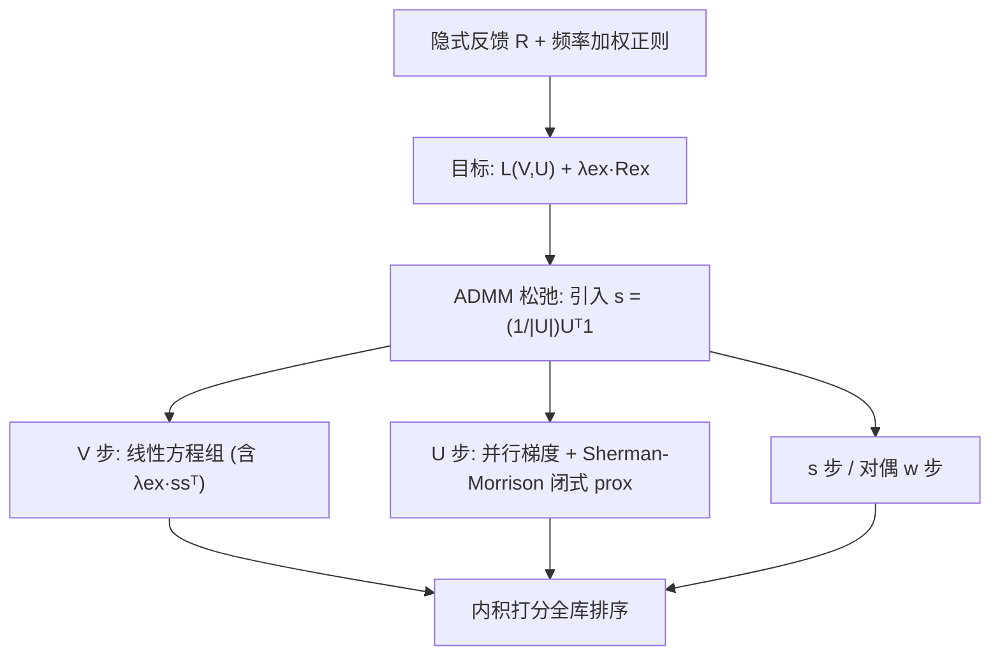
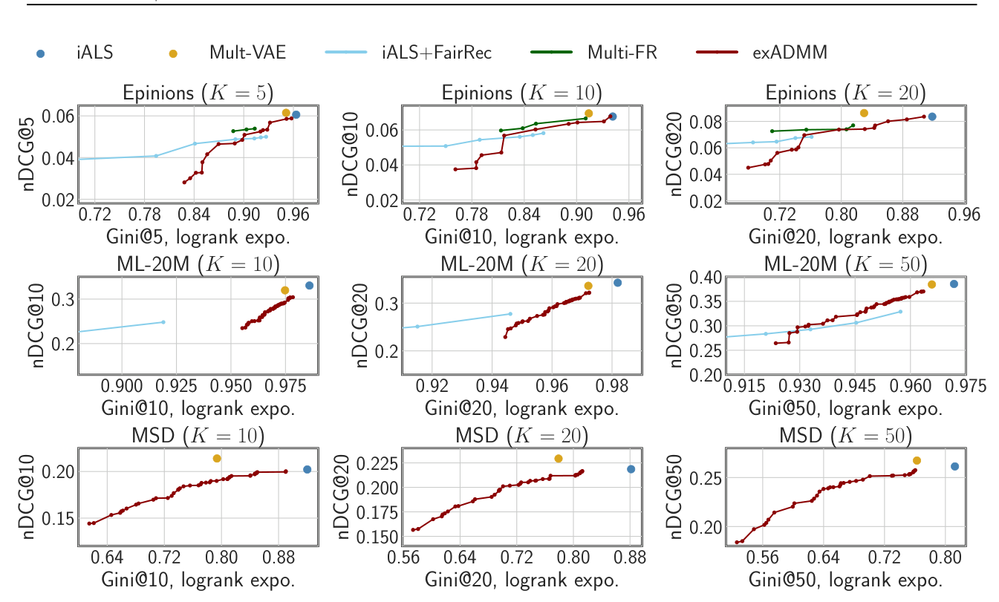
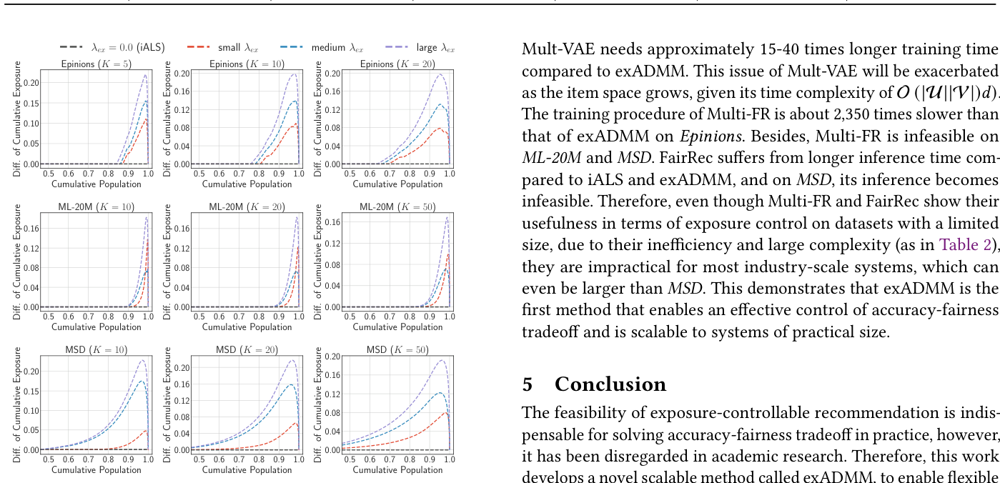

# Scalable and Provably Fair Exposure Control for Large-Scale Recommender Systems (面向大规模推荐系统的可扩展且可证明公平的曝光控制)

- **会议/期刊**: WWW 2024 (The Web Conference, Singapore)
- **作者与机构**: Riku Togashi, Kenshi Abe (CyberAgent), Yuta Saito (Cornell University)
- **推荐链路定位**: 召回 / 表征学习（矩阵分解训练目标层）
- **研究方向**: 去偏公平、可信隐私与工业架构 / 协同过滤与双塔召回
- **论文原文**: [https://arxiv.org/abs/2402.14369v1](https://arxiv.org/abs/2402.14369v1)
- **开源代码**: [https://github.com/riktor/exADMM-recommender](https://github.com/riktor/exADMM-recommender)

## TL;DR (1分钟核心速览)

现有公平感知推荐（Multi-FR、FairRec、PL 模型 SGD）的时间/空间复杂度均含 $|\mathcal{U}||\mathcal{V}|$项，只能在小数据上跑，工业级百万物品场景无法做曝光调控。本文在可扩展的 iALS 目标上加入"物品平均打分二阶矩"曝光正则$R_{ex}$，用 ADMM 引入辅助变量$\mathbf{s}$把被正则破坏的用户/物品可分性重新解耦，配合近端梯度与 Sherman-Morrison 闭式解，总代价$O(\mathrm{nz}(\mathbf{R})d^2+|\mathcal{V}|d^3)$ 甚至低于 iALS，并给出三块非凸优化的收敛性证明。在 ML-20M（13.6 万用户/1 千万交互）与 MSD（57 万用户/3360 万交互）上首次实现可调曝光控制，训练时间仅为 Mult-VAE 的 1/15–1/40、Multi-FR 的 1/2350。

## Background & Motivation (背景与核心矛盾)

- **主流范式**: 两条路线——后处理重排（FairRec 轮转、xQuAD 类改写）与 in-processing 正则化（Multi-FR、Plackett–Luce 随机排序策略），目标是在 nDCG 与 Gini@K 之间取 Pareto 权衡。
- **前人局限**: (1) 后处理必须在内存中物化 $|\mathcal{U}|\times|\mathcal{V}|$稠密偏好矩阵，无法利用反馈稀疏性；(2) 基于 Frank–Wolfe 的 in-processing 每轮每用户都要做 top-$K$全排序，$O(|\mathcal{U}||\mathcal{V}|\log K)$ 级开销，且 SGD 在物品库巨大时收敛极慢。
- **核心洞察 (Key Insight)**: iALS 之所以可扩展，靠的是"目标按行可分 + Gramian 技巧 + 稀疏性"三件套；而公平正则天然把全体用户耦合在一起（平均用户向量 $\frac{1}{|\mathcal{U}|}\mathbf{U}^{\top}\mathbf{1}$），一旦加入就摧毁可分性——这正是公平推荐难以工业化的根因，而非精度问题。
- **本文切入点**: 不改 iALS 的稀疏计算骨架，只在优化层面用 ADMM 把耦合项"局部化"到 $d$维辅助变量$\mathbf{s}$ 上，使可分性以近似方式恢复，同时保持收敛保证。

## Method (核心方法设计)

### 1. 整体框架 (Overall Architecture)

模型仍是 MF 双塔：用户/物品 $d$维隐向量$\mathbf{U},\mathbf{V}$，预测分$\hat{r}_{ij}=(\mathbf{U}\mathbf{V}^{\top})_{ij}$。输入隐式反馈矩阵$\mathbf{R}$后，在 iALS 损失$\mathcal{L}(\mathbf{V},\mathbf{U})$（含隐式正则$\alpha_0\|\mathbf{U}\mathbf{V}^{\top}\|_F^2$与频率加权 Tikhonov 项$\boldsymbol{\Lambda}_U,\boldsymbol{\Lambda}_V$）上叠加曝光正则$\lambda_{ex}R_{ex}$；训练时按$\mathbf{V}\to\mathbf{U}\to\mathbf{s}\to\mathbf{w}$四步交替，$\mathbf{V}$与$\mathbf{s}$走二阶（线性方程组）加速、$\mathbf{U}$走"并行梯度下降 + 非并行近端映射"，双变量$\mathbf{w}$ 做对偶上升。推理即内积全库排序，无额外开销。

### 2. 关键设计拆解 (Key Designs)

1. **结构化曝光正则 $R_{ex}$（把 Gini 型不平等变成可导矩）**：Gini 不可微且需要排序，本文改用"物品跨用户平均得分的二阶矩"：
$$R_{ex}(\mathbf{V},\mathbf{U})=\frac{1}{|\mathcal{V}|}\sum_{j\in\mathcal{V}}\Big(\frac{1}{|\mathcal{U}|}\sum_{i\in\mathcal{U}}\hat{r}_{ij}\Big)^2=\frac{1}{|\mathcal{V}|}\Big\|\frac{1}{|\mathcal{U}|}\mathbf{V}\mathbf{U}^{\top}\mathbf{1}\Big\|_2^2 .$$
与 iALS 的隐式正则 $\|\mathbf{U}\mathbf{V}^{\top}\|_F^2$（逐对独立惩罚）本质不同：它惩罚的是"列均值"这一$d$维统计量，等效于压缩极端热门/极端冷门物品的平均分，从而抬升长尾曝光；代价是$\frac{1}{|\mathcal{U}|}\mathbf{U}^{\top}\mathbf{1}$让$\mathbf{U}$ 各行不再独立。

2. **ADMM 解耦 + 三步更新（恢复可分性的核心算子）**：引入辅助 $\mathbf{s}\in\mathbb{R}^d$与等式约束$\mathbf{s}=\frac{1}{|\mathcal{U}|}\mathbf{U}^{\top}\mathbf{1}$，得增广拉格朗日$\mathcal{L}_\rho=\mathcal{L}+\frac{\lambda_{ex}}{2}\|\mathbf{V}\mathbf{s}\|_2^2+\frac{\rho}{2}\|\frac{1}{|\mathcal{U}|}\mathbf{U}^{\top}\mathbf{1}-\mathbf{s}+\mathbf{w}\|_2^2-\frac{\rho}{2}\|\mathbf{w}\|_2^2$。$\mathbf{V}$步退化为逐行线性系统，仅多一个秩一项$\lambda_{ex}\mathbf{s}\mathbf{s}^{\top}$：
$$\mathbf{v}_j=\Big(\sum_{i}r_{ij}\mathbf{u}_i\mathbf{u}_i^{\top}+\alpha_0\mathbf{G}_U+\lambda_{ex}\mathbf{s}\mathbf{s}^{\top}+\lambda_V^{(j)}\mathbf{I}\Big)^{-1}\sum_{i}r_{ij}\mathbf{u}_i .$$
$\mathbf{U}$步因 ADMM 罚项仍不可分，故只对$\mathbf{U}$做一阶线性化（$\mathbf{V}$、$\mathbf{s}$保留二阶），再用 Sherman-Morrison 把$|\mathcal{U}|\times|\mathcal{U}|$ 求逆化为闭式：
$$\mathrm{prox}_\gamma(\tilde{\mathbf{U}})=\Big(\mathbf{I}-\tfrac{1}{|\mathcal{U}|^2}\big(\tfrac{1}{|\mathcal{U}|}+\tfrac{1}{\rho\gamma}\big)^{-1}\mathbf{1}\mathbf{1}^{\top}\Big)\Big(\tilde{\mathbf{U}}+\tfrac{\rho\gamma}{|\mathcal{U}|}\mathbf{1}(\mathbf{s}-\mathbf{w})^{\top}\Big),$$
使矩阵乘从 $O(|\mathcal{U}|^2d)$降到$O(|\mathcal{U}|d)$——只需算一次"累加用户向量"$\mathbf{t}=\tilde{\mathbf{U}}^{\top}\mathbf{1}$再回写每行。这正是 exADMM 总复杂度能反超 iALS（去掉$\mathbf{U}$步的$d^3$ 求逆）的关键。

3. **训练目标、超参缩放与推理效率**：总损失即式 (2)，无负采样（全隐式 0/1 矩阵 + 频率加权 Tikhonov），$\lambda_{ex}$与$\rho$按$|\mathcal{U}|^2$重参数化为$\lambda^{*}_{ex},\rho^{*}$以做到规模无关调参；每轮代价$O(\mathrm{nz}(\mathbf{R})d^2+|\mathcal{U}|d^2+|\mathcal{V}|d^3)$，且$\mathbf{V}$、$\mathbf{U}$两侧均可完全并行。理论上给出：当$\rho\ge\max\{24\lambda_{ex}^2C_VC_s/\lambda_V,\ \frac12+\sqrt{\frac14+6\lambda_{ex}^2C_V^2}\}$且$\gamma\le 1/\big(\sqrt{|\mathcal{U}|}((1+\alpha_0)C_V+\bar{\lambda}_U)+1\big)$ 时，增广拉格朗日收敛、各变量差分为 0、梯度趋于 0（即收敛到 KKT 鞍点）。

## Experimental Setup & Evaluation Protocol (实验设置与评估协议)

- **数据集与预处理**: ML-20M / Epinions 将评分 ≥4 二值化为隐式反馈；MSD 用全部记录；Epinions 仅保留交互 >20 的用户与物品。

| 数据集 | #Users | #Items | #Interactions | 稀疏度 | 特征/场景说明 |
| :--- | :---: | :---: | :---: | :---: | :--- |
| ML-20M | 136,677 | 20,108 | 10M | 99.64% | 电影评分二值化，$d=256$ |
| MSD | 571,355 | 41,140 | 33.6M | 99.86% | 音乐收听，规模最大，$d=512$ |
| Epinions | 6,287 | 3,999 | 0.13M | 99.48% | 社交电商评分，$d=32$ |

- **数据划分与防穿越 (Splitting Strategy)**: 采用 **用户级强泛化划分**——80% 用户全部交互作训练，剩余 20% 用户对半分为验证/测试（非 Leave-One-Out、非时间戳切分）；测试用户完全冷启于训练集，属严格 holdout-user 协议。
- **排名评测协议 (Ranking Protocol)**: **Full-Ranking（全库未交互物品排序）**，模型对验证/测试用户预测全部 $|\mathcal{V}|$ 个物品分值，不做负采样。
- **指标**: 精度用 nDCG@K（$K\in\{5,10,20,50\}$视数据集而定）；公平用 Gini@K，曝光$o_j=\sum_i\mathbb{I}\{\pi_i^{-1}(j)\le K\}/\log_2(\pi_i^{-1}(j)+1)$，与 DCG 考察模型一致；Gini 越低越公平。
- **对比基线与超参**: iALS（可扩展但不公平）、Mult-VAE（精度上界参考）、iALS+FairRec（后处理）、Multi-FR（in-processing 正则）。iALS/exADMM 训练 50 epoch，Mult-VAE 200，Multi-FR 500；均用官方高效 C++ iALS 实现，公平对比下共享频率加权正则；以 Pareto 前沿（网格搜索）而非单点比较。

## Key Experimental Results (实验关键数据)

### 1. 主实验对比 (Main Results)

原文主结果以 nDCG@K–Gini@K Pareto 前沿（图 1）呈现，可行性与此消彼长关系如下表（✓ 表示可运行；"位置"指前沿上的相对占优区间）：

| 方法 | 类型 | Epinions | ML-20M | MSD | 前沿相对位置 |
| :--- | :--- | :---: | :---: | :---: | :--- |
| iALS | 点估计、无公平约束 | ✓ | ✓ | ✓ | 高 nDCG，但 Gini 显著偏高（不公平锚点） |
| Mult-VAE | 点估计、无公平约束 | ✓ | ✓ | ✓ | 各数据集 nDCG 上界参考，Gini 同样偏高 |
| iALS+FairRec | 后处理重排 | ✓ | ✓ | ✗ (超时/超存) | **强公平约束区**占优；高精度区劣于 exADMM |
| Multi-FR | in-processing 正则 | ✓ | ✗ | ✗ | 与 exADMM 前沿基本重合，但慢约 $2.35\times10^3$ 倍 |
| **exADMM (本文)** | in-processing 正则 | ✓ | ✓ | ✓ | **高精度区**占优/相当，且唯一在 MSD 可行 |

运行开销（原文表 3，单位：秒；"NA"为不可行）：

| 方法 | Epinions 训练 | Epinions 推理 | ML-20M 训练 | ML-20M 推理 | MSD 训练 | MSD 推理 |
| :--- | :---: | :---: | :---: | :---: | :---: | :---: |
| iALS | 0.7 | 0.1 | 67.2 | 4.2 | 857.6 | 39.4 |
| Mult-VAE | 72.6 | 0.5 | 1,872.6 | 14.7 | 22,580.1 | 145.2 |
| iALS+FairRec | 0.7 | 0.3–0.4 | 67.2 | 23.3–30.1 | 857.6 | NA |
| Multi-FR | 4,011.3 | 0.5 | NA | NA | NA | NA |
| **exADMM** | **1.7** | **0.4** | **98.0** | **9.5** | **1,533.1** | **89.6** |

<figure class="paper-figure" markdown="span">
  <figcaption>图1：各方法在推荐准确率（nDCG@K）与曝光平等性（Gini@K）之间的权衡。</figcaption>
</figure>

### 2. 消融实验 (Ablation Study)

本文无传统模块消融，但 $\lambda_{ex}=0$ 即退化为 iALS，本质是"关闭公平正则"的消融；其余为超参敏感性扫描：

| 配置 | Epinions | ML-20M | MSD | 观察 |
| :--- | :---: | :---: | :---: | :--- |
| $\lambda_{ex}=0$（=iALS） | ✓ | ✓ | ✓ | 曝光 Lorenz 曲线为平线，Gini 最高 |
| 小 $\lambda_{ex}$|$2\times10^{-4}$|$1\times10^{-10}$|$1\times10^{-12}$ | 曝光分布轻微向长尾偏移 |
| 中 $\lambda_{ex}$|$3\times10^{-3}$|$1\times10^{-7}$|$1\times10^{-10}$ | 偏移显著、nDCG 轻微下降 |
| 大 $\lambda_{ex}$|$9\times10^{-2}$|$3\times10^{-6}$|$1\times10^{-3}$ | 曝光最均衡，精度代价最大 |

<figure class="paper-figure" markdown="span">
  <figcaption>图2：我们的方法在不同超参数（𝜆𝑒𝑥）设置下实现的物品曝光分布。</figcaption>
</figure>

### 3. 关键实验发现 (Key Findings)

1. **可扩展性是数量级级别的胜利**：exADMM 在 Epinions 上训练 1.7s，比 Multi-FR 的 4011.3s 快约 $2.35\times10^3$倍；在 MSD 上训练 1533.1s，对比 Mult-VAE 的 22580.1s 快约 14.7 倍，而 Multi-FR/FairRec 在 MSD 直接不可行——说明"$|\mathcal{U}||\mathcal{V}|$ 依赖"才是公平推荐的真正落地瓶颈。
2. **公平正则几乎免费**：exADMM 相对 iALS 的额外训练开销仅 2.4×（Epinions 0.7→1.7s）、1.46×（ML-20M 67.2→98.0s）、1.79×（MSD 857.6→1533.1s），远小于同等公平收益所需的公平基线代价，验证了 ADMM+近端梯度解耦的工程价值。
3. **$\lambda_{ex}$是单调、稳定的"公平旋钮"**：图 2 的 Lorenz 曲线在三数据集、多$K$下均随$\lambda_{ex}$增大单调向均衡移动，说明重参数化$\lambda_{ex}=\lambda^{*}_{ex}|\mathcal{U}|^2$ 成功消除了用户规模依赖，跨数据集可直接迁移调参经验。
4. **in-processing 与 post-processing 的占优区间互补**：需要高精度时 exADMM 前沿优于 iALS+FairRec，需要强公平约束时 FairRec 略优——原因在于 exADMM 通过平滑正则连续挤压分数分布，而 FairRec 用硬性最小分配配额强制保障。

## Highlights & Limitations (亮点、对比与审稿批判)

- **与代表作对比 (vs. Prior Work)**: 相比 Multi-FR（PL 模型 + SGD，$O(\mathrm{nz}(\mathbf{R})|\mathcal{V}|+|\mathcal{U}||\mathcal{V}|d)$），本文不引入随机排序策略、直接在点估计打分上施加"列均值矩"正则，代价降数个数量级；相比 iALS+FairRec（需物化稠密偏好矩阵、轮转不可并行），本文全程只用稀疏$\mathrm{nz}(\mathbf{R})$与 Gramian；相比 vanilla iALS，多出的仅是一个秩一$\mathbf{s}\mathbf{s}^{\top}$项与一次$O(|\mathcal{U}|d)$ 的近端回写。
- **可迁移亮点**: (1) "引入 $d$ 维辅助变量吸收全局耦合统计量"的 ADMM 松弛模板，可直接搬到任何含全局池化（如全局流行度、跨用户曝光配比、双塔温度系数）的召回目标中；(2) Sherman-Morrison 把"均值约束近端算子"降为一次求和 + 逐行减秩一项更新，是超大用户集下做全局约束的标准提速手法。
- **审稿级局限批判**: (1) $R_{ex}$只是平均分二阶矩，与真正的 Gini/曝光份额并不等价，缺少"正则值与 Gini@K 的定量映射"，调参仍需网格搜索前沿；(2) 收敛定理依赖有界性假设与$\rho,\gamma$的强条件下界，实际网格中$\gamma\in\{0.001,0.01,0.05\}$ 已贴近边界，超参敏感；(3) 评测采用 holdout-user 划分 + 全库排序，未报告时间切分或冷启动物品分桶，且缺少与曝光公平之外（如 impact-based fairness）目标的对照；训练时间仍有 1.5–2.4 倍劣化，在千万物品级需重新评估。

## Rating (四维评分)

- **方法创新性 (Novelty)**: ⭐⭐⭐⭐ （把"公平正则破坏 iALS 可分性"识别为核心技术障碍，并用 ADMM+部分线性化+闭式近端算子给出可证明收敛的解耦方案，理论贡献扎实）
- **评估协议与实验扎实度 (Protocol & Experiments)**: ⭐⭐⭐⭐ （三数据集含 57 万用户/3360 万交互的 MSD、Full-Ranking 全库排序、Pareto 前沿 + 完整时间/空间复杂度实测，唯缺时间切分与统计显著性检验）
- **写作与数学规范度 (Clarity & Rigor)**: ⭐⭐⭐⭐⭐ （目标—松弛—四步更新—复杂度—收敛定理链条完整，每步给出并行性与复杂度，公式与算法伪代码一一对应）
- **工业落地与复现价值 (Industrial & Practical Value)**: ⭐⭐⭐⭐ （开源 C++ 级实现、训练开销逼近 iALS、$\lambda_{ex}/\rho$ 规模无关重参数化即插即用；扣分在于仍需网格搜前沿且 Gini 与正则不严格对齐）

