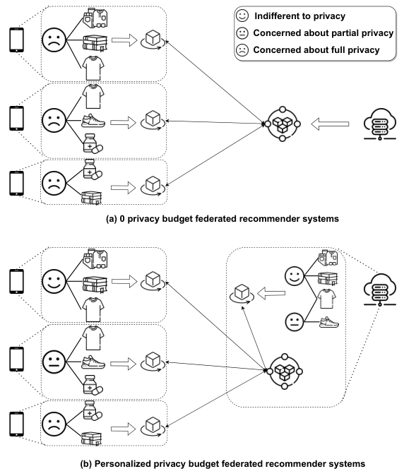
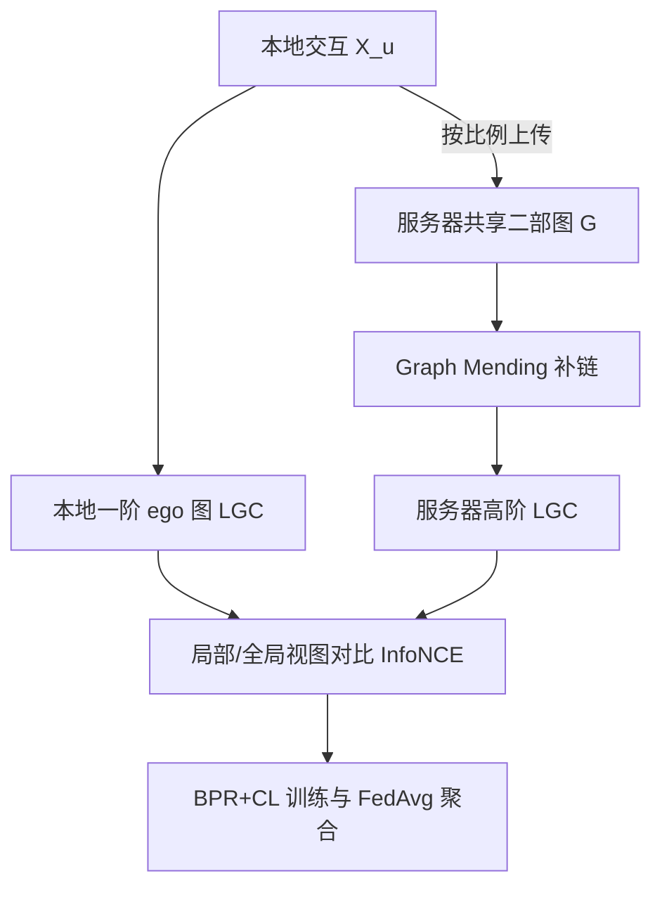
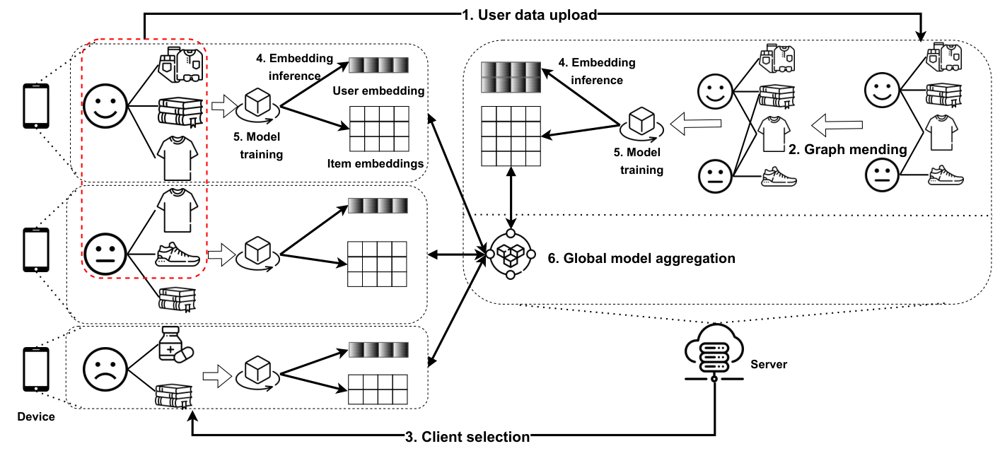

# Towards Personalized Privacy: User-Governed Data Contribution for Federated Recommendation (迈向个性化隐私：用户自主数据贡献的联邦推荐)

- **会议/期刊**: WWW 2024
- **作者与机构**: Liang Qu, Wei Yuan, Ruiqi Zheng, Lizhen Cui, Yuhui Shi, Hongzhi Yin；The University of Queensland / Shandong University / SUSTech
- **推荐链路定位**: 召回（Top-K 推荐）
- **研究方向**: 去偏公平、可信隐私与工业架构 / 图神经网络推荐
- **论文原文**: [论文原文链接](https://arxiv.org/abs/2401.17630v1)
- **开源代码**: 暂未开源

## TL;DR (1分钟核心速览)

传统 FedRec 默认所有用户都是“0 隐私预算”，忽视愿意共享数据以换取更好服务的用户，且设备端只有一阶 ego 图，难以获得高阶协同信号。本文提出用户自主数据贡献的 UGFedRec 框架与 CDCGNNFed：用户控制上传比例，服务器用图修补补全共享二部图，设备与服务器分别推理同一节点的局部/全局表征并用 InfoNCE 对齐。在 Gowalla/Yelp2018 的全库 Top-20 评测、8:1:1 划分下，部分共享 [0,1] 的 NDCG@20 较最强基线提升 3.72%/2.72%，全共享时超过集中式 LightGCN。

## Background & Motivation (背景与核心矛盾)

- **主流范式**: FedRec 将用户交互保留在本地，仅上传模型参数/梯度并用 FedAvg 聚合；GNN-FedRec 进一步尝试在隐私约束下学习高阶图结构。
- **前人局限**: 现有架构统一假设 0 隐私预算，忽略“少隐私敏感、愿共享全部或部分数据”的用户；同时设备端只有一阶 ego 图，GNN 难以捕获高阶协同信号，非 IID 数据又进一步拉低效用。
- **核心洞察 (Key Insight)**: 隐私偏好是异质的，用户可自主决定共享比例；服务器收到的共享数据虽稀疏、碎片化，但可通过补链恢复高阶图，并与设备端局部视图形成天然对比学习信号。
- **本文切入点**: 用 UGFedRec 替代刚性 0 隐私预算，用 CDCGNNFed 将“云端高阶图 + 端侧一阶图”通过图修补与对比学习协同起来。

<figure class="paper-figure" markdown="span">
  <figcaption>图1：(a) 0隐私预算联邦推荐系统，用户不向服务器上传任何数据。(b) 个性化隐私预算联邦推荐系统，用户可自由控制是否共享数据以及向服务器共享数据的比例。</figcaption>
</figure>

## Method (核心方法设计)

### 1. 整体框架 (Overall Architecture)

输入是用户本地交互 $X_u$与用户选择的共享比例。本地保留完整 ego 图，服务器仅收集共享数据$X^{+}$；服务器先通过 graph impairing/mending 预测缺失链接，形成可承载高阶结构的分片二部图。每轮选定设备后，设备与服务器分别用 LGC 推理，得到同一节点的 local/global 视图；共享用户/物品表征用 InfoNCE 对齐，未共享用户仅做本地 BPR。最后 FedAvg 聚合，服务器模型被视为特殊设备。

<figure class="paper-figure" markdown="span">
  <figcaption>图2：所提方法的架构。</figcaption>
</figure>

### 2. 关键设计拆解 (Key Designs)

1. **用户自主数据贡献 + 图修补**：共享数据少时服务器图由多个孤立子图组成，直接 GNN 无法传播高阶信息。本文先 impair 一部分真实边作为监督，再用 LightGCN 编码受损图并做余弦链接预测：$\mathcal{L}_{gm}=\sum_{e_{ui}\in\hat{X}^{+}}\|\cos(z_u,z_i)-e_{ui}\|^2$，最后以阈值$t$ 判定补边。直觉是让服务器图“先破后立”，在稀疏共享下恢复可用高阶结构。
2. **云端双视图对比学习**：同一用户在设备端得到局部表征 $e_{u-d}$，在服务器端得到全局表征$e_{u-s}$，二者构成正对，其他共享用户为负对：$\mathcal{L}_{userCL}=\sum_{u\in U^{+}}-\log\frac{\exp(\cos(e_{u-d},e_{u-s})/\tau)}{\sum_{v\in U^{+}}\exp(\cos(e_{u-d},e_{v-s})/\tau)}$；物品侧同理。该设计把“端侧个性化”和“云端协同性”拉近，而非把服务器简单当普通设备。
3. **训练目标、负采样与推理效率**：本地未共享用户用 BPR：$\mathcal{L}_{BPR}=-\sum_{i\in N_u}\sum_{j\notin N_u}\ln\sigma(\cos(e_{u-d},e_{i-d})-\cos(e_{u-d},e_{j-d}))+\lambda\|e\|^2$；共享用户与服务器用$\mathcal{L}=\mathcal{L}_{BPR}+\lambda_1\mathcal{L}_{CL}+\lambda\|e\|^2$。BPR 负样本从未交互物品采，CL 负样本为其他共享用户/物品；推理用余弦/内积 Top-K。设备端 1 层 LGC、服务器端 3 层，通信仅发生在选中设备与服务器之间。

## Experimental Setup & Evaluation Protocol (实验设置与评估协议)

- **数据集与预处理**: 过滤交互数少于 20（Gowalla）与 10（Yelp2018）的用户/物品：

| 数据集 | #Users | #Items | #Interactions | 密度 | 特征/场景说明 |
| :--- | :---: | :---: | :---: | :---: | :--- |
| Gowalla | 29,858 | 40,981 | 1,027,370 | 0.084% | LBS 签到 |
| Yelp2018 | 31,668 | 38,048 | 1,561,406 | 0.130% | 商户评论 |

- **数据划分与防穿越**: 比例划分 8:1:1（训练/验证/测试），非 Leave-One-Out。
- **排名评测协议**: 将用户未交互物品全部作为候选，属无偏 `Full-Ranking`；报告 Recall@20 与 NDCG@20，并按用户平均。
- **对比基线与超参**: 集中式 NeuMF/LightGCN；FedMF/FedPerGNN；FedeRank；UGFed-MF/UGFed-GNN 为同设定朴素基线。Embedding 维度 $d=64$，Adam，学习率/权重衰减网格搜索；每轮设备数 256/528；GNN 层数设备端 1、服务器端 3；5 个随机种子均值，$p<0.05$。

## Key Experimental Results (实验关键数据)

### 1. 主实验对比 (Main Results)

部分共享 [0,1] 场景（主战场）：

| 方法 | Gowalla R@20 | Gowalla N@20 | Yelp R@20 | Yelp N@20 |
| :--- | :---: | :---: | :---: | :---: |
| FedeRank | 0.1477 | 0.1269 | 0.0499 | 0.0433 |
| UGFed-MF | 0.1489 | 0.1270 | 0.0527 | 0.0431 |
| UGFed-GNN | 0.1716 | 0.1396 | 0.0560 | 0.0478 |
| **CDCGNNFed** | **0.1724** | **0.1448** | **0.0579** | **0.0491** |
| **Improv.% vs 最强基线** | **+0.47%** | **+3.72%** | **+3.39%** | **+2.72%** |

0/1 端点场景（0=不共享，1=全共享；NeuMF/LightGCN 仅在集中式全量数据下可比较）：

| 方法 | Gowalla 0 R/N | Gowalla 1 R/N | Yelp 0 R/N | Yelp 1 R/N |
| :--- | :---: | :---: | :---: | :---: |
| FedMF | 0.1435/0.1220 | - | 0.0482/0.0413 | - |
| FedPerGNN | **0.1442/0.1233** | - | 0.0453/0.0409 | - |
| FedeRank | 0.1432/0.1197 | 0.1494/0.1308 | 0.0476/0.0408 | 0.0574/0.0470 |
| UGFed-MF | 0.1435/0.1220 | 0.1504/0.1312 | **0.0482/0.0413** | 0.0583/0.0475 |
| UGFed-GNN | 0.1428/0.1117 | 0.1776/0.1538 | 0.0457/0.0412 | 0.0626/0.0503 |
| NeuMF | - | 0.1509/0.1309 | - | 0.0586/0.0476 |
| LightGCN | - | 0.1811/0.1534 | - | 0.0627/0.0509 |
| **CDCGNNFed** | 0.1428/0.1117 | **0.1823/0.1553** | 0.0457/0.0412 | **0.0639/0.0522** |

全共享时相对 LightGCN：Gowalla Recall +0.66%、NDCG +1.24%；Yelp Recall +1.91%、NDCG +2.55%。

### 2. 消融实验 (Ablation Study)

| 变体 | Gowalla R@20 | Gowalla N@20 | Yelp R@20 | Yelp N@20 |
| :--- | :---: | :---: | :---: | :---: |
| w/o GM | 0.1697 | 0.1441 | 0.0525 | 0.0413 |
| w/o CL | 0.1710 | 0.1443 | 0.0530 | 0.0434 |
| **CDCGNNFed** | **0.1724** | **0.1448** | **0.0579** | **0.0491** |

### 3. 关键实验发现 (Key Findings)

- **图修补是稀疏场景的第一贡献项**：Yelp 上去掉 GM 后 Recall 从 0.0579 降至 0.0525（-9.3%），NDCG 从 0.0491 降至 0.0413（-15.9%），说明共享图越碎，补链对高阶 GNN 越关键。
- **对比学习负责“端云对齐”，但收益依赖共享比例**：Yelp 去掉 CL 后 Recall 降 8.5%、NDCG 降 11.6%；Gowalla 的 NDCG 仅降 0.3%，表明共享用户越多，local/global 正对越充分。
- **共享比例单调放大收益**：Gowalla 从 [0.1,0.2) 的 0.1478 升至 [0.9,1) 的 0.1809（+22.4%），Yelp 从 0.0505 升至 0.0623（+23.4%）；但 0 共享时退化为仅一阶图，Gowalla Recall 0.1428 低于 FedMF 的 0.1435，Yelp 0.0457 低于 0.0482。

## Highlights & Limitations (亮点、对比与审稿批判)

- **与代表作对比 (vs. Prior Work)**: FedeRank 只让用户控制“梯度上传比例”，原始数据仍全留本地；本文让用户直接控制“数据上传比例”，服务器可构图并补链。FedPerGNN 依赖可信第三方分配邻居，本文把共享数据留在服务器并做图修补。相对集中式 LightGCN，本文在全共享时反而略优，说明补链+CL 可缓解稀疏性。
- **可迁移亮点**: “ impair-mend ”图修补可迁移到任何部分可见二部图场景；local/global 双视图 InfoNCE 可用于跨端云、跨域或多场景表征对齐。
- **审稿级局限批判**: 其一，用户上传原始交互后，联邦隐私保证被弱化，LDP 仅作为可选参数加密，缺少形式化隐私预算与泄漏分析；其二，补链阈值 $t$ 敏感，过低引入假边、过高保留孤岛，且实验仅两个公开数据集、无线上 A/B 与冷启动验证。

## Rating (四维评分)

- **方法创新性 (Novelty)**: ⭐⭐⭐⭐ （将个性化隐私预算、图修补与端云对比学习组合成新 FedRec 范式，问题定义有新意）
- **评估协议与实验扎实度 (Protocol & Experiments)**: ⭐⭐⭐⭐ （Full-Ranking、8:1:1 划分、5 种子与 $p<0.05$ 较规范，但仅两数据集、缺线上验证）
- **写作与数学规范度 (Clarity & Rigor)**: ⭐⭐⭐⭐ （核心公式与流程清晰；隐私共享策略的形式化与理论分析偏弱）
- **工业落地与复现价值 (Industrial & Practical Value)**: ⭐⭐⭐ （架构贴近工业联邦场景，但原始数据上传合规成本、补链阈值调参与通信开销需额外工程权衡）

