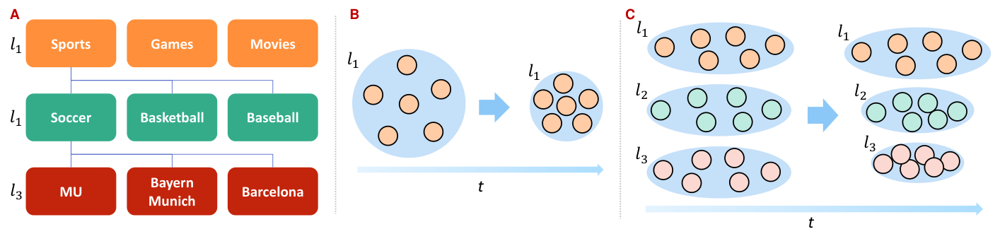
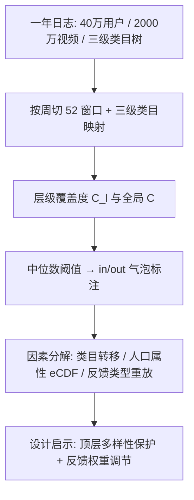
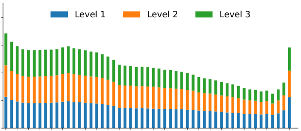

# Uncovering the Deep Filter Bubble: Narrow Exposure in Short-Video Recommendation (揭示深层过滤气泡：短视频推荐中的窄化曝光)

- **会议/期刊**: WWW 2024 (The Web Conference, Singapore)
- **作者与机构**: Nicholas Sukiennik, Nian Li, Chen Gao（清华大学电子工程系 / 深圳国际研究生院）
- **推荐链路定位**: 全链路曝光生态分析（非模型方法，刻画召回-排序-曝光闭环产生的平台级效应）
- **研究方向**: 去偏公平与工业架构 / 强化学习与长期留存
- **论文原文**: [https://arxiv.org/abs/2403.04511v1](https://arxiv.org/abs/2403.04511v1)
- **开源代码**: 暂未开源

## TL;DR (1分钟核心速览)

本文指出过滤气泡研究长期停留在“顶层类目”层面，忽略了短视频平台中用户在大兴趣内部被逐层窄化的“深层过滤气泡”。作者用国内某头部短视频平台一年期、4 亿交互、含三级类目树的日志，定义层级覆盖度 $C_l$ 与基于中位数的“in/out”气泡判定，做了一次纯描述性但大规模的长周期实证。核心发现：一年内处于气泡的总体用户比例几乎不变，但**气泡的深度构成在迁移**——顶层气泡年末加剧、中层大幅缓解、深层基本恒定；显式反馈（like/follow）是气泡加剧器，隐式完播信号反而是缓和剂。本文无模型、无 Baseline、无排序指标。

## Background & Motivation (背景与核心矛盾)

- **主流范式**: 过滤气泡研究分两支——机制解释（用户-算法自适应动力学、模拟沙盒）与模型缓解（多样性重排、DPP、DGCN、RL 可控曝光）。
- **前人局限**: ①已有工作一律把气泡定义为“用户看到的类别集合相对全平台类目的收窄”，只讨论 sports vs. news 这类**顶层**替代关系；②短视频单列沉浸流几乎没有搜索等外显兴趣信号，兴趣“被学习”与“被形成”发生在同一空间，理论上更易收窄，却从未在**层级维度**上被量化。
- **核心洞察 (Key Insight)**: 气泡不止横向（跨大类）收窄，更会纵向（类目树内部）下钻收窄——从 sports 到 only soccer 再到 only 某支球队。若只看顶层，可能完全漏掉最深的那层窄化。
- **本文切入点**: 借助视频的三级类目标注，把“深度”变成可测量的覆盖度指标，先验证现象存在，再归因到类目、人群、反馈三类因素。

<figure class="paper-figure" markdown="span">
  <figcaption>图 1：传统过滤气泡的概念性概览，其中 A 表示层级类别的一个示例树结构，B 和 C 分别表示浅层和深层过滤气泡，项目之间的距离表示相似度。假设 B 中的项目在层级上全部一致，而 C 中的项目被分解为三个层级。图 C 假设更深层级随时间收敛到更相似的项目。</figcaption>
</figure>

## Method (核心方法设计)

### 1. 整体框架 (Overall Architecture)

本文的“模型”是一条测量管线：先对 40 万用户、2000 万视频、3.2 亿～4 亿条交互按周切分为 52 个时间窗，并挂载平台原生三级类目树；随后对每个用户在每层每窗计算归一化覆盖度，得到绝对多样性刻画；再用同窗全体用户覆盖度**中位数**作为动态阈值，把用户标注为“in/out 气泡”，从而剥离平台整体趋势、只保留用户间的相对窄化；最后从三个角度做归因——主导类目的周间转移概率矩阵（类目拉力）、四类人口属性的覆盖度 eCDF（人群易感性）、以及按反馈类型重放交互子集后重算气泡比例（反馈作用）。整条管线不含任何可训练参数。

### 2. 关键设计拆解 (Key Designs)

**创新设计一：层级归一化覆盖度（把“深度”变成可比的数）**。痛点：传统气泡指标以全平台类目为分母，天然只能刻画顶层。做法是对每层分别归一化并把各层加总：

$$C_l=\frac{n_{\text{seen},l}}{n_{\text{total},l}},\qquad C=\sum_{l=1}^{3}\frac{n_{\text{seen},l}}{n_{\text{total},l}}$$

物理直觉：$C_l$ 越小说明该层曝光越集中；三层同时观察即可区分“跨大类窄化”与“大类内部下钻窄化”，这是本文相对前人唯一的度量增量。

**创新设计二：中位数相对气泡判定（剥离平台整体漂移）**。痛点：绝对覆盖度会随平台内容供给、新用户冷启等全局因素漂移，无法说明“谁被困住”。做法是用同窗全体用户覆盖度中位数做阈值：

$$B_{u,t}=\text{``in''}\ \ \text{if}\ \ C_{u,t}<\mathrm{Median}\left(C_{\cdot,t}\right),\ \ \text{else ``out''}$$

直觉：这是一个**相对排名型**指标，跨时间可比，且不依赖任何模型打分；代价是它只度量“比同龄人更窄”，不能直接度量“窄到什么程度”。

**创新设计三：反馈类型重放（无需训练的因果线索）**。将交互按反馈拆成两个互斥子集——显式（like/follow/share/comment）与隐式（完播率 >50% 的 “click”，且显式子集之外的交互）——分别重算覆盖度与气泡比例，用两条趋势线的分歧推断推荐系统对各信号的**隐含权重**。这是在没有 A/B 与反事实数据时，最接近“归因”的低成本做法。

## Experimental Setup & Evaluation Protocol (实验设置与评估协议)

- **数据集与预处理**:

| 数据集 | #Users | #Items | #Interactions | 稀疏度/密度 | 特征/场景说明 |
| :--- | :---: | :---: | :---: | :---: | :--- |
| 某头部短视频平台一年日志 | 400,000 | 20,000,000 | 400,000,000 | ≈5×10⁻⁵ | 单列沉浸流；三级类目 58/326/512；含 like/collect/comment 等反馈 |

过滤规则：仅保留被实际观看（>50% 时长）的视频，剔除秒滑样本；全部用户在当年第一天注册，构成一个“同起点”队列。

- **数据划分与防穿越 (Splitting Strategy)**: 非训练/测试划分，而是 `全局时间戳切分` 为 52 个自然周窗口，逐窗统计；无穿越问题，但也**无留出验证**。
- **排名评测协议 (Ranking Protocol)**: **不适用**——本文不做推荐排序评测，既非 `Full-Ranking` 也非 `Sampled Ranking`，指标为覆盖度比值与“in-bubble 用户占比”，属描述性统计。这既是本文的诚实之处，也是其最硬的短板。
- **对比基线与超参设置**: 无 Baseline、无超参、无显著性检验；所有“对比”均为同一数据集内部的**时间纵向对比**（年初 vs. 年末）与**子集横向对比**（显式 vs. 隐式、不同人口属性）。

## Key Experimental Results (实验关键数据)

### 1. 主实验对比 (Main Results)

本文无 SOTA 对比表，其“主结果”是三级类目结构统计与气泡状态分布。下表汇总原文给出/可读出的核心量化结论（`Improv.%` 不适用）：

| 层级 $l$ | 唯一类别数 | 平均子类数/节点 | 覆盖度分布形态 | in-bubble 用户占比演化 | 绝对覆盖度水平 |
| :--- | :---: | :---: | :--- | :--- | :--- |
| Level 1 | 58 | **49.3** | 近似正态，中心 ≈0.2 | 全年平稳，**末 20 周上升，年末最高** | 最“公平”（分布最宽） |
| Level 2 | 326 | 21.2 | 尖峰落在 **0–0.1** | **年初最高 → 年末最低** | 整体偏低 |
| Level 3 | 512 | — | 尖峰落在 **0–0.1** | 基本恒定，末 20 周波动 | 整体偏低 |
| 全局 | — | — | 低值尖峰 + ≈0.35 处次峰 | 总体比例基本不变（≈0.11–0.125） | 年末小幅下行 |

### 2. 消融实验 (Ablation Study)

以“反馈类型重放”与“人口属性分层”替代常规消融，观察各因素移除/切换后气泡比例的走向：

| 因素/子集 | Level 1 | Level 2 | Level 3 | 净效应 |
| :--- | :--- | :--- | :--- | :--- |
| 仅显式反馈 | 前 12 周骤降 | 骤降 | 骤降 | 10 周内反弹并**超过初值**，年末再抬升 → **加剧** |
| 仅隐式反馈 | 持续下行 | 持续下行 | 持续下行 | 单调降至第 48 周后跳升 → **缓解** |
| 年龄（12–17 vs. 50+） | 弱 | 弱 | **最显著** | 越年轻覆盖度越低 |
| 城市线级 | 一线最高 | 一线最高 | 一线略强 | 低线级更易被困 |
| 手机价位（收入代理） | 无趋势 | 无趋势 | 无趋势 | 无效因素 |
| 性别 | 男性更低 | 无差异 | 男性更低 | 男性更易被困 |

### 3. 关键实验发现 (Key Findings)

1. **深层窄化有很大一部分是“树结构税”，不该全算在算法头上**：Level 1 平均每节点挂 49.3 个子类、Level 2 仅 21.2，用户在上层只看到少量类别时，下层的可行类目集合被机械性压缩，导致 L2/L3 覆盖度分布出现 0–0.1 的极尖峰。若直接用绝对覆盖度指控算法，会高估其责任。
2. **相对判定与绝对分布严重倒挂，单一指标会误判**：按中位数相对判定，L1 气泡最“严重”（年末占比最高），但绝对覆盖度上 L1 分布最宽（≈0.2 正态）；真正被压在 0–0.1 的是 L2/L3。这说明“比同侪窄”与“窄到无内容可选”是两件事，工业监控必须同时上报绝对与相对两套指标。
3. **显式反馈是气泡加剧器，隐式完播信号是缓和剂，二者趋势在第 10 周发生交叉**：仅用显式反馈时，三层气泡比例在 10 周内反弹并超过初始水平且年末再度抬升（L1 主导）；仅用隐式反馈时三层比例单调下降直至第 48 周。这强烈暗示线上模型对 like/follow 这类强信号赋权过重，用少量强偏好挤出了多样性曝光。

<figure class="paper-figure" markdown="span">
  <figcaption>图 8：分别仅使用显式反馈和隐式反馈交互时，三级过滤发展随时间的演进。</figcaption>
</figure>

## Highlights & Limitations (亮点、对比与审稿批判)

- **与代表作对比 (vs. Prior Work)**: 与 Li 等（短视频过滤气泡探索性研究）相比，本文把气泡从“跨大类”推进到“类目树内部下钻”，多了层级维度；与 Gao 等的 RL/因果过度曝光建模、DGCN/Yang 等的多样化推荐相比，本文不含任何可训练模块，价值在于**问题定义与度量**而非算法；与 Nguyen 等的协同过滤时序多样性分析相比，本文的样本规模（40 万用户×1 年）与类目深度（3 层）都更贴近生产。
- **可迁移亮点**: ①“层级覆盖度 + 中位数相对判定”是一套几乎零成本、模型无关的线上生态监控看板，可直接挂到已有曝光日志上；②“按反馈类型拆子集重放”是缺少 A/B 时快速诊断模型信号偏置的实用技巧。
- **审稿级局限批判**: ①**全篇为零假设检验的描述性相关分析**，无因果识别、无反事实、无模拟验证，文末关于“保护顶层多样性、调节反馈权重”的设计建议完全没有被任何离线或线上实验检验；②**队列与采样偏差**：所有用户均在同一天注册，第 48–52 周各层气泡比例的集体跳升，作者自己承认可能是采样/队列效应而非真实行为变化；③**指标内在混淆**：$C_l$ 的分母随层级爆炸（58→326→512）而节点扇出却反向收缩（49.3→21.2），跨层比较本质上不可比；④**写作自相矛盾**：§4.2.4 明确得出“男性覆盖度更低、更易被困”，结论节却写成“younger people, females, and those from lower-tier cities”；图 2 的 Level 3 唯一类目数标为 517，正文写 512——这类硬伤会削弱实证结论的可信度。

## Rating (四维评分)

- **方法创新性 (Novelty)**: ⭐⭐⭐ （首次把过滤气泡推进到层级/深度维度，但度量本身仍是“覆盖度比值 + 中位数阈值”的朴素组合，无理论或因果支撑）
- **评估协议与实验扎实度 (Protocol & Experiments)**: ⭐⭐⭐ （40 万用户×1 年、三级类目的大规模真实日志难得，但无 Baseline、无排序协议、无显著性检验，结论强度止步于相关性）
- **写作与数学规范度 (Clarity & Rigor)**: ⭐⭐⭐ （三个公式与 $B_{u,t}$ 定义足够清晰，但性别结论与数据方向矛盾、类目数 512/517 前后不一，严谨度受损）
- **工业落地与复现价值 (Industrial & Practical Value)**: ⭐⭐⭐⭐ （无需训练即可上线为生态健康监控指标，反馈权重调节建议对排序模型改造有直接指导意义；未开源但基于自家日志，复现门槛主要在数据而非代码）

