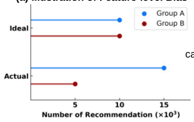
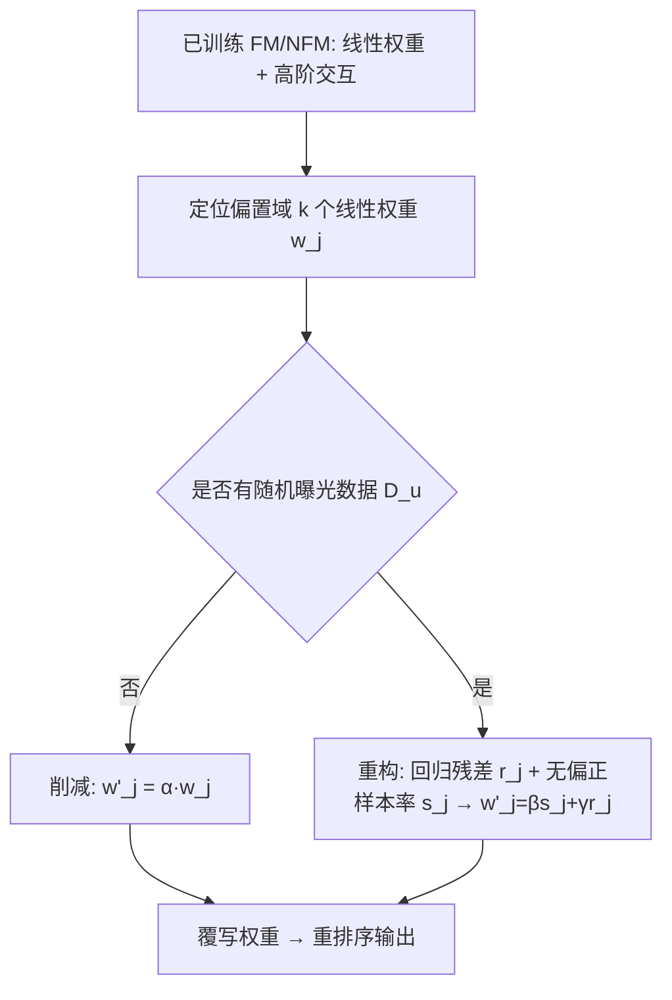

# Understanding and Counteracting Feature-Level Bias in Click-Through Rate Prediction (理解与对抗点击率预估中的特征级偏差)

- **会议/期刊**: WWW 2024
- **作者与机构**: Jinqiu Jin, Sihao Ding, Wenjie Wang, Fuli Feng（中国科学技术大学、新加坡国立大学）
- **推荐链路定位**: 精排（CTR 预估模型的后处理去偏）
- **研究方向**: 去偏公平、可信隐私与工业架构 / CTR 预估与特征交叉
- **论文原文**: [论文原文链接](https://arxiv.org/abs/2402.03600v1)
- **开源代码**: [开源代码链接](https://github.com/mitao-cat/feature-level_bias.git)

## TL;DR (1分钟核心速览)

本文研究 CTR 模型按某特征域（如电影类型）划分物品组时出现的**特征级偏差**（某些组被过度/不足推荐）。作者通过"逐块屏蔽"实验与梯度理论分析，证明偏差主要源自**线性权重**，而线性权重又与训练集各组**正样本率**高度相关（Spearman 0.88/0.90）。据此提出两种**推理期微创后处理**：线性权重削减（仅调 $k$ 个参数）与线性权重重构（仅需 1 万条随机曝光记录），在 ML-1M/Book/KuaiRand 上把 REO@5 降低 14.35%–47.00%（精度仅损 1.06%），无偏测试 UAUC/NDCG@5 反升 4.4%/7.7%。

## Background & Motivation (背景与核心矛盾)

- **主流范式**: FM 系模型（FM/NFM/DeepFM）把打分拆成"线性特征投影 $\sum_i w_i x_i$+ 高阶特征交互$f_\theta(\boldsymbol{x})$"；现有公平化手段靠正则项、对抗训练（FairGo）或因果推断（IPW/DecRS）在**训练期**改动学习目标。
- **前人局限**: (1) 全部把偏差当黑盒，只调损失而不回答"偏差在模型内部**由哪一层生成**"，因此难以针对性治理；(2) 需改造训练流程、重训全模型，工业代价高，且对细粒度物品组公平效果不稳定（IPW 在 Book 上甚至使 REO 上升）。
- **核心洞察 (Key Insight)**: 屏蔽实验显示线性部分的跨组方差远大于高阶部分（NFM 负样本上 0.1572 vs 0.0129），即**偏差由线性权重承载**；而 BCE 梯度 $\partial l/\partial w_j=(\sigma(\hat{y})-y)x_j$决定$w_j$ 单调累积各组正负样本数之差，故**组间正样本率不均**是数据侧根源。
- **本文切入点**: 既然偏差集中在 $k$个（$k\ll n$）偏置域线性权重上，就直接在**训练完成后**改写这$k$ 个参数，切断"数据偏差→线性权重→偏置打分→偏置推荐"的传播路径。

<figure class="paper-figure" markdown="span">
  <figcaption>图1：一个说明特征级偏差的玩具示例。(a) 理想值和实际值分别表示由真值和CTR模型得到的期望推荐数量。(b) 物品侧不公平性，A组和B组分别被过度推荐和推荐不足。(c) 损害用户体验，模型向用户（ID=23）推荐60%的A和40%的B，而其真实偏好由40%的A和60%的B组成。</figcaption>
</figure>

## Method (核心方法设计)

### 1. 整体框架 (Overall Architecture)

输入用户-物品稀疏特征向量，FM 系模型输出 $\hat{y}=w_0+\sum_{i=1}^{n}w_i x_i+f_\theta(\boldsymbol{x})$，经 sigmoid 得点击率并排序。本文不改训练，只在**推理前**取出与偏置域（如 genre/tag）对应的$k$个线性权重$w_1,\dots,w_k$，按两种策略替换为$w_j'$：无随机曝光数据时用"削减"，有少量随机曝光数据时用"重构"。流程中高阶部分$f_\theta$ 与其余域权重完全冻结，因此部署代价仅为一次参数覆写。

### 2. 关键设计拆解 (Key Designs)

1. **偏差归因：线性部分方差诊断 + 正样本率相关性验证**。为回答"哪一部分造成偏差"，将式 (6) 定义为各物品组平均打分的跨组方差 $\mathrm{V}(\{m_j\}_{j=1}^{k})$，$m_j=\mathbb{M}(f(\boldsymbol{x})\mid x_j>0,y=1)$，对线性/高阶分别计算。结果显示 FM 负样本上线性 0.1233 vs 高阶 0.0168，NFM 0.1572 vs 0.0129，线性部分占绝对主导。进一步统计发现$w_j$与组正样本率$N_p/(N_p+N_n)$呈强正相关（FM: SP 0.8782 / PS 0.8069；NFM: SP 0.8989 / PS 0.8584，$p<10^{-4}$），而与单纯$N_p$ 几乎无关——说明**比值而非数量**决定偏差，因为负样本会反向拉低权重。

2. **线性权重削减 (Linear Weight Reduction)**：最直接的干预是把偏置域线性权重整体清零 $w_j'=\alpha w_j,\ \alpha\in[0,1]$（默认$\alpha=0$）。直觉是：$f_\theta$与其余域（ItemID、用户特征）仍足以刻画偏好，去掉这$k$个"被正样本率污染的常数偏移"几乎不损排序能力，却能消除组间系统性抬升/压低。$\alpha$ 提供公平-精度连续可调旋钮。

3. **线性权重重构 (Linear Weight Reconstruction)**：仅"清零"没有注入真实偏好，故在拥有少量随机曝光数据 $\mathcal{D}_u$时，先用线性回归剔除污染：$r_j=w_j-\hat{w}_j$（残差已与有偏正样本率解耦），再用$\mathcal{D}_u$估计无偏正样本率$s_j$，合成$w_j'=\beta s_j+\gamma r_j$。因为只需从$\mathcal{D}_u$估$k+2$个量，样本需求远低于重训或蒸馏类方法（实验仅用 1 万条随机曝光）。总损失仍为原 BCE，无额外训练目标；推理开销为$O(1)$ 参数覆写。

## Experimental Setup & Evaluation Protocol (实验设置与评估协议)

| 数据集 | #Users | #Items | #Train | 偏置域组数 #G | 说明 |
| :--- | :---: | :---: | :---: | :---: | :--- |
| ML-1M | 6.0k | 3.7k | 700k | 18 | 电影，genre 为偏置域，评分 >3 为正 |
| Book | 117k | 79.2k | 3,970k | 486 | Amazon 图书，category 为偏置域 |
| KuaiRand | 16.7k | 5.1k | 1,036k | 46 | 快手短视频，tag 为偏置域，含随机曝光 |

- **数据划分与防穿越**: 全局**时间戳切分**为 train/val/test；统一 **20-core 过滤**；KuaiRand 额外提供无偏随机曝光测试集（验证集随机抽 10,000 条供重构使用）。
- **排名评测协议**: 采用**用户级全列表排序**（每个用户对测试集全部样本打分，取 top-$k_u^{+}$为曝光），非采样排序。指标：UAUC、NDCG@5；公平性用$REO@K=\mathrm{S}(\{P(j,K)\})/\frac{1}{k}\sum_j P(j,K)$（越小越公平）；并定义$EHR(j)$ 直接判别某组被过度（>1）或不足（<1）推荐。
- **对比基线与超参**: 骨干为 FM、NFM（DeepCTR 实现），Adam、batch 256、学习率 $\{5e^{-4},1e^{-3},5e^{-3}\}$，正则$\{1e^{-6},\dots,1e^{-3}\}$；基线含 Unawareness、w/o l/p、w/o b/l/w、IPW、DecRS、FairGo；无偏测试另比 Finetune、InterD；$\beta,\gamma\in\{1,2,4,8,12,16,20\}$。

## Key Experimental Results (实验关键数据)

### 1. 主实验对比 (Main Results)

常带有偏测试（top-5 曝光，REO@5 越低越公平）：

| 方法 | FM ML-1M UAUC↑ | FM ML-1M REO↓ | FM Book REO↓ | FM KuaiRand REO↓ | NFM ML-1M REO↓ | NFM Book REO↓ | NFM KuaiRand REO↓ |
| :--- | :---: | :---: | :---: | :---: | :---: | :---: | :---: |
| Basemodel | 0.7266 | 0.5577 | 0.1624 | 0.3857 | 0.4969 | 0.1620 | 0.4036 |
| Unawareness | 0.7210 | 0.4814 | <u>0.1421</u> | 0.4025 | 0.5103 | 0.1563 | 0.3959 |
| w/o l/p | 0.7100 | 0.7267 | 0.1551 | 0.4002 | 0.6294 | 0.1650 | 0.3699 |
| w/o b/l/w | 0.7193 | 0.5507 | 0.1549 | 0.4342 | 0.5229 | <u>0.1558</u> | 0.3959 |
| IPW | 0.7112 | <u>0.3537</u> | 0.1648 | <u>0.2925</u> | <u>0.3857</u> | 0.1667 | <u>0.3114</u> |
| DecRS | 0.7202 | 0.4350 | 0.1596 | 0.4225 | 0.5158 | 0.1627 | 0.3941 |
| FairGo | 0.7248 | 0.5230 | 0.1638 | 0.3899 | 0.5253 | 0.1851 | 0.4273 |
| **Reduction** | 0.7172 | **0.2956** | **0.1391** | **0.2829** | **0.3351** | **0.1341** | **0.3058** |
| Improv. (REO) | −1.29% | **47.00%** | **14.35%** | **26.55%** | **32.56%** | **17.22%** | **24.23%** |

### 2. 消融实验 (Ablation Study)

KuaiRand 无偏随机曝光测试（验证重构策略的组件与必要数据量）：

| 方法 | FM UAUC↑ | FM NDCG@5↑ | NFM UAUC↑ | NFM NDCG@5↑ |
| :--- | :---: | :---: | :---: | :---: |
| Basemodel | 0.5748 | 0.4151 | 0.5735 | 0.4140 |
| Finetune | 0.5795 | 0.4238 | 0.5933 | 0.4427 |
| InterD | 0.5777 | 0.4191 | 0.5852 | 0.4320 |
| w/ finetuning LW | 0.5749 | 0.4153 | 0.5928 | 0.4392 |
| w/o ratio ($\beta=0$) | 0.5865 | 0.4304 | 0.5791 | 0.4197 |
| w/o residual ($\gamma=0$) | <u>0.5952</u> | <u>0.4427</u> | <u>0.5959</u> | <u>0.4436</u> |
| **Reconstruction** | **0.5999** | **0.4465** | **0.6003** | **0.4465** |
| Improv. | **+4.37%** | **+7.56%** | **+4.67%** | **+7.85%** |

### 3. 关键实验发现 (Key Findings)

1. **"改线性"胜过"改学习"**：同为后处理，Reduction 在三个数据集上稳定把 REO@5 压低 14%–47%，而训练期对抗/因果方法（FairGo、DecRS）多数情形几乎无效，IPW 甚至在 Book 上使 REO 由 0.1624 升至 0.1648——因为它们主要调节高阶 embedding，而偏差实际由线性项承载，验证了归因分析的正确性。
2. **精度损失可忽略，且残差项必要**：Reduction 平均仅损 −1.06% UAUC/NDCG，说明偏置域线性权重对排序贡献有限；重构消融中 w/o ratio（无随机曝光，仅残差）已达 0.5865，仍优于 Basemodel，说明"去污染残差"本身即有效；去掉残差（$\gamma=0$）后降至 0.5952，证明"个体化残差 + 无偏组先验"两者互补，仅微调线性权重（w/ finetuning LW，0.5749）则几乎无收益。
3. **公平-精度存在可调旋钮，且并非总是对立**：$\alpha$从 0→1 时 UAUC 单调回升而 REO 在 Book/KuaiRand 单调上升；但在 ML-1M 上 REO 先降后升，说明取$\alpha\in[0.1,0.2]$ 的小非零值可能同时改善公平与精度，为线上调参提供帕累托参考点。

## Highlights & Limitations (亮点、对比与审稿批判)

- **与代表作对比 (vs. Prior Work)**: 相比 FairGo（对抗移除敏感信息）与 DecRS（因果去混淆 embedding），本文首次在**模型内部**定位偏差载体并只改 $k$个标量，改动量与可解释性均占优；相比 InterD（多教师蒸馏）与 Finetune（需大量无偏数据微调），重构法仅估$k+2$ 个参数，1 万条随机曝光即超越二者（0.6003 vs 0.5933 UAUC）。
- **可迁移亮点**: (1) "逐块屏蔽 + 跨组方差"是一套通用偏差归因探针，可直接用于诊断其他特征域或位置/流行度偏差的载体层；(2) 用组级正样本率对权重做回归取残差，可作为其他"组先验驱动"打分头的轻量去偏模板。
- **审稿级局限批判**: (1) 分析仅覆盖带显式线性项的 FM 系模型，对 DIN/AutoInt 等无线性项或不显式分离特征的模型未给方案，适用面受限；(2) 重构依赖随机曝光数据 $\mathcal{D}_u$，且$\beta,\gamma$ 在无偏验证集上网格搜索，实际线上随机曝光成本与超参稳定性未量化评估，也缺少线上 A/B 与多轮反馈回路的讨论。

## Rating (四维评分)

- **方法创新性 (Novelty)**: ⭐⭐⭐⭐ （从"改损失"转向"改 $k$ 个线性权重"的归因-干预范式新颖，梯度与相关性分析构成完整证据链，但技术本体较朴素）
- **评估协议与实验扎实度 (Protocol & Experiments)**: ⭐⭐⭐⭐ （三数据集 + 有偏/无偏双测试 + 用户级全排序 + 6 类基线齐备，唯缺显著性检验与更多骨干模型验证）
- **写作与数学规范度 (Clarity & Rigor)**: ⭐⭐⭐⭐ （$EHR$、$REO@K$ 定义清晰并与 EO 建立联系，式 (8)(9) 推导简洁；EHR 的组内多值特征处理略欠讨论）
- **工业落地与复现价值 (Industrial & Practical Value)**: ⭐⭐⭐⭐⭐ （推理期覆写 $k$ 个参数、零重训、单旋钮调公平-精度，代码开源，工程落地成本极低）

