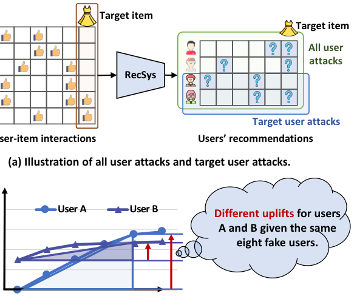
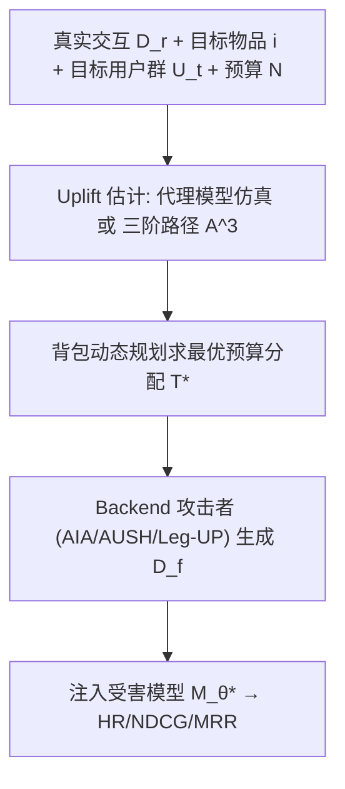

# Uplift Modeling for Target User Attacks on Recommender Systems (面向推荐系统目标用户攻击的 Uplift 建模)

- **会议/期刊**: WWW 2024 (Oral)
- **作者与机构**: Wenjie Wang, Changsheng Wang, Fuli Feng, Wentao Shi, Daizong Ding, Tat-Seng Chua (NUS / USTC / Fudan)
- **推荐链路定位**: 召回-排序全链路的安全性（攻击侧建模与评测）
- **研究方向**: 去偏公平、可信隐私与工业架构 / 强化学习与动态探索推荐（因果 treatment effect）
- **论文原文**: [https://arxiv.org/abs/2403.02692v1](https://arxiv.org/abs/2403.02692v1)
- **开源代码**: [https://github.com/Wcsa23187/UBA](https://github.com/Wcsa23187/UBA)

## TL;DR (1分钟核心速览)

现有注入攻击向"全体用户"平摊虚假用户预算，忽视物品只对特定受众有吸引力、且不同用户的攻击难度差异极大，导致预算浪费。本文提出**目标用户攻击 (target user attacks)** 任务，把"给用户 $u$分配$t_u$个虚假用户"形式化为因果 treatment、把推荐概率增量形式化为 uplift，提出 model-agnostic 的 **UBA** 框架：用代理模型仿真或**三阶交互路径数**$\alpha(\boldsymbol{A}^3_{u,i})^\beta$ 估计逐用户 uplift，再用背包动态规划求最优预算分配。在 ML-1M/Amazon/Yelp 上即插即用于 AIA/AUSH/Leg-UP，受害模型 LightGCN 下 HR@10 相对"Target"平均分配基线提升 **30%–86%**。

## Background & Motivation (背景与核心矛盾)

- **主流范式**: 注入攻击（heuristic / gradient-based DADA / neural AIA、AUSH、Leg-UP）通过伪造用户交互矩阵 $\boldsymbol{D}_f$提升目标物品$i$的曝光，攻击目标$O(\mathcal{M}_{\theta^*},\mathcal{U}_r,i)$定义在**全体真实用户**上，且预算$|\mathcal{U}_f|\le N$ 在用户间平均或随机分摊。
- **前人局限**: ① 物品有独特受众（连衣裙主要吸引女性买家），对全体用户攻击是对无兴趣用户的无效投放；② 攻击难度跨用户高度异质——同一目标用户从 4 个虚假用户增至 5 个可能毫无收益，另一用户则显著跃升（图 1(b)）。DADA 虽意识到难度差异，但仅用 **贪心** 把预算倾斜给"易攻击"用户，既未量化难度也未做全局最优分配。
- **核心洞察 (Key Insight)**: 从因果视角看，预算分配是多维 treatment $T=\{t_u\}_{u\in\mathcal{U}_t}$，outcome 是 Top-$K$命中概率$Y^{\theta^*}_{u,i}(\boldsymbol{D}_f(T))$，难度差异本质是**异质处理效应 (HTE / uplift)**；同时发现用户-物品对在交互图上的**三阶路径数**与 CF 预测分数近似成正比（Spearman$r\ge0.998$,$p\le1.46e^{-59}$），可直接作为 uplift 的无模型代理。
- **本文切入点**: 先估计逐用户 uplift 曲线，再在总预算约束下做一次全局最优分配，最后交回原攻击者生成 $\boldsymbol{D}_f$——不改变任何攻击者的生成算子。

<figure class="paper-figure" markdown="span">
  <figcaption>图1：针对所有用户和目标用户的注入攻击示意图（a），以及两个用户上攻击难度变化的示意图（b），其中一个虚假用户可能导致推荐概率出现不同幅度的提升。</figcaption>
</figure>

## Method (核心方法设计)

### 1. 整体框架 (Overall Architecture)

UBA 是包裹在现有攻击者外层的**预算分配器**：输入为目标物品 $i$、目标用户群$\mathcal{U}_t$、真实交互$\boldsymbol{D}_r$与总预算$N$；核心模块以两条并行路径估计每个目标用户在预算$t_u\in\{1,\dots,H\}$下的命中概率$Y^{\theta^*}_{u,i}(\boldsymbol{D}_f(t_u))$——路径 A 用代理模型$S_\phi$做$E\approx10$次仿真回放，路径 B 直接用三阶路径闭式代理；随后以背包 DP 在$\sum t_u\le N$约束下求最优$T^*$；最后把$T^*$ 下发给 AIA/AUSH/Leg-UP 等 backend 生成对应数量的虚假用户并注入受害模型训练。

### 2. 关键设计拆解 (Key Designs)

1. **Uplift 形式化的目标函数**：把原"全用户命中率最大化"改成逐用户概率求和并显式约束预算，使难度异质性进入优化目标：
$\max_{T,\boldsymbol{D}_f}\ \sum_{u\in\mathcal{U}_t}Y^{\theta^*}_{u,i}(\boldsymbol{D}_f(T))\ \ \text{s.t.}\ \sum_{u\in\mathcal{U}_t}t_u\le N,\ t_u\in\mathbb{Z}_{\ge0}.$直觉：只有当边际收益$\partial Y_{u,i}/\partial t_u$ 在不同用户间差异大时，重分配才有增益——这正是"平摊"次优的根源。

2. **三阶路径代理 (免代理模型估计)**：若无可信 $S_\phi$，用$\hat{Y}^{\theta^*}_{u,i}(\boldsymbol{D}_f(t_u))=\alpha\cdot\big((\boldsymbol{A}')^3_{u,i}\big)^{\beta}$近似，其中$\boldsymbol{A}'$为拼接真假用户的对称交互矩阵。**Proposition 2** 给出闭式解释：$(\boldsymbol{A}')^3_{u,i}$等价于"喜欢$i$的中间用户"的加权和，权重为其与$u$的共同喜好物品数，故最优伪造策略即是选取$t_u$个与$u$最相似、且点赞$i$的虚假用户。**Proposition 1**（附录 A.2）通过 BPR/BCE 梯度推导证明$\mathcal{M}_{\theta^*}(u,i)\propto\boldsymbol{A}^3_{u,i}$，说明该代理对 MF/NCF/LightGCN 均成立——这是"每加一个虚假用户能带来多少命中概率"的可计算近似。

3. **背包 DP 分配与推理开销**：把 $Y$视为容量$N$、每用户可选重量$0..H$ 的多重背包，递推
$dp[k][n]=\max_{t\in[0,H]}\{dp[k-1][n-t]+Y[k][t]\},$复杂度$O(|\mathcal{U}_t|\cdot N\cdot H)$，秒级可解。**无训练损失**（UBA 不改写 backend 的攻击损失，仅是前置分配），负采样/生成策略完全沿用 backend；在线侧额外开销仅是一次 DP + 每条 uplift 曲线的$H$次构造，$H\ll N$。

## Experimental Setup & Evaluation Protocol (实验设置与评估协议)

- **数据集与预处理**: 三数据集统一 **10-core** 过滤，评分 $>3$ 映射为隐式正反馈 1，其余为 0。

| 数据集 | #Users | #Items | #Interactions | 稀疏度 | 特征/场景说明 |
| :--- | :---: | :---: | :---: | :---: | :--- |
| ML-1M | 5,950 | 3,702 | 567,533 | 0.257% | 电影，含显式评分 |
| Amazon-Game | 3,179 | 5,600 | 38,596 | 0.216% | 游戏，极稀疏 |
| Yelp | 54,632 | 34,474 | 1,334,942 | 0.070% | 本地生活，规模最大最稀疏 |

- **数据划分与防穿越**: 攻击类工作不采用 Leave-One-Out 或时间切分，而是以完整交互矩阵训练受害模型（**无未来信息可用**，因为攻击是"投毒训练集"而非预测未来）；目标物品按人气五分组，分别取最热/最冷组各一件，每设定跑 **5 个随机种子取均值**。
- **排名评测协议**: **Full-Ranking（全库 Top-K 未交互排序）**；指标 HR@10/20、NDCG@10、MRR@10，统计的是"目标物品是否进入该**目标用户**的 Top-K 列表"，而非全体用户平均。
- **对比基线与超参**: 基线含 Random/Segment/Bandwagon/Average/WGAN、SOTA 梯度攻击 DADA(-DICT/-DIV)、神经攻击 AIA/AUSH/Leg-UP；作者另设 **"Target"** 基线（把攻击目标从 $\mathcal{U}_r$改为$\mathcal{U}_t$但**预算均摊**），用于隔离"选人"与"分配"两种增益。受害模型 MF/NCF/LightGCN，代理模型固定为最简 MF；总预算$N=100$，单用户上限$H\ll N$，目标用户默认 50 人（另测 100/500）；显著性用$t$-test，$p<0.05$。

## Key Experimental Results (实验关键数据)

### 1. 主实验对比 (Main Results)

受害模型 LightGCN、预算 $N=100$、ML-1M 热门目标物品（NDCG/MRR 均为 @10，"*"为相对 Target 的显著提升）：

| 方法 | HR@10 | NDCG@10 | MRR@10 | Improv. (HR) |
| :--- | :---: | :---: | :---: | :---: |
| Before Attack | 0.0000 | 0.0000 | 0.0000 | — |
| Bandwagon | 0.0200 | 0.0035 | 0.0020 | — |
| DADA | 0.0600 | 0.0112 | 0.0123 | — |
| AIA | 0.0200 | 0.0061 | 0.0033 | — |
| AIA + Target (均摊) | 0.2000 | 0.0244 | 0.0222 | — |
| AIA + UBA(w/o $S_\phi$) | 0.2400 | 0.0315 | 0.0300 | +20.0% |
| **AIA + UBA(w/ $S_\phi$)** | **0.2600\*** | **0.0431\*** | **0.0520\*** | **+30.0%** |
| AUSH + Target | 0.2400 | 0.0349 | 0.0340 | — |
| **AUSH + UBA(w/ $S_\phi$)** | **0.3200\*** | **0.0474\*** | **0.0533\*** | **+33.3%** |
| Leg-UP + Target | 0.1400 | 0.0187 | 0.0200 | — |
| **Leg-UP + UBA(w/ $S_\phi$)** | **0.2600\*** | **0.0480\*** | **0.0371\*** | **+85.7%** |
| DADA（最强非目标式基线） | 0.0600 | 0.0112 | 0.0123 | — |

Amazon 上同趋势更明显：AUSH + UBA(w/ $S_\phi$) 达 HR@10 **0.8600**（Target 0.6400，+34.4%），AIA 从 0.5800→**0.7200**（+24.1%），冷门物品上 AUSH 亦从 0.7400→**0.8000**。

### 2. 消融实验 (Ablation Study)

ML-1M 热门物品、HR@10，逐层拆解"是否选人 / 是否按 uplift 分配 / 是否有代理模型"：

| Backend | Origin（无攻击） | +Target（选人+均摊） | +UBA(w/o $S_\phi$)（路径代理） | +UBA(w/$S_\phi$)（仿真估计） |
| :--- | :---: | :---: | :---: | :---: |
| AIA | 0.02 | 0.20 | 0.24 | **0.26** |
| AUSH | 0.02 | 0.24 | 0.28 | **0.32** |
| Leg-UP | 0.04 | 0.14 | 0.18 | **0.26** |

### 3. 关键实验发现 (Key Findings)

1. **增益几乎全部来自"分配"而非"生成"**：backend 的 $\boldsymbol{D}_f$生成算子完全不变，仅把$N=100$ 从均摊改为 uplift 引导分配，AUSH 的 HR@10 就从 0.24 升到 0.32、Leg-UP 从 0.14 升到 0.26（+85.7%），说明在固定伪造能力下，**预算的边际配置效率**才是攻击瓶颈。
2. **三阶路径代理以极低成本逼近仿真**：w/o $S_\phi$版本保留 w/$S_\phi$增益的 60%–110%（AUSH 0.28 vs 0.32；Amazon AUSH 0.74 vs 0.86），却省去$E\approx10$次代理模型重训；其有效性由 Spearman$r\ge0.998$（MF/NCF/LightGCN × BCE/BPR）与三/五/七阶路径均成立的稳健性支撑。
3. **预算越小、用户越多，UBA 价值越大**：$N=50$时相对 Target 的提升幅度最大；目标用户从 50 扩到 500（预算不变）时，AUSH+UBA(w/$S_\phi$) 的 HR@10 仍保持 0.38（Target 0.28），单用户预算被摊薄到极小时分配精度更关键。防御侧，FAP 将 Leg-UP+UBA(w/$S_\phi$) 的 HR@10 从 0.26 压到 0.06，但仍高于 Target 在同等防御下的 0.04——即强攻击者被削弱后**依旧保留残余风险**，且 NCF/LightGCN 因更强拟合能力反而比 MF 更易被注入攻击。

## Highlights & Limitations (亮点、对比与审稿批判)

- **与代表作对比 (vs. Prior Work)**: DADA 用贪心把预算倾给"易攻击用户"但无 uplift 量化、无全局最优；AUSH/Leg-UP 直接把目标用户当模板随机采样，等价于均摊。UBA 与之的本质差别是把**预算看作可优化的多维 treatment**，估计 HTE 后做一次背包最优解，因而能"外挂"在任何 backend 上并叠加增益。
- **可迁移亮点**: ① 用**三阶交互路径数**作为 CF 预测分数的免训练代理，可迁移到冷启动打分、邻居采样剪枝与可解释性归因；② "先估 uplift 曲线、再做资源受限 DP 分配"范式可直接搬到推荐系统的**多目标预算调度**（如补贴券分配、Push 推送配额）。
- **审稿级局限批判**: ① 未建模目标用户之间的**相互干扰**（$t_u$之间本就耦合，作者自己也承认 left for future）；② 仿真法需要为每个候选预算重训代理模型$\approx10$次，$N$、$H$与$\alpha,\beta$的敏感度只给了附录，且 DP 的$O(|\mathcal{U}_t|NH)$ 在万级用户群下会变得吃紧；③ 评测仅覆盖 CF 类受害模型与两个无监督防御（PCA/FAP），未涉及图对比去噪、LLM 推荐等新范式。

## Rating (四维评分)

- **方法创新性 (Novelty)**: ⭐⭐⭐⭐ （首次把注入攻击预算分配写成因果 HTE 问题，并以 $\boldsymbol{A}^3$ 路径给出可证的代理，但 uplift/背包本身是成熟工具的组合）
- **评估协议与实验扎实度 (Protocol & Experiments)**: ⭐⭐⭐⭐ （三数据集 × 3 受害模型 × 3 backend × 变化预算/用户数/交互比例/2 种防御，5 seed 平均 + $t$ 检验，消融链条清晰；未见采样排序协议细节与统计显著性以外的方差报告）
- **写作与数学规范度 (Clarity & Rigor)**: ⭐⭐⭐⭐ （Proposition 1 的 BPR/BCE 梯度推导与 Proposition 2 的矩阵分解证明完整，符号统一；附录较多依赖经验验证而非严格界）
- **工业落地与复现价值 (Industrial & Practical Value)**: ⭐⭐⭐⭐ （model-agnostic、代码开源、DP 秒级可解，可直接作为红队工具评估推荐系统抗注入能力；但万级用户群的可扩展性与防御对抗仍需工程验证）

