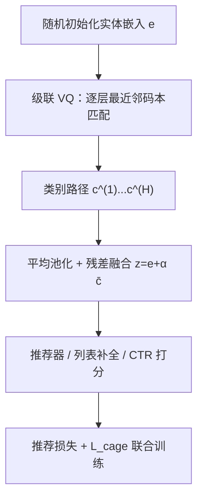
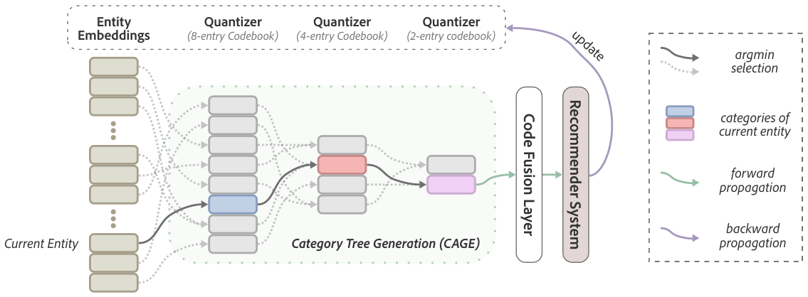

# Learning Category Trees for ID-Based Recommendation: Exploring the Power of Differentiable Vector Quantization (学习面向 ID 推荐的类别树：探索可微向量量化的力量)

- **会议/期刊**: WWW 2024 (The Web Conference)
- **作者与机构**: Qijiong Liu, Lu Fan, Jiaren Xiao, Jieming Zhu, Xiao-Ming Wu；香港理工大学、华为诺亚方舟实验室
- **推荐链路定位**: 通用表征插件（召回/精排/列表补全）
- **研究方向**: 生成式推荐与离散语义 ID / 协同过滤
- **论文原文**: [论文原文链接](https://arxiv.org/abs/2308.16761v6)
- **开源代码**: [开源代码仓库链接](https://github.com/Jyonn/Cage)

## TL;DR (1分钟核心速览)

纯 ID 推荐缺乏类别侧信息，现有 VQ 多依赖预训练内容嵌入且三阶段分离。CAGE 用级联可微向量量化从随机初始化端到端学习用户/物品类别树，并以残差码融合注入推荐器。在列表补全、CF、CTR 十个数据集上，CAGE_FANS 于 Goodreads N@10 较 FANS 提升 21.41%，CF/CTR 多数基线亦正向。

## Background & Motivation (背景与核心矛盾)

- **主流范式**: 类别特征能提升个性化并缓解冷启动，但 ID-only 推荐数据通常只有用户/物品 ID，深度推荐器只能学习 ID embedding。
- **前人局限**: 现有 VQ 推荐多采用“表征学习→量化→推荐”三阶段流程，需要内容侧嵌入；ID-only 下初始嵌入无语义，量化结果不可用。单层码本也难兼顾类别粒度：过细导致稀疏，过粗丢失区分度。
- **核心洞察 (Key Insight)**: 层级类别结构不必来自人工标签，可从交互目标与量化约束中联合涌现；级联码本能形成由细到粗的类别树。
- **本文切入点**: 用可微 VQ + Straight-Through Estimator 把类别树生成与下游推荐端到端联合训练。

## Method (核心方法设计)

### 1. 整体框架 (Overall Architecture)

输入为随机初始化的用户/物品 ID 嵌入 $\mathbf{e}$。CAGE 以$H$个级联量化器逐层做最近邻码本匹配，为实体生成由细到粗的类别路径；各层码向量平均池化后经残差连接$\mathbf{z}=\mathbf{e}+\alpha\bar{\mathbf{c}}$注入推荐器。训练时推荐损失、量化损失与承诺损失联合反传，STE 绕过 argmin 不可导；推理阶段固定码本与树连接，只做$H$次查表/最近邻与融合，额外开销近似$O(Hkd)$。

<figure class="paper-figure" markdown="span">
  <figcaption>图3：我们提出的类别树生成框架（CAGE）概览。</figcaption>
</figure>

### 2. 关键设计拆解 (Key Designs)

1. **可微级联 VQ 类别树**：前人三阶段 VQ 依赖内容嵌入，ID-only 下初始嵌入无语义；本文让实体嵌入与码本从随机态共同演化。每层 $c^{(i)}=Q^{(i)}(c^{(i-1)}), c^{(0)}=\mathbf{e}$，$j=\arg\min_i\|\mathbf{e}-\mathbf{c}_i\|_2^2$；量化/承诺损失为$\mathcal{L}_{cage}=\sum_i(\|sg[c^{(i-1)}]-c^{(i)}\|_2^2+\beta\|c^{(i-1)}-sg[c^{(i)}]\|_2^2)$，并用 STE 近似梯度。码本 entry 数逐层递减，形成细到粗树，迫使相似实体共享高层类别。
2. **码融合与残差注入**：直接用量化码替换 ID 会丢失个体信息；采用 $\bar{\mathbf{c}}=\frac{1}{H}\sum_i c^{(i)}$、$\mathbf{z}=\mathbf{e}+\alpha\bar{\mathbf{c}}$，以残差保留原 ID、以$\alpha$ 控制类别先验强度。对非序列推荐同时在用户/物品两侧加 CAGE，对序列推荐只加物品 CAGE。
3. **联合训练目标与树分类辅助**：非序列任务 $\mathcal{L}=\mathcal{L}_{rec}+\omega_q(\mathcal{L}_{cage}^{(u)}+\mathcal{L}_{cage}^{(i)})$；序列列表补全额外用$\mathcal{L}_{tree}=\frac{1}{H}\sum_i\mathrm{CE}(g_i(\mathbf{z}),y^{(i)})$，总损失$\mathcal{L}=\mathcal{L}_{item}+\omega_c\mathcal{L}_{tree}+\omega_q\mathcal{L}_{cage}$。CAGE 本身免负采样；CF 基线沿用 BPR 负采样，列表补全用全词表分类/生成，CTR 为二分类。

## Experimental Setup & Evaluation Protocol (实验设置与评估协议)

- **数据集与预处理**: 规模统计原文附录 A 未在正文给出，下表不臆造具体计数。

| 数据集 | #Users | #Items | #Interactions | 预处理/场景 |
| :--- | :---: | :---: | :---: | :--- |
| Zhihu / Spotify / Goodreads | 附录A | 附录A | 附录A | 列表补全；频次<10 过滤、按最大/最小长度截断，8:1:1 划分 |
| Amazon Toys/Kindle/Phones/Grocery, MovieLens-1M | 附录A | 附录A | 附录A | CF；仅使用 ID 交互，无侧信息 |
| MIND-small, MovieLens-100K | 附录A | 附录A | 附录A | CTR；MIND 历史行为展开为 user-item 对 |

- **数据划分与防穿越 (Splitting Strategy)**: 列表补全采用 8:1:1 训练/验证/测试；CF 与 CTR 的划分细节正文未展开，需以公开代码为准。FANS* 的类别特征由全数据预抽取且含测试集，CAGE 不使用该泄漏特征。
- **排名评测协议 (Ranking Protocol)**: 使用 NDCG@5/10、HR@5/10；列表补全按全词表 item 概率/生成结果评估。正文未明确 CF/CTR 的 Full-Ranking 或 Sampled 负例比例，复现时应核查代码。
- **对比基线与超参设置**: 列表补全对比 Caser、GRU4Rec、SASRec、CAR、BERT4Rec、FANS、FANS_TSC；CF 对比 BPRMF、NeuMF、CFKG、LGCN；CTR 对比 DCN、DeepFM、FiBiNET、FinalMLP。CAGE 层数 1–3、码本 entry 10–8000 网格搜索；正文未报告显著性检验。

## Key Experimental Results (实验关键数据)

### 1. 主实验对比 (Main Results)

**表 1：列表补全主结果（Improv. 为 CAGE_FANS 相对最强非泄漏基线 FANS 的相对提升）**

| 数据集 | 指标 | SASRec | CAR | BERT4Rec | FANS | FANS_TSC | CAGE_FANS | Improv. |
| :--- | :---: | ---: | ---: | ---: | ---: | ---: | ---: | ---: |
| Zhihu | N@5 | 0.0070 | 0.0138 | 0.0194 | 0.0256 | 0.0232 | **0.0301** | +17.58% |
| Zhihu | N@10 | 0.0111 | 0.0211 | 0.0290 | 0.0389 | 0.0337 | **0.0428** | +10.03% |
| Zhihu | HR@10 | 0.2020 | 0.3101 | 0.3758 | 0.4819 | 0.4604 | **0.4859** | +0.83% |
| Spotify | N@5 | 0.0147 | 0.0166 | 0.0178 | 0.0313 | 0.0315 | **0.0352** | +11.75% |
| Spotify | N@10 | 0.0203 | 0.0231 | 0.0257 | 0.0461 | 0.0438 | **0.0519** | +12.58% |
| Spotify | HR@10 | 0.3159 | 0.3630 | 0.3991 | 0.5927 | 0.5552 | **0.6282** | +5.99% |
| Goodreads | N@5 | 0.0061 | 0.0129 | 0.0108 | 0.0334 | 0.0293 | **0.0399** | +19.46% |
| Goodreads | N@10 | 0.0084 | 0.0188 | 0.0160 | 0.0467 | 0.0418 | **0.0567** | +21.41% |
| Goodreads | HR@10 | 0.1582 | 0.2672 | 0.2678 | 0.5149 | 0.4514 | **0.5473** | +6.29% |

CF 与 CTR 上 CAGE 亦多数正向：如 CAGE_DeepFM 在 MIND 的 N@5 由 0.2170 提至 0.2428（+11.89%）；CAGE_BPRMF 在 Toys 的 HR@10 由 0.4095 提至 0.4377（+6.89%）。

### 2. 消融实验 (Ablation Study)

**表 2：类别树层数与码本规模消融（Zhihu 代表性配置）**

| 配置 | N@5 | N@10 | HR@5 | HR@10 |
| :--- | ---: | ---: | ---: | ---: |
| CAGE-BERT4Rec 1层 (10) | 0.0197 | 0.0295 | 0.2151 | 0.3752 |
| CAGE-BERT4Rec 1层 (500) | 0.0057 | 0.0094 | 0.0910 | 0.1752 |
| CAGE-BERT4Rec 2层 (200,10) | 0.0235 | 0.0311 | 0.2429 | 0.3832 |
| CAGE-BERT4Rec 2层 (500,10) | 0.0223 | 0.0307 | 0.2376 | 0.3966 |
| CAGE-FANS 1层 (10) | 0.0280 | 0.0412 | 0.3002 | 0.4839 |
| CAGE-FANS 2层 (500,10) | **0.0301** | **0.0428** | **0.3034** | **0.4859** |

图 4 进一步显示：非序列推荐中仅加用户或物品 CAGE 均优于 backbone，双侧 CAGE 通常最好。

### 3. 关键实验发现 (Key Findings)

1. **端到端可微 VQ 优于预抽取类别特征**：Goodreads N@10 上 CAGE_FANS 达 0.0567，较 FANS 的 0.0467 提升 21.41%；且 FANS* 使用了含测试集的预抽取类别，CAGE 仅从 ID 交互学习，说明类别树可由推荐目标反向塑造。
2. **列表补全受益最大，CF/CTR 增益较稳但幅度小**：CAGE_BERT4Rec 相对 BERT4Rec 在全部列表补全数据集上 N@5 平均提升约 38%、HR@5 平均提升约 31%；CTR 如 CAGE_DeepFM 在 MIND N@5 提升 11.89%，CF 多数提升 1%–7%。
3. **树结构存在粒度甜点区，并非越深/码本越大越好**：Zhihu 上两层 (200,10) 的 N@5 为 0.0235，高于单层 20 的 0.0208；但单层 500 崩至 0.0057。超参重要性在 Zhihu 为 $\omega_q>\beta>\alpha\approx\omega_c$，Goodreads 为$\omega_q\approx\beta>\alpha>\omega_c$，码本需按数据调。

## Highlights & Limitations (亮点、对比与审稿批判)

- **与代表作对比 (vs. Prior Work)**: FANS 用 word2vec+kmeans 预抽取类别特征，CAGE 改为端到端可微 VQ，且不依赖测试集泄漏；传统三阶段 VQ 需要内容嵌入，CAGE 可在 ID-only 下从随机态联合优化；AQCL 仅用 VQ 辅助 CTR 对比学习，CAGE 则显式学习多级类别树并覆盖三类任务。
- **可迁移亮点**: 双侧 CAGE 可即插即用于 CF/CTR 的 user/item 表征；序列推荐中“树分类辅助损失”可把离散类别监督转化为多级正则，低成本增强 item 表征。
- **审稿级局限批判**: 其一，码本层数与 entry 数强依赖数据集，单层 500 出现明显退化，argmin+STE 的码本塌缩与训练稳定性仍需分析；其二，CF/CTR 的划分与负采样协议正文未透明化，且无显著性检验与线上 A/B，工业收益仍待验证。

## Rating (四维评分)

- **方法创新性 (Novelty)**: ⭐⭐⭐⭐ （首次将级联可微 VQ 用于 ID-only 类别树生成，机制新颖，但 VQ+STE 本身非全新）
- **评估协议与实验扎实度 (Protocol & Experiments)**: ⭐⭐⭐ （十个数据集、三类任务、多 backbone 较全面；但 CF/CTR 协议细节与显著性检验不足）
- **写作与数学规范度 (Clarity & Rigor)**: ⭐⭐⭐⭐ （核心公式与损失定义简洁，STE/码融合清晰；附录数据与复现细节略欠透明）
- **工业落地与复现价值 (Industrial & Practical Value)**: ⭐⭐⭐⭐ （开源、即插即用，推理仅多级查表；但码本超参与训练开销需线上调优）

