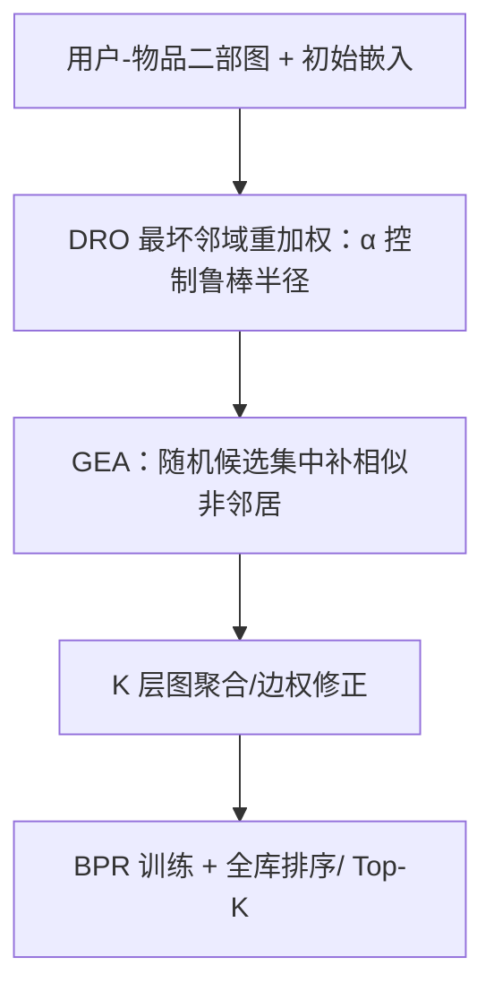
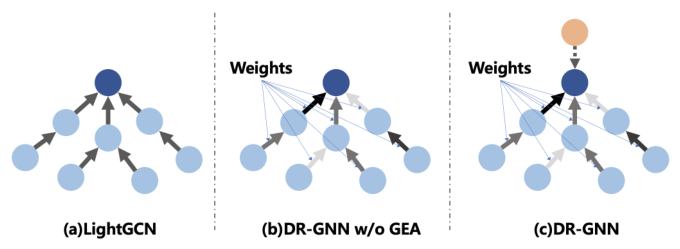

# Distributionally Robust Graph-based Recommendation System (分布鲁棒的图推荐系统)

- **会议/期刊**: WWW 2024
- **作者与机构**: Bohao Wang, Jiawei Chen, Changdong Li, Sheng Zhou, Qihao Shi, Yang Gao, Yan Feng, Chun Chen, Can Wang；浙江大学、杭州城市大学、Intelligence Indeed
- **推荐链路定位**: 召回（图协同过滤 Top-K）
- **研究方向**: 图神经网络与知识图谱推荐 / 去偏公平、可信隐私与工业架构
- **论文原文**: [论文原文链接](https://arxiv.org/abs/2402.12994v2)
- **开源代码**: [开源代码仓库链接](https://github.com/WANGBohaO-jpg/DR-GNN)

## TL;DR (1分钟核心速览)

针对GNN推荐在流行度、时间与曝光偏移下IID假设失效，DR-GNN把LightGCN聚合重写为图平滑正则，将DRO最坏邻域分布闭式化为可学习边权，并用GEA扩展稀疏邻域支撑；在8个数据集的OOD全库排序NDCG上6/8最优，Gowalla/Douban/Yelp分别较最佳基线提升29.6%/17.0%/33.1%。

## Background & Motivation (背景与核心矛盾)

- **主流范式**: LightGCN等图协同过滤通过多跳邻居聚合捕获高阶协同信号，在IID测试下显著优于MF。
- **前人局限**: InvCF/BOD等OOD方法未针对图结构，图上的分布偏置仍会扭曲嵌入；APDA/GraphDA等图鲁棒方法多为启发式边权或邻接重构，只处理噪声/流行度，缺少通用分布偏移的理论保证。
- **核心洞察**: LightGCN的图聚合可等价为图平滑正则；若把邻居分布放入KL球做DRO，可在训练时主动覆盖更坏邻域分布，且最坏分布有闭式边权形式。
- **本文切入点**: 用DRO重写图聚合边权，并用GEA补相似非邻居，解决推荐图稀疏导致DRO支撑过窄的问题。

<figure class="paper-figure" markdown="span">
  ![图1：MF \[20\] 与 LightGCN \[13\] 在分布内（IID）和分布外（OOD）测试场景下的性能比较。对于 OOD 测试，我们在 Yelp2018 中引入流行度偏移，在 Movielens-1M 中引入时间偏移。实验设置的更多细节见第4节。](../../../../assets/papers/2402.12994v2/figure_1.png)<figcaption>图1：MF [20] 与 LightGCN [13] 在分布内（IID）和分布外（OOD）测试场景下的性能比较。对于 OOD 测试，我们在 Yelp2018 中引入流行度偏移，在 Movielens-1M 中引入时间偏移。实验设置的更多细节见第4节。</figcaption>
</figure>

## Method (核心方法设计)

### 1. 整体框架 (Overall Architecture)

DR-GNN以LightGCN为骨干：输入用户-物品二部图与初始嵌入，每层聚合前用DRO按当前embedding计算邻居重加权，$\alpha$控制KL鲁棒半径；GEA从随机物品候选集补入与用户最相似的非邻居，并令新分布$P^{new}_u=\gamma P_u+(1-\gamma)P^{add}_u$。随后执行K层边权修正聚合，输出用户/物品表示，用BPR训练，推理仍走标准Top-K全库排序，不引入额外对抗内循环。

<figure class="paper-figure" markdown="span">
  <figcaption>图2：DR-GNN 如何增强 LightGCN 的示意图：它在图聚合过程中为边赋予权重，并引入新节点作为邻居。</figcaption>
</figure>

### 2. 关键设计拆解 (Key Designs)

1. **图平滑视角下的DRO重加权**：LightGCN聚合等价于优化$L_{smooth}=\frac12\sum_u d_u \mathbb{E}_{v\sim P_u}\|\frac{\mathbf{E}_u}{\sqrt{d_u}}-\frac{\mathbf{E}_v}{\sqrt{d_v}}\|_F^2$；对邻居分布做KL球内的max，得$P_u^*(v)=\frac{P_u(v)\exp(g(u,v)/\alpha)}{\mathbb{E}_{w\sim P_u}[\exp(g(u,w)/\alpha)]}$，其中$g(u,v)=-\frac{\mathbf{E}_u^\top\mathbf{E}_v}{\sqrt{d_u d_v}}$。落地为$\tilde{\mathbf{A}}'_{ij}=d_i\frac{\exp(g(i,j)/\alpha)}{\sum_{k\in N(i)}\exp(g(i,k)/\alpha)}\tilde{\mathbf{A}}_{ij}$，只改聚合边权，无需显式对抗训练；直觉是放大高损失邻居权重，让模型在更坏分布上仍稳。

2. **GEA扩展稀疏邻域支撑**：DRO要求同支撑，稀疏推荐下KL球只覆盖少数邻居；GEA令$P^{new}_u=\gamma P_u+(1-\gamma)P^{add}_u$，$P^{add}_u$覆盖全物品，并在随机候选集中选$g(u,v)$最小（最相似）的非邻居补边。$\gamma$控制扰动强度；直觉是用相似非邻居扩大不确定性集合，避免鲁棒优化被稀疏图锁死。

3. **训练目标、负采样与推理效率**：总损失$\mathcal{L}=\mathcal{L}_{BPR}+\lambda\|\mathbf{E}\|_2^2$；负采样为BPR均匀负采样，DRO通过边权融入聚合，GEA只遍历随机候选集。推理复杂度与LightGCN同阶$O(K(|E|d))$，适合大规模召回。

## Experimental Setup & Evaluation Protocol (实验设置与评估协议)

- **数据集与预处理**: 8个数据集，完整#Users/#Items/#Interactions与过滤细节见附录A.4；正文按三类偏移组织：

| 偏移场景 | 数据集 | 划分/构造 |
| :--- | :--- | :--- |
| 流行度 | Gowalla/Douban/Amazon/Yelp | 训练-测试流行度分布偏移（OOD） |
| 时间 | ML-1M/Food | 按用户交互时间戳切分训练/测试 |
| 曝光 | Coat/Yahoo | MNAR曝光偏差数据 |

- **数据划分与防穿越**: 流行度偏移采用OOD重采样；时间偏移按用户时间戳切分；曝光偏移利用MNAR缺失。训练构图不使用测试交互。
- **排名评测协议**: 无偏**Full-Ranking（全库未交互排序）**，报告NDCG/Precision/Recall；训练用BPR负采样，评测不采样。
- **对比基线与超参**: 统一LightGCN backbone+BPR；基线含InvCF/BOD、LightGCL/SGL、APDA/GAT/GraphDA；维度与超参见附录A.5，原文未报告显著性p值。

## Key Experimental Results (实验关键数据)

### 1. 主实验对比 (Main Results)

下表仅列NDCG（原文主表），P/R趋势基本一致；APDA在Douban OOM。

| 方法 | Gowalla | Douban | Amazon | Yelp | ML-1M | Food | Coat | Yahoo |
| :--- | ---: | ---: | ---: | ---: | ---: | ---: | ---: | ---: |
| LightGCN | .0369 | .0792 | .0227 | .0136 | .2041 | .0429 | .0802 | .0736 |
| LightGCL | .0380 | .0746 | .0243 | .0136 | .2055 | .0421 | .0839 | .0734 |
| SGL | .0381 | .0773 | .0232 | .0143 | .2177 | .0401 | .0839 | .0740 |
| InvCF | .0399 | .0740 | .0210 | .0144 | .2138 | .0411 | .0842 | .0742 |
| BOD | .0361 | .0815 | .0253 | .0145 | .2116 | .0436 | .0817 | **.0816** |
| APDA | .0367 | OOM | .0229 | .0141 | **.2362** | .0400 | .0821 | .0756 |
| GraphDA | .0341 | .0892 | .0199 | .0140 | .2213 | .0411 | .0847 | .0748 |
| **DR-GNN** | **.0517** | **.1044** | **.0327** | **.0193** | .2330 | **.0440** | **.0874** | .0774 |
| Δ vs 最佳基线 | +29.6% | +17.0% | +29.2% | +33.1% | -1.4% | +0.9% | +3.2% | -5.1% |

### 2. 消融实验 (Ablation Study)

| 数据集 | 方法 | NDCG | Precision | Recall |
| :--- | :--- | ---: | ---: | ---: |
| Gowalla | LightGCN | .0369 | .0170 | .0563 |
| Gowalla | DR-GNN w/o DRO | .0391 | .0174 | .0583 |
| Gowalla | DR-GNN w/o GEA | .0494 | .0231 | .0761 |
| Gowalla | **DR-GNN** | **.0517** | **.0238** | **.0774** |
| Yelp2018 | LightGCN | .0136 | .0060 | .0221 |
| Yelp2018 | DR-GNN w/o DRO | .0161 | .0070 | .0265 |
| Yelp2018 | DR-GNN w/o GEA | .0182 | .0081 | .0305 |
| Yelp2018 | **DR-GNN** | **.0193** | **.0086** | **.0322** |

### 3. 关键实验发现 (Key Findings)

1. **DRO是主增益，GEA是稀疏补丁**：Gowalla去掉DRO后NDCG从.0517降至.0391（-24.4%），去掉GEA仅降至.0494（-4.5%）；Yelp同样DRO贡献更大，说明鲁棒边权是核心。
2. **流行度偏移下表征更齐**：DR在Gowalla/Douban/Amazon/Yelp相对最佳基线提升29.6%/17.0%/29.2%/33.1%，且Douban t-SNE中热/冷物品表示几乎同空间（图3），缓解热度分层。
3. **α是鲁棒半径旋钮**：α越小KL球越大；图4显示偏移越大最优α越小，过大/过小均掉点。ML-1M上APDA NDCG高1.4%，Yahoo上BOD NDCG高5.1%，但P/R与跨集稳定性不及DR。

## Highlights & Limitations (亮点、对比与审稿批判)

- **与代表作对比 (vs. Prior Work)**: APDA也用动态边权，但用多层embedding且为启发式；DR-GNN由DRO推导，用初始embedding即得闭式权重并具泛化界。GraphDA重构邻接用于去噪/增广，GEA目的是扩展DRO支撑。GAT注意力在稀疏推荐上易过拟合。
- **可迁移亮点**: “图聚合=平滑正则”可把DRO/鲁棒优化无缝接入任意GNN召回；GEA的随机候选相似补边可低成本缓解稀疏图支撑不足。
- **审稿级局限批判**: α对偏移程度敏感且需按数据集调参；KL支撑约束与候选采样仍限制GEA的理论覆盖，且原文未报告显著性检验与在线A/B。

## Rating (四维评分)

- **方法创新性 (Novelty)**: ⭐⭐⭐⭐ （把LightGCN聚合重写为平滑正则并闭式嵌入DRO，理论视角新颖）
- **评估协议与实验扎实度 (Protocol & Experiments)**: ⭐⭐⭐⭐ （8数据集×3类偏移+全库排序+消融完整，但缺显著性检验）
- **写作与数学规范度 (Clarity & Rigor)**: ⭐⭐⭐⭐ （Lemma/Theorem链条清晰，边权推导可直接落地；部分附录细节依赖原文）
- **工业落地与复现价值 (Industrial & Practical Value)**: ⭐⭐⭐⭐ （仅改边权、推理同阶LightGCN，代码开源，适合召回阶段低成本鲁棒化）

