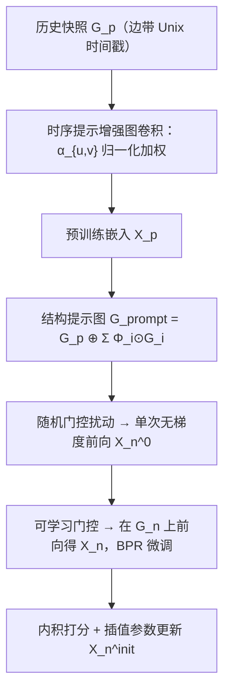
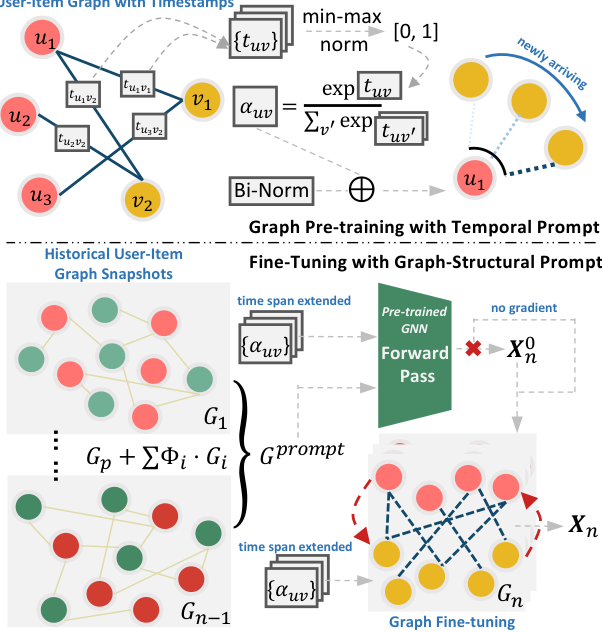

# GraphPro: Graph Pre-training and Prompt Learning for Recommendation (图预训练与提示学习驱动的动态推荐)

- **会议/期刊**: WWW 2024 (Full Paper)
- **作者与机构**: Yuhao Yang, Lianghao Xia, Chao Huang (香港大学) ; Da Luo, Kangyi Lin (腾讯微信)
- **推荐链路定位**: 召回 (Top-K 检索) + 动态在线服务
- **研究方向**: 图神经网络与知识图谱推荐 / 冷启动与长尾推荐
- **论文原文**: [https://arxiv.org/abs/2311.16716v5](https://arxiv.org/abs/2311.16716v5)
- **开源代码**: [https://github.com/HKUDS/GraphPro](https://github.com/HKUDS/GraphPro)

## TL;DR (1分钟核心速览)

现有 GNN 推荐器都在**单张静态图**上"一次训练、长期使用"，新交互到来时要么从头重训（昂贵），要么小窗口增量微调（易陷入局部最优、且参数漂移）。GraphPro 提出**参数高效的两段式动态框架**：预训练阶段用**无参数的时序提示（相对时间编码）**改写 LightGCN 的归一化项，使模型天然偏好近期交互；微调阶段把"预训练时点→当前时点"的新增边拼成**结构提示图**，经**随机门控 + 可学习门控**做一次无梯度前向，即完成知识迁移。在 Taobao/Koubei/Amazon 三个**快照式动态评测**上，Recall@20 相对最优基线提升 **2.55%–9.77%**，线上 A/B 的 CTR 提升 **1.53%**。

## Background & Motivation (背景与核心矛盾)

- **主流范式**: 以 LightGCN 为代表的双向归一化消息传递，配合 SGL/SimGCL/MixGCF 等自监督或负采样增强，在**一张覆盖全历史的用户-物品图**上训练后直接推理。
- **前人局限**: ① 单图范式与真实线上"持续到数据→立即预测"的流程脱节，离线-在线 gap 大；② 迭代增量微调只在小时间窗交互上更新参数，既会**收敛到该时段局部最优**，又带来持续的算力开销；③ 新快照带来的**表征分布漂移**无法被无上下文模型吸收。
- **核心洞察 (Key Insight)**: 预训练时点与当前时点之间的**新增交互边本身就是"离散提示"**——不需要训练，只要把这些边接到预训练图上做一次前向传播，就足以让预训练嵌入感知分布漂移；而时间信息也无需新增嵌入参数，可作为**相对位置编码**直接融进聚合权重（类比 NLP 中相对位置编码优于绝对位置编码的泛化性、可扩展性）。
- **本文切入点**: 用"时序提示 + 结构提示 + 插值参数更新"三件套，把**任意** GNN 推荐器改造成动态、低成本的插件式框架。

## Method (核心方法设计)

### 1. 整体框架 (Overall Architecture)

输入是按时间粒度（日/周）切分的历史交互图快照序列 $[\mathcal{G}_1,\dots,\mathcal{G}_N]$，边携带 Unix 时间戳。**离线阶段**在长时间跨度的大图上做带时序提示的 GNN 预训练，得到嵌入$\mathbf{X}_p$；**在线阶段**对每个目标时点$T_n$：采样$T_p\!\to\!T_n$之间的新边构造结构提示图$\mathcal{G}_{prompt}$，先用高斯随机门控轻微扰动$\mathbf{X}_p$，再在$\mathcal{G}_{prompt}$上做**一次无梯度前向**得到初始表征$\mathbf{X}_n^0$（梯度截断，不优化预训练主体）；随后用可学习门控把$\mathbf{X}_n^0$适配到$\mathbf{X}_n$，在当期图$\mathcal{G}_n$上前向，以 BPR 损失微调，并用滑动窗口插值刷新下一时点的初始嵌入。预测即内积$\hat{y}_{u,i}=\mathbf{x}_u^\top\mathbf{x}_i$，全流程无增量重训。

<figure class="paper-figure" markdown="span">
  <figcaption>图2：GraphPro 的整体框架。</figcaption>
</figure>

### 2. 关键设计拆解 (Key Designs)

1. **时序提示增强图卷积 (Temporal Prompt)**：绝对时间/位置嵌入需要固定长度、跨时段泛化差。本文将时间戳除固定间隔 $\tau$取整并 min-max 归一化得$t_{u,v}\in[0,1]$，对一阶邻居做 softmax 得到时近权重$\alpha_{u,v}=\frac{\exp(t_{u,v})}{\sum_{v'\in\mathcal{N}_u}\exp(t_{u,v'})}$，并以**均值池化**方式并入双向归一化项：
$\mathbf{x}_u^{(l)}=\sum_{v\in\mathcal{N}_u}\left(\frac{1}{2\sqrt{|\mathcal{N}_u||\mathcal{N}_v|}}+\frac{\alpha_{u,v}}{2}\right)\mathbf{x}_v^{(l-1)}$。
**零新增参数**、保持嵌入量级不变，越近期的交互在聚合中权重越高——直觉上等价于给协同信号加了"时间衰减先验"。

2. **结构提示图 + 双门控微调 (Graph-Structural Prompt)**：直接增量微调易陷局部最优，故把跨期新边当作提示，按采样衰减 $\phi$ 组合：
$\mathcal{G}_{prompt}=\mathcal{G}_p\oplus\sum_{i=1}^{n}\Phi_i\odot\mathcal{G}_i,\ \ \Phi_i=\begin{cases}1-(i-1)\phi,&\phi>0\\ 1+(n-i)\phi,&\phi<0\end{cases}$先在提示图上做一次**无梯度**前向（随机门控$\tilde{\mathbf{X}}_p=\mathbf{X}_p\odot\sigma(\tilde{\mathbf{W}}\mathbf{X}_p+\tilde{\mathbf{b}})$，$\tilde{\mathbf{W}}$为高斯随机、不可学，起扰动防过拟合作用）；再用可学习门控$\tilde{\mathbf{X}}_n^0=\mathbf{X}_n^0\odot\sigma(\mathbf{W}_l\mathbf{X}_n^0+\mathbf{b}_l)$吸收当期图$\mathcal{G}_n$ 的结构，**只训练门控与嵌入**，避免破坏预训练知识。这让"长期兴趣"与"短期漂移"在同一次前向中解耦。

3. **插值参数更新、损失与推理开销**：总目标为标准 BPR $\mathcal{L}=-\sum_{(u,i,j)\in\mathcal{D}}\log\sigma(\hat{y}_{ui}-\hat{y}_{uj})$，负样本按 mini-batch 均匀随机采样（无难负样本挖掘、无对比损失）。下一时点初始化取预训练嵌入与滑动窗口$[T_{n-\omega},T_{n-1}]$的线性加权均值的平均：$\mathbf{X}_n^{init}=\mathrm{mean}\!\left(\mathbf{X}_p,\frac{\sum_{i=1}^{\omega} i\cdot\mathbf{X}_{n-i}}{\sum_{k=1}^{\omega}k}\right)$，抑制近期噪声导致的局部最优。推理只需一次提示前向 + 一次微调前向，参数量与 LightGCN 同级，线上以 10 分钟粒度更新。

## Experimental Setup & Evaluation Protocol (实验设置与评估协议)

- **数据集与预处理**: 三个带时间戳的隐式反馈集，按固定时间窗切分为预训练段与"微调-预测"段。

| 数据集 | #Users | #Items | #Interactions | 密度 | 时间切分 (预训练 / 微调-预测 / 粒度) |
| :--- | :---: | :---: | :---: | :---: | :--- |
| Taobao | 117,450 | 86,718 | 8,795,404 | 8.6e-4 | 5 天 / 5 天 / 日 |
| Koubei | 119,962 | 101,404 | 3,986,609 | 3.3e-4 | 4 周 / 5 周 / 周 |
| Amazon | 131,707 | 107,028 | 876,237 | 6.2e-5 | 4 周 / 9 周 / 周 |

- **数据划分与防穿越**: **快照式动态划分**——预训练用早期大跨度图；随后按"两步滑动窗口"逐快照微调并在紧邻的下一快照上预测，**严格只使用 $T_n$ 之前的交互**，杜绝未来信息泄漏。
- **排名评测协议**: 指标 **Recall@20 / nDCG@20**，在所有未来快照上取平均；负采样仅用于 BPR 训练。需注意原文**未显式声明候选集规模**（未指明 Full-Ranking 或 1:N 采样排序），按该类工作惯例应为全库排序，这一点复现时需二次确认。
- **对比基线与超参**: 三类基线——动态 GNN（EvolveGCN-H/-O、ROLAND、DGCN）、图提示（GraphPrompt、GPF）；并叠加在 LightGCN / SGL / MixGCF / SimGCL 四种主干上验证插件性。显著性用 $p<0.01$ 的配对检验（表中 `*`）。

## Key Experimental Results (实验关键数据)

### 1. 主实验对比 (Main Results)

以 LightGCN 为统一主干（另在 MixGCF/SimGCL 主干上复核，结论一致）：

| 方法 | Taobao R@20 | Taobao N@20 | Koubei R@20 | Koubei N@20 | Amazon R@20 | Amazon N@20 |
| :--- | :---: | :---: | :---: | :---: | :---: | :---: |
| DGCN | 0.0229 | 0.0228 | **0.0353** | **0.0255** | 0.0158 | 0.0084 |
| GraphPrompt | 0.0199 | 0.0195 | 0.0342 | 0.0249 | 0.0154 | 0.0075 |
| GPF | 0.0223 | 0.0220 | 0.0348 | 0.0251 | **0.0174** | **0.0088** |
| EvolveGCN-H | 0.0224 | 0.0221 | 0.0315 | 0.0231 | 0.0138 | 0.0066 |
| EvolveGCN-O | **0.0236** | **0.0232** | 0.0334 | 0.0242 | 0.0157 | 0.0084 |
| ROLAND | 0.0226 | 0.0226 | 0.0301 | 0.0223 | 0.0150 | 0.0069 |
| **GraphPro** | **0.0251\*** | **0.0245\*** | **0.0362\*** | **0.0265\*** | **0.0191\*** | **0.0094\*** |
| Improv. vs 最优基线 | +6.36% | +5.60% | +2.55% | +3.92% | +9.77% | +6.82% |

跨主干最优：MixGCF+GraphPro 在 Taobao 达 0.0280 / 0.0273、Koubei 达 0.0393 / 0.0291；SimGCL+GraphPro 在 Amazon 达 0.0205 / 0.0108。

### 2. 消融实验 (Ablation Study)

| 消融设置 | Taobao | Koubei | 观察 |
| :--- | :---: | :---: | :--- |
| 完整 GraphPro | 基准 | 基准 | 精度最高、收敛最快 |
| w/o 时序提示 (LGN(−)TE) | −6.36% | −6.16% | 去掉时间归一化项，预训练与微调双端精度均掉 |
| w/o 结构提示 (−PT) | 下降 | 下降 | 直接用新交互微调，精度与收敛速度双退化 |
| w/o 自适应门控 (−GT) | 下降 | 下降 | **收敛 epoch 显著延长**，跨快照分布漂移未被吸收 |
| w/o 插值更新 (−IU) | 下降 | 下降 | 预训练权重静态冻结，抗局部最优能力丧失 |
| 换更强预训练主干 MixGCF(+)TE | +2.40% | +4.70% | 预训练表征越强，微调收益越大 |
| 换更强预训练主干 SimGCL(+)TE | +1.20% | +3.31% | 同上，验证"大模型预训练 + 轻量下游微调"范式 |

### 3. 关键实验发现 (Key Findings)

1. **稀疏度越高，提示机制收益越大**：Amazon 密度仅 6.2e-5，GraphPro 的 Recall@20 相对 GPF 提升 **+9.77%**，远高于稠密的 Taobao（+6.36%）与 Koubei（+2.55%），说明"结构提示图"本质是在给稀疏快照补足跨期上下文；图 5 进一步显示未在当期被微调的**冷启动用户**自 $T_2$ 起也稳定优于 GPF，提示边是冷启动的主要信息来源。
2. **收益来自"迁移"而非"更强模型"**：仅加时序提示就能挽回 6% 级别的精度（−TE 掉 6.36%/6.16%），而换用更强预训练主干只再涨 1.2%–4.7%；反观 EvolveGCN-O 在更强主干下几乎不再增益，说明 GraphPro 的知识迁移路径比参数更新路径更稳健。
3. **效率与工业价值可量化**：GraphPro 只需约 **一半的 epoch 与训练时间**即收敛（对比 EvolveGCN-O/GPF）；线上 5 天 A/B（各约 200 万用户）CTR **+1.53%±0.68%**、高个性化内容 CTR **+3.45%±0.64%**、人均点击 **+1.71%**、视频点击 **+3.28%±1.76%**，且以 1 层 GNN、10 分钟更新粒度落地。

## Highlights & Limitations (亮点、对比与审稿批判)

- **与代表作对比**: 与 **EvolveGCN / ROLAND** 的本质差异在于"不更新预训练参数"——它们用 RNN/元学习反复改写 GCN 权重，扰动大且易破坏表征；GraphPro 只前向传播提示边。与 **GraphPrompt / GPF** 的差异在于它们面向静态图任务统一模板、无时序概念，GraphPro 把提示落在**时间维（归一化项）与结构维（跨期新边）**两个正交方向上，且是首个面向快照动态推荐的预训练-提示框架。
- **可迁移亮点**: ① 把相对时间编码以"均值池化并入归一化系数"的方式注入 GNN，零参数、可直接插到 LightGCN/NGCF/SGL 的聚合层；② "跨期新增边 = 离散提示 + 单次无梯度前向"这一套路可平移到跨域/多场景迁移，用新增交互替代重新训练。
- **审稿级局限批判**: ① **超参敏感且缺指导**：采样衰减 $\phi$的正负与大小、窗口$\omega$、时间粒度$\tau$三者耦合，原文只给曲线（图 8）未给选择准则，工程落地需重新网格搜索；② **评测口径不完整**：未声明候选集是全库还是采样排序，指标仅 Recall/nDCG@20、无 MRR/HR 与置信区间，且 Amazon 绝对指标极低（Recall≈0.019），小分母放大了相对提升幅度；③ **时序建模仍是一阶**：$\alpha_{u,v}$ 只作用于直接邻居，多跳时序衰减未建模，长程兴趣漂移可能被平滑掉；④ 线上部署用的是 DGI 无监督嵌入 + 1 层 GNN，与离线 BPR 训练路径不完全一致，复现存在细节缺口。

## Rating (四维评分)

- **方法创新性 (Novelty)**: ⭐⭐⭐⭐ （把"相对时间编码"和"跨期新边=离散提示"两个朴素想法组合成参数高效的动态推荐范式，思路简洁但确实填补了快照动态 GNN 预训练-提示的空白）
- **评估协议与实验扎实度 (Protocol & Experiments)**: ⭐⭐⭐⭐ （三数据集 + 四种主干 + 快照式动态评测 + 冷启动分组 + 5 天线上 A/B 相当完整，但候选集协议与显著性细节披露不足）
- **写作与数学规范度 (Clarity & Rigor)**: ⭐⭐⭐ （公式清晰、时序提示的物理直觉解释到位；但插值权重方向的文字描述与公式符号略有不一致，消融以曲线呈现、缺少数值表）
- **工业落地与复现价值 (Industrial & Practical Value)**: ⭐⭐⭐⭐⭐ （模型无关插件、零额外嵌入参数、约半数 epoch 收敛、已有腾讯线上验证且代码开源，落地性价比极高）

