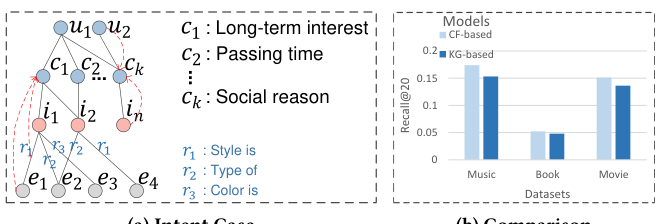
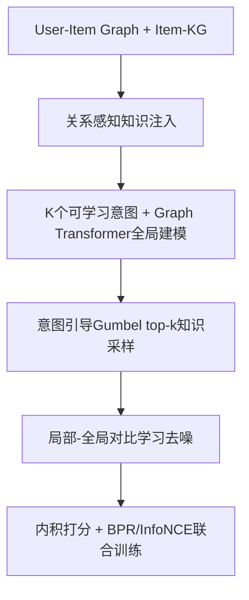
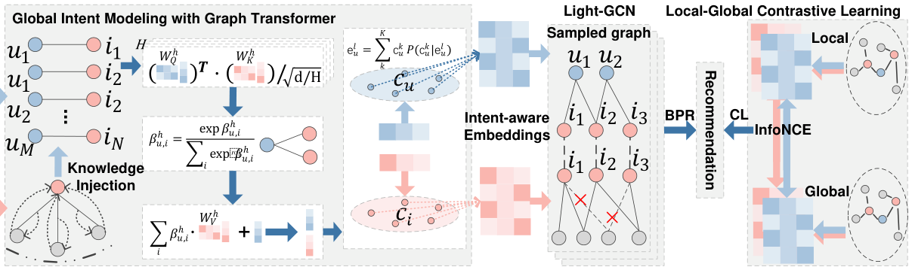

# Knowledge Enhanced Multi-intent Transformer Network for Recommendation (知识增强的多意图Transformer推荐网络)

- **会议/期刊**: WWW 2024 Companion (Industry Track)
- **作者与机构**: Ding Zou、Wei Wei 等；华中科技大学 CCIIP Lab、新加坡管理大学、淘天集团
- **推荐链路定位**: 精排（CTR / Top-K 排序）
- **研究方向**: 图神经网络与知识图谱推荐 / 自监督对比学习与交互去噪
- **论文原文**: [https://arxiv.org/abs/2405.20565v1](https://arxiv.org/abs/2405.20565v1)
- **开源代码**: [https://github.com/CCIIPLab/KGTN](https://github.com/CCIIPLab/KGTN)

## TL;DR (1分钟核心速览)

论文针对知识增强推荐中“多意图被局部聚合忽视”与“KG噪声反噬效果”两大痛点，提出 KGTN：用 $K$个可学习意图原型与图Transformer注入全局 user-item-relation-entity 信号，再以意图表示指导 Gumbel top-$k$ 知识采样，并做局部-全局 InfoNCE 去噪。在 Book/Movie/Last 的采样排序协议下，AUC 较最强基线 MCCLK 提升 2.76%/1.20%/2.41%，R@20 提升 36.2%/12.9%/19.6%；阿里线上 ipv/uvctr 均约 +2.3%。

## Background & Motivation (背景与核心矛盾)

- **主流范式**: KGR 从早期 KG embedding、meta-path，发展到 GNN 高阶聚合与 KGCL/MCCLK 等对比学习去噪。
- **前人局限**: ①多意图建模多在 user-intent-item 局部图上做线性组合，未利用全局 user-item-relation-entity 信号；②KG 并非总有益，Music 上 CKE 的 R@20 为 0.1532，低于无KG的 BPRMF 0.1740；Movie 上 CKE 0.1364 亦低于 BPRMF 0.1512。
- **核心洞察 (Key Insight)**: 用户意图横跨多个异质 KG 节点；若先学到全局意图，便可用意图表示判断哪些知识三元组与当前偏好相关。  
  <figure class="paper-figure" markdown="span">
  <figcaption>图1：(a) 一个用于说明具有全局信息的多个用户意图的简单案例；(b) 性能比较。</figcaption>
</figure>
- **本文切入点**: 将“全局意图学习”与“意图引导的知识去噪”放进同一闭环，而非只在 KG 侧做静态剪枝。

## Method (核心方法设计)

### 1. 整体框架 (Overall Architecture)

输入 user-item 图与 item-relation-entity KG。先做关系感知实体/关系聚合，将知识注入 item；再在 user-item 图上用图Transformer以 $K$个可学习意图为查询做全局消息传递，得到 intent-aware 用户/物品表示；随后用该表示给 KG 三元组打分，Gumbel top-$k$ 采样生成去噪知识图；在去噪图与 user-item 图上做轻量聚合，并对比局部/全局表示；最后层求和内积，联合 BPR 与 InfoNCE 训练。

<figure class="paper-figure" markdown="span">
  <figcaption>图2：所提出的 KGTN 模型的整体框架示意图。建议彩色查看。</figcaption>
</figure>

### 2. 关键设计拆解 (Key Designs)

1. **全局意图与图Transformer**：前人把意图当交互物品或关系集合的局部线性组合，跨用户全局证据不足。KGTN 用意图原型注意力生成每层表示，并在 user-item 边上做多头全局注意力：  
   $\mathbf{e}_u^{l}=\sum_{k=1}^{K}\mathbf{c}_u^{k}P(\mathbf{c}_u^{k}\mid\mathbf{e}_u^{l}),\quad P=\operatorname{softmax}_k(\eta(\mathbf{e}_u^{l-1\top}\mathbf{c}_u^{k}))$；  
   $\mathbf{e}_u^{l+1}=\sum_i m_{u,i}\sum_{h=1}^{H}\beta_{u,i}^{h}\mathbf{W}_h^{V}\mathbf{e}_i^{l}$，其中$\beta_{u,i}^{h}=\operatorname{softmax}_i((\mathbf{W}_h^Q\mathbf{e}_u^{l})^\top(\mathbf{W}_h^K\mathbf{e}_i^{l})/\sqrt{d/H})$。直觉是：同一意图可由不同品牌/风格/关系节点共同支撑，全局注意力把这些证据汇聚到意图原型上。

2. **意图引导的Gumbel top-$k$知识采样**：KG 中无关属性会污染表示。KGTN 用 intent-aware 表示给三元组打分，再加 Gumbel 噪声并保留 top-$k$：  
   $\tilde{\beta}_{(i,r,v)}=\operatorname{softmax}((\mathbf{e}_i\|\mathbf{e}_r)^\top(\mathbf{e}_v\|\mathbf{e}_r))-\log(-\log\epsilon),\ \epsilon\sim\mathrm{Uniform}(0,1)$；  
   $\hat{\beta}_{(i,r,v)}=\tilde{\beta}_{(i,r,v)}$若进入 top-$k$，否则为 0。这样既剪掉低相关边，又比硬规则剪枝更稳健。

3. **局部-全局对比与训练目标**：在采样图上分别以原始表示得 $\mathbf{z}_{u,\mathrm{local}}$、以 intent-aware 表示得$\mathbf{z}_u$，逐层做 InfoNCE：  
   $\mathcal{L}_c=\frac{1}{L}\sum_{l=0}^{L}-\log\frac{\exp(s(\mathbf{z}_u^l,\mathbf{z}_{u,\mathrm{local}}^l)/\tau)}{\sum_{k\neq u}\exp(s(\mathbf{z}_u^l,\mathbf{z}_k^l)/\tau)+\sum_{k\neq u}\exp(s(\mathbf{z}_u^l,\mathbf{z}_{k,\mathrm{local}}^l)/\tau)}$。  
   总损失 $\mathcal{L}_{KGTN}=\mathcal{L}_{BPR}+\alpha\mathcal{L}_c+\lambda\|\Theta\|_2^2$，其中$\mathcal{L}_{BPR}=\sum_{(u,i,j)}-\ln\sigma(\hat{y}_{ui}-\hat{y}_{uj})$。BPR 负例为未交互随机采样，对比负例来自 batch 内其他节点；推理为层表示求和后内积，无额外重排。

## Experimental Setup & Evaluation Protocol (实验设置与评估协议)

- **数据集与预处理**: 三个公开基准，沿用 RippleNet 转隐式反馈，并用 Microsoft Satori 构建置信度 $>0.9$ 的子KG；训练负例按每正例随机等量采样。

| 数据集 | #Users | #Items | #Interactions | KG实体/关系/三元组 | 密度 |
| :--- | ---: | ---: | ---: | ---: | ---: |
| Book-Crossing | 17,860 | 14,967 | 139,746 | 77,903 / 25 / 151,500 | 0.052% |
| MovieLens-1M | 6,036 | 2,445 | 753,772 | 182,011 / 12 / 1,241,996 | 5.11% |
| Last.FM | 1,872 | 3,846 | 42,346 | 9,366 / 60 / 15,518 | 0.588% |

- **数据划分与防穿越**: 沿用 RippleNet 的固定训练/验证/测试划分，正文未复述具体比例；需注意其划分细节披露不足。
- **排名评测协议**: CTR 任务在平衡测试集上报 AUC/F1；Top-K 任务每用户从测试候选（正例+等量随机负例）中选 $K$ 个，报 Recall@10/20。属于 **Sampled Ranking**，并非全库 Full-Ranking。
- **对比基线与超参**: 覆盖 BPRMF、CKE、RippleNet、PER、KGCN、KGNN-LS、KGAT、CKAN、KGIN、CG-KGR、KGCL、MCCLK；$d=64$，Xavier 初始化，Adam，batch=2048，学习率与$L_2$网格搜索；显著性用$p<0.001$的未配对$t$ 检验。

## Key Experimental Results (实验关键数据)

### 1. 主实验对比 (Main Results)

| 模型 | Book AUC | Book R@20 | Movie AUC | Movie R@20 | Last AUC | Last R@20 |
| :--- | ---: | ---: | ---: | ---: | ---: | ---: |
| BPRMF | 0.6583 | 0.0525 | 0.8920 | 0.1512 | 0.7563 | 0.1740 |
| RippleNet | 0.7211 | 0.0622 | 0.9190 | 0.1766 | 0.7762 | 0.1520 |
| KGAT | 0.7314 | 0.0670 | 0.9140 | 0.2296 | 0.8293 | 0.2313 |
| KGIN | 0.7273 | 0.0699 | 0.9190 | 0.2404 | 0.8486 | 0.2487 |
| CG-KGR | 0.7498 | 0.0781 | 0.9110 | 0.2495 | 0.8336 | 0.2106 |
| KGCL | 0.7453 | 0.0845 | 0.9184 | 0.2499 | 0.8455 | 0.2471 |
| MCCLK | 0.7625 | 0.0936 | 0.9252 | 0.2503 | 0.8663 | 0.2598 |
| **KGTN** | **0.7901** | **0.1275** | **0.9372** | **0.2826** | **0.8904** | **0.3106** |

相对最强基线 MCCLK：AUC **+2.76% / +1.20% / +2.41%**，R@20 **+36.2% / +12.9% / +19.6%**；F1 亦最优（0.6876 / 0.8642 / 0.7996），相对提升 1.46% / 0.97% / 3.13%。

### 2. 消融实验 (Ablation Study)

原文以图3展示消融趋势、未给具体表值；下表不伪造绝对值，仅汇总可核实主模型值与相对结论。

| 变体 | 移除内容 | Book / Movie / Last 趋势 |
| :--- | :--- | :--- |
| KGTN | 完整模型 | AUC 0.7901 / 0.9372 / 0.8904 |
| w/o S | 意图引导知识采样 | 三数据集均下降，Book 降幅明显 |
| w/o C | 局部-全局对比 | 均下降，但通常小于 w/o I |
| w/o I | 多意图+全局建模 | 最差，说明全局意图是主增益来源 |

### 3. 关键实验发现 (Key Findings)

1. **全局意图是主增益**：相较 MCCLK，KGTN 在 Book 上 R@20 从 0.0936 升至 0.1275（+36.2%），Movie 0.2503→0.2826（+12.9%），Last 0.2598→0.3106（+19.6%）；消融中 w/o I 最差，说明收益不只来自 KG 聚合。
2. **KG去噪比“加KG”更重要**：Music 上 CKE R@20 仅 0.1532，低于 BPRMF 0.1740；Movie 上 CKE 0.1364 低于 BPRMF 0.1512；KGTN 通过意图采样把 Music R@20 提到 0.3106，验证噪声过滤的必要性。
3. **深度与超参不靠堆叠**：图Transformer层数 $L=1$最优，$L=2/3$时 Book AUC 降至 0.7743/0.7603；$K=1$最差，$\alpha=0.1$ 最佳；线上 A/B 三周，ipv/用户 +2.3%、uv l2o +2.22%、uvctr +2.3%。

## Highlights & Limitations (亮点、对比与审稿批判)

- **与代表作对比 (vs. Prior Work)**: 相比 KGIN 的局部意图/关系聚合，KGTN 用图Transformer做全局意图建模；相比 KGCL/MCCLK 的 CF-KG 跨视图对比，KGTN 先在意图引导下去噪，再对比同一图上的局部/全局表示；相比 CG-KGR，本文强调意图反哺知识采样。
- **可迁移亮点**: ①用 intent-aware score + Gumbel top-$k$ 做可微软剪枝，可迁移到多模态特征选择或社交边去噪；②局部-全局逐层对比可作为通用自监督正则，不依赖人工增广。
- **审稿级局限批判**: ①Top-K 采用等量负采样排序而非全库 Full-Ranking，绝对 Recall 与真实线上召回难度仍有差距，划分比例披露也不充分；②图Transformer、Gumbel top-$k$与对比学习带来额外构图/采样开销，论文未报推理延迟与工业QPS；$K$、$\alpha$ 存在明显敏感区间。

## Rating (四维评分)

- **方法创新性 (Novelty)**: ⭐⭐⭐⭐ （全局意图+意图引导知识采样形成闭环，局部-全局对比有新意，但图Transformer本身非全新。）
- **评估协议与实验扎实度 (Protocol & Experiments)**: ⭐⭐⭐⭐ （三数据集、CTR/Top-K、消融、噪声注入、线上A/B与 $p<0.001$ 齐全；但采样排序与划分细节是短板。）
- **写作与数学规范度 (Clarity & Rigor)**: ⭐⭐⭐⭐ （核心算子与损失定义清楚，符号基本一致；部分图例与消融数值仅以图呈现，复现需读代码。）
- **工业落地与复现价值 (Industrial & Practical Value)**: ⭐⭐⭐⭐ （开源代码+阿里A/B，意图引导去噪对KG推荐很实用；线上收益约2.3%，但未充分披露服务开销。）

