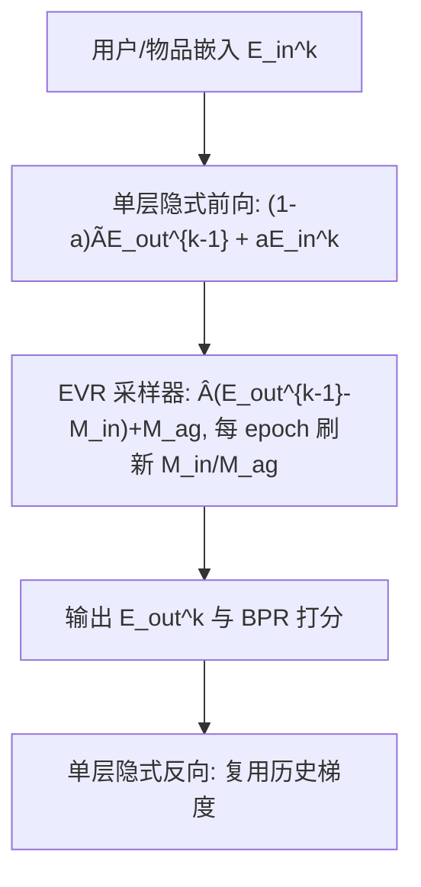
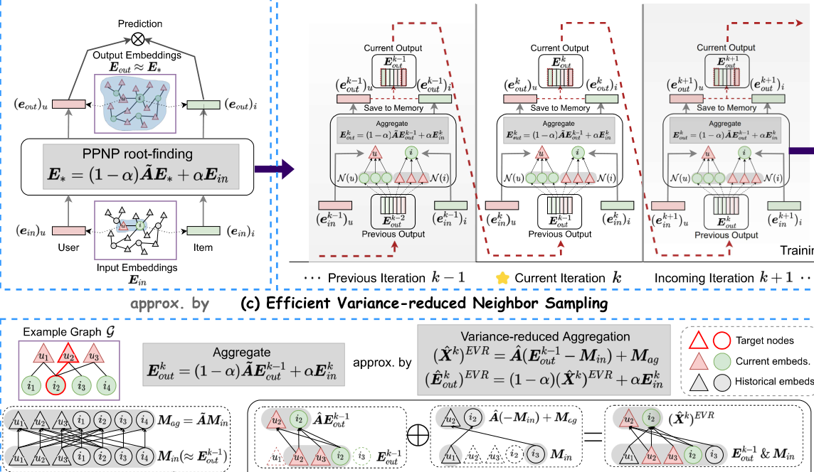

# Linear-Time Graph Neural Networks for Scalable Recommendations (线性时间图神经网络的可扩展推荐)

- **会议/期刊**: The Web Conference 2024 (WWW '24)
- **作者与机构**: Jiahao Zhang, Rui Xue, Wenqi Fan, Xin Xu, Qing Li, Jian Pei, Xiaorui Liu（香港理工大学、北卡罗来纳州立大学、杜克大学）
- **推荐链路定位**: 召回（图协同过滤骨干）
- **研究方向**: 图神经网络与知识图谱推荐 / 协同过滤与双塔召回
- **论文原文**: [https://arxiv.org/abs/2402.13973v1](https://arxiv.org/abs/2402.13973v1)
- **开源代码**: [https://github.com/QwQ2000/TheWebConf24-LTGNN-PyTorch](https://github.com/QwQ2000/TheWebConf24-LTGNN-PyTorch)

## TL;DR (1分钟核心速览)

GNN 推荐虽能刻画高阶协同信号，但 LightGCN 一个 epoch 需 $O(\frac{1}{B}L|E|^2d)$、PinSAGE 需$O(|E|DLd^2)$，边数上亿时无法落地，这与工业界仍以 MF/DNN 为主形成矛盾。LTGNN 把多层递归传播替换为 PPNP 不动点方程的**单层隐式前向/反向传播**（复用上一训练迭代的输出作为求解器初值），并配以"按 epoch 周期更新历史聚合"的高效方差缩减采样，做到$O(|E|Dd)$ 线性复杂度。在 Yelp2018/Alibaba-iFashion/Amazon-Large 上，NDCG@20 较 LightGCN 分别提升 0.1%/7.1%/13.2%，Amazon-Large 单 epoch 训练从 2999s 降至 706s（4.2×）。

## Background & Motivation (背景与核心矛盾)

- **主流范式**: 以 LightGCN 为代表的全图轻量传播（去掉非线性，逐层平均）已成为图协同过滤的标准骨干；工业侧则因算力瓶颈仍大量使用 MF/NCF 这类"逐交互线性"的模型。
- **前人局限**: ①全图多层的复杂度随边数**二次增长**（$L|E|^2d/B$），GC-MC/NGCF/DGCF 在 Amazon-Large 上直接 OOM；②邻居采样路线（PinSAGE/GraphSAGE）把复杂度变成随**层数指数/乘积增长**（$DLd^2$），且随机采样引入巨大近似误差；③VR-GCN/MVS-GNN/GAS 等历史嵌入方案虽降方差，但每个 mini-batch 仍需对历史嵌入做**全邻居聚合**$\tilde{A}E_{in}$，复杂度回退到$O(|E|^2d/B)$。
- **核心洞察 (Key Insight)**: 多层传播的本质是在逼近 Personalized PageRank 的**不动点**；既然不动点与层数无关，就没有必要真的堆层——利用训练迭代间的历史输出作为不动点求解器的"热启动"，单层前向即可在若干 epoch 内收敛到与全传播一致的结果（图 4 的 relative error 在约 4000 次迭代、<10 epoch 内降到 $10^{-3}$ 量级）。
- **本文切入点**: 隐式图建模（把深度从"层"搬到"训练迭代"）+ 周期式高效方差缩减（把 $\tilde{A}M_{in}$ 的聚合摊销到 epoch 级）。

## Method (核心方法设计)

### 1. 整体框架 (Overall Architecture)

输入为用户/物品可学习嵌入 $\boldsymbol{E}^k_{in}$；前向不再做$L$次稀疏乘，而是用单层算子把历史输出$\boldsymbol{E}^{k-1}_{out}$与当前输入混合，得到逼近 PPNP 不动点的输出$\boldsymbol{E}^k_{out}$；其中邻接聚合项$\tilde{A}\boldsymbol{E}^{k-1}_{out}$由 EVR 采样器以$\hat{A}(\boldsymbol{E}^{k-1}_{out}-\boldsymbol{M}_{in})+\boldsymbol{M}_{ag}$无偏估计，$\boldsymbol{M}_{in}/\boldsymbol{M}_{ag}$仅在 epoch 末刷新。反向传播与层数解耦，同样用单层 + 历史梯度$\partial\mathcal{L}/\partial\boldsymbol{E}^{k-1}_{in}$求解隐式梯度，无需存图、无需反传多层。最终$\boldsymbol{E}_{out}$送入 BPR 打分$\hat{y}_{ui}=\boldsymbol{e}_u^\top\boldsymbol{e}_i$ 做全库检索。

<figure class="paper-figure" markdown="span">
  <figcaption>图1：我们的模型架构示意图。(a) 模型的前向过程旨在求解 PPNP 不动点方程，该方程表示嵌入传播的平衡状态，可用于捕捉任意一对节点之间的长距离关系，而不论其距离远近。(b) PPNP 不动点方程通过单个前向传播层求解，该层利用先前训练迭代中的历史输出嵌入。(c) LTGNN 中高效方差缩减邻居采样过程。</figcaption>
</figure>

### 2. 关键设计拆解 (Key Designs)

1. **单层隐式传播（Implicit Propagation）**: 前人"solve by stacking"（APPNP/LightGCN 迭代 $L$层）$\to$改为直接求不动点$\boldsymbol{E}^k_{*}=(1-\alpha)\tilde{A}\boldsymbol{E}^k_{*}+\alpha\boldsymbol{E}^k_{in}$，并用一次前向层近似：
$\boldsymbol{E}^k_{out}=(1-\alpha)\tilde{A}\boldsymbol{E}^{k-1}_{out}+\alpha\boldsymbol{E}^k_{in}$。
直觉：把"层间递归"换成"迭代间递归"，$\boldsymbol{E}^{k-1}_{out}$天然是$k\to\infty$不动点的热启动，收敛后等价于无限跳邻域，从而在$L=1$ 下保留长程协同信号，且复杂度与层数彻底脱钩。
2. **高效方差缩减采样 EVR（Efficient Variance Reduction）**: 经典 VR 的 $\hat{A}(\boldsymbol{E}^k_{in}-\bar{\boldsymbol{E}}^k_{in})+\tilde{A}\bar{\boldsymbol{E}}^k_{in}$里第二项需每 batch 全聚合$\to$ 本文只保留历史量并按 epoch 摊销：
$(\hat{X}^k)_{EVR}=\hat{A}(\boldsymbol{E}^{k-1}_{out}-\boldsymbol{M}_{in})+\boldsymbol{M}_{ag},\ \ \boldsymbol{M}_{ag}=\tilde{A}\boldsymbol{M}_{in}$，
再代回 $(\hat{E}^k_{out})_{EVR}=(1-\alpha)(\hat{X}^k)_{EVR}+\alpha\boldsymbol{E}^k_{in}$；反向对称使用$\boldsymbol{M}'_{in},\boldsymbol{M}'_{ag}$。直觉：$\hat{A}$的无偏估计把"采样漏掉的邻居"用历史全聚合补偿，误差项变为$(\boldsymbol{E}-\boldsymbol{M}_{in})$这种**随时间衰减的漂移量**而非嵌入本身的量级，故即使每个节点只采$D=2$ 个邻居也几乎不掉点。
3. **训练目标、负采样与推理效率**: 沿用 BPR 成对损失 $\mathcal{L}=\sum_{(u,i,j)\in\mathcal{O}}-\ln\sigma(\hat{y}_{ui}-\hat{y}_{uj})$，负样本为均匀采样（与损失解耦，可与 SSL/难负采样正交叠加）；每个 epoch 复杂度$O(|E|Dd)$，仅与 MF 的$O(|E|d)$差常数$D$。推理阶段无多层展开，直接内积 + ANN 检索。

**复杂度对比（表 1 核心）**: LightGCN $O(\frac{1}{B}L|E|^2d)$、PinSAGE$O(|E|DLd^2)$、MF$O(|E|d)$、LTGNN$O(|E|Dd)$。

## Experimental Setup & Evaluation Protocol (实验设置与评估协议)

| 数据集 | #Users | #Items | #Interactions | 稀疏度/密度 | 特征/场景说明 |
| :--- | :---: | :---: | :---: | :---: | :--- |
| Yelp2018 | 31,668 | 38,048 | 1,561,406 | 0.13% | 商户点评，NGCF/LightGCN 官方切分 |
| Alibaba-iFashion | 300,000 | 81,614 | 1,607,813 | 0.0066% | 服饰电商，高稀疏 |
| Amazon-Large | 872,557 | 453,553 | 15,236,325 | 0.0038% | Book/Clothing/Home 三子集交集用户，评分>4 转隐式，`10-core` 过滤 |

- **数据划分与防穿越 (Splitting Strategy)**: 正文未展开，明确置于附录 A.2，沿用 NGCF/LightGCN 在 Yelp2018 上的经典用户级比例划分（无可视时间戳切分）。
- **排名评测协议 (Ranking Protocol)**: 主表指标为 Recall@20 / NDCG@20；未在正文注明候选集规模与正负比，属于**协议披露不足**（见局限）。
- **对比基线与超参设置**: 基线含经典 MF/NCF、图模型 GC-MC/PinSAGE/NGCF/DGCF/LightGCN，以及 LightGCN 的三种可扩展变体 NS（GraphSAGE 采样）、VR（VR-GCN）、GAS（历史嵌入）；统一 BPR 目标与相同嵌入维度设置，LTGNN 仅用 $L=1$与极少邻居（$D$ 可低至 2）。

## Key Experimental Results (实验关键数据)

### 1. 主实验对比 (Main Results)

| Dataset | 方法 | Recall@20 | NDCG@20 | 备注 |
| :--- | :--- | :---: | :---: | :--- |
| Yelp2018 | MF | 0.0436 | 0.0353 | 无图结构 |
| | PinSAGE | 0.04951 | 0.04049 | 采样 GNN |
| | NGCF | 0.0581 | 0.0475 | 多层传播 |
| | DGCF | **0.0640** | **0.0522** | 解耦图卷积 |
| | LightGCN (L=3) | 0.06347 | 0.05238 | 全图传播 |
| | LightGCN-NS (L=3) | 0.06256 | 0.05140 | 采样变体 |
| | **LTGNN (L=1)** | 0.06393 | 0.05245 | +0.1% vs LightGCN |
| Alibaba-iFashion | NGCF | 0.07979 | 0.03570 | |
| | LightGCN (L=3) | 0.08793 | 0.04096 | |
| | LightGCN-NS (L=3) | 0.08804 | 0.04147 | |
| | **LTGNN (L=1)** | **0.09335** | **0.04387** | **+6.2% / +7.1%** |
| Amazon-Large | NCF | 0.02785 | 0.01807 | |
| | PinSAGE | 0.02809 | 0.01973 | |
| | NGCF / DGCF / GC-MC | OOM | OOM | 内存不可行 |
| | LightGCN (L=3) | **0.03310** | 0.02283 | 2999.35s/epoch |
| | LightGCN-VR (L=3) | 0.02903 | 0.02093 | 4849.59s/epoch |
| | **LTGNN (L=1)** | 0.02942 | **0.02585** | **+13.2% NDCG，705.91s/epoch** |

### 2. 消融实验 (Ablation Study)

| 配置（Amazon-Large, L=3 或注明） | Recall@20 | NDCG@20 | 单 epoch 时间 |
| :--- | :---: | :---: | :---: |
| LightGCN 全传播 | 0.03310 | 0.02283 | 2999.35s |
| w/ NS（无方差缩减） | 0.02835 | 0.02035 | 4291.37s |
| w/ VR（经典全聚合方差缩减） | 0.02903 | 0.02093 | 4849.59s |
| w/ GAS（历史嵌入） | 0.02886 | 0.02085 | 932.03s |
| **LTGNN（单层 + EVR）** | 0.02942 | **0.02585** | **705.91s** |

### 3. 关键实验发现 (Key Findings)

1. **可扩展性变体普遍"降点换速"，LTGNN 是唯一"既提速又提点"的方案**：Amazon-Large 上 NS/VR/GAS 的 NDCG 相对全传播 LightGCN 分别下降 10.9%/8.3%/8.7%，而 LTGNN 反升 13.2%，且耗时从 2999s 降到 706s（较 GAS 再快 24%），验证 EVR 的漂移项补偿确实比"每 batch 全聚合"更省更准。
2. **层数不再是性能来源**：图 2 显示 LTGNN 在 $L=1\sim2$即超过 LightGCN$L=3\sim5$ 的效果，继续加层几乎无收益，说明"迭代间热启动"已经覆盖了多跳邻域，深度冗余被完全剥离。
3. **采样率鲁棒性极强**：图 3 中即便每个目标节点只采 2 个邻居，带 EVR 的 LTGNN 仍稳定优于无 EVR 的 LTGNN-NS；图 4 显示其输出在 <10 epoch 内相对误差收敛到与全聚合 LTGNN-Full 几乎重合的曲线，说明随机误差已被历史聚合吸收。
4. **代价是召回端的轻微妥协**：Yelp2018 上 LTGNN 略低于 DGCF（0.06393 vs 0.0640），Amazon-Large 上 Recall@20 低于 LightGCN(L=3)，说明隐式单层主要收益在**排序质量（NDCG）**与效率，而非召回广度。

## Highlights & Limitations (亮点、对比与审稿批判)

- **与代表作对比 (vs. Prior Work)**: 与 LightGCN 的差别在于把"层"从计算图搬到训练轨迹上（$L=1$但跨迭代递归）；与 GAS/VR-GCN 的差别在于把历史聚合从"每 batch"降为"每 epoch"（$\boldsymbol{M}_{ag}=\tilde{A}\boldsymbol{M}_{in}$摊销），这是线性复杂度的关键一步；与 PinSAGE 的差别在于用无偏估计 + 漂移补偿替代纯随机采样，避免$D$ 必须取大的困境。
- **可迁移亮点**: ①"历史输出当求解器初值"的隐式求解范式可直接用于任意多层 GNN 骨干的加速；②$\hat{A}(E-M_{in})+M_{ag}$ 的周期刷新方差缩减思路可迁移到大规模图上的动量式负采样与 EMB 缓存。
- **审稿级局限批判**: ①**评估协议披露不足**：正文未给出负采样比例、候选规模与划分细节（全库排序还是采样排序不明），削弱结果可比性；②**精度并非全面占优**，Yelp2018 Recall 被 DGCF 反超、Amazon-Large Recall 低于全传播 LightGCN，摘要"outperform all baselines on Yelp"表述略有夸大；③EVR 依赖 $\boldsymbol{M}_{ag}$的 epoch 级陈旧性，收敛速度对学习率与$\alpha$敏感（图 5 显示$\alpha$ 有明显最优区间），冷启动/动态图（嵌入随时间漂移）下的失效风险未被讨论；④相对 MF 仍有数倍常数开销（127s vs 706s）。

## Rating (四维评分)

- **方法创新性 (Novelty)**: ⭐⭐⭐⭐ （把 PPNP 不动点与训练迭代耦合的"单层隐式 GNN"设计新颖，且给出严格的复杂度与收敛误差实证）
- **评估协议与实验扎实度 (Protocol & Experiments)**: ⭐⭐⭐ （三数据集含亿级边 Amazon-Large 与 OOM 标记很有说服力，但划分/排序协议推给附录、缺显著性检验与方差报告）
- **写作与数学规范度 (Clarity & Rigor)**: ⭐⭐⭐⭐ （前向/反向/EVR 公式对称清晰，复杂度推导逐模型对齐；但正文符号与附录超参割裂）
- **工业落地与复现价值 (Industrial & Practical Value)**: ⭐⭐⭐⭐⭐ （PyTorch 代码开源，单层 + 2 邻居即可训练，复杂度与 MF 同阶，直接可替换现有 LightGCN 骨干）

