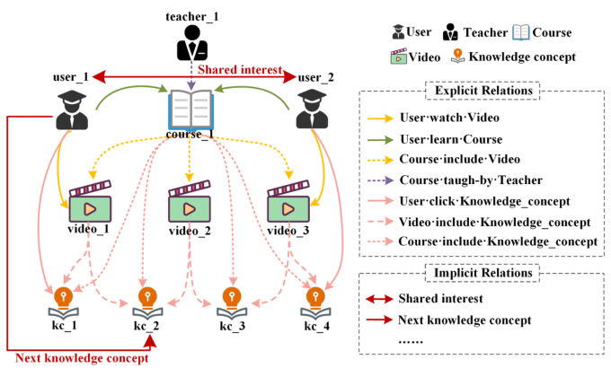
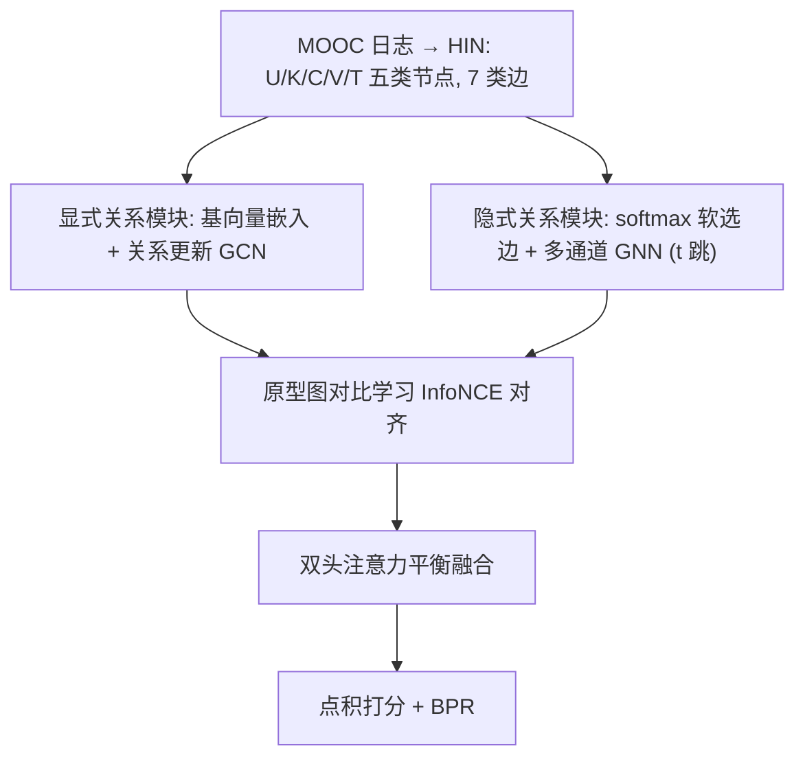

# Modeling Balanced Explicit and Implicit Relations with Contrastive Learning for Knowledge Concept Recommendation in MOOCs (基于对比学习的 MOOC 显式/隐式关系平衡建模与知识点推荐)

- **会议/期刊**: WWW 2024
- **作者与机构**: Hengnian Gu, Zhiyi Duan, Dongdai Zhou（东北师范大学），Pan Xie（吉林开放大学）
- **推荐链路定位**: 召回（为学习者返回 Top-$N$ 知识点）
- **研究方向**: 图神经网络推荐 / 自监督对比学习
- **论文原文**: [https://arxiv.org/abs/2402.08256v1](https://arxiv.org/abs/2402.08256v1)
- **开源代码**: 暂未开源

## TL;DR (1分钟核心速览)

MOOC 知识点推荐长期依赖用户-知识点-课程-视频的显式单跳关系，忽略了「同课程学习者共享兴趣、同视频下点击跳转」这类更难刻画的隐式多跳关系，且显式关系在数量上远少于隐式关系，二者直接拼接会造成表示失衡。CL-KCRec 提出：用基向量关系嵌入 + 关系更新 GCN 建模显式关系，用多通道软选边 GNN 自动挖掘 $t$ 跳隐式关系，并以「原型图 + GAT + InfoNCE」对比学习统一增强，最后用双头注意力平衡融合。在真实 MOOCs 数据集 MOOCCube1819 上按「用户级时间切分 + 1:99 负采样」评测，相对最优基线（HGCL/CoNR）在 N@5 提升 10.2%、MRR 提升 9.4%。

## Background & Motivation (背景与核心矛盾)

- **主流范式**: 将 MOOC 平台四类实体（User / Knowledge Concept / Course / Video / Teacher）与七类关系建成 HIN，用元路径（metapath2vec、HERec）或注意力 GCN（ACKRec）在显式边上传播表示后做点积召回。
- **前人局限**: ① 显式边稀疏但语义确定，隐式边（同课程共同兴趣、同视频知识概念的补充关系）数量更多却难以从海量多类型实体组合中自动抽取；② 两类关系天然数量悬殊且语义复杂度不同，直接拼接/加权会让主导模态压倒另一侧，导致「兴趣传播」链条断裂。
- **核心洞察 (Key Insight)**: 显式关系可视为「少而确定」的监督，隐式关系可视为「多而含噪」的自监督信号；把二者建模为同一节点在两个关系子空间中的两种视角，用对比学习强制它们共享「内在关系知识」，即可在不引入额外标注的情况下同时增强两侧。
- **本文切入点**: 用原型图把「隐式关系 = 显式关系的加权多跳组合」显式写出，再用 InfoNCE 把两种关系视角对齐，并用双头注意力做软融合以平衡贡献。

<figure class="paper-figure" markdown="span">
  <figcaption>图1：MOOCs 中显式与隐式关系的综合视图。</figcaption>
</figure>

## Method (核心方法设计)

### 1. 整体框架 (Overall Architecture)

输入是 MOOC 日志构建的 HIN $\mathcal{G}=(\mathcal{V},\mathcal{E})$（U/K/C/V/T 五类节点、7 类边）。显式关系模块先用 BERT 编码节点辅助文本，再用基向量关系嵌入 + 圆形相关（circular-correlation）合成的关系更新 GCN 得到$\boldsymbol{h}_{v|er}$；隐式关系模块把 7 个邻接矩阵当作「关系基」，通过 softmax 软选边叠加得到$t$跳隐式邻接矩阵$A_{ir}$，在多通道 GNN 上得到$\boldsymbol{h}_{v|ir}$。随后进入原型图对比学习：对每个用户/知识点分别聚类得到$n$个原型，原表示与原型全连接构成原型图，经 GAT 得到增强表示$\boldsymbol{z}_{u|er}$、$\boldsymbol{z}_{u|ir}$，用 InfoNCE 互为正/负样本对齐。最终用双头注意力对两个视角加权融合为$\boldsymbol{h}^F_u,\boldsymbol{h}^F_k$，点积打分并以 BPR + 对比损失联合训练。

### 2. 关键设计拆解 (Key Designs)

1. **基向量关系嵌入 + 关系更新 GCN（显式关系的过参数化抑制）**：直接为 7 类边学独立关系向量会引入冗余参数且难以泛化到低频边。用 $B$个共享基向量线性组合表示任一关系：$\boldsymbol{z}_r=\sum_{b=1}^{B}\alpha_{br}\boldsymbol{c}_b$，再把$\boldsymbol{z}_r$通过圆形相关$\varphi(\cdot)$注入 GCN，得到$\boldsymbol{h}_{v_i|er}^{(l)}=f_{agg}(\sum_{(v_j,r)}\boldsymbol{W}_r^{(l-1)}\varphi(\boldsymbol{h}_{v_j|er}^{(l-1)},\boldsymbol{h}_r^{(l-1)}))$。直觉是：关系嵌入被压缩到低秩子空间，$\alpha_{br}$ 让高频边贡献更多基权重、低频边只借用强基的共享信息，天然抗稀疏。

2. **软选边多通道 GNN（隐式关系的可学习多跳组合）**：隐式关系没有显式边，作者视「关系类型的线性组合」为隐式关系。用 $1\times1$卷积配合 softmax 对邻接矩阵做凸组合：$F(A;\boldsymbol{W})=\sum_{i=1}^{|\mathcal{T}_e|}\alpha_i A_i$，再逐层堆叠得到$t$跳隐式邻接矩阵$A^{(t)}=(D^{(t)})^{-1}A^{(t-1)}F(A;\boldsymbol{W}^{(t)})$；并设$C$个通道并行，得到多通道表示$\boldsymbol{h}_{v_i|ir}^{(l)}=f_{agg}(\|_{c=1}^{C}\sigma(\hat{D}_c^{-1}\hat{A}_c^{(t)}\boldsymbol{h}_{v_i|ir}^{(l-1)}\boldsymbol{W}^{(l-1)}))$。这等价于在元路径空间上做可微搜索：$\alpha_i$自动学到「用户-视频-知识点」等有效路径组合，$t$ 增大时捕获更深层的跨实体语义。

3. **原型图对比学习 + 双头注意力、损失与复杂度**：对显式表示 $\boldsymbol{h}_{u|er}$做$k$-means 得原型集$\mathcal{C}=\{\boldsymbol{c}_i\}_{i=1}^{n}$，将原表示与全部原型全连接为原型图$\mathcal{G}_{u|er}$，经 GAT 得$\boldsymbol{z}_{u|er}$。InfoNCE 损失把另一视角的增强表示作为负例：$\mathcal{L}_{u}^{cl}=\sum_{i}-\log\frac{\exp(s(\boldsymbol{h}_{u_i|er},\boldsymbol{z}_{u_i|er})/\tau)}{\sum_{j}\exp(s(\boldsymbol{h}_{u_i|er},\boldsymbol{z}_{u_j|ir})/\tau)}+\text{(对称项)}$，$\mathcal{L}_{cl}=\alpha_u\mathcal{L}^{cl}_u+\alpha_k\mathcal{L}^{cl}_k$。融合端用双头注意力（跨模态映射共享$W_v,b_v$、注意力共享$W_s,b_s$）计算$\tilde{\alpha}_{u|er},\tilde{\alpha}_{u|ir}$后加权，最后$\mathcal{L}=\mathcal{L}_{bpr}+\beta\cdot\mathcal{L}_{cl}$，BPR 负例采用均匀采样。训练复杂度与 HGCL 同级：显式$\mathcal{O}((|\mathcal{T}_e|d_1+|\mathcal{E}|)d_1L_{er})$、隐式$\mathcal{O}(|\mathcal{A}|Td_0L_{ir}C)$、对比$\mathcal{O}(((n+1)^2+N_u+N_k)db_{min})$。

## Experimental Setup & Evaluation Protocol (实验设置与评估协议)

- **数据集与预处理**（MOOCCube1819，源自学堂在线，2018-01-01 至 2019-06-30 行为切片；作者未给出完整 5-core 过滤统计）：

| 数据集 | #Users | #Items(KC) | #Interactions | 稀疏度/密度 | 特征/场景说明 |
| :--- | :---: | :---: | :---: | :---: | :--- |
| MOOCCube1819 | —（见原文附录 A.1.1） | —（见原文附录 A.1.1） | —（见原文附录 A.1.1） | — | MOOC 学习行为：U/K/C/V/T 五类节点、7 类边 |
| Yelp | — | — | — | — | 商业点评，跨域泛化测试 |
| Douban Movie | — | — | — | — | 电影点评，跨域泛化测试 |

- **数据划分与防穿越 (Splitting Strategy)**: 采用**全局时间戳切分**——以 2019-03-31 为切分点，之前为训练集、之后为测试集，避免未来信息泄露。
- **排名评测协议 (Ranking Protocol)**: **Sampled Ranking**，每个测试正例随机采样 **99 个负例**（1 正 : 99 负）后计算打分排序；指标为 HR@{5,10,20}、NDCG@{5,10,20}、MRR。
- **对比基线与超参设置**: 基线 12 个，覆盖 CF（FISM / NeuMF / NAIS）、HIN 表示学习（metapath2vec / HIN2vec / HetGNN / HERec）、HIN 推荐（ACKRec / MHCN / CoNR）、图对比学习（KGCL / HGCL）。关键超参：基向量数 $B=15$（MOOCCube1819）/$B=10$（Yelp、Douban），隐式关系跳数$t\in\{4,5\}$，原型数$n=10$（MOOCCube1819）/$n=40$（跨域数据集）。作者未报告显著性检验（如$p<0.05$）。

## Key Experimental Results (实验关键数据)

### 1. 主实验对比 (Main Results)

MOOCCube1819 上的召回结果（H*=HR, N*=NDCG，**加粗为最优基线**）：

| 方法 | H@5 | H@10 | H@20 | N@5 | N@20 | MRR |
| :--- | :---: | :---: | :---: | :---: | :---: | :---: |
| NeuMF | 0.2470 | 0.4843 | 0.6757 | 0.2238 | 0.2755 | 0.2054 |
| NAIS | 0.2756 | 0.5022 | 0.7011 | 0.2591 | 0.3231 | 0.2436 |
| metapath2vec | 0.3190 | 0.5314 | 0.7252 | 0.2736 | 0.3462 | 0.2673 |
| HetGNN | 0.4208 | 0.6022 | 0.7927 | 0.3313 | 0.4241 | 0.3244 |
| ACKRec | 0.4566 | 0.6287 | 0.8159 | 0.3570 | 0.4548 | 0.3490 |
| MHCN | 0.4421 | 0.6293 | 0.8205 | 0.3568 | 0.4542 | 0.3413 |
| KGCL | 0.4584 | 0.6428 | 0.8288 | 0.3597 | 0.4610 | 0.3454 |
| **CoNR** | 0.4593 | 0.6462 | 0.8315 | **0.3778** | 0.4668 | **0.3687** |
| **HGCL** | **0.4657** | **0.6572** | **0.8364** | 0.3624 | **0.4705** | 0.3598 |
| **CL-KCRec (本文)** | **0.5136** | **0.6751** | **0.8417** | **0.4163** | **0.5163** | **0.4032** |
| Improv.% (vs 最优基线) | +10.29% | +2.72% | +0.63% | +10.19% | +9.73% | +9.36% |

跨数据集泛化（Yelp / Douban Movie）:CL-KCRec 均优于全部基线，但优势幅度明显收窄。Yelp 上 H@5 0.7078 vs 最优基线 HGCL 0.6983（**+1.4%**），MRR 0.5427 vs 0.5398（**+0.5%**）；Douban 上 H@5 0.5631 vs 0.5441（**+3.5%**），MRR 0.4035 vs 0.3922（**+2.9%**）。

### 2. 消融实验 (Ablation Study)

| 变体 | H@5 | H@20 | N@5 | N@20 | MRR | 相对 N@5 降幅 |
| :--- | :---: | :---: | :---: | :---: | :---: | :---: |
| w/-er（去显式关系） | 0.4762 | 0.7996 | 0.3648 | 0.4859 | 0.3738 | −12.4% |
| w/-ir（去隐式关系） | 0.4987 | 0.8255 | 0.3965 | 0.5088 | 0.3862 | −4.8% |
| w/o-cl（去对比学习） | 0.5002 | 0.8267 | 0.3987 | 0.5100 | 0.3937 | −4.2% |
| w/o-att + 拼接 (⊕) | 0.5108 | 0.8392 | 0.4147 | 0.5109 | 0.3989 | −0.4% |
| w/o-att + 相加 (+) | 0.5086 | 0.8321 | 0.4078 | 0.5067 | 0.3944 | −2.0% |
| **CL-KCRec** | **0.5136** | **0.8417** | **0.4163** | **0.5136** | **0.4032** | — |

> 注：原文主表 N@20 记为 0.5163，消融表中同型号结果记为 0.5136，两处数值存在微小不一致，推测为排版误差，不影响趋势结论。

### 3. 关键实验发现 (Key Findings)

1. **显式关系才是 MOOC 场景的主干信号，隐式关系是增益而非替代**。移除显式模块（w/-er）使 N@5 从 0.4163 跌至 0.3648（**−12.4%**），跌幅是移除隐式模块（−4.8%）的 2.6 倍——说明碎片化的学习行为仍是最可靠的兴趣锚点，隐式多跳更适合作为「在显式稀疏处补全」的次优信号，这与作者「隐式关系数量更多」的动机呈现出有趣的张力。

2. **对比学习主要在「排序质量」而非「命中率」上发力**。去掉 $\mathcal{L}_{cl}$ 后 H@20 仅从 0.8417 降至 0.8267（−1.8%），但 MRR 从 0.4032 降至 0.3937（−2.4%）、N@10 从 0.4313 降至 0.4046（−6.2%）:原型图增强把正确知识点从列表后段前移到首位，验证了原型图是在修正「关系数量悬殊」导致的兴趣传播偏差，而不是简单地扩充候选覆盖。

3. **双头注意力的收益高度依赖融合方式**。与「拼接替换」相比 N@5 只提升 0.4%，但与「相加替换」相比 N@5 提升 2.0%、N@20 提升 1.4%——说明作者主张的「平衡贡献」本质上是把两个语义不同源的向量投影到共享空间后再分配权重，而简单相加会让 7 类边主导的隐式通道数值量级压过 3 类边的显式通道；同时跨域实验涨幅收窄到 1–3%，暗示该方法对 MOOC 特有的「课程-视频-知识点」三元嵌套结构有较强依赖。

## Highlights & Limitations (亮点、对比与审稿批判)

- **与代表作对比 (vs. Prior Work)**: 相较 ACKRec（元路径 + 注意力 GCN，只建模显式边），本文补上了「隐式关系」这一块，并用软选边 GNN 把「元路径组合」从人工设计变成可微搜索，这是对 ACKRec 的实质增量；相较 HGCL（HIN 上的图对比学习），本文的对比信号不再局限于随机边扰动/特征遮蔽，而是用「原型 + GAT」构造同一节点在两个关系子空间中的语义匹配对，属于对「自监督增广策略」的重新设计；相较 KGCL（KG 上的对比学习，结构增强依赖实体/关系扰动），本文将两侧不对称的稀疏程度（显式少、隐式多）也纳入损失设计，从「增强精度」延伸到「平衡贡献」。
- **可迁移亮点**: ①「基向量低秩关系嵌入」可直接嫁接到任意对边类型做线性分解的双塔/图模型上，降低低频边过参数化;②「原型聚类 + 全连接 + GAT」的对比增广不需要扰动原图，适合在只能拿到一阶邻居的工业召回场景里构造自监督正例对。
- **审稿级局限批判**: ① 评测采用 1:99 负采样而非全库 Full-Ranking,100 个候选的量级可能低估排序难度与实际提升幅度（H@20 涨幅仅 0.63% 也侧面说明头部容量已饱和），且未报告多次重复实验的方差或显著性检验；② 对比学习每轮需对 mini-batch 内全部用户/知识点做 $k$-means 聚类与原型图 GAT，$n$个原型全连接使复杂度随原型数平方增长，在节点数达到千万级的真实 MOOC 平台上在线延迟与训练成本会显著高于单通道 GCN;③ 超参$B$、$t$、$n$的最优值随数据集规模漂移（MOOCCube 上$B=15,n=10$;Yelp/Douban 上$B=10,n=40$），缺乏自适应的选择策略，线上需要对每个业务域单独调参。

## Rating (四维评分)

- **方法创新性 (Novelty)**: ⭐⭐⭐⭐ （将「显式少、隐式多」这一不对称性显式建模为关系子空间对比，并用软选边 GNN 替代人工元路径，思路新颖且有清晰的物理直觉支撑）
- **评估协议与实验扎实度 (Protocol & Experiments)**: ⭐⭐⭐ （MOOCCube 时间切分合理、基线覆盖 12 个、消融与跨域实验完整，但仅采用 1:99 采样排序、缺失数据集统计表与显著性检验，H@20 提升幅度偏弱）
- **写作与数学规范度 (Clarity & Rigor)**: ⭐⭐⭐⭐ （HIN 定义 → 显式/隐式模块 → 对比学习 → 融合的推导链完整，复杂度分析到位；但主表与消融表中同一数值出现 0.5136/0.5163 的不一致，个别公式排版存在乱码）
- **工业落地与复现价值 (Industrial & Practical Value)**: ⭐⭐⭐ （整体框架与 LightGCN 系 GCN 思路兼容、可增量接入现有 HIN 召回链路，但原型图全连接与逐 epoch 聚类带来额外训练开销，且代码未开源，复现成本较高）

