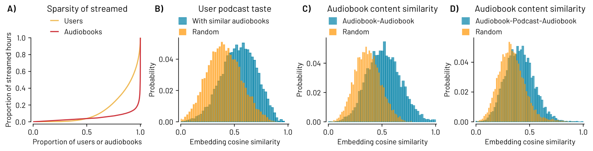
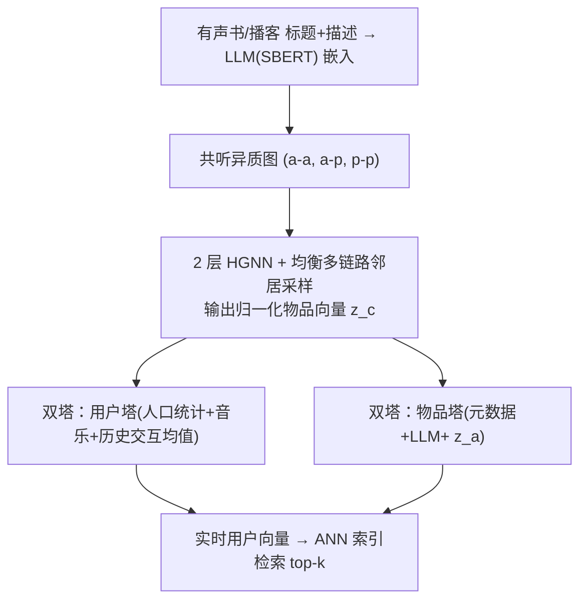
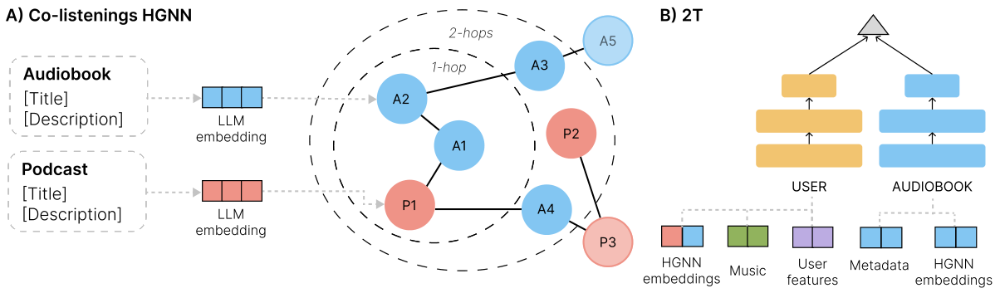

# Personalized Audiobook Recommendations at Spotify Through Graph Neural Networks (Spotify 基于图神经网络的有声书个性化推荐)

- **会议/期刊**: WWW 2024 (The Web Conference, Companion/Research Track)
- **作者与机构**: Marco De Nadai, Francesco Fabbri, Paul Gigioli, Alice Wang, Ang Li, Fabrizio Silvestri, Laura Kim, Shawn Lin, Vladan Radosavljevic, Sandeep Ghael, David Nyhan, Hugues Bouchard, Mounia Lalmas-Roelleke, Andreas Damianou (Spotify; Sapienza University of Rome)
- **推荐链路定位**: 召回（候选生成）+ 物品表征预训练（HGNN 离线产 embedding，2T 在线查 ANN 索引）
- **研究方向**: 图神经网络与知识图谱推荐 / 冷启动与长尾推荐
- **论文原文**: [https://arxiv.org/abs/2403.05185v1](https://arxiv.org/abs/2403.05185v1)
- **开源代码**: [https://github.com/spotify/annoy](https://github.com/spotify/annoy)（仅开源在线 NN 检索库 Annoy，模型代码未开源）

## TL;DR (1分钟核心速览)

Spotify 上线有声书时面临三重困境：新品类的**极端交互稀疏 + 付费墙导致的高风险决策 + 亿级用户低延迟要求**。本文提出 2T-HGNN：把用户节点从图中**彻底解耦**，只在"有声书-播客共听异质图"上训 2 层 GraphSAGE 式 HGNN 学物品长程表征（含 LLM 内容特征），再把该表征灌入双塔（2T）做用户-物品检索，并配套一个**按边类型欠采样的均衡邻居采样器**解决播客边压倒有声书边的失衡。离线全局时间戳切分（10M 用户 / 250K+ 有声书 / 3.5M+ 播客）上，热启动用户 HR@10 达 0.353（较最强基线 +36.8%），冷启动 0.200（较 2T +48.1%）；1150 万 MAU 的线上 A/B 带来新书起播率 +46.83%、播放率 +25.82%，并**反向提升存量播客业务的 HR@10 +7%、覆盖率 +80%**。

## Background & Motivation (背景与核心矛盾)

- **主流范式**: 工业推荐主流是双塔（2T）召回 + ANN 检索；学界/工业界图推荐多用含用户节点的 (H)GNN 做协同过滤式消息传递，或用 GraphSAGE 类归纳式采样控制邻居爆炸。
- **前人局限**: ①含用户节点的图在 Spotify 规模下 k-hop 聚合不可行，用户图极度稀疏（大量不连通分量、平均度低），HGNN-w-users 的 MRR/覆盖率相比纯物品图分别掉 30%/53%；②纯 2T 在极度稀疏的新品类上几乎无法从协同信号学到东西（冷启动 HR@10 仅 0.135，甚至**低于 Popularity 的 0.161**）；③新品类初期只有付费墙后的弱信号（follow/preview/intent-to-pay），显式正反馈量极少。
- **核心洞察 (Key Insight)**: 作者用 90 天 8 亿+ 流媒体数据做了三组统计验证——(i) >70% 的早期有声书消费者此前有播客行为，且共听同一本书的用户在播客隐空间上显著更相似；(ii) 被共同收听的有声书对的内容嵌入（Sentence-BERT）相似度远高于随机对；(iii) **通过同一播客桥接、彼此却从未共听的两本有声书，其内容嵌入依然高度相似**——这说明"有声书–播客–有声书"的 2-hop 路径是稀疏场景下可用的伪协同信号。同时逻辑回归显示 follow/preview/intent-to-pay 分别把后续起播几率提升 +118%/+18%/+13%。
- **本文切入点**: 既然音频内容（书与播客）在"通勤/家务"场景共用同一消费心智，就把播客当"知识源"，在物品侧建异质共听图做长程传播，在用户侧保留轻量双塔保证实时性。

<figure class="paper-figure" markdown="span">
  <figcaption>图2：A）上线时的有声书消费非常稀疏。25%的用户占全部流媒体播放时长的75%。B）有声书品味相似的用户在播客偏好上比随机选择的用户更相似。C）至少被一名用户共同收听的有声书具有相似的内容嵌入（从有声书标题和描述中提取的LLM嵌入）。D）两本有声书若与同一播客共同收听、但彼此未共同收听，则具有相似的内容嵌入。</figcaption>
</figure>

## Method (核心方法设计)

### 1. 整体框架 (Overall Architecture)

离线每日先训 HGNN：输入是共听异质图（节点为有声书 $a$与播客$p$，边类型$r\in\{(a,a),(a,p),(p,p)\}$，只要有一名用户同时流播即连边），节点初始特征为标题+描述经多语言 Sentence-BERT 得到的 LLM 嵌入，两层 HGNN 输出归一化物品向量$\mathbf{z}_c$。随后把$\mathbf{z}_a,\mathbf{z}_p$喂入双塔：用户塔拼接人口统计学特征（国家、年龄）+ 音乐向量（平台预计算）+ 近 90 天交互过的有声书/播客 HGNN 向量的均值$\bar{\mathbf{z}}_a,\bar{\mathbf{z}}_p$（流播与弱信号都计入）；物品塔拼语言、BISAC 类目、LLM 嵌入与$\mathbf{z}_a$，各自输出 128 维向量。线上物品向量离线入 ANN 索引，用户向量实时前向生成后检索 top-$k$，端到端延迟 <100 ms。

<figure class="paper-figure" markdown="span">
  <figcaption>图3：我们的模型概览。A）我们用包含两种节点类型的异质图表示有声书-播客关系：有声书和播客；当至少一名用户同时收听两者时相连。每个节点具有从有声书和播客标题与描述中提取的LLM嵌入特征。我们在该图上使用2层HGNN。B）我们的2T模型通过利用HGNN嵌入、用户人口统计特征（如国家和年龄）以及表示为嵌入的历史用户交互（音乐、播客和有声书）向用户推荐有声书。</figcaption>
</figure>

### 2. 关键设计拆解 (Key Designs)

1. **用户解耦的异质共听图 + 归纳式 HGNN**：痛点是把用户当节点会让邻域规模随亿级用户爆炸且高度稀疏。做法是彻底移除用户节点，只留物品-物品边，异质聚合算子写成按关系分别池化再求和：
$\mathbf{h}^k_{\mathcal{N}(c,r)} = \max\big(\{\sigma(\mathbf{W}_r\mathbf{h}^{k-1}_{c'}+\mathbf{b}), \forall c'\in\mathcal{N}(c,r)\}\big)$，
$\mathbf{h}^k_c = \sigma\big(\mathbf{W}^k_c \mathbf{h}^{k-1}_c + \sum_r \mathbf{h}^k_{\mathcal{N}(c,r)}\big)$，最终$\mathbf{z}_c=\mathbf{h}^l_c/\|\mathbf{h}^l_c\|$。由于聚合是归纳式的（GraphSAGE 系），**从未被流播的新书仅凭 LLM 特征即可生成 embedding**，天然覆盖 strict 冷启动物品；归一化后可直接内积/近邻检索。
2. **均衡多链路邻居采样器（Balanced Multi-link Sampler）**：痛点是有声书刚上线，$|(p,p)|$与$|(a,p)|$边数远大于$|(a,a)|$，均匀采样会让对比损失被播客边淹没、有声书表征学不动。做法是对多数类边类型欠采样到与少数类同量级（如取$N$条$a$-$a$与$N$条$a$-$p$），每个 epoch 重新均匀抽取以保证覆盖；训练用 hinge 对比损失：
$\mathcal{L}_{HGNN}=\mathbb{E}_{n\sim\mathcal{C}}\max\{0,\mathbf{z}_a\cdot\mathbf{z}_n-\mathbf{z}_a\cdot\mathbf{z}_p+\Delta\}$，负样本为图中不与锚点相连的随机节点。效果是把单 epoch 期望开销从最坏$O(|\mathcal{E}|)$ 压到可控，训练时间减少约 60%。
3. **训练目标、负采样与推理**：2T 用批内负样本 + 逆流行度加权（防止热门负样本主导梯度）：
$\mathcal{L}_{2T}=\mathbb{E}_{n\sim\mathcal{B}}\big[w_n\,(\mathbf{o}_u\cdot\mathbf{o}_n-\mathbf{o}_u\cdot\mathbf{o}_a)\big]$。HGNN 侧为 margin 负采样（非 InfoNCE），2T 侧为**免显式负采样池的 in-batch**策略；部署上物品向量日更、用户向量实时算，书库小时用暴力检索、扩张后切 ANN（Annoy）。

## Experimental Setup & Evaluation Protocol (实验设置与评估协议)

- **数据集与预处理**: 90 天 Spotify 平台交互（含流播与弱信号），离线子集 10M 用户 / 3.5M+ 播客 / 250K+ 有声书；图节点特征来自标题+描述的多语言 Sentence-BERT 嵌入，无 5-core 类强过滤（保稀疏原貌）。

| 数据集 | #Users | #Items | #Interactions | 稀疏度/密度 | 特征/场景说明 |
| :--- | :---: | :---: | :---: | :---: | :--- |
| Spotify-Audiobook(离线) | 10M | 250K+ 有声书 + 3.5M+ 播客 | 90 天流播，含 198M+ 弱信号交互 | 极稀疏；25% 用户占 75% 播放时长，top 20% 书占 80% 时长 | 共听异质图 + 人口统计 + 音乐/播客/有声书历史 |
| Spotify 线上 A/B | 11.5M MAU | 同上（生产目录） | 生产流量 | — | "Audiobook for you" 首页模块随机三分组 |

- **数据划分与防穿越 (Splitting Strategy)**: **全局时间戳切分**——训练用 90 天窗口，hold-out 为最后 14 天全部有声书/播客流播；训练集内再切 10% 作 HGNN 验证集（early stopping，连续 10 epoch 不升即停，最多 50 epoch）。
- **排名评测协议 (Ranking Protocol)**: 检索式 **Sampled/NN 候选排序**而非全库 Full-Ranking——用户向量经 k-NN 索引取候选项，HR@10 统计至少命中 1 个真实交互的比例，MRR 与 Coverage 截断在前 100 项；论文未报告负采样正负比，也未做显著性检验（离线部分）。
- **对比基线与超参设置**: Popularity（90 天最热）、LLM-KNN（历史书嵌入均值最近邻）、HGNN（本文物品图，仅能服务热启动用户）、HGNN-w-users（用户-播客-有声书三分图）、2T（纯双塔）。HGNN：2 层、批 256、lr 1e-3、Adam、单卡 T4、PyG；2T：批 128、lr 1e-3、三隐含层 512/256/128、输出 128 维、10 epoch、TensorFlow。

## Key Experimental Results (实验关键数据)

### 1. 主实验对比 (Main Results)

| Model | 热启动 HR@10↑ | 热启动 MRR↑ | 热启动 Cov↑ | 冷启动 HR@10↑ | 冷启动 MRR↑ | 冷启动 Cov↑ |
| :--- | :---: | :---: | :---: | :---: | :---: | :---: |
| Popularity | 0.150 | 0.100 | 0.0% | 0.161 | 0.100 | 0.0% |
| LLM-KNN | 0.164 | 0.202 | **54.7%** | — | — | — |
| HGNN (物品图) | 0.258 | **0.224** | 52.8% | — | — | — |
| HGNN-w-users | 0.238 | 0.163 | 25.3% | 0.174 | 0.153 | 6.4% |
| 2T | 0.231 | 0.173 | 21.2% | 0.135 | 0.146 | **19.3%** |
| **2T-HGNN (本文)** | **0.353** | 0.218 | 22.3% | **0.200** | **0.156** | 12.0% |
| Improv. (vs 最强基线) | **+36.8%** | −2.7% | — | **+14.9%** / vs 2T **+48.1%** | +1.9% | — |

线上 A/B（11.5M MAU，同数据窗口训练）：

| Model | 播放率 (Stream rate) | 新书起播率 (New audiobook start rate) |
| :--- | :---: | :---: |
| 现网模型 | 基线 | 基线 |
| 2T | 无显著变化 | +23.87% |
| **2T-HGNN** | **+25.82%** | **+46.83%** |

跨品类增益（播客推荐，现网即 2T）：2T-HGNN 的 HR@10 为 0.123 vs 2T 0.114（**+7%**），MRR 0.138 vs 0.135 基本持平，覆盖率 20.6% vs 11.4%（**+80%**）。

### 2. 消融实验 (Ablation Study)

| 变体 | HR@10↑ | MRR↑ | Coverage↑ | 相对全模型 |
| :--- | :---: | :---: | :---: | :---: |
| 2T-HGNN 全模型 | **0.353** | **0.218** | 22.3% | — |
| A) w/o 多边均衡采样 | 0.332 | 0.214 | **24.1%** | HR −6% |
| B) w/o 弱信号 | 0.267 | 0.182 | 17.0% | HR −24% |
| C) w/o 播客-播客边 | 0.333 | 0.210 | 22.3% | HR −6% |
| D) w/o 有声书-有声书边 | 0.312 | 0.198 | 9.4% | HR −11%，Cov −57% |
| E) 仅有声书-有声书边 (2T-GNN) | 0.329 | 0.201 | 22.1% | HR −7% |
| F) 仅播客-播客边 (2T-GNN) | 0.294 | 0.192 | 10.6% | HR −16%，MRR −12%，Cov −52% |

### 3. 关键实验发现 (Key Findings)

- **弱信号是最大单点贡献，比任何图结构设计都重要**：去掉 follow/preview/intent-to-pay 后 HR@10 从 0.353 掉到 0.267（−24%），覆盖率也从 22.3% 降到 17.0%——这与逻辑回归中 follow 使起播几率提升 +118% 的统计结论一致，说明付费墙场景必须靠"未成交意图"补足正反馈。
- **异质性是刚需，"只借播客"会崩**：仅用播客-播客边的变体 F 虽保留同隐空间可直接归纳推理新书，但 HR@10 掉 16%、覆盖率腰斩 52%；反之去掉有声书-有声书边（D）让覆盖率从 22.3% 暴跌到 9.4%，证明书-书协同边是长尾扩散的主通道，播客边只提供语义桥接。
- **解耦用户是"精度换规模"的划算交易**：HGNN-w-users 把用户放进图，MRR/覆盖率反而比纯物品图低 30%/53%；而 2T-HGNN 相对纯 2T 在热启动 +52% HR@10、冷启动 +48%，并在长尾分层（tier 3–5）上 HR@10/+118%、MRR/+102%，说明"离线图学物品 + 在线塔学用户"的组合在稀疏新品类上是更优折中；代价是冷启动覆盖率 12.0% 明显低于纯 2T 的 19.3%。

## Highlights & Limitations (亮点、对比与审稿批判)

- **与代表作对比 (vs. Prior Work)**: 与 PinSage/GraphSAGE 类工业图召回相比，本文不再把用户当节点，而是把"共听"压成纯物品图的异质边，从根本上消除用户侧邻居爆炸；与 TwHIN 等异质信息网络相比，本文不依赖元路径手工设计，而是用**边类型欠采样**在训练期隐式平衡多关系；与纯 2T（Yi et al. 的采样偏差校正双塔）相比，本文给了 2T "内容+长程协同"的物品语义底座，冷启动从 0.135 提到 0.200。
- **可迁移亮点**: ①"用户解耦 + 物品图预训练 + 2T 消费"这一三段式流水线可直接复用到任何**新增品类接入存量平台**的场景（短视频/直播/商品类目），且 HGNN 与 2T 可异步训练；②按边类型欠采样到同量级的采样器是一个几乎零成本、可插拔的异质图训练技巧，实测省 60% 训练时间。
- **审稿级局限批判**: ①**评估协议偏弱**：离线仅报 HR@10/MRR/Coverage，未做全库 Full-Ranking、未给负采样比例、无重复实验与显著性检验（$p$值只在线上隐含），与学界标准的全排序协议不可直接对比；②MRR/Coverage 截断前 100 且覆盖率指标本身与"精度"天然冲突，本文热启动覆盖率（22.3%）甚至低于 LLM-KNN（54.7%），作者仅口头承认这一 trade-off，缺少对多样性/新颖性的系统度量；③超参（HGNN 层数仅 2、$\Delta$、欠采样比例）与 2-hop 传播的时效性未做敏感性分析，且图需每日重建，冷启动新书仍依赖 LLM 嵌入质量。

## Rating (四维评分)

- **方法创新性 (Novelty)**: ⭐⭐⭐⭐ （"用户解耦异质物品图 + 边类型均衡采样 + 2T 消费"组合在工业界是务实的新范式，但单点算子多为 GraphSAGE/双塔的工程化改造，缺理论/谱分析支撑）
- **评估协议与实验扎实度 (Protocol & Experiments)**: ⭐⭐⭐⭐ （11.5M MAU 线上 A/B 与七组消融极具说服力，且有冷启动/长尾/跨品类三视角；但离线为采样排序、无显著性检验与全库排序基线，扣一档）
- **写作与数学规范度 (Clarity & Rigor)**: ⭐⭐⭐⭐ （四个 Observation 的数据分析链条清晰、公式简洁；但部分符号（如 $\mathcal{B}$ 的加权细节、Coverage 截断）定义略松，2T 损失写成期望形式而非显式和）
- **工业落地与复现价值 (Industrial & Practical Value)**: ⭐⭐⭐⭐⭐ （模型已全量上线，延迟 <100ms、训练省 60% 时间，模块化设计可独立迭代；唯模型代码未开源、仅公开 Annoy 检索库，复现门槛偏高）

