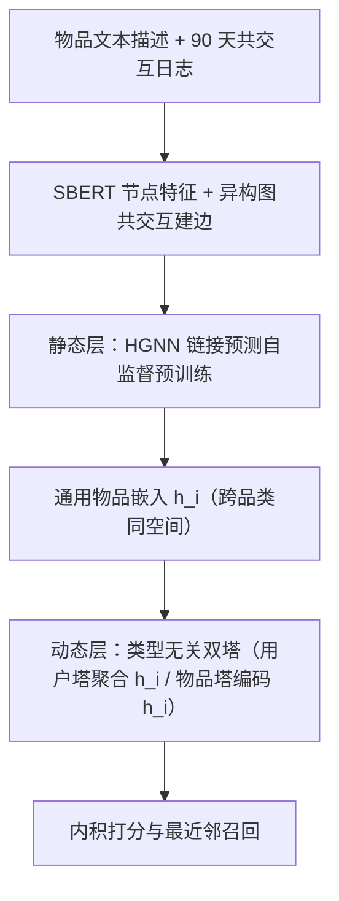
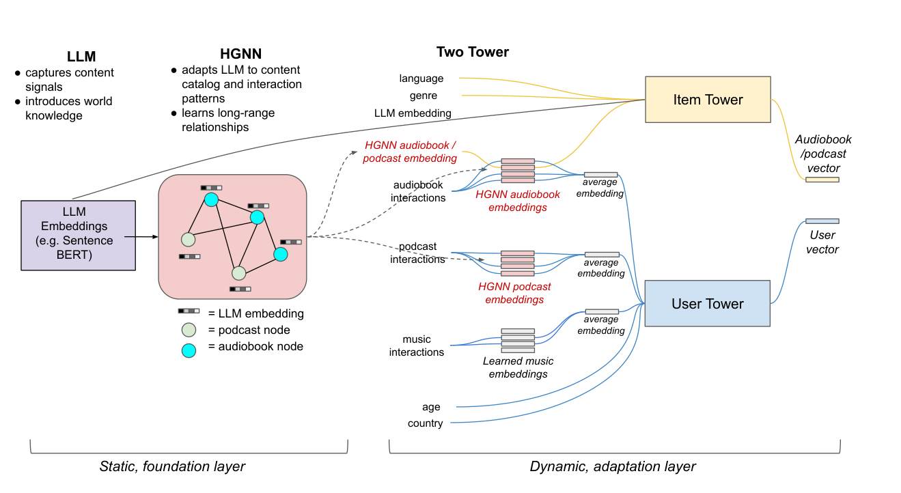

# Towards Graph Foundation Models for Personalization (面向个性化的图基础模型)

- **会议/期刊**: WWW 2024 Companion (Industrial/Applied Track)
- **作者与机构**: Andreas Damianou, Francesco Fabbri, Paul Gigioli, Marco De Nadai, Alice Wang, Enrico Palumbo, Mounia Lalmas（Spotify）
- **推荐链路定位**: 召回（双塔召回 + 物品表征预训练）
- **研究方向**: 图神经网络与知识图谱推荐 / 大语言模型推荐
- **论文原文**: [https://arxiv.org/abs/2403.07478v1](https://arxiv.org/abs/2403.07478v1)
- **开源代码**: 暂未开源

## TL;DR (1分钟核心速览)

本文针对工业推荐中「LLM 直接做个性化难以跟上目录/偏好漂移、GNN 方案按品类各自为政形成烟囱」的痛点，提出首个个性化领域专用图基础模型 (GFM)：用 LLM 句子嵌入作为异构图节点特征、以「共交互」而非内容类型建边训练 HGNN 得到**静态**通用物品表征，再以**类型无关的单物品塔双塔模型**作为轻量**动态**适配层，把多品类（播客/有声书）映射进同一向量空间。在 Spotify 10M 用户、3.5M 播客、250K 有声书的 90 天训练/14 天留出数据上，Unified 2T 相比有声书专用 2T 的 HR@10 由 0.271 提升至 0.316（**+16.6%**）。

## Background & Motivation (背景与核心矛盾)

- **主流范式**: 工业界主流是 GNN（GraphSAGE/PinSage 式）做大规模物品表征 + 双塔模型做用户-物品打分；近期 LLM 微调/In-Context 在排序与召回任务上开始见效。
- **前人局限一 (LLM 路线)**: LLM 直接个性化难以适配大规模在线目录的快速变化（新物品上架、用户兴趣迁移）与频繁重训成本，工程上不可持续。
- **前人局限二 (GNN 路线)**: GNN 虽具备归纳能力与异质关系建模优势，但实践上为每个品类/任务各自建图、各自建塔，形成烟囱式管线，跨品类信息与冷启动知识无法共享。
- **核心洞察 (Key Insight)**: 若把「表征学习」与「用户偏好建模」解耦——用共交互信号（天然跨内容类型）建图、用 LLM 文本嵌入（天然统一任意品类）做节点特征——则只需一次预训练即可产出**类型无关**的通用物品向量；用户侧建模交给可高频更新的轻量双塔。
- **本文切入点**: 用「静态基础层 + 动态适配层」两段式蓝图实现 domain-specific GFM，声称同时获得泛化性、可扩展性与去偏收益。

## Method (核心方法设计)

### 1. 整体框架 (Overall Architecture)

输入为多品类物品目录及其文本描述与 90 天共交互日志：先用 Sentence-BERT 将每个物品的描述编码为节点特征，以「至少被同一用户交互过」为边构建异构图（podcast–podcast、audiobook–podcast、audiobook–audiobook 多种边类型），训练 GraphSAGE 式 HGNN，**用户不作为节点**，输出得通用物品嵌入 $\mathbf{h}_i$。该嵌入同时喂给双塔：物品塔编码$(\mathbf{h}_i,\mathbf{x}_i)$得物品向量，用户塔把用户近 90 天交互物品的$\mathbf{h}_i$ 取平均并拼接人口属性与音乐兴趣向量得用户向量，两塔共享同一物品嵌入矩阵并共享同一组物品塔参数（与品类无关）。训练完成后静态层低频更新、动态层日更，推理为向量内积最近邻检索；新条目/新集数凭 HGNN 归纳性零样本继承其所属 show 的嵌入。

<figure class="paper-figure" markdown="span">
  <figcaption>图1：我们基于 GFM 的个性化方法，在真实在线流媒体平台中面向有声书/播客推荐领域的实例化。LLM 嵌入作为 HGNN 的节点特征，也作为 2T 中的物品特征。给定物品对应的 HGNN 嵌入被传入物品塔。对于给定用户，我们取其交互过的所有物品对应 HGNN 嵌入的平均值。请注意，HGNN 嵌入因此在这两个塔之间共享。采用该方法，所得的用户和物品嵌入（</figcaption>
</figure>

### 2. 关键设计拆解 (Key Designs)

1. **LLM 统一特征化 + 共交互建图（解决「多品类无法同图」）**: 传统做法按品类异质特征工程，跨品类无法共享节点空间。本文令节点特征 $\mathbf{x}_v=\mathrm{SBERT}(d_v)$（$d_v$ 为物品描述文本），节点类型由品类给出、边由共交互生成，从而拓扑与特征两侧均与内容规格无关。直觉：LLM 世界知识提供冷启动与语义泛化，共交互边提供协同信号，二者在 HGNN 中融合即得「内容 + 消费」双源表征。
2. **静态/动态解耦与用户侧平均聚合（解决「重训成本 vs 偏好漂移」）**: 关键在于**用户不入图**，故 HGNN 表征不随用户行为膨胀而失效，只需低频更新；用户表示下放到双塔：$\mathbf{u}=f_\theta\big(\tfrac{1}{|\mathcal{I}_u^{90}|}\sum_{i\in\mathcal{I}_u^{90}}\mathbf{h}_i \oplus \mathbf{e}_u^{demo} \oplus \bar{\mathbf{m}}_u\big)$，物品侧$\mathbf{v}_i=g_\phi(\mathbf{h}_i\oplus\mathbf{x}_i)$，且$g_\phi$**对 podcast 与 audiobook 完全共享**。这样$\mathbf{u},\mathbf{v}_i$ 共处同一向量空间，跑一次双塔即可同时服务多品类召回，并因内容表征已由基础层承担而弱化热门度偏置（popularity bias）。
3. **训练目标、负采样与推理效率**: 静态层用自监督链接预测（PinSage 式）：$\mathcal{L}_{static}=-\sum_{(v,u)\in\mathcal{E}}\log\sigma(\mathbf{h}_v^{\top}\mathbf{h}_u)-\sum_{k=1}^{K}\mathbb{E}_{u_k\sim P_n}\log\sigma(-\mathbf{h}_v^{\top}\mathbf{h}_{u_k})$，使节点表征既保持自身语义又与邻居对齐；动态层沿用双塔常规 batch 内负采样 + sampled softmax，$\mathcal{L}_{dyn}=-\sum_{(u,i)\in\mathcal{D}}\log\frac{\exp(\mathbf{u}^{\top}\mathbf{v}_i/\tau)}{\sum_{j\in\mathcal{B}}\exp(\mathbf{u}^{\top}\mathbf{v}_j/\tau)}$（原文未明示负采样细节，此为 2T 标准配置）。推理仅需 ANN 内积检索，静态层可周级/月级重训，动态层日更，成本远低于 LLM 微调。

## Experimental Setup & Evaluation Protocol (实验设置与评估协议)

- **数据集与预处理**: 单一工业音频平台采样，无公开数据集、无 5-core 过滤说明。

| 数据集 | #Users | #Items | #Interactions | 稀疏度/密度 | 特征/场景说明 |
| :--- | :---: | :---: | :---: | :---: | :--- |
| Spotify 内部采样 | 10M | 3.5M podcasts + 250K audiobooks | 未披露（90 天流媒体日志） | 未披露 | 多品类召回；节点特征为 SBERT 文本嵌入，用户侧含人口属性、近 90 天交互、跨产品音乐向量 |

- **数据划分与防穿越 (Splitting Strategy)**: 全局时间戳切分——前 90 天训练，随后 14 天全部播客/有声书流媒体作为 hold-out 评估；未涉及 LOO 或冷启动专项划分。
- **排名评测协议 (Ranking Protocol)**: 仅报告 HR@10；**未声明是 Full-Ranking 全库排序还是采样排序**（亦未给候选规模/正负比），属该文评估透明度的主要短板。
- **对比基线与超参设置**: 无外部 SOTA（无 LightGCN/SGL/PinSage 等公开基线），全部为内部消融式对照（品类专用 2T、去 GNN 嵌入、去日更）；两模型"特征与超参可比但非完全相同"；未做显著性检验，且作者自述表 1 与表 2 数据采集日期不同、不可跨表比较。

## Key Experimental Results (实验关键数据)

### 1. 主实验对比 (Main Results)

原文无外部基线，下表汇总三组内部对照（指标均为 HR@10，加粗为更优）：

| 对照设置 | Podcasts | Audiobooks | Improv. |
| :--- | :---: | :---: | :---: |
| 有声书专用 2T（单品类） | – | 0.271 | – |
| **Unified 2T（多品类共享）** | – | **0.316** | **+16.6%** |
| Unified 2T w/o GNN 嵌入（表 2） | 0.159 | 0.329 | – |
| **Unified 2T（表 2）** | **0.165** | **0.343** | +3.8% / +4.3% |
| Unified 2T w/o 日更（表 3） | 0.152 | 0.284 | – |
| **Unified 2T（表 3）** | **0.151** | **0.284** | −0.7% / 0.0% |

### 2. 消融实验 (Ablation Study)

| 变体 | 移除组件 | Podcasts HR@10 | Audiobooks HR@10 | Δ |
| :--- | :--- | :---: | :---: | :---: |
| w/o GNN | 静态基础层物品嵌入 | 0.159 | 0.329 | −3.8% / −4.3% |
| w/o 日更 | 动态层高频重训 | 0.152 | 0.284 | +0.7% / 0.0% |
| Audiobook-only 2T | 跨品类共享物品塔 | – | 0.271 | −14.2%（相对 Unified） |

### 3. 关键实验发现 (Key Findings)

1. **跨品类联合训练本身就是最大增益源**：在完全相同输入特征下，把播客数据并入后有声书 HR@10 从 0.271 跃至 0.316（+16.6%），远超任何单模块消融的 3–4% 量级——说明多品类共享双塔带来的数据密度与迁移收益，比精细表征工程更值钱。
2. **HGNN 通用表征对两个品类均有稳定正贡献**：去掉 GNN 嵌入后播客 −3.8%、有声书 −4.3%，两侧降幅接近，证实共交互图确实提供了跨品类的公共协同信号而非仅服务某一品类；但增益幅度有限，暗示当前 LLM 特征 + 浅层图卷积已接近该图结构的信息上限。
3. **"静态层免日更"的工程论断被数据支持**：停止 HGNN 日更后播客 0.151 vs 0.152、有声书 0.284 vs 0.284，差异在噪声范围内；即内容表征可低频更新，真正的实时性需求集中在轻量双塔，这与 FM 领域"基础模型冻结、适配层微调"的经验一致。

## Highlights & Limitations (亮点、对比与审稿批判)

- **与代表作对比 (vs. Prior Work)**: 相比 PinSage/GraphSAGE 类工业 GNN 方案（单品类、用户入图、需随交互频繁重训），本文的核心差异是**用户不入图 + 品类无关共享塔**，把"表征"与"偏好"的更新频率解耦；相比 LLM4Rec（P5/LLM-Rec 类微调范式），本文不让 LLM 直接生成推荐，而只把 LLM 当**离线特征器**，从而规避目录漂移与在线延迟问题；相比 GFM 综述中的通用图基础模型（如 ULTRA 面向 KG 补全），本文明确自我限定为 domain-specific GFM，换取工程可落地性。
- **可迁移亮点**: ①「LLM 文本嵌入做节点特征、共交互建边、用户不入图」是低成本跨品类统一的通用配方，任何多业务线平台可直接复用；②「低频预训练基础层 + 日更轻量双塔」的双速更新范式，可迁移到短视频、电商等目录高频更新场景；③ 新集数零样本继承父级 show 嵌入，为层级物品冷启动提供免费解法。
- **审稿级局限批判**: ① **评估严重不足**：无公开数据集、无外部 SOTA 基线、未声明 Full-Ranking 还是采样排序、无显著性检验，且作者自承表 1/表 2 不可横向比较，工业结论难以复现核验；② **架构未端到端**：LLM 与 GNN 独立训练、静态层与动态层分离优化，作者亦将其列为未来工作，表征协同潜力未释放；③ **去偏与冷启动仅有定性声称**，全文无长尾分桶、无 popularity 分层实验，也无线上 A/B 指标（CTR/留存），工业价值主张停留在离线 HR@10。

## Rating (四维评分)

- **方法创新性 (Novelty)**: ⭐⭐⭐⭐ （首个面向个性化的 domain-specific GFM 蓝图，"静态表征 / 动态偏好"解耦与品类无关共享塔的思路清晰，但单点技术均为成熟组件组合，缺理论/谱分析支撑）
- **评估协议与实验扎实度 (Protocol & Experiments)**: ⭐⭐ （仅内部消融、单一 HR@10、未披露排序协议与显著性检验，且跨表不可比，远低于 WWW 主会实证标准）
- **写作与数学规范度 (Clarity & Rigor)**: ⭐⭐⭐ （5 页短文框架清楚、动机链完整，但公式几乎全部省略，损失函数、负采样与双塔细节均需读者自行补全）
- **工业落地与复现价值 (Industrial & Practical Value)**: ⭐⭐⭐⭐ （10M 用户真实平台验证、双速更新与零样本新品继承极具工程参考价值，但未开源、无公开数据，复现门槛高）

