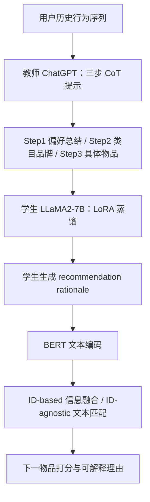
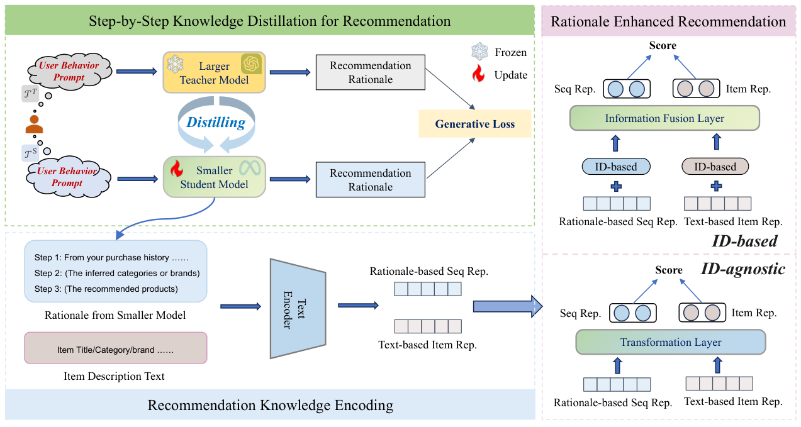
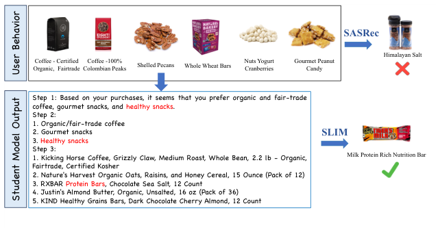

# Can Small Language Models be Good Reasoners for Sequential Recommendation? (小语言模型能成为序列推荐的好推理者吗？)

- **会议/期刊**: WWW 2024
- **作者与机构**: Yuling Wang 等；北京邮电大学、蚂蚁集团、中科院计算所、北航
- **推荐链路定位**: 序列推荐打分（可用于召回/精排）；生成式知识增强
- **研究方向**: 大语言模型推荐 / 序列推荐
- **论文原文**: [论文原文链接](https://arxiv.org/abs/2403.04260v2)
- **开源代码**: [LLaMA recipes](https://github.com/facebookresearch/llama-recipes)（检测到的链接为微调依赖，并非 SLIM 官方实现；SLIM 代码暂未开源）

## TL;DR (1分钟核心速览)

LLM 用于序列推荐面临两大痛点：一步推理易产生错误或与推荐无关的响应；175B 级模型/API 成本难落地。SLIM 让教师 ChatGPT 按“偏好总结→类目/品牌→具体物品”三步 CoT 生成 rationale，再将这种逐步推理蒸馏到约 4% 参数的 LLaMA2-7B 学生模型；学生生成的 rationale 经 BERT 编码后，可注入 ID-based 主干，也可直接做 ID-agnostic 文本匹配。在 Amazon Games/Food/Home 的 101 候选采样排序下，SLIM 相对最强传统主干最高取得 Home Hit@10 +28.29%、Games +13.88% 的提升。

## Background & Motivation (背景与核心矛盾)

- **主流范式**: LLM4Rec 大致分两类：LLM as ranker 直接零样本/少样本排序；LLM as knowledge enhancer 先用大模型生成知识，再喂给传统推荐主干。
- **前人局限**: 其一，冻结 LLM 缺乏域内协同信号，直接排序常不如传统序列模型；其二，知识增强路线多依赖 175B/API，离线生成与在线推理成本高，且未充分利用逐步推理。
- **核心洞察 (Key Insight)**: 推荐可模仿人类导购：先总结用户偏好，再缩小类目/品牌，最后落到具体物品；这种 macro-to-micro 的中间 rationale 比一步答案更适合蒸馏。
- **本文切入点**: 用教师 CoT rationale 当“标签”蒸馏小模型，让 7B 学生成为可部署的推荐推理器，并把 rationale 文本编码为推荐特征。

## Method (核心方法设计)

### 1. 整体框架 (Overall Architecture)

输入用户按时间排序的行为序列 $S_u$。教师 ChatGPT 通过零样本三步 CoT 提示，在小规模采样子集上生成推荐 rationale；学生 LLaMA2-7B 用简化 prompt 与 LoRA 学习教师 rationale 的 token 级分布。部署时学生作为知识生成器，将 rationale 与物品描述分别经 BERT 编码，再通过线性变换/融合层注入 GRU4Rec、SASRec、SRGNN 等主干；或在 ID-agnostic 场景下直接用文本相似度匹配。训练分两阶段：先蒸馏学生，再训练/接入推荐打分器；推理可在单张 A100 上完成。

<figure class="paper-figure" markdown="span">
  <figcaption>图1：所提出框架的概览。</figcaption>
</figure>
图1：SLIM 的“教师 CoT 生成—学生蒸馏—推荐知识编码”总体框架。

### 2. 关键设计拆解 (Key Designs)

1. **三步 CoT 教师提示（把推荐拆成宏观到微观）**：痛点是一步生成容易跑题；教师 prompt 固定为 Step1 总结偏好、Step2 选类目/品牌、Step3 给具体物品，即 $r'_u=\mathrm{LLM}_{T}(\mathcal{T}_t(S_u))$。这样中间步骤既约束输出格式，又把开放世界知识落到可匹配的物品语义上。
2. **学生逐步蒸馏（小模型学推理链而非只学答案）**：直接用 ChatGPT rationale 当特征仍受无关内容干扰；SLIM 用简化 prompt $\mathcal{T}_s$和 LoRA 微调学生，以教师 rationale 为标签做条件语言建模：$\mathcal{L}_{\text{distill}}=\sum_{u\in\mathcal{U}'}\sum_{t=1}^{|r'_u|}\log P_\theta(r'_{u,t}\mid p'_u,r'_{u,<t})$。学中间 rationale 相当于软标签，保留“偏好→类目→物品”的推理路径，比只拟合最终物品更稳。
3. **Rationale 编码与双场景融合**：文本编码器将物品描述与用户 rationale 映射到统一空间，$\boldsymbol{z}_i^{\text{text}}=\mathrm{TextEncoder}(f_i)$，$\boldsymbol{s}_u^{\text{text}}=\mathrm{TextEncoder}(r_u)$。ID-based 用$\boldsymbol{z}_i=g_f([g_l(\boldsymbol{z}_i^{\text{text}});\boldsymbol{z}_i^{\text{id}}])$、$\boldsymbol{s}_u=g_f([g_l(\boldsymbol{s}_u^{\text{text}});\boldsymbol{s}_u^{\text{SeqEnc}}])$融合协同信号；ID-agnostic 则$\boldsymbol{z}_i=g_t(\boldsymbol{z}_i^{\text{text}})$、$\boldsymbol{s}_u=g_t(\boldsymbol{s}_u^{\text{text}})$，用$\hat{y}_{ui}=\sigma(\boldsymbol{s}_u^\top\boldsymbol{z}_i)$ 打分。前者打破闭环数据，后者利于冷启动与文本泛化。

**训练目标、负采样与推理效率**：论文分阶段优化，未给统一总损失；蒸馏用 $\mathcal{L}_{\text{distill}}$，推荐阶段沿用 BCE：$\mathcal{L}_{\text{rec}}=-\sum_{u,i}y_{ui}\log\hat{y}_{ui}+(1-y_{ui})\log(1-\hat{y}_{ui})$。推荐训练对每个用户随机采 100 个负物品，无 hard negative；教师离线生成 rationale，学生 7B + LoRA 可在单卡 A100 部署，论文报告离线生成约 6.11s/条，在线推荐打分不调用 ChatGPT API。

## Experimental Setup & Evaluation Protocol (实验设置与评估协议)

- **数据集与预处理**: 采用 Amazon Review 的 Video Games、Grocery and Gourmet Food、Home and Kitchen 三个子集。正文未给出具体统计与 5-core 过滤细节，附录 A.1 未包含在给定文本中。

| 数据集 | #Users | #Items | #Interactions | 稀疏度/密度 | 特征/场景说明 |
| :--- | :---: | :---: | :---: | :---: | :--- |
| Games | 未报告（附录 A.1） | 未报告 | 未报告 | 未报告 | Amazon Video Games |
| Food | 未报告（附录 A.1） | 未报告 | 未报告 | 未报告 | Grocery & Gourmet Food |
| Home | 未报告（附录 A.1） | 未报告 | 未报告 | 未报告 | Home & Kitchen |

- **数据划分与防穿越 (Splitting Strategy)**: 正文未明确说明是 Leave-One-Out、比例划分还是全局时间戳切分；这是复现性缺口。
- **排名评测协议 (Ranking Protocol)**: 采用 **Sampled Ranking**。每个用户随机采 100 个负物品，与 ground-truth 组成 101 候选排序，报告 5 次运行均值±标准差；非 Full-Ranking 全库排序。
- **对比基线与超参设置**: 基线为 GRU4Rec、SASRec、SRGNN 及其 item feature extension（+）；SLIM− 为直接把 ChatGPT rationale 接入文本编码、不做蒸馏。教师为 ChatGPT，学生为 LLaMA2-7B + LoRA，文本编码器为 BERT，蒸馏样本约 1000–2000；嵌入维度 $d$ 未报告，未做显著性检验。

## Key Experimental Results (实验关键数据)

### 1. 主实验对比 (Main Results)

G/F/H 表示 Games/Food/Home；N@10 为 NDCG@10，H@10 为 Hit Rate@10。SLIM−/SLIM 行取各数据集最佳主干（Games/Food 多为 SASRec，Home 为 GRU4Rec）。

| Methods | G-N@10 | G-H@10 | F-N@10 | F-H@10 | H-N@10 | H-H@10 |
| :--- | ---: | ---: | ---: | ---: | ---: | ---: |
| GRU4Rec | 17.61 | 30.87 | 9.10 | 15.27 | 2.19 | 4.17 |
| GRU4Rec+ | 27.33 | 44.06 | 17.75 | 31.10 | 12.19 | 26.76 |
| SASRec | 22.73 | 37.77 | 26.78 | 35.78 | 2.66 | 5.56 |
| SASRec+ | 27.46 | 44.88 | 30.95 | 44.98 | 5.58 | 11.09 |
| SRGNN | 16.45 | 29.29 | 10.99 | 20.32 | 5.04 | 13.48 |
| SRGNN+ | 21.54 | 36.77 | 11.91 | 21.39 | 11.61 | 25.22 |
| SLIM− (best) | **31.58** | 50.83 | 32.65 | 48.01 | 13.59 | 30.30 |
| SLIM (best) | 31.43 | **51.11** | **32.80** | **48.27** | **15.64** | **34.33** |

相对同主干最强传统基线，SLIM 的 H@10 提升为：Games/SASRec+ +13.88%、Food/SASRec+ +7.31%、Home/GRU4Rec+ +28.29%；对应 N@10 提升 +14.46%、+5.98%、+28.30%。注意 Games N@10 上 SLIM− 的 31.58 略高于 SLIM 的 31.43，说明蒸馏并非在所有指标上单调胜出。

### 2. 消融实验 (Ablation Study)

ID-agnostic 文本匹配下的逐步 rationale 与蒸馏对比：

| Methods | G-N@10 | G-H@10 | F-N@10 | F-H@10 | H-N@10 | H-H@10 |
| :--- | ---: | ---: | ---: | ---: | ---: | ---: |
| SLIM-Step1 | 13.78 | 26.08 | 13.62 | 24.90 | 4.25 | 9.53 |
| SLIM-Step2 | 16.78 | 30.09 | 13.71 | 24.23 | 4.75 | 10.30 |
| SLIM-Step3 | 20.20 | 35.57 | 15.69 | 26.69 | **4.83** | **10.39** |
| SLIM− | 21.75 | 38.05 | **19.08** | **32.34** | 4.63 | 10.15 |
| SLIM | **21.99** | **38.33** | 18.13 | 30.84 | 4.49 | 9.96 |

### 3. 关键实验发现 (Key Findings)

1. **ID-based 主实验中蒸馏优于直接使用 ChatGPT rationale**：27 个指标设置中 SLIM 有 22 个超过 SLIM−；Home 的 GRU4Rec 主干 Hit@10 从 SLIM− 的 11.83 提到 12.01，说明学生把教师“正确但可能无关”的内容压缩成更推荐相关的知识。
2. **微观 Step3 最匹配物品文本**：ID-agnostic 下 Games NDCG@10 为 Step1 13.78 < Step2 16.78 < Step3 20.20；Home 上 Step3 的 4.83 甚至超过完整 rationale 的 4.49。宏观 Step1 更利于解释，但语义粒度与 item 标题/类目对齐较弱。
3. **长尾与稀疏用户受益明显**：案例中目标“Milk Protein Rich Nutrition Bar”训练集仅出现一次，SASRec 失败而 SLIM 通过“Healthy snacks→Protein Bars”推理命中；用户稀疏分组 G1 的提升大于密集组 G5；同时 7B 学生仅约教师 4% 参数，1000 样本即可微调，成本与 ChatGPT API 同量级但无 API 费用。

<figure class="paper-figure" markdown="span">
  <figcaption>图4：案例研究。SASRec 与 SLIM 对下一物品预测的比较。</figcaption>
</figure>
图4：案例研究。SASRec 与 SLIM 对下一物品预测的对比；SLIM 通过逐步 rationale 命中长尾物品并给出解释。

## Highlights & Limitations (亮点、对比与审稿批判)

- **与代表作对比 (vs. Prior Work)**: 相比 LLM as ranker 的零样本排序，SLIM 引入域内蒸馏与协同信号；相比 LLM as knowledge enhancer 直接依赖 175B/API，SLIM 把逐步推理压到 7B 学生；相比 Recformer 等 ID-agnostic 文本序列模型，SLIM 的文本来自开放世界 CoT 推理而非仅数据集描述。
- **可迁移亮点**: 用教师 CoT 的中间 rationale 当软标签，比只蒸馏最终答案更适合小模型；简化 prompt + LoRA + 1000 级样本即可迁移，适合工业低成本知识增强。
- **审稿级局限批判**: 其一，7B 学生仍需生成 rationale，线上延迟、缓存与存储成本未被 A/B 验证；教师幻觉和 prompt 敏感性未量化。其二，评估仅为每用户 100 负采样的 101 候选排序，且数据划分、5-core 过滤、嵌入维度与显著性检验缺失，可能高估实际全库排序收益。

## Rating (四维评分)

- **方法创新性 (Novelty)**: ⭐⭐⭐⭐ （首个面向序列推荐的 LLM 逐步知识蒸馏框架，CoT 三步 rationale + 7B 学生 + 双场景融合，机制清晰）
- **评估协议与实验扎实度 (Protocol & Experiments)**: ⭐⭐⭐ （三数据集、多主干、5 次均值±标准差较完整，但采样 101 排序、划分/统计缺失且无显著性检验）
- **写作与数学规范度 (Clarity & Rigor)**: ⭐⭐⭐ （框架与公式简洁易读，但总损失、数据预处理与超参报告不足，理论分析较薄）
- **工业落地与复现价值 (Industrial & Practical Value)**: ⭐⭐⭐⭐ （7B/4% 参数、单 A100、无 API 成本，具备落地吸引力；但生成延迟与官方代码缺失限制复现）

